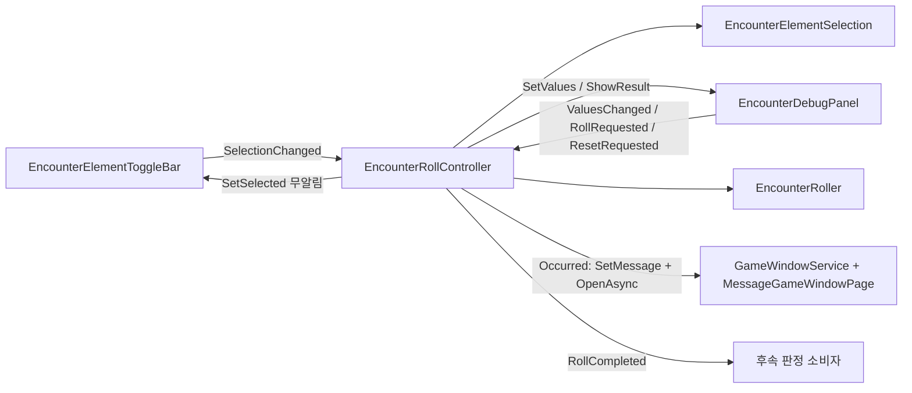

# 요소 토글과 이벤트 판정 (Encounter Roll)

`Candidate_MainScene`의 `MiddleArea` 상단에 있는 다중 선택 요소 토글 바, 선택된 요소로 이벤트(전투·이벤트·휴식) 발생을 판정하는 규칙, 개발 빌드 전용 디버그 패널, 결과 모달의 현재 구현을 설명합니다. 구현 지침은 [candidate-main-scene-encounter-toggles-and-debug-roll.md](../instructions/candidate-main-scene-encounter-toggles-and-debug-roll.md)입니다.

현재 판정은 디버그 패널의 `이벤트 발생` 버튼으로만 실행합니다. 실제 판정 시점(턴 진행, 이동 등)과 전투·휴식·랜덤 이벤트 실행 연결은 아직 없습니다(후속 작업).

## 구성 요소

| 어셈블리·경로 | 타입 | 책임 |
| --- | --- | --- |
| `TxTRPG.Gameplay` `Gameplay/Runtime/Encounters/` | `EncounterKind` | `Combat`(0), `Event`(1), `Rest`(2). 정수 값 고정 |
| | `EncounterRollSettings` | 불변 판정 값. 발생 확률·요소 포함 확률(0~1, NaN은 0), 세 종류 가중치(음수·NaN은 0). `WithX` 복사 메서드, `Default`(0.5, 0.5, 1·1·1) |
| | `EncounterElementSelection` | 선택된 요소 ID 집합(앞뒤 공백 제거, 대소문자 구분, 빈 ID 거부). 실제로 바뀔 때만 `Changed` |
| | `EncounterRoller`, `EncounterRollResult`, `EncounterRollOutcome` | 판정 규칙과 결과(`Occurred`, `NoElementsSelected`, `ChanceFailed`, `NoKindAvailable`) |
| `TxTRPG.Application` `Application/Runtime/Encounters/` | `EncounterElementCatalog`(ScriptableObject) | 요소 항목(`Id`, `DisplayName`) 목록. 순서가 버튼 순서·결과 문구 순서. `Validate`가 빈 ID·중복 ID·빈 이름 보고, 잘못된 항목은 버튼을 만들지 않음 |
| | `EncounterRollConfiguration`(ScriptableObject) | 판정 기본값. 디버그 패널은 이 자산을 바꾸지 않음 |
| | `EncounterResultFormatter` | `룬 : 전투` 형식 문구와 종류 표시 이름, 미발생 문구 |
| | `EncounterRollController`(MonoBehaviour) | Scene 수명 소유자. 선택 상태와 실행 중 설정을 보유하고 판정·모달·결과 이벤트를 담당 |
| `TxTRPG.UI` `UI/Runtime/Encounters/` | `EncounterElementToggleBar`, `EncounterElementToggleView`, `EncounterElementToggleEntry` | 토글 버튼 줄 표시. 선택 상태는 표시만 하고 사용자 변경은 `SelectionChanged`로 알림 |
| | `EncounterDebugPanel`, `EncounterDebugValues` | 슬라이더 5개·값 텍스트·`이벤트 발생`·`기본값으로`·결과 문구·접기 버튼 |
| `TxTRPG.UI` `UI/Runtime/` | `DevelopmentBuildOnly` | Release Player(`Debug.isDebugBuild == false`)에서 `Awake`에 GameObject를 비활성화. Editor·Development Build에서는 아무것도 하지 않음 |
| `TxTRPG.UI` `UI/Runtime/Windows/` | `ModalCancelForwarder` | 선택된 컨트롤(결과 모달의 닫기 버튼)이 받은 `Cancel`을 `ModalWindowHost.OnCancel`로 전달 |

UI 어셈블리 타입은 Gameplay·Application 타입을 쓰지 않고 표시 데이터(`EncounterElementToggleEntry`, `EncounterDebugValues`)와 이벤트만 주고받습니다. 연결은 `EncounterRollController`가 담당합니다.

## 판정 순서와 확률 독립성

`EncounterRoller.Roll(selectedElementIds, settings)`는 `IRandomIndexProvider`를 다음 순서로 사용합니다. 확률 판정은 `NextIndex(10000) < round(p × 10000)`이므로 p = 0은 항상 실패, p = 1은 항상 성공입니다.

1. 선택된 요소가 없으면 난수 없이 `NoElementsSelected`.
2. 종류 가중치 합(1/1000 단위 정수, `round(w × 1000)`)이 0이면 난수 없이 `NoKindAvailable`.
3. 발생 확률로 1회 판정. 실패하면 `ChanceFailed`.
4. 선택된 요소마다 입력 순서로 요소 포함 확률 판정. 하나도 포함되지 않으면 `NextIndex(선택 수)`로 하나를 균등 추첨.
5. 가중치 누적 구간에서 `NextIndex(합계)`로 종류 선택. 가중치 0인 종류는 선택되지 않음.
6. `Occurred`(요소 1개 이상, 입력 순서 유지).

3단계와 4·5단계는 서로 다른 난수 호출이므로 발생 여부가 요소·종류 확률을 바꾸지 않습니다. 컨트롤러는 선택된 ID를 카탈로그 순서로 넘기므로 결과 요소도 카탈로그 순서입니다.

## 데이터 흐름



- `Awake`에서 `Initialize()`가 카탈로그로 버튼을 만들고, 설정 자산으로 현재 설정을 만들고, 선택을 비웁니다. 선택 상태와 슬라이더 값은 Scene 수명 동안만 유지하고 저장하지 않습니다.
- 공개 API: `Selection`, `CurrentSettings`, `SetSettings`, `ResetSettingsToConfiguration`, `SelectedElementIds()`, `RollNow(GameObject returnFocus = null)`, `event RollCompleted`. 후속 판정 시점은 `RollNow`를 호출해 연결합니다.
- `RollNow`는 `Occurred`이면 결과 문구를 `MessageGameWindowPage.SetMessage`로 넣고 `GameWindowService.OpenAsync("encounter-result", returnFocus)`로 모달을 엽니다. 모든 판정은 `RollCompleted`를 발생시키고 디버그 패널이 있으면 같은 문구를 `ShowResult`로 남깁니다. 모달이 열려 있으면 판정하지 않고 경고만 남기고 `null`을 반환합니다.
- 디버그 버튼의 판정은 `RollNow(디버그 RollButton)`으로 실행되어, 모달이 닫히면 포커스가 `이벤트 발생` 버튼으로 돌아옵니다.
- 테스트용 난수 공급자는 Editor 전용 `ConfigureForEditor(..., IRandomIndexProvider)`로 바꿔 끼우고 `Initialize()`를 호출합니다.

## 실패 동작

| 상황 | 동작 |
| --- | --- |
| 카탈로그·설정 자산·토글 바 누락 | 오류 1회, 컨트롤러만 동작 중지(`IsReady == false`, `RollNow`는 경고와 `null`). Scene의 다른 기능은 영향 없음 |
| 카탈로그의 잘못된 항목 | 경고 1회, 해당 항목은 버튼 없음. 모두 잘못되면 버튼 없음, 판정은 `NoElementsSelected` |
| 결과 모달·페이지 없음 | 초기화 시 경고. 발생 결과는 경고와 디버그 패널 문구로만 알림, 예외 없음 |
| 모달이 열지 못함·예외 | 경고와 결과 문구 로그, 예외 전파 없음 |
| 디버그 패널 없음(Release에서 비활성) | 정상 동작. 디버그 패널은 공개 API만 사용 |

## Prefab 계층

네 Prefab은 `Assets/TxTRPG/UI/Prefabs/Encounters/`에 있는 개발자 소유 자산이며 Prefab Rebuild 배치에 등록하지 않습니다([등록 기반 Prefab Rebuild](prefab-rebuild-registry.md)).

```text
EncounterElementToggleBar.prefab   EncounterElementToggleBar
└── Scroll View                    ScrollRect(가로만, Clamped, Scrollbar 없음)
    └── Viewport                   RectMask2D, 투명 Image(스크롤 입력)
        └── Content                HorizontalLayoutGroup(간격 8, 좌우 8, 가운데 왼쪽), ContentSizeFitter(가로 Preferred)

EncounterElementToggle.prefab      LayoutElement(최소 96×48, 선호 120×48), Toggle(ToggleGroup 없음), EncounterElementToggleView
├── HitArea                        투명 Image(입력 대상)
└── VisualRoot                     효과 적용 루트(입력 대상 아님)
    ├── Background                 UiShapeGraphic 둥근 사각형(Toggle의 targetGraphic)
    ├── SelectedBorder             UiShapeGraphic InnerBorder 4(선택 시 표시)
    ├── Checkmark                  TMP "✓"(선택 시 표시)
    └── Label                      TMP(줄바꿈 없음, 자동 크기 12~20, 말줄임)

EncounterDebugPanel.prefab         Image, EncounterDebugPanel, DevelopmentBuildOnly, VerticalLayoutGroup, ContentSizeFitter(세로)
├── Header                         Title "DEBUG · 이벤트 판정", CollapseButton("접기"/"펼치기")
└── Body                           (접으면 비활성)
    ├── OccurrenceRow / InclusionRow                    Label · Slider(0~100 정수 = 0~100%) · Value("50%")
    ├── CombatWeightRow / EventWeightRow / RestWeightRow Label · Slider(0~100 정수 = 0.0~10.0) · Value("1.0")
    ├── Buttons                    RollButton("이벤트 발생"), ResetButton("기본값으로")
    └── ResultText

EncounterResultModal.prefab        GameWindowService(pages = [EncounterResultPage])
└── ModalWindowHost                ModalWindowHost, CanvasGroup, 반투명 배경 Image(바깥 클릭 대상), 화면 전체
    └── FrameArea                  ScreenFrameAlignedRect(그래픽 없음) — 화면 프레임 영역에 맞춤
        └── WindowFrame            HorizontalLayoutGroup(여백 16, 가운데) — 그리지 않음
            └── Window             windowRect, UiShapeGraphic, LayoutElement(선호 560×240, 최소 0)
                ├── Title          "이벤트 발생"
                ├── CloseButton    "닫기", ModalCancelForwarder, 결과 페이지의 initialFocus
                ├── Loading / ErrorStateRoot(Error, RetryButton)
                ├── ContentContainer   ModalContentContainer → Pages/EncounterResultPage(MessageGameWindowPage, PageId "encounter-result")/Message
                └── OverlayRoot
```

- `Window`는 `WindowFrame`의 레이아웃으로 `min(560, 프레임 너비 − 32) × min(240, 프레임 높이 − 32)` 크기를 받고 화면 프레임 가운데에 놓입니다. 배경은 레터박스를 포함한 화면 전체를 덮으므로 레터박스 영역을 눌러도 바깥 클릭으로 닫힙니다.
- `FrameArea.controller`는 Prefab에서 비어 있고, `Candidate_MainScene` 인스턴스가 Scene의 `ScreenFrameController`를 Override로 저장합니다. 참조가 없으면 `FrameArea`는 화면 전체로 늘어나고 경고를 한 번 남깁니다([화면 프레임과 레터박스](screen-frame.md)).
- 토글 버튼의 Toggle 상태 색 전환(강조·눌림·포커스)은 `Background`에 적용됩니다. 선택 여부는 색이 아니라 `Checkmark`와 `SelectedBorder`로 표시합니다.
- 결과 모달은 기존 `ModalWindowHost`·`GameWindowService`·`MessageGameWindowPage`를 재사용합니다([퀵 아이템과 게임 창](quick-items-and-game-windows.md)). 바깥 클릭은 누른 위치와 뗀 위치가 모두 창 밖이고 드래그가 아닐 때만 닫습니다. `Cancel`은 선택된 `CloseButton`의 `ModalCancelForwarder`가 호스트로 전달합니다.

## Candidate_MainScene 배치

```text
Canvas
├── ScreenFrame                               화면 프레임(1920×1080 Canvas 단위)
│   ├── MainArea/ContentLayer/MiddleArea      FlexibleLayoutPanel 인스턴스 Override: Fixed Axis = Vertical, Axis Policy = Fixed
│   │   └── ContentLayer                      (패널이 축 설정을 ContentLayer의 FlexibleContentLayoutGroup에 동기화)
│   │       ├── EncounterElementToggleBar     Prefab 인스턴스 + FlexibleLayoutItem(Fixed 64)
│   │       └── MiddleContentPlaceholder      FlexibleLayoutPlaceholder.prefab 인스턴스(Weighted 1, 활성)
│   └── OverlayLayer
│       ├── SlotReelDock
│       └── EncounterDebugPanel               오른쪽 위 앵커, 여백 16, 폭 320
├── LetterboxLayer
├── ScreenOverlayLayer
│   └── EncounterResultModal                  Stretch(화면 전체), 열릴 때 ScreenOverlayLayer 안에서 SetAsLastSibling
└── EncounterRollController                   카탈로그·설정·토글 바·결과 모달(GameWindowService·페이지)·디버그 패널 참조
```

결과 모달은 2026-10-19 화면 프레임 적용 때 `OverlayLayer`에서 `ScreenOverlayLayer`로 옮겼습니다. 같은 오브젝트를 옮겼으므로 `EncounterRollController`의 참조는 그대로입니다.

- `MiddleArea`는 `MainArea`가 너비 720 미만에서 세로 배치로 바뀌어도 내부는 세로 고정이므로 토글 바가 항상 상단 64를 차지합니다.
- 설정 자산은 `Assets/TxTRPG/Application/Configuration/Encounters/EncounterElementCatalog.asset`(`rune`/`룬`)과 `EncounterRollConfiguration.asset`(0.5, 0.5, 1·1·1)입니다.

## 요소 추가

`EncounterElementCatalog.asset`의 `Entries`에 `Id`와 `DisplayName`을 추가하면 버튼과 결과 문구에 반영됩니다. 코드와 Prefab은 바꾸지 않습니다. 버튼 수가 영역 너비를 넘으면 가로 스크롤로 넘깁니다.

## DevelopmentBuildOnly 정책

디버그 노출 여부는 `DevelopmentBuildOnly` 하나로 판정합니다. 판정 함수 `ShouldDisable(bool isDebugBuild)`는 Release(`false`)에서 비활성화를 반환합니다. 기능 코드에는 전처리기 지시문을 두지 않습니다. 판정 규칙과 컨트롤러는 Release에서도 그대로 동작합니다.

## 효과 적용 위치

토글 버튼의 효과는 `VisualRoot` 아래(`Background`, `SelectedBorder`, `Checkmark`, `Label`)에 적용합니다. 레이아웃이 쓰는 루트, `HitArea`, `Toggle`은 효과가 바꾸지 않습니다. 스크롤 Viewport의 `RectMask2D`가 버튼 바깥으로 넘치는 glow·outline을 자를 수 있으므로, 그런 효과를 추가할 때는 여백(현재 상하 8, 좌우 8)을 함께 정합니다. 결과 모달의 효과는 `Window`의 Graphic이나 그 아래 자식에 적용하고, `WindowFrame`과 호스트 배경의 입력 판정은 바꾸지 않습니다.

## 테스트와 검증 도구

Edit Mode 테스트와 임시 메뉴는 [개발 및 검증 절차](../development/workflows.md)의 "Candidate_MainScene 요소 토글과 디버그 이벤트 판정" 절에 정리되어 있습니다.
