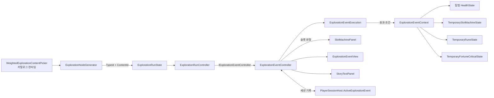

# 탐험 이벤트 노드와 이벤트 시스템

탐험 노드 종류 `event`는 후보를 만들 때 이벤트 하나를 확정하고(노드 기록의 `ContentId`), 노드를 고르면 `ExplorationNodePanel` 안의 이벤트 화면에서 페이지·선택지·슬롯 판정을 진행한 뒤 노드를 완료합니다. 이벤트는 ScriptableObject 자산으로 작성하고, 페이지·상호작용·조건·효과를 Inspector에서 조합합니다. 구현 지침은 [탐험 이벤트 노드 지침서](../instructions/exploration-event-nodes.md)입니다.

## 구성과 어셈블리 경계



| 어셈블리·경로 | 타입 | 책임 |
| --- | --- | --- |
| `TxTRPG.Gameplay` `Gameplay/Runtime/Exploration/ExplorationRunState.cs` | `ExplorationNodeCandidate`, `IExplorationNodeContentPicker`, `ExplorationNodeContentRequest`, `WeightedExplorationContentPicker` | 후보의 내용 ID 추첨. 같은 후보 집합 안의 중복을 피하고, 남은 항목이 없을 때만 중복을 허용합니다. |
| `TxTRPG.Gameplay` `Gameplay/Runtime/Exploration/Events/` | `ExplorationEvent`, `ExplorationEventPage`, `ExplorationEventBranch`, `ExplorationEventContinue`·`Choice`·`SlotCheck`, `ExplorationEventExecution` | 불변 이벤트 모델, 검증, 상호작용, 실행 상태 기계. Unity에 의존하지 않습니다. |
| 같은 폴더 `ExplorationEventContracts.cs` | `IExplorationEventEffect`, `IExplorationEventCondition`, `IExplorationEventContext`, `ExplorationEventRuneAccess`, `ExplorationEventEffectResult` | 효과·조건이 쓰는 계약과 기능(capability) 묶음 |
| `TxTRPG.Gameplay` `SlotMachine/FortuneCritical/IFortuneCriticalRuleStore.cs` | `IFortuneCriticalRuleStore` | 세션 Fortune Critical 규칙 읽기·변경 계약. `TemporaryFortuneCriticalState`가 구현합니다. |
| `TxTRPG.Application` `Application/Runtime/Exploration/Events/` | `ExplorationEventDefinition`, `ExplorationEventCatalog`, `*Definition` 상호작용, 효과·조건 클래스, `ExplorationEventContext`, `TemporaryExplorationEventRecord`, `ExplorationEventController`, `ExplorationEventStoryFormatter` | 자산 작성, 세션 어댑터, 실행 제어, 문구 |
| `TxTRPG.UI` `UI/Runtime/Exploration/` | `ExplorationEventView`, `ExplorationEventChoiceView`, `ExplorationEventPageDisplay`, `ExplorationEventChoiceDisplay` | 이벤트 화면 표시와 입력. Gameplay·Application 타입을 쓰지 않습니다. |
| `TxTRPG.Application.Editor` | `ExplorationEventReferencePickerDrawer`, `ExplorationEventDefinitionEditor`, `TemporaryExplorationEventNodesApply`, `ExplorationEventViewBuilder`, `ExplorationTestEventContent`, `TemporaryExplorationEventPlayValidation` | `[SerializeReference]` 드롭다운, 검증 경고 표시, 적용·검증·Play 확인 메뉴 |

## 이벤트 모델

```text
ExplorationEventDefinition (자산)
├─ eventId, title, summary, startPageId
└─ pages[] (ExplorationEventPageDefinition)
   ├─ pageId, title(비면 이벤트 제목), body
   ├─ onEnter: [SerializeReference] IExplorationEventEffect[]   페이지에 들어올 때마다 한 번
   └─ interaction: [SerializeReference] ExplorationEventInteractionDefinition
      ├─ ExplorationEventContinueDefinition  : label, branch
      ├─ ExplorationEventChoiceDefinition    : options[] = { label, conditions[], branch }
      └─ ExplorationEventSlotCheckDefinition : label, useFortuneCritical(기본 켜짐), outcomes[] = { min?, max?, branch }, fallback
branch = { effects[], next(페이지 ID 또는 End) }
```

- 텍스트만 있는 이벤트는 `Continue` 페이지로 만듭니다. 페이지 사이 분기와 반복을 허용하며, 한 번의 이벤트에서 페이지 진입은 `ExplorationEventLimits.MaximumPageVisits`(64)까지입니다. 넘으면 이벤트를 `Completed`로 끝내고 오류를 기록합니다.
- 슬롯 구간의 `min`·`max`는 각각 생략할 수 있는 포함 경계입니다. 위에서부터 처음 맞는 구간, 없으면 `fallback`을 씁니다. 구간 겹침과 "모든 선택지에 조건이 있음"은 오류가 아닌 경고로 Inspector(`ExplorationEventDefinitionEditor`)와 `CollectWarnings`에 표시합니다.
- 실행 전에 `ExplorationEventDefinition.TryCreateEvent`가 Gameplay 모델로 변환하며 검증합니다: 빈 이벤트 ID, 빈·중복·예약(`End`) 페이지 ID, 없는 `startPageId`·`next`, 빈 상호작용, 선택지 0개, `null` 효과·조건, 효과·조건의 `Validate`, `min > max`.

### 기본 상호작용·조건·효과

| 구분 | 타입 | 규칙 |
| --- | --- | --- |
| 상호작용 | `Continue`, `Choice`, `SlotCheck` | Gameplay 타입 `ExplorationEventContinue`·`ExplorationEventChoice`·`ExplorationEventSlotCheck`가 입력(`ExplorationEventInput`)을 해석합니다. |
| 조건 | `HealthAtLeastCondition`, `ReelCountAtLeastCondition`, `ReelCountAtMostCondition`, `HasRuneDefinitionCondition` | 미충족 사유 예: `체력 6 이상 필요`, `Reel 2개 이상 필요`, `공격 룬 1개 필요`. 기능이 없으면 미충족입니다. |
| 체력 | `ChangeHealthEffect`, `RestoreHealthEffect`, `ChangeMaximumHealthEffect` | 양수 `Heal`, 음수 `ApplyDamage`. 최대 체력은 최소 1, 증가 시 `alsoChangeCurrent`면 같은 양 회복, 감소 시 현재값은 잘리고 0이 되지 않습니다. |
| Reel | `AddReelSymbolEffect`, `RemoveReelSymbolEffect`, `AddReelEffect`, `RemoveReelEffect` | 대상은 `ExplorationReelSelector`(ID·처음·마지막·N번째). 칸 추가는 끝에, 제거는 앞에서부터이며 마지막 칸은 남깁니다. 새 Reel ID가 있으면 `.2`, `.3` 접미사를 붙입니다. Reel이 하나면 제거하지 않습니다. 모두 `SlotMachine`의 `Try...` API를 씁니다. |
| Fortune Critical | `ChangeFortuneChanceEffect`, `ChangeFortuneCapEffect` | 대상 `DefaultReel`·`Reel`·`Total`, `Set`·`Add`. 확률은 0~1로, 상한은 1~`FortuneCriticalLimits.MaximumEffectiveMultiplier`로 자릅니다. 개별 규칙이 없는 Reel은 기본 규칙 사본을 만듭니다. |
| 룬 | `GrantRuneEffect` | 배치 `NewLine`(새 줄 `line.event.N`), `StackOnLine`(지정 줄 또는 같은 정의의 첫 줄), `Unequipped`. 인스턴스 ID는 `{정의 ID}.event.N`. 장착에 실패하면 추가한 룬을 제거합니다. 카탈로그에 없는 정의는 실행 시 건너뜁니다. |

## 확장 절차

- **새 효과**: `TxTRPG.Application.Exploration.Events`에 `[Serializable]` 클래스 하나를 추가하고 `IExplorationEventEffect`를 구현합니다. 매개변수 없는 생성자와 직렬화 필드만 두고, 자산이 공유되므로 실행 상태를 필드에 저장하지 않습니다. 여러 상태를 바꾸는 효과는 실패 시 자기 변경을 되돌립니다. 클래스를 추가하면 Inspector 드롭다운(`ExplorationEventReferencePickerDrawer`, `TypeCache` Editor 전용)에 나타납니다.
- **새 게임 시스템이 필요한 효과**: 그 시스템의 기능 계약을 Gameplay에 두고 `IExplorationEventContext`에 `TryGet...`로 추가한 뒤 `ExplorationEventContext`에서 세션 상태에 연결합니다.
- **새 조건**: `IExplorationEventCondition`을 구현하는 `[Serializable]` 클래스. **새 상호작용**: Gameplay에 `IExplorationEventInteraction` 구현을, Application에 `ExplorationEventInteractionDefinition` 하위 클래스를 추가합니다.
- **이름 변경**: `[SerializeReference]` 자산은 클래스 이름·네임스페이스·어셈블리를 기록하므로, 바꿀 때 `[UnityEngine.Scripting.APIUpdating.MovedFrom]`을 붙입니다. 이 규칙은 기반 클래스와 효과·조건 파일 주석에도 있습니다.
- 확장 방향(아이템 획득, 룬 강화·합성, 이벤트 전투, 무작위 분기, 등장 조건, 대화 연출, 현지화)은 [지침서 12절](../instructions/exploration-event-nodes.md#12-확장-방향-미구현)에 있으며 구현하지 않았습니다.

## 실행 상태 기계

`ExplorationEventExecution`의 상태는 `NotStarted → AwaitingInput ⇄ AwaitingSlotResult → Completed | Defeated`입니다.

- 입력: `Start`, `TryContinue`, `TryChoose`, `TryBeginSlotCheck`, `TryResolveSlotCheck(finalTotal)`, `TryEndWithoutOptions`. 각 입력은 표시 당시의 `AppliedStepCount`를 함께 받으며, 상태가 맞지 않거나 단계 번호가 다르거나 조건이 미충족이면 아무것도 바꾸지 않고 거부합니다. 같은 입력이 두 번 와도 효과는 한 번만 적용됩니다.
- 한 단계 = 분기 효과 → 다음 페이지 진입 → 그 페이지 `onEnter` 효과. 결과는 `ExplorationEventStepResult`(항목: 입력, 적용, 건너뜀, 실패, 방문 상한, 패배)입니다.
- 효과는 순서대로 적용하고, 각 효과 뒤 탐험 체력이 0이면 남은 효과를 적용하지 않고 `Defeated`가 됩니다.
- 효과가 기능 없음 등으로 적용할 수 없으면 `Skipped`, 예외를 던지면 실행기가 잡아 `EffectFailed`로 바꿉니다. 둘 다 이벤트를 멈추지 않으며 앞선 효과는 되돌리지 않습니다. Story에 `[이벤트] 적용할 수 없는 효과를 건너뛰었습니다: {사유}`를 쓰고 경고(실패는 오류) 로그를 남깁니다.
- 실행 중 모든 선택지가 비활성이면 화면에 `이벤트 종료`를 추가하고, 누르면 `TryEndWithoutOptions`로 `Completed`가 됩니다.

## 노드 생성과 노드 처리 연결

- `ExplorationRunConfiguration.nodeWeights`(종류 ID, 가중치) 목록과 `eventCatalog`를 씁니다. 옛 `combatWeight`·`recoveryUpgradeWeight` 필드는 숨긴 필드로 남아 있고, 0 이상이면 `OnAfterDeserialize`에서 목록으로 그대로 옮긴 뒤 -1(이전 완료)로 표시합니다. 이벤트 가중치는 이전 코드가 아니라 적용 메뉴가 씁니다.
- `ExplorationRunController`는 탐험을 만들 때 이벤트 컨트롤러의 카탈로그로 피커를 만들어 생성기에 등록합니다. 컨트롤러·유효한 카탈로그가 없으면 이벤트 가중치를 0으로 취급합니다(`CreateWeights(false)`). 피커가 실패하면 그 칸은 이벤트를 제외하고 다시 추첨합니다.
- 카드: 제목 `Title`, 설명 `Summary`, 배지 `이벤트`. Story: `[탐험] 이벤트: {제목} 노드를 선택했습니다. (node-n)`.
- 완료 이유: `EventCompleted`, 불러오지 못한 이벤트·컨트롤러 없음은 `EventUnavailable`(탐험 계속), 체력 0은 `EventDefeat`(`FailActive`, 전투 패배와 같은 종료 화면).

| 상황 | 동작 |
| --- | --- |
| 카탈로그 없음 | 경고 한 번, 이벤트 노드 없음 |
| 카탈로그 구조 오류(빈 항목, 음수 가중치, 중복 ID)·비어 있음 | 오류 한 번, 이벤트 노드 없음. 게임은 시작합니다. |
| 이벤트 자산 하나가 검증 실패 | 그 이벤트만 런타임 목록에서 빼고 사유를 오류로 기록 |
| 노드의 이벤트 ID를 실행 시 찾지 못함 | 화면에 `이벤트를 불러오지 못했습니다`와 `계속`, 노드는 `EventUnavailable` |

## 세션 기록과 Scene 재로드

`PlayerSessionHost.ActiveExplorationEvent`(`TemporaryExplorationEventRecord`: Run ID, Node ID, 이벤트 ID, `ExplorationEventExecution`, 수락된 슬롯 판정, 아직 쓰지 않은 Story 문구)가 진행 중 이벤트의 원본입니다. 저장하지 않으며 앱 실행 동안만 유지됩니다.

- 새 Scene의 `ExplorationRunController.RefreshRunPresentation`은 활성 노드가 `event`이면 `Restore`를 호출합니다. 기록이 같은 Run·Node이면 다시 연결해 현재 페이지를 표시하고, 새 이벤트를 고르거나 단계를 다시 적용하지 않습니다.
- 수락된 슬롯 판정은 새 Scene의 패널에 정지 결과로 표시합니다. 이전 Scene의 작업이 아직 잠금을 쥐고 있으면 그 작업이 결과를 적용하고, 잠금 해제(`TemporaryCombatActionEnded`) 후 새 컨트롤러가 화면을 갱신합니다. 잠금이 없는데 미적용이면 새 컨트롤러가 적용합니다. `TemporaryExplorationEventSlotCheck.Resolved`로 정확히 한 번만 `TryResolveSlotCheck`를 호출합니다.
- Story 문구는 기록에 먼저 쌓고, Story 패널이 활성일 때 한 번 써서 비웁니다.
- 이벤트를 마치면 컨트롤러가 `Completed(nodeId, outcome)`을 알리고 기록을 지웁니다.

## 슬롯 판정

1. 슬롯 판정 버튼은 공용 행동 잠금을 `PlayerSessionHost.TryBeginTemporarySlotPresentation`으로 얻습니다(전투 없이 쓰는 오버로드). 전투 행동과 동시에 실행되지 않으며, 잠금이 있으면 `[이벤트] 다른 행동이 진행 중이라 슬롯을 돌릴 수 없습니다.`를 기록하고 상태를 바꾸지 않습니다.
2. `TryBeginSlotCheck` 후 세션 Reel로 `Spin`, `useFortuneCritical`이면 `FortuneCriticalResolver.Resolve`(아니면 `FortuneCriticalResult.None`)로 결과를 한 번 정해 기록에 저장합니다. 룬 분배는 하지 않습니다. 난수는 회전용·Fortune용 두 `IRandomIndexProvider`이며 `SetRandomForTests`·`SetFortuneRandomForTests`로 바꿀 수 있습니다.
3. 노드 패널을 숨겨 `SlotMachinePanel`이 보이고 덮인 패널 입력 차단이 풀립니다. `TemporarySlotCombatController.CreateSpinDisplay(spin, fortune, weightLines)`로 표시 데이터를 만들며 룬 표는 회전 중·정지 후 모두 쌓인 수(`×N`)를 보여 줍니다.
4. `PlaySpinAsync`를 `TemporaryCombatPresentationTimeout` 규칙으로 기다리고, 시간 초과·실패면 `StopAtResult`로 정지시킵니다. Reduce Motion(`TemporaryDicePreferences.ReduceMotion`)을 따릅니다.
5. 최종 합계로 `TryResolveSlotCheck`, Story에 `[슬롯] …`, 행운 치명 줄, `[이벤트] 판정 결과: N`, 효과 문구를 쓰고 노드 패널을 다시 보여 준 뒤 잠금을 해제합니다.

`TemporarySlotCombatController`는 현재 노드의 이벤트 기록에 슬롯 판정이 있으면 상태 `Changed`로 Reel을 다시 그릴 때도 합계·룬 표를 유휴 표시로 덮어쓰지 않습니다. 회전 중의 구성 변경은 기존처럼 연출이 끝난 뒤 반영됩니다. 이벤트 노드를 마친 뒤 다음 상태 변경이나 전투 시작에서 패널은 기존 규칙대로 갱신됩니다. 이벤트가 바꾼 Reel·룬·Fortune 상태는 기존 세션 상태를 직접 바꾸므로 다음 전투부터 쓰입니다.

## 이벤트 화면

```text
ExplorationNodePanel (TMP_MainScene, MiddlePanel/ContentLayer)
├─ Status / Choices(legacy) / Continue / CardScroll   (기존)
└─ EventView                      ExplorationEventView, 배치 루트, 평소 비활성, Status 아래 카드 영역과 같은 여백
   └─ VisualRoot                  VerticalLayoutGroup (외형·효과 루트)
      ├─ Background               ignoreLayout, raycast 끔
      ├─ Title                    TMP 26
      ├─ BodyScroll > Viewport > Content > Body      flexibleHeight 1, 최소 64
      ├─ ChoicesScroll > Viewport > Content           높이 = 선택지 내용, 최대 화면 높이의 50%(maximumChoicesShare)
      │  └─ ChoiceTemplate (비활성) Button + 투명 Image(입력 영역) + VerticalLayoutGroup, 최소 52
      │     ├─ VisualRoot         ignoreLayout, 배경 Image(Button targetGraphic, raycast 끔)
      │     ├─ Label              TMP 20
      │     └─ Reason             TMP 16, 비활성 선택지에서만 표시
      └─ EffectRoot               ignoreLayout
```

- 선택지의 글자는 `VisualRoot`의 형제이고 루트가 배치합니다. 효과는 `VisualRoot`(배경)에 적용해도 글자·입력 영역·배치를 바꾸지 않습니다. 장식 Graphic과 TMP의 `raycastTarget`은 꺼져 있고, 입력 영역 Image와 스크롤 Viewport Image만 Raycast를 받습니다.
- 본문만 스크롤되고 선택지는 항상 보입니다. 선택지가 많으면 선택지 영역도 스크롤합니다. 선택지 영역 높이는 페이지가 바뀌거나 크기가 바뀔 때만 계산합니다.
- 비활성 선택지는 색과 함께 `조건 미충족: {사유}` 문구를 표시합니다.
- 입력: 클릭·터치와 `Submit`은 같은 `Button.onClick` 경로입니다. 새 페이지는 선택지를 자동 선택하지 않고, 노드 카드와 같이 중립 이후 첫 방향 입력에서 첫 활성 선택지에 포커스를 줍니다. `Cancel`은 아무것도 하지 않습니다. 하나를 누르면 다음 페이지 표시까지 모든 선택지가 잠깁니다. `GameWindowService.BlocksGameplayInput` 동안 입력을 무시하고 자신이 가진 포커스를 해제합니다.
- 이벤트 진행 중 노드 패널의 Status 줄은 `이벤트 진행 중 · 현재 체력 a/b`이며 탐험 체력 `Changed`마다 갱신됩니다.
- 기록 트리는 `ExplorationTreeDefaultStyle.asset`의 `event`(`이벤트`) 항목을 쓰며 전용 Sprite가 없어 `fallbackIcon`을 표시합니다. 트리 노드에 이벤트 제목은 표시하지 않습니다.

## 자산

| 경로 | 내용 |
| --- | --- |
| `Assets/TxTRPG/Application/Configuration/Events/ExplorationEventCatalog.asset` | 테스트 이벤트 5개와 등장 가중치(3·3·3·3·1) |
| `Assets/TxTRPG/Application/Configuration/Events/Test/SignpostEvent.asset` | `event.test.signpost` 낡은 표지판: 두 페이지 텍스트 |
| `…/Test/ShrineEvent.asset` | `event.test.shrine` 수상한 제단: 기도(최대 체력 +5, 현재 +5) / 피를 바친다(체력 6 이상, 체력 -5, Reel 기본 Fortune 확률 +0.02) / 지나친다 |
| `…/Test/SlotTrialEvent.asset` | `event.test.slot-trial` 운명의 슬롯: 6 이하 체력 -4 / 7~12 없음 / 13 이상 체력 +6, 첫 Reel에 7 추가 |
| `…/Test/WorkshopEvent.asset` | `event.test.workshop` 떠돌이 세공사: Reel `reel.event`(1~6) 추가 / 첫 Reel의 1 하나 제거 / 공격 룬 1개(새 줄) |
| `…/Test/TrapEvent.asset` | `event.test.trap` 무너지는 천장: 시작 페이지 `onEnter` 체력 -6 |

문구와 수치는 임시값입니다. 결과를 보여 주기 위해 제단·슬롯 이벤트에는 지침서 표의 효과 뒤에 결과 페이지(`계속`)를 두었습니다.

## 검증 기록 (2026-10-13)

- Edit Mode: `ExplorationEventExecutionTests` 21, `ExplorationRunStateTests` 7, `ExplorationEventEffectTests` 12, `ExplorationEventAssetTests` 7, `ExplorationEventControllerTests` 7, `ExplorationEventViewTests` 7과 관련 기존 클래스(`ExplorationTreeProjectionTests`, `SlotMachineCombatTests`, `SlotFortuneCriticalCombatTests`, `PlayerSessionTests`, `FortuneCriticalTests`, `ExplorationInitialSelectionTests`, `ExplorationNodeChoiceCardTests`)를 클래스별로 실행해 통과했습니다.
- Play Mode(`AppScene` → `TMP_MainScene`): `Validate Exploration Event Nodes In Play Mode`가 테스트 이벤트 5개를 실제 카드·선택지 버튼(포인터 클릭 이벤트, `Submit`)으로 진행했습니다. 카드 제목·설명·배지, 모달 중 선택지 무시, 체력·최대 체력·Fortune 확률, 슬롯 판정(판정 중 가방 창 열고 닫기, 판정 중 Scene 재로드 + Reduce Motion, 결과 1회 적용과 최종 합계 구간), Reel 추가·칸 제거·룬 줄 추가가 패널에 반영됨, 다음 전투 회전이 4개 Reel과 이벤트 룬 줄을 사용함, 체력 6에서 함정으로 `EventDefeat`·탐험 실패 화면을 확인했습니다. 1920×1080, 21:9, 1024×768, 390×844 크기의 페이지 Viewport에서 제목·본문·선택지가 이벤트 화면 안에 있고 선택지 높이 52를 확인했습니다.
- 확인하지 못한 것: 실제 키보드·게임패드 장치의 첫 방향 입력 포커스(코드 경로는 노드 카드와 같음), 실제 터치 기기, 확대 글자, 모바일 safe area·회전, Player/IL2CPP 빌드에서 `SerializeReference` 클래스 보존, 성능 측정.
