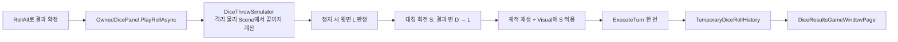

# 보유 주사위 3D 표시와 결과 기록

`TMP_MainScene`의 `ExplorationAndDicePanel`은 기존 `NodeTreePanel`과 `OwnedDicePanel`을 세로로 배치합니다. 넓은 화면에서는 내부 항목의 가중치가 2:1이며, 좁은 화면에서는 부모의 최소 높이와 `ResponsiveMainScreen`의 전체 페이지 스크롤을 사용합니다. 탐험 트리 오브젝트와 `ExplorationRunController.treePanel` 참조는 유지됩니다.

| 책임 | 구현 |
| --- | --- |
| 보유 목록 | `TemporaryPlayerDiceState`가 인스턴스 ID, 정의 ID, 면 구성을 복사해 보관하고 변경을 알립니다. |
| 판정과 전투 | `TemporaryDiceRollMenuController`가 `RollAll`을 한 번 호출하고 연출 후 기존 `TemporaryCombatState.ExecuteTurn`을 한 번 호출합니다. |
| 행동 잠금·결과 수명 | `PlayerSessionHost`가 수락된 행동 ID와 전투·Story 완료 알림, 결과 창 요청을 Scene 교체 중에도 유지합니다. |
| 3D 표시 | `OwnedDiceSessionBinder`가 보유 스냅샷을 UI 데이터로 변환합니다. `OwnedDicePanel`은 독립 `DiceStage`의 Camera 출력을 크기 제한 RenderTexture로 받습니다. |
| 던지기 연출 | `OwnedDicePanel`이 `DiceThrowSimulator`로 격리된 물리 Scene에서 던지기를 미리 계산하고 `DiceTrajectory`를 재생합니다. `DieFaceGeometry`가 윗면 판정과 결과 보정 회전을 계산합니다. |
| 구도 | `DiceArenaLayout`이 표시 영역 비율과 주사위 수로 바닥·벽·천장 범위와 직교 카메라 크기를 계산하고, `DiceStageRig`가 Camera와 `Floor`에 적용합니다. |
| 기록·창 | `TemporaryDiceRollHistory`가 전투 노드별 스냅샷을 보관합니다. `DiceResultsGameWindowPage`는 기존 `GameWindowService`와 `ModalWindowHost`에 등록됩니다. |

## 판정은 확률, 물리는 연출

결과는 지금처럼 연출 전에 Gameplay의 확률 판정(`RollAll`)이 한 번 정합니다. 물리 시뮬레이션은 그 결과를 보여주기만 하며, 시뮬레이션의 정지 자세가 판정을 바꾸는 경로는 없습니다. 연출 난수는 `OwnedDicePanel` 내부의 `System.Random`이며 Gameplay의 `IRandomIndexSource` 소비 순서에 영향을 주지 않습니다.

1. 수락된 결과 목록을 받으면 현재 구도로 `DiceThrowSimulator.Simulate`를 호출합니다. 시뮬레이터는 `SceneManager.CreateScene(..., LocalPhysicsMode.Physics3D)`로 만든 Scene에 바닥, 보이지 않는 네 벽, 천장 BoxCollider와 주사위별 볼록 `MeshCollider` + `Rigidbody` 대리 오브젝트를 만들고, 고정 간격으로 `PhysicsScene.Simulate`를 호출합니다. 비기본 물리 Scene은 Unity가 자동 시뮬레이션하지 않으므로 프로젝트 기본 물리 Scene은 진행되지 않습니다. 중력은 대리 오브젝트에만 가속도로 더하므로 전역 `Physics.gravity`를 바꾸지 않습니다.
2. 주사위는 카메라 쪽 벽 근처의 천장 아래에서 출발해 먼 쪽으로 던져집니다. 방향·속도·회전 속도와 초기 자세는 연출 시드로 정합니다.
3. 모든 주사위의 선속도·각속도가 `settleHoldSeconds` 동안 기준 이하이면 정지로 봅니다. 각 주사위의 윗면은 면 법선과 위쪽의 내적이 가장 큰 면이며, 그 각도 차이가 `flatToleranceDegrees` 이내이고 중심 높이가 `restHeight`와 `floorHeightTolerance` 이내여야 정상 정지입니다. 벽이나 다른 주사위에 기대거나 다른 주사위 위에 얹힌 경우는 거부됩니다.
4. 시간 안에 멈추지 않거나 정상 정지가 아니면 시드를 바꿔 `maximumAttempts`까지 다시 계산합니다. 매 시도는 대리 오브젝트를 새로 만들어 같은 시드에서 같은 결과를 재현합니다.
5. 각 주사위의 실제 윗면 L과 확정 결과 면 D에 대해, 형태의 회전 대칭 중 `S * n(D) = n(L)`인 S를 고릅니다. 후보가 여러 개이면 정지 후 결과 라벨의 위쪽이 카메라에서 멀어지는 방향(+Z)과 가장 가까운 S를 고릅니다. S는 다면체의 대칭이므로 시각 모델 외형은 대리 오브젝트와 겹치고 충돌 궤적이 그대로 맞습니다. 면 라벨 내용을 바꿔 쓰지 않습니다.
6. 재생은 `liftDuration` 동안 현재 정지 자세에서 출발 자세로 들어 올리며 이전 보정을 새 S로 섞고, 이어서 기록 궤적을 `Time.realtimeSinceStartup` 경과 시간 × `playbackSpeed`로 보간합니다. 화면 프레임 속도는 샘플링 빈도만 바꾸며 궤적과 최종 자세는 같습니다.
7. 종료 시 각 주사위의 윗면을 다시 계산해 확정 결과와 다르면 `OWNED_DICE_DISPLAY_MISMATCH` 오류를 남기고 결과 자세로 교정합니다.

계층은 `Models/Die-{instanceId}`(Root: 배치와 물리 궤적)와 그 아래 모델 Prefab 인스턴스 `Visual`(Body: 대칭 보정 S만)로 나뉩니다. 모델 Prefab 자체는 바꾸지 않고 런타임 래퍼 Root를 만듭니다.

## 대체 연출, 실패, 모션 감소

| 상황 | 동작 | 반환 |
| --- | --- | --- |
| 재시도 초과, 시뮬레이션 예외, 대칭 보정 실패 | `OWNED_DICE_SIMULATION_FALLBACK` 경고(예외는 `OWNED_DICE_SIMULATION_ERROR` 오류) 후 `fallbackDuration` 동안 정돈된 겹치지 않는 위치에 결과 면이 위인 자세로 이동합니다. | `true` |
| `ReduceMotion` | 던지기와 시뮬레이션을 생략하고 `reducedMotionDuration` 동안 같은 결과 배치로 이동합니다. | `true` |
| 형태 없음, 카메라·모델·`DiceStageRig` 누락, 패널 비활성, 취소·시간 초과 | 표시하지 않습니다. 호출자가 기존 `ShowRollFallback` 텍스트를 표시하고 같은 결과를 적용합니다. 취소된 재생이 남긴 주사위는 패널이 활성이면 결과 면 정돈 배치로 즉시 놓습니다. | `false` |

어떤 경우에도 재추첨하거나 결과를 두 번 적용하지 않습니다. 시뮬레이션 실패는 `OWNED_DICE_SIMULATION_*`, 표시 실패는 호출자의 기존 텍스트 대체 경로로 구분됩니다.

## 카메라, 바닥, 벽

`DiceStage.prefab` 루트의 `DiceStageRig`가 `Camera`, `Models`, `Floor` 참조를 Prefab 안에 보관합니다. `OwnedDicePanel`은 기존에 연결된 `stageCamera`의 부모에서 Rig를 찾으므로 Scene 연결은 바뀌지 않았습니다. 레이어 30(`DicePresentation`)과 AudioListener 없는 분리 원칙은 유지합니다.

- 카메라는 아래로 55°(`cameraPitch`) 기울인 직교 카메라입니다. 직교를 선택한 이유는 보이는 바닥 범위를 원근 없이 `orthographicSize`, 비율, 기울기만으로 정확히 계산할 수 있고, 좁은 화면에서도 주사위 크기가 위치에 따라 달라지지 않기 때문입니다.
- `DiceArenaLayout.Compute`는 현재 RenderTexture 비율과 주사위 수, 가장 큰 `boundingRadius`로 크기를 찾습니다. 벽·천장 상자 `[±HalfWidth] × [0, Ceiling] × [NearZ, FarZ]`의 모든 점이 화면 안에 들도록 계산하므로 던지기 중과 정지 후 모두 주사위가 잘리지 않습니다. 16:9를 가정하지 않으며 정돈 배치 칸이 `capacityPerDie × 주사위 수` 이상이고 바닥이 `minimumExtentRadii` 이상일 때까지 넓힙니다.
- `Floor`는 벽 사각형 크기로 맞춘 Quad(`DiceFloor.mat`)라서 던지기 영역이 보입니다. 벽과 천장은 물리 Scene에만 있습니다.
- 굴림 중에는 RenderTexture 재할당과 구도 변경을 미룹니다. 굴림이 끝나면 새 크기로 재할당하고 구도를 다시 계산하며, 범위 밖 주사위는 방향을 유지한 채 가장 가까운 유효 위치로 옮깁니다. 옮긴 결과가 겹치면 정돈 배치로 다시 놓습니다. RenderTexture 상한·재할당·비활성 해제 정책은 기존과 같습니다.

## 정지 후 배치와 보유 목록 변경

- 첫 표시와 보유 목록 변경 직후에는 정돈 배치(가운데 정렬 행 우선 격자)에 놓습니다. 각 주사위는 마지막으로 보여준 면(처음에는 1번 면)이 위를 향하고 라벨이 카메라에서 바로 읽히는 `PoseFor` 자세입니다. 즉 결과를 보여주던 주사위는 목록이 바뀌어도 결과 면을 유지합니다.
- 굴림이 끝나면 멈춘 위치와 방향을 유지하고, 다음 굴림은 그 자세에서 들어 올려 다시 던집니다.
- 굴림 중 추가된 주사위는 숨겨 두었다가 굴림이 끝나면 나타나고 다음 행동부터 참여합니다. 이때 정돈 배치로 다시 놓습니다. 굴림 중 제거된 주사위의 재생은 안전하게 건너뜁니다. 굴림에 참여하지 않는 표시 중 주사위는 시뮬레이션에서 움직이지 않는 장애물로 들어갑니다.
- 굴림 중 패널이 비활성화되면 재생을 중단하고, 다시 활성화될 때 확정 결과 면으로 정돈 배치합니다. 배치는 Scene 재진입 후 저장하지 않습니다.

## 물리 Scene 수명

`OwnedDicePanel`이 `DiceThrowSimulator`를 소유합니다. 물리 Scene은 첫 던지기에서 만들고, 패널이 활성인 동안 하나만 유지하며, `OnDisable`·`OnDestroy`에서 `UnloadSceneAsync`로 해제합니다. 대리 오브젝트는 계산이 끝나면 즉시 파괴합니다. 빌드 Scene 목록에는 없고, Scene 전환 시스템은 지정한 Scene만 Additive로 로드·언로드하므로 충돌하지 않습니다.

## 형태 데이터와 윗면 평행 조건

`DieShapeDefinition`은 다음 데이터를 가집니다.

| 소유 | 필드 | 의미 |
| --- | --- | --- |
| 개발자 | `definitionId`, `additionalDefinitionIds` | 이 형태를 쓰는 정의 ID입니다. `temporary.d6` 형태가 별칭 `temporary.d6-secondary`도 받습니다. |
| 개발자 | `modelPrefab`, `readingRule` | 모델과 읽기 규칙 문구입니다. |
| 생성기(생성 모델을 쓰는 동안) | `faceNormals`, `faceReadingUps` | 면 인덱스별 로컬 법선과 라벨의 위쪽 방향입니다. 메시 순서나 표시 숫자로 추정하지 않습니다. |
| 생성기 | `facePoseEuler` | 면별 정지 자세: 그 면이 위를 향하고 라벨이 카메라에서 바로 읽힙니다. 정돈 배치, 대체 연출, 모션 감소에 씁니다. |
| 생성기 | `colliderMesh`, `restHeight`, `boundingRadius` | 볼록 충돌 대리 메시, 중심-면 거리, 중심-꼭짓점 거리입니다. |

표시에 쓰는 형태는 모든 면 법선 n에 대해 -n인 면이 있어야 하며(윗면 평행 조건), 모든 (L, D) 쌍에 대칭 회전이 있어야 합니다. `DieShapeDefinition.IsPresentable`이 이를 검사하고 `DieShapeCatalog.Find`는 조건을 만족하지 않는 형태를 반환하지 않습니다. 정육면체와 정팔면체는 24개의 회전 대칭을 가집니다. 정사면체는 위쪽에 꼭짓점이 오므로 거부됩니다. 런타임에 4면 주사위를 추가하면 다른 형태로 위장하지 않고 "3D 형태 없음" 상태와 텍스트 결과로 처리됩니다.

기본 형태는 `Assets/TxTRPG/UI/Prefabs/Dice/DiceD6.prefab`, `DiceD8.prefab`과 `Assets/TxTRPG/UI/Styles/Dice/DieShapeCatalog.asset`입니다. 기본 보유 구성은 `D6 (보조)`(`temporary.d6-secondary`, 공1·회2·공3·회4·공5·회6), `D6`, `D8`입니다. `D6 (보조)`는 D6 형태 자산의 별칭으로 연결해 같은 모델·면 데이터를 공유합니다. 형태 자산을 하나 더 두면 면 데이터가 두 벌이 되어 생성기 동기화가 어긋날 수 있기 때문입니다. 이전 기본 D4 메시·Prefab·형태 자산은 참조가 없음을 확인하고 삭제했습니다.

## 기본 연출 설정값

`OwnedDicePanel`의 `arenaSettings`와 `throwSettings`에서 조정합니다. 아래 값은 Editor Play Mode 측정(`Validate Throw Presentation`)으로 정했습니다.

| 설정 | 기본값 | 근거 |
| --- | --- | --- |
| `simulationStep` | 0.01초 | 100Hz 고정 간격. 2단위 크기 주사위의 벽 충돌을 안정적으로 처리합니다. |
| `maximumSimulationSeconds` / `playbackSpeed` / `liftDuration` | 2.2초 / 1.1 / 0.16초 | 최대 표시 시간 약 2.16초로 `rollTimeoutSeconds`(Scene 값 3초)보다 짧습니다. 측정 최장 굴림 2.01초(20개). |
| `maximumAttempts` | 5 | 기본 3개는 대부분 1~2회, 20개도 2회 안에 정상 정지했습니다. |
| `gravity` | 40 | 2단위 주사위를 실제 주사위처럼 빠르게 멈추게 합니다. 전역 중력은 바꾸지 않습니다. |
| 정지 기준 | 선속도 0.06, 각속도 0.12, 유지 0.18초, 기울기 3°, 높이 0.06 | |
| `cameraPitch` / `padding` / `ceilingRadii` | 55° / 0.5 / 3 | padding 0.25에서는 벽에 붙은 주사위가 접촉 침투로 화면 끝을 0.2% 넘는 경우가 측정되어 0.5로 정했습니다. |
| `capacityPerDie` / `minimumExtentRadii` | 2 / 5 | 3개에서 주사위가 충분히 크게 보이면서 던질 공간을 확보합니다. |

시뮬레이션 계산은 행동 수락 직후 한 프레임에서 실행됩니다. Editor 측정에서 3개 6~20ms, 12개 약 23ms, 20개 약 36ms였고 첫 계산은 콜라이더 생성 때문에 약 28ms였습니다. 모바일 실제 기기 측정은 아직 없습니다. 지원 개수에 임의 제한은 없으며 20개까지 물리 던지기가 성공했습니다. 개수가 늘수록 카메라가 넓어져 주사위가 작아집니다.

## 결과 기록

행동을 수락하면 참여 주사위와 `RunId`·`NodeId`·전투 참조를 고정합니다. 연출 실패나 타임아웃에는 확정 결과를 텍스트로 대체한 뒤 같은 결과를 적용합니다. 새 세션이나 전투로 바뀐 오래된 작업은 적용하지 않습니다. 화면이 교체되어도 같은 세션의 전투 완료와 Story·결과 요청은 새 바인딩으로 전달됩니다. 기록과 자동 결과 표시 여부는 세션 수명이며 저장 파일에는 기록하지 않습니다.

기본 기록 모드는 `LatestCombatNode`이고 새 전투에 진입하면 그 전투의 기록으로 전환합니다. `RecentSessionCombats`와 보관 전투 수는 `TemporaryDiceRollMenuController`의 Inspector에서 선택합니다. 자동 결과 표시 기본값은 켜짐이며 `PlayerSessionHost.TemporaryDicePreferences.AutoShowResults`에서 런타임 변경할 수 있습니다. `ReduceMotion`도 같은 설정 경계에 있습니다. 결과 창은 확인 또는 공통 모달의 바깥 클릭·탭으로 닫고, 닫을 때 기존 포커스를 복원합니다. 결과 보기 버튼은 주사위가 0개여도 빈 기록 상태를 보여줍니다.

영구 저장, 획득·제거 화면, 인게임 옵션 화면, 효과음·진동·파티클은 이 구현에 포함되지 않습니다. 자산 생성·교체, Scene 적용과 검증 경로는 [개발 절차](../development/workflows.md#보유-주사위-3d-패널과-결과-기록)를 참고합니다.
