# 보유 주사위 3D 표시와 결과 기록

> **보류 상태**: 이 문서는 보류된 주사위 표시를 설명합니다. 현재 `TMP_MainScene`에서는 `OwnedDicePanel` GameObject가 비활성이고, `OwnedDiceSessionBinder`와 `TemporaryDiceRollMenuController` 컴포넌트가 꺼져 있습니다. 두 컴포넌트는 꺼져 있으면 `InitializeAsync`에서 바로 반환합니다. 같은 자리(같은 `FlexibleLayoutItem` 값)에는 `SlotMachinePanel`이 표시됩니다([슬롯머신과 룬 기반 전투 행동](slot-machine-and-runes.md)). 코드, Prefab, 형태 자산, 직렬화 설정과 테스트는 삭제하지 않았습니다. 주사위로 되돌릴 때 바꿔야 할 참조(버튼 처리기, `ExplorationRunController`, 경계선 패널, 입력 차단 대상)는 [개발 및 검증 절차](../development/workflows.md#슬롯머신-전투-적용)에 정리했습니다. 아래 설명은 보류 전 연결 상태 기준입니다.

`OwnedDicePanel`은 `TMP_MainScene`의 가운데 열 `MiddlePanel/ContentLayer`에서 `EnemyDisplayPanelDemo`(Weight 2) 아래에 있습니다(`FlexibleLayoutItem` Weight 0.7, 최소 200). 사용자가 `StoryTextPanel`과 위치를 바꾸기 전에는 첫째 열(이전 이름 `ExplorationAndDicePanel`, 현재 `LeftPanel`)에서 `NodeTreePanel` 아래에 2:1로 있었습니다. 좁은 화면에서는 `ResponsiveMainScreen`이 `MiddlePanel`에 높이 520을 주며, 이때 주사위 패널은 약 332×274(390×844 기준)입니다. 넓어진 표시 영역은 `DiceArenaLayout`이 현재 비율로 다시 계산하고 RenderTexture는 `maximumTextureDimension`(1024) 상한을 따릅니다.

노드 선택 중에는 `ExplorationNodePanel`이 `MiddlePanel` 전체를 덮으므로 주사위 패널도 가려집니다. `ExplorationNodePanel`의 `CoveredPanelInteractionBlocker`가 이 동안 `OwnedDicePanel`과 `EnemyDisplayPanelDemo`의 `CanvasGroup.interactable`을 꺼서 컨트롤러·키보드 탐색이 `ResultsButton`에 닿지 않게 하고, 노드 선택이 끝나면 원래 값으로 되돌립니다. 전투 "행동" 버튼은 적 패널과 주사위 패널의 경계선 위에 놓여 주사위 화면 위쪽 가운데와 `Title` 일부를 덮을 수 있습니다(사용자 허용). 주사위가 버튼 아래에 멈추면 결과 면 일부가 가려질 수 있으며, 결과는 Story와 결과 창에서도 확인할 수 있습니다.

| 책임 | 구현 |
| --- | --- |
| 보유 목록 | `TemporaryPlayerDiceState`가 인스턴스 ID, 정의 ID, 면 구성을 복사해 보관하고 변경을 알립니다. |
| 판정과 전투 | `TemporaryDiceRollMenuController`가 `RollAll`을 한 번 호출하고, 모든 주사위가 멈추고 결과 대기 시간이 지난 뒤 기존 `TemporaryCombatState.ExecuteTurn`을 한 번 호출합니다. |
| 행동 잠금·결과 수명 | `PlayerSessionHost`가 수락된 행동 ID와 전투·Story 완료 알림, 결과 창 요청을 Scene 교체 중에도 유지합니다. |
| 3D 표시 | `OwnedDiceSessionBinder`가 보유 스냅샷을 UI 데이터로 변환합니다. `OwnedDicePanel`은 독립 `DiceStage`의 Camera 출력을 크기 제한 RenderTexture로 받습니다. |
| 던지기 연출 | `OwnedDicePanel`이 `DiceThrowSimulator`로 격리된 물리 Scene에서 던지기를 미리 계산하고 `DiceTrajectory`를 재생합니다. `DieFaceGeometry`가 윗면 판정과 결과 보정 회전을 계산합니다. |
| 구도 | `DiceArenaLayout`이 표시 영역 비율과 주사위 수로 바닥·벽·천장 범위와 직교 카메라 크기를 계산하고, `DiceStageRig`가 Camera와 `Floor`에 적용합니다. |
| 기록·창 | `TemporaryDiceRollHistory`가 전투 노드별 스냅샷을 보관합니다. `DiceResultsGameWindowPage`는 기존 `GameWindowService`와 `ModalWindowHost`에 등록됩니다. |

## 판정은 확률, 물리는 연출

결과는 지금처럼 연출 전에 Gameplay의 확률 판정(`RollAll`)이 한 번 정합니다. 물리 시뮬레이션은 그 결과를 보여주기만 하며, 시뮬레이션의 정지 자세가 판정을 바꾸는 경로는 없습니다. 연출 난수는 `OwnedDicePanel` 내부의 `System.Random`이며 Gameplay의 `IRandomIndexSource` 소비 순서에 영향을 주지 않습니다.

```mermaid
flowchart LR
    Roll[RollAll로 결과 확정] --> Panel[OwnedDicePanel.PlayRollAsync]
    Panel --> Sim[DiceThrowSimulator<br/>화면 밖 출발부터 정지까지 계산]
    Sim --> Fix[윗면 L 판정, 대칭 회전 S: D → L]
    Fix --> Recall[회수: 각 주사위가 가장 가까운<br/>화면 가장자리 밖으로 이동]
    Recall --> Swap[화면 밖에서 출발 자세와 S로 교체]
    Swap --> Delay[throwDelay 동안 대기]
    Delay --> Replay[궤적 재생: 아래 가장자리로 진입, 정지]
    Replay --> Hold[resultRevealDelay 동안 정지 유지]
    Hold --> Combat[ExecuteTurn 한 번]
    Combat --> History[TemporaryDiceRollHistory]
    History --> Modal[DiceResultsGameWindowPage]
```

1. 수락된 결과 목록을 받으면 현재 구도로 `DiceThrowSimulator.Simulate`를 호출합니다. 시뮬레이터는 `SceneManager.CreateScene(..., LocalPhysicsMode.Physics3D)`로 만든 Scene에 바닥, 천장, 벽 BoxCollider와 주사위별 볼록 `MeshCollider` + `Rigidbody` 대리 오브젝트를 만들고, 고정 간격으로 `PhysicsScene.Simulate`를 호출합니다. 비기본 물리 Scene은 Unity가 자동 시뮬레이션하지 않으므로 프로젝트 기본 물리 Scene은 진행되지 않습니다. 중력은 대리 오브젝트에만 가속도로 더하므로 전역 `Physics.gravity`를 바꾸지 않습니다.
2. 주사위는 화면 아래 가장자리 너머(카메라 쪽, `z < NearZ`)에서 출발해 +Z 방향으로 던져집니다. `DiceArenaLayout.OffscreenStartPositions`가 직교 크기, 기울기, 출발 높이(`launchHeightRadii` × 최대 `boundingRadius`), 최대 `boundingRadius`로 각 주사위의 경계 구 전체가 화면 아래 밖에 있도록 위치를 계산합니다(여유 `0.1 × 반지름`). 가로 위치는 정돈 배치와 같은 열 간격으로 좌우 벽 안쪽에 두고, 열보다 많은 주사위는 카메라 쪽으로 한 칸씩 더 멀리 두어 다음 물결(wave)로 기다리게 합니다. 기다리는 주사위는 키네마틱으로 화면 밖에 멈춰 있다가, 바로 앞 물결의 모든 주사위가 출발선에서 한 칸(`Spacing`) 이상 나아가거나 영역에 들어오면 출발선(첫 행 위치, 여전히 화면 밖)으로 옮겨져 미리 뽑아 둔 속도로 던져집니다. 그래서 모든 주사위가 같은 거리를 날아 들어옵니다. 전진 속도는 `forwardSpeed`에 `max(1, sqrt(Depth / (referenceDepthRadii × 반지름)))`을 곱합니다. 주사위가 많아 영역이 깊을수록 더 멀리 떨어져 뒤 물결이 입구에서 막히지 않게 하기 위해서입니다. 방향·속도·회전 속도와 초기 자세는 연출 시드로 정하며, 같은 시드·구도·구성은 같은 출발 위치와 궤적을 냅니다.
3. 바닥, 천장, 좌우 벽은 출발 행 뒤(`WallCorridorEnd`)부터 먼 벽까지 이어진 진입 통로를 이룹니다. 카메라 쪽 벽(`WallNear`)은 처음부터 있지만 각 주사위와의 충돌을 `Physics.IgnoreCollision`으로 꺼 둡니다. 주사위의 충돌 메시 꼭짓점이 모두 `NearZ` 안쪽으로 들어오면 그 주사위에 대해서만 충돌을 켭니다. 이때 벽과 주사위는 겹치지 않고, 들어온 주사위는 통로로 되돌아갈 수 없습니다. 마지막 출발 뒤 `maximumEntrySeconds` 안에 모두 들어오지 않으면 그 시도는 실패(`Dice did not enter the arena ... of their release (die, wave, 위치)`)이며 기존 재시도 규칙을 따릅니다. 정지 판정은 모든 주사위가 들어온 뒤에만 하므로 정지 위치는 항상 화면 안 바닥입니다.
   - 처음 구현(모두 들어온 뒤 벽을 한 번에 켜고, 경계 구 기준으로 진입을 판정)은 측정에서 6개 이상일 때 거의 항상 실패했습니다. 경계 구가 실제 외형보다 커서 벽에 붙어 정지한 주사위를 "되돌아감"으로, 막 들어온 주사위를 "미진입"으로 판정했고, 뒷줄 주사위가 입구에서 앞줄에 막혔기 때문입니다(화면 비율 1.40, 시드 10개: 12개 0/10, 20개 0/10). 꼭짓점 기준 진입, 주사위별 벽 충돌, 물결 출발, 깊이 비례 속도로 바꾼 뒤 같은 조건에서 3·6·12·20개 모두 정상 던지기가 됩니다(기본 연출 설정값 절).
4. 모든 주사위의 선속도·각속도가 `settleHoldSeconds` 동안 기준 이하이면 정지로 봅니다. 각 주사위의 윗면은 면 법선과 위쪽의 내적이 가장 큰 면이며, 그 각도 차이가 `flatToleranceDegrees` 이내이고 중심 높이가 `restHeight`와 `floorHeightTolerance` 이내여야 정상 정지입니다. 벽이나 다른 주사위에 기대거나 다른 주사위 위에 얹힌 경우는 거부됩니다.
5. 시간 안에 멈추지 않거나 정상 정지가 아니면 시드를 바꿔 `maximumAttempts`까지 다시 계산합니다. 매 시도는 대리 오브젝트를 새로 만들어 같은 시드에서 같은 결과를 재현합니다.
6. 각 주사위의 실제 윗면 L과 확정 결과 면 D에 대해, 형태의 회전 대칭 중 `S * n(D) = n(L)`인 S를 고릅니다. 후보가 여러 개이면 정지 후 결과 라벨의 위쪽이 카메라에서 멀어지는 방향(+Z)과 가장 가까운 S를 고릅니다. S는 다면체의 대칭이므로 시각 모델 외형은 대리 오브젝트와 겹치고 충돌 궤적이 그대로 맞습니다. 면 라벨 내용을 바꿔 쓰지 않습니다.
7. 시뮬레이션이 성공하면 회수 연출을 재생합니다. `DiceArenaLayout.PlanRecall`이 각 참여 주사위의 정지 위치를 화면 좌표(가로 `x`, 세로 `ScreenHeight`)로 바꿔 네 가장자리(`x = ±OrthographicSize × Aspect`, `ScreenHeight = ±OrthographicSize`)까지의 화면상 거리가 가장 짧은 쪽(`DiceRecallEdge`)을 고릅니다. 거리가 같으면(차이 1e-4 이하) 아래 → 왼쪽 → 오른쪽 → 위 순서이며 연출 난수를 쓰지 않습니다. `RecallTarget`은 그 가장자리에 수직으로만 이동한 화면 밖 목표를 계산합니다. 왼쪽·오른쪽은 X만 바꾸고, 아래·위는 `recallLiftRadii`만큼 들어 올린 높이에서 Z를 바꿉니다. 목표에서는 경계 구 전체가 해당 가장자리 밖에 있고 여유 `0.1 × 반지름`이 있습니다. 모든 주사위는 `recallDuration` 동안 같은 가속 곡선(`t²`)으로 자기 목표까지 직선 이동하므로, 가장자리에서 먼 주사위일수록 빠르고 전체 회수 시간은 일정합니다. 회전은 이동 방향으로 구르는 축(`위쪽 × 이동 방향`)으로 `recallTumbleDegrees`만큼입니다. 첫 표시 직후의 정돈 배치에서도 같습니다. 시뮬레이션이 실패하면 회수 없이 대체 배치로 갑니다.
   - 겹침 방지(`FirstRecallConflict`): 같은 진행률에서 두 주사위 중 하나라도 화면에 보이는 동안 중심 거리가 두 `restHeight` 합 × 0.98보다 짧으면 충돌로 봅니다(진행률 49개 표본). 주사위를 순서대로 배정하면서 각자 가장 가까운 가장자리부터 앞서 배정한 주사위와 충돌하지 않는 첫 가장자리를 고릅니다(`Reassigned`). 어떤 주사위도 충돌 없는 가장자리가 없으면, 가장 가까운 가장자리별로 묶어 묶음마다 하나의 공통 이동을 씁니다(`EdgeGroups`). 같은 묶음 안에서는 서로 교차하지 않습니다. 이 단계는 지침서의 "모든 조합 실패 시 공통 아래쪽 회수"보다 먼저 시도하는 추가 단계입니다. 많은 주사위가 같은 변으로 나갈 때 일부를 다른 변으로 돌리는 것보다 가까운 변 방향을 지키는 편이 자연스럽기 때문입니다. 묶음끼리도 충돌하면 그 굴림만 기존 공통 아래쪽 회수(`RecallOffsetZ`, `CommonBottom`)로 대체하고 `OWNED_DICE_RECALL_FALLBACK` 경고를 남깁니다. 비참여 장애물 주사위는 회수하지 않습니다.
   - 위쪽 회수는 +Z로 이동하므로 보이는 `Floor` 범위(`FarZ`) 밖 배경 위를 지나갑니다. 들림 0.4 × 반지름을 그대로 두어 공중으로 빠져나가는 모습이 되며, 0.25초 회수 중 배경 위 구간은 짧아 별도 조정은 하지 않았습니다. 이 판단은 측정값 기반이며 눈으로 확인하는 절차가 남아 있습니다.
8. 회수가 끝나면 모든 주사위를 목표 위치에 놓고, 회수 위치와 교체 후 출발 자세 양쪽에서 모든 참여 주사위의 경계 구가 네 가장자리 중 어느 쪽이든 화면 밖에 있는지 확인합니다(`OwnedDiceRollTimeline.HiddenAtSwap`, `SwapDetail`). 이때 Root를 궤적 첫 프레임 자세로, Body를 새 S로 한 번에 바꿉니다. 화면 안에서 보정 회전을 섞는 동작은 없습니다. 주사위별 회수 방향과 겹침 처리 결과는 `RecallEdges`, `RecallResolution`에 기록합니다.
   - 교체 뒤 `throwDelay` 동안 기다렸다가 궤적 재생을 시작합니다(`ThrowStartedAt`). 이 동안 화면에는 바닥과 비참여 주사위만 보입니다. 대기는 실시간 경과로 계산하고 기존 취소 규칙(취소·시간 초과·패널 비활성화 시 결과 면 정돈 배치, 결과 1회 적용)을 따릅니다. 모션 감소와 시뮬레이션 실패 대체 배치에는 회수가 없으므로 대기도 없습니다.
9. 기록 궤적을 `Time.realtimeSinceStartup` 경과 시간 × `playbackSpeed`로 보간합니다. 주사위는 화면 아래 가장자리에서 들어와 구르다가 멈춥니다. 회수·재생·대기 모두 실시간 경과로 계산하므로 화면 프레임 속도는 샘플링 빈도만 바꾸며 길이와 최종 자세는 같습니다.
10. 종료 시 각 주사위의 윗면을 다시 계산해 확정 결과와 다르면 `OWNED_DICE_DISPLAY_MISMATCH` 오류를 남기고 결과 자세로 교정합니다.
11. 굴림 중 추가된 주사위 표시와 굴림 중 바뀐 표시 영역 크기를 이때 적용하고(정지 확인 전), 그 뒤 `resultRevealDelay` 동안 주사위를 움직이지 않은 채 기다렸다가 `PlayRollAsync`가 `true`를 반환합니다. 대기 중 바뀐 표시 영역 크기는 대기가 끝난 직후 적용합니다. 대기는 모션 감소와 대체 배치 경로에도 적용하며, 대기 중 취소되면 기존 취소 규칙(결과 면 정돈 배치, `false` 반환)을 따릅니다. 컨트롤러는 반환 뒤에 `ExecuteTurn`, 기록, Story, HP·적 표시, 전투 완료 알림, 결과 창 요청을 기존 순서로 한 번 실행합니다.

시뮬레이터는 첫 정지 프레임을 유지 구간 끝의 최종 자세로 바꿉니다. 그 직전 프레임과 최종 자세의 차이를 `DiceThrowOutcome.FinalSnapDistance`/`FinalSnapDegrees`로 측정하며, 측정값이 눈에 띄지 않는 크기여서 보간을 추가하지 않았습니다(기본 연출 설정값 절 참고).

계층은 `Models/Die-{instanceId}`(Root: 배치와 물리 궤적)와 그 아래 모델 Prefab 인스턴스 `Visual`(Body: 대칭 보정 S만)로 나뉩니다. 모델 Prefab 자체는 바꾸지 않고 런타임 래퍼 Root를 만듭니다.

## 대체 연출, 실패, 모션 감소

| 상황 | 동작 | 반환 |
| --- | --- | --- |
| 재시도 초과(진입 실패 포함), 시뮬레이션 예외, 대칭 보정 실패 | `OWNED_DICE_SIMULATION_FALLBACK` 경고(예외는 `OWNED_DICE_SIMULATION_ERROR` 오류) 후 회수 없이 `fallbackDuration` 동안 정돈된 겹치지 않는 위치에 결과 면이 위인 자세로 이동하고 `resultRevealDelay`를 기다립니다. | `true` |
| `ReduceMotion` | 회수, 던지기, 시뮬레이션을 생략하고 `reducedMotionDuration` 동안 같은 결과 배치로 이동한 뒤 `resultRevealDelay`를 기다립니다. | `true` |
| 형태 없음, 카메라·모델·`DiceStageRig` 누락, 패널 비활성, 취소 | 표시하지 않습니다. 호출자가 기존 `ShowRollFallback` 텍스트를 표시하고 같은 결과를 적용합니다. 취소된 재생이 남긴 주사위는 패널이 활성이면 결과 면 정돈 배치로 즉시 놓습니다. | `false` |
| 시간 초과 | 컨트롤러가 토큰을 취소하고 `OwnedDicePanel.StopRollAtResults()`를 동기 호출합니다. 패널은 진행 중인 재생을 무효화하고 모든 주사위를 결과 면 정돈 배치로 즉시 놓습니다. 그 뒤 같은 프레임에서 `ShowRollFallback`, `OWNED_DICE_ROLL_TIMEOUT` 경고, 결과 적용이 이어집니다. 결과 대기는 더하지 않습니다. 패널이 비활성·파괴되었으면 기다리지 않습니다. 늦게 끝나는 재생 작업은 세대 번호가 바뀌어 주사위를 다시 움직이지 않습니다. | `false` |

시간 제한은 `TemporaryDiceRollMenuController.ResolveRollTimeout(rollTimeoutSeconds, panel.MaximumPresentationSeconds, rollTimeoutMarginSeconds)` = `max(최소값, 최대 연출 길이 + 여유)`이며 1~15초로 제한됩니다. `rollTimeoutSeconds`(Scene 값 3)는 의미와 직렬화 이름을 바꾸지 않고 최소값으로 쓰므로 Scene 변경이 없습니다. `OwnedDicePanel.MaximumPresentationSeconds`는 `max(recallDuration + throwDelay + maximumSimulationSeconds / playbackSpeed, fallbackDuration, reducedMotionDuration) + resultRevealDelay`입니다. 시뮬레이션 계산은 `PlayRollAsync` 호출 안에서 동기로 끝난 뒤 시간 제한 타이머가 시작되므로 계산 시간은 제한에 포함되지 않습니다.

어떤 경우에도 재추첨하거나 결과를 두 번 적용하지 않습니다. 시뮬레이션 실패는 `OWNED_DICE_SIMULATION_*`, 표시 실패는 호출자의 기존 텍스트 대체 경로로 구분됩니다.

## 카메라, 바닥, 벽

`DiceStage.prefab` 루트의 `DiceStageRig`가 `Camera`, `Models`, `Floor` 참조를 Prefab 안에 보관합니다. `OwnedDicePanel`은 기존에 연결된 `stageCamera`의 부모에서 Rig를 찾으므로 Scene 연결은 바뀌지 않았습니다. 레이어 30(`DicePresentation`)과 AudioListener 없는 분리 원칙은 유지합니다.

- 카메라는 아래로 55°(`cameraPitch`) 기울인 직교 카메라입니다. 직교를 선택한 이유는 보이는 바닥 범위를 원근 없이 `orthographicSize`, 비율, 기울기만으로 정확히 계산할 수 있고, 좁은 화면에서도 주사위 크기가 위치에 따라 달라지지 않기 때문입니다.
- `DiceArenaLayout.Compute`는 현재 RenderTexture 비율과 주사위 수, 가장 큰 `boundingRadius`로 크기를 찾습니다. 벽·천장 상자 `[±HalfWidth] × [0, Ceiling] × [NearZ, FarZ]`의 모든 점이 화면 안에 들도록 계산하므로 던지기 중과 정지 후 모두 주사위가 잘리지 않습니다. 16:9를 가정하지 않으며 정돈 배치 칸이 `capacityPerDie × 주사위 수` 이상이고 바닥이 `minimumExtentRadii` 이상일 때까지 넓힙니다.
- `Floor`는 벽 사각형 크기로 맞춘 Quad(`DiceFloor.mat`)라서 던지기 영역이 보입니다. 벽과 천장은 물리 Scene에만 있습니다.
- 굴림 중에는 RenderTexture 재할당과 구도 변경을 미룹니다. 정지 직후(결과 대기 전) 새 크기로 재할당하고 구도를 다시 계산합니다. 구도의 경계가 실제로 바뀐 경우에만 범위 밖 주사위를 방향을 유지한 채 가장 가까운 유효 위치로 옮기고, 옮긴 결과가 정지 자세 기준으로 겹치면(`DiceArenaLayout.HasRestOverlap`: 중심 거리 < 두 `restHeight` 합 × 0.98) 정돈 배치로 다시 놓습니다. 경계가 같으면 정지한 주사위를 그대로 둡니다. 이전 기준(`radius × 1.5`)은 맞닿아 정지한 주사위를 겹침으로 판정해 정상 던지기 직후 정돈 배치로 순간 이동시킬 수 있었고, 경계가 같아도 `InnerNearZ`로 끌어당겼기 때문에 바꿨습니다. RenderTexture 상한·재할당·비활성 해제 정책은 기존과 같습니다.

## 정지 후 배치와 보유 목록 변경

- 첫 표시와 보유 목록 변경 직후에는 정돈 배치(가운데 정렬 행 우선 격자)에 놓습니다. 각 주사위는 마지막으로 보여준 면(처음에는 1번 면)이 위를 향하고 라벨이 카메라에서 바로 읽히는 `PoseFor` 자세입니다. 즉 결과를 보여주던 주사위는 목록이 바뀌어도 결과 면을 유지합니다.
- 굴림이 끝나면 멈춘 위치와 방향을 유지하고, 다음 굴림은 그 자세에서 가장 가까운 화면 가장자리 밖으로 회수한 뒤 `throwDelay` 뒤에 다시 던집니다. 측정에서 정지 배치의 회수 처리는 3개 시드 20개가 모두 `NearestEdges`(한 번 실행에서는 `Reassigned` 1회)였습니다. 20개는 시드 9~10개 모두 `EdgeGroups`였고, `CommonBottom` 대체는 측정 중 한 번도 일어나지 않았습니다.
- 굴림 중 추가된 주사위는 숨겨 두었다가 정지 직후(결과 대기 전) 나타나고 다음 행동부터 참여합니다. 이때 정돈 배치로 다시 놓습니다. 굴림 중 제거된 주사위의 회수·재생은 안전하게 건너뜁니다. 굴림에 참여하지 않는 표시 중 주사위는 시뮬레이션에서 움직이지 않는 장애물로 들어가며 회수하지 않습니다.
- 굴림 중 패널이 비활성화되면 재생을 중단하고, 다시 활성화될 때 확정 결과 면으로 정돈 배치합니다. 배치는 Scene 재진입 후 저장하지 않습니다.

## 물리 Scene 수명

`OwnedDicePanel`이 `DiceThrowSimulator`를 소유합니다. 물리 Scene은 첫 던지기에서 만들고, 패널이 활성인 동안 하나만 유지하며, `OnDisable`·`OnDestroy`에서 `UnloadSceneAsync`로 해제합니다. 대리 오브젝트는 계산이 끝나면 즉시 파괴합니다. 빌드 Scene 목록에는 없고, Scene 전환 시스템은 지정한 Scene만 Additive로 로드·언로드하므로 충돌하지 않습니다.

## 형태 데이터와 윗면 평행 조건

`DieShapeDefinition`은 다음 데이터를 가집니다.

| 소유 | 필드 | 의미 |
| --- | --- | --- |
| 개발자 | `definitionId`, `additionalDefinitionIds` | 이 형태를 쓰는 정의 ID입니다. `temporary.d6` 형태가 별칭 `temporary.d6-secondary`도 받습니다. |
| 개발자 | `modelPrefab`, `readingRule` | 모델과 읽기 규칙 문구입니다. |
| 생성기(생성 모델을 쓰는 동안) | `faceNormals`, `faceReadingUps` | 면 인덱스별 로컬 법선과 라벨의 위쪽 방향입니다. 메시 순서나 표시 숫자로 추정하지 않습니다. |
| 생성기 | `facePoseEuler` | 면별 정지 자세: 그 면이 위를 향하고 라벨이 카메라에서 바로 읽힙니다. 정돈 배치, 대체 연출, 모션 감소에 씁니다. |
| 생성기 | `colliderMesh`, `restHeight`, `boundingRadius` | 볼록 충돌 대리 메시, 중심-면 거리, 중심-꼭짓점 거리입니다. |

표시에 쓰는 형태는 모든 면 법선 n에 대해 -n인 면이 있어야 하며(윗면 평행 조건), 모든 (L, D) 쌍에 대칭 회전이 있어야 합니다. `DieShapeDefinition.IsPresentable`이 이를 검사하고 `DieShapeCatalog.Find`는 조건을 만족하지 않는 형태를 반환하지 않습니다. 정육면체와 정팔면체는 24개의 회전 대칭을 가집니다. 정사면체는 위쪽에 꼭짓점이 오므로 거부됩니다. 런타임에 4면 주사위를 추가하면 다른 형태로 위장하지 않고 "3D 형태 없음" 상태와 텍스트 결과로 처리됩니다.

기본 형태는 `Assets/TxTRPG/UI/Prefabs/Dice/DiceD6.prefab`, `DiceD8.prefab`과 `Assets/TxTRPG/UI/Styles/Dice/DieShapeCatalog.asset`입니다. 기본 보유 구성은 `D6 (보조)`(`temporary.d6-secondary`, 공1·회2·공3·회4·공5·회6), `D6`, `D8`입니다. `D6 (보조)`는 D6 형태 자산의 별칭으로 연결해 같은 모델·면 데이터를 공유합니다. 형태 자산을 하나 더 두면 면 데이터가 두 벌이 되어 생성기 동기화가 어긋날 수 있기 때문입니다. 이전 기본 D4 메시·Prefab·형태 자산은 참조가 없음을 확인하고 삭제했습니다.

## 기본 연출 설정값

`OwnedDicePanel`의 `arenaSettings`와 `throwSettings`에서 조정합니다. 아래 값은 Editor Play Mode 측정(`Validate Throw Presentation`과 임시 측정)으로 정했습니다. 측정 환경은 Windows Editor이며 모바일 기기 측정은 아직 없습니다.

| 설정 | 기본값 | 근거 |
| --- | --- | --- |
| `simulationStep` | 0.01초 | 100Hz 고정 간격. 2단위 크기 주사위의 벽 충돌을 안정적으로 처리합니다. |
| `maximumSimulationSeconds` / `playbackSpeed` | 4.0초 / 1.1 | 화면 밖 진입과 물결 출발을 포함합니다. 측정 최장 시뮬레이션은 3.52초(20개, 화면 비율 0.60)였고, 3초에서는 20개가 시드 10개 중 1~2개 정지하지 못했습니다. 최장 실제 굴림은 3개 2.54초, 20개 4.76초(`throwDelay` 2초 포함)였습니다. |
| `maximumEntrySeconds` / `launchHeightRadii` | 1.2초 / 1.3 | 측정 최장 진입 0.72초(3개), 0.84초(20개). 진입 중 천장 여유(`EntryCeilingClearance`)는 최소 0.61로 천장에 닿지 않았습니다. 진입 제한을 3초로 늘려도 이전 구조의 실패는 줄지 않아 값은 그대로 두었습니다. |
| `forwardSpeed` / `referenceDepthRadii` | 9~15 / 4 | 시도 1회 기준 성공률(시드 30개, 화면 비율 1.40·0.60)을 기준 깊이 6·5·4 × 반지름으로 비교해 4를 골랐습니다. 4에서 3개 24/30, 6개 20~27/30, 12개 17~21/30, 20개 14~23/30이고, 남은 실패는 대부분 기울어진 정지입니다. 5회 재시도 기준으로 `Validate Throw Presentation` 측정은 3개 20/20, 20개 9/10 정상 던지기였습니다. |
| `recallDuration` / `recallLiftRadii` / `recallTumbleDegrees` | 0.25초 / 0.4 / 90° | 지침서 목표 범위 0.2~0.3초의 중간값입니다. 회수 중 화면에 보이는 두 주사위의 최소 중심 거리는 정지 접지 거리의 1.34배 이상이었습니다(겹침 기준 0.98배). |
| `throwDelay` | 0.3초 | 지침서 기본값입니다. 측정 지연은 0초 설정에서 0.000초, 2초 설정에서 2.002~2.003초였고, 최대값 2초에서도 3개 3.84초(제한 7.29초), 20개 4.76초(제한 7.29초)로 시간 제한 안에 끝났습니다. |
| `resultRevealDelay` | 0.4초 | 지침서 범위 0.3~0.5초의 중간값입니다. 측정 결과 대기 0.40초, Validate Play Flow에서 정지 후 결과 적용까지 0.43초였습니다. 0.3~0.5초 범위의 값들을 비교한 측정은 하지 않았습니다. |
| `rollTimeoutMarginSeconds` (`TemporaryDiceRollMenuController`) | 1초 | 기본 최대 연출 길이 0.25 + 0.3 + 4.0/1.1 + 0.4 ≈ 4.59초에 더해 실제 제한은 약 5.59초입니다. |
| `maximumAttempts` | 5 | 화면 밖 던지기에서 3개는 시드 20개에 평균 1.35회(27회), 20개는 시드 10개에 15회가 들었습니다. |
| `gravity` | 40 | 2단위 주사위를 실제 주사위처럼 빠르게 멈추게 합니다. 전역 중력은 바꾸지 않습니다. |
| 정지 기준 | 선속도 0.06, 각속도 0.12, 유지 0.18초, 기울기 3°, 높이 0.06 | |
| `cameraPitch` / `padding` / `ceilingRadii` | 55° / 0.5 / 3 | padding 0.25에서는 벽에 붙은 주사위가 접촉 침투로 화면 끝을 0.2% 넘는 경우가 측정되어 0.5로 정했습니다. |
| `capacityPerDie` / `minimumExtentRadii` | 2 / 5 | 3개에서 주사위가 충분히 크게 보이면서 던질 공간을 확보합니다. |

시뮬레이션 계산은 행동 수락 직후 한 프레임에서 실행됩니다. Editor 측정에서 3개 6~20ms, 12개 약 23ms, 20개 약 36ms였고 첫 계산은 콜라이더 생성 때문에 약 28ms였습니다. 모바일 실제 기기 측정은 아직 없습니다. 지원 개수에 임의 제한은 없으며 20개까지 물리 던지기가 성공했습니다. 개수가 늘수록 카메라가 넓어져 주사위가 작아집니다.

## 결과 기록

행동을 수락하면 참여 주사위와 `RunId`·`NodeId`·전투 참조를 고정합니다. 연출 실패나 타임아웃에는 확정 결과를 텍스트로 대체한 뒤 같은 결과를 적용합니다. 새 세션이나 전투로 바뀐 오래된 작업은 적용하지 않습니다. 화면이 교체되어도 같은 세션의 전투 완료와 Story·결과 요청은 새 바인딩으로 전달됩니다. 기록과 자동 결과 표시 여부는 세션 수명이며 저장 파일에는 기록하지 않습니다.

기본 기록 모드는 `LatestCombatNode`이고 새 전투에 진입하면 그 전투의 기록으로 전환합니다. `RecentSessionCombats`와 보관 전투 수는 `TemporaryDiceRollMenuController`의 Inspector에서 선택합니다. 자동 결과 표시 기본값은 켜짐이며 `PlayerSessionHost.TemporaryDicePreferences.AutoShowResults`에서 런타임 변경할 수 있습니다. `ReduceMotion`도 같은 설정 경계에 있습니다. 결과 창은 확인 또는 공통 모달의 바깥 클릭·탭으로 닫고, 닫을 때 기존 포커스를 복원합니다. 결과 보기 버튼은 주사위가 0개여도 빈 기록 상태를 보여줍니다.

영구 저장, 획득·제거 화면, 인게임 옵션 화면, 효과음·진동·파티클은 이 구현에 포함되지 않습니다. 자산 생성·교체, Scene 적용과 검증 경로는 [개발 절차](../development/workflows.md#보유-주사위-3d-패널과-결과-기록)를 참고합니다.
