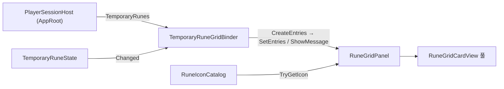

# 룬 Grid 패널

`Candidate_MainScene`의 `LeftArea`에 세션의 룬 라인을 정사각형 카드 Grid로 표시하는 표시 전용 UI입니다. 카드 하나가 `RuneLoadout`의 라인 하나이며, 카드 왼쪽 위에 겹친 배지에 라인 Weight(`RuneLoadoutLine.Weight`, 라인에 쌓인 룬 인스턴스 수)를 표시합니다. 구현 지침은 [candidate-main-scene-rune-grid.md](../instructions/candidate-main-scene-rune-grid.md)입니다.

## 구성 요소

| 타입 | 어셈블리·경로 | 책임 |
| --- | --- | --- |
| `RuneGridEntryDisplay` | `TxTRPG.UI`, `UI/Runtime/Runes/` | 표시 데이터(`Key` = 라인 ID, `DefinitionId`, `DisplayName`, `StackCount`). null 문자열은 빈 문자열, 음수 개수는 0 |
| `RuneIconCatalog` | 같은 위치(ScriptableObject) | 룬 정의 ID ↔ Sprite. ID는 앞뒤 공백 제거·대소문자 구분. `Validate`가 빈 ID·중복 ID를 보고하고, 조회는 첫 항목만 사용. Sprite가 없으면 아이콘 없음 |
| `RuneGridLayoutSettings`, `RuneGridPadding` | `RuneGridLayoutMath.cs` | 최소·최대 카드 크기(64·120), 간격 8, 안쪽 여백 8, 배지 크기 비율 0.33, 배지 돌출 비율 0.13. 읽을 때 유효 범위로 고정 |
| `RuneGridLayoutMath` | 같은 파일 | 열 수·셀·카드·배지 크기와 Content 높이를 계산하는 순수 함수 |
| `RuneGridLayoutGroup` | `LayoutGroup` 파생 | Content의 활성 카드 셀을 계산 결과대로 배치하고 Content의 선호 높이를 공급. 레이아웃 재계산 때만 동작. LayoutGroup 자체의 Padding·Child Alignment는 쓰지 않음 |
| `RuneGridCardView` | MonoBehaviour | 카드 하나의 표시(`Bind`, `Clear`, `ApplyProportions`). 아이콘이 있으면 `Icon`, 없으면 `FallbackLabel`. 배지는 100 이상이면 `99+` |
| `RuneGridPanel` | MonoBehaviour | `SetEntries`, `ShowMessage`, `SetIconCatalog`, `SetTooltips`. 카드 풀 재사용(줄면 비활성화, 파괴 안 함). 필수 참조가 없으면 오류 한 번 후 표시 중단. 카드를 바인딩할 때 툴팁 트리거에 `tooltipPresenter`·`tooltipCatalog`와 표시 데이터를 넘기고, 카드를 풀에 돌려줄 때 트리거를 해제합니다 |
| `RuneTooltipCatalog` | `UI/Runtime/Runes/`(ScriptableObject) | 룬 정의 ID ↔ `TooltipContent`. `RuneIconCatalog`와 같은 ID 규칙. 항목이 없으면 대체 툴팁 |
| `RuneGridCardTooltipTrigger` | 카드 루트 MonoBehaviour | 두 `HitArea`의 진입·이탈을 하나의 호버로 합쳐 룬 툴팁을 엽니다([툴팁](tooltips.md)). `ITooltipAnchor` 구현(기준 사각형 = `CardArea`) |
| `TemporaryRuneGridBinder` | `TxTRPG.Application`, `Application/Runtime/Runes/` | `PlayerSessionHost.TemporaryRunes`를 표시 데이터로 바꾸고 `TemporaryRuneState.Changed`에서 갱신. 룬 상태를 바꾸지 않음 |

UI 어셈블리의 룬 Grid는 Gameplay·Application 타입을 쓰지 않고 표시 데이터만 받습니다.

## 데이터 흐름



1. `Start`에서 `PlayerSessionHost.Instance`를 사용합니다. 없으면 경고 후 `룬 정보를 불러올 수 없습니다`를 표시합니다.
2. `WhenReady`를 기다립니다. 기다리는 동안 Binder가 파괴되면 연결하지 않고, 세션 초기화가 실패하면 실패 문구를 표시합니다.
3. `TemporaryRunes`가 null이면(설정 오류) `TemporarySlotCombatError`를 포함한 경고와 실패 문구를 표시합니다. 게임 진행은 막지 않습니다.
4. 연결되면 즉시 표시하고 `Changed`를 구독합니다. 라인이 없으면 `장착된 룬이 없습니다`를 표시합니다. `OnDisable`·`OnDestroy`에서 구독을 해제하고, 다시 활성화되면 재구독하고 현재 상태를 표시합니다.
5. `CreateEntries`는 라인 순서대로 `Key = LineId`, `DefinitionId = Loadout.DefinitionIdOf(line)`, 정의의 `DisplayName`, `StackCount = Weight`를 만듭니다. 정의가 없으면 이름은 `알 수 없는 룬`, `DefinitionId`는 빈 문자열입니다. 목록은 `Changed` 때만 만듭니다.

룬 상태는 세션 수명 동안만 유지되며 저장되지 않습니다.

## Prefab 계층

`Assets/TxTRPG/UI/Prefabs/Runes/RuneGridPanel.prefab`

```text
RuneGridPanel                     RuneGridPanel
├── Scroll View                   ScrollRect(세로만, Clamped, Scrollbar AutoHide)
│   ├── Viewport                  RectMask2D, 투명 Image(스크롤 입력 대상), 오른쪽 10은 Scrollbar 몫
│   │   └── Content               RuneGridLayoutGroup, ContentSizeFitter(세로 Preferred)
│   └── Scrollbar Vertical        폭 10, Navigation 없음
└── Message                       TMP_Text(빈 상태·실패 문구, 기본 비활성)
```

`Assets/TxTRPG/UI/Prefabs/Runes/RuneGridCard.prefab`

```text
RuneGridCard                      셀(레이아웃이 크기·위치 제어), RuneGridCardView, RuneGridCardTooltipTrigger
└── VisualRoot                    효과 적용 루트(셀 전체 Stretch)
    ├── CardArea                  앵커 비율로 셀 오른쪽 아래, 한 변 C
    │   ├── CardBackground        UiShapeGraphic 둥근 사각형(진한 남색)
    │   ├── Icon                  Image(preserveAspect)
    │   ├── FallbackLabel         TMP_Text(줄바꿈, 자동 크기, 말줄임)
    │   └── HitArea               Image(alpha 0, Raycast 대상, Stretch) — 툴팁 입력 대상
    └── BadgeArea                 앵커 비율로 셀 왼쪽 위, 한 변 C × 0.33
        ├── BadgeBackground       UiShapeGraphic 둥근 사각형(붉은색)
        ├── CountText             TMP_Text(굵게, 흰색, 자동 크기)
        └── HitArea               Image(alpha 0, Raycast 대상, Stretch)
```

- 카드와 배지의 표시 Graphic은 모두 `raycastTarget = false`입니다. 입력 대상은 Viewport의 투명 Image, Scrollbar, 카드마다 `CardArea/HitArea`·`BadgeArea/HitArea`(2026-10-25 추가)입니다. 셀의 빈 모서리(배지 돌출로 생긴 여백)는 입력 대상이 아닙니다. `HitArea`는 `VisualRoot` 아래에 있지만 표시가 없는 입력 전용 Graphic이므로, 효과는 `CardBackground`·`Icon` 같은 표시 요소에 적용합니다.
- `RuneGridCardTooltipTrigger`는 진입·이탈 처리기만 구현합니다. 휠·드래그 이벤트는 부모 `ScrollRect`로 전달되어 카드 위에서도 세로 스크롤이 동작합니다.
- Prefab에는 카드 인스턴스를 저장하지 않습니다. 카드는 실행 중 `RuneGridPanel`의 풀에서 만듭니다.
- 색과 모양은 Prefab에서 바꿀 수 있습니다. 색만으로 룬 종류를 구분하지 않으며 아이콘이 없으면 이름이 보입니다.
- 두 Prefab은 개발자 소유 자산이며 Prefab Rebuild 배치에 등록하지 않습니다([prefab-rebuild-registry.md](prefab-rebuild-registry.md)).

## 열 수와 크기 계산

배지가 카드 밖으로 돌출하므로 셀 크기는 `S = C × (1 + o)`(o = 돌출 비율)입니다. `W`는 Content 너비에서 좌우 여백을 뺀 값, `g`는 간격입니다.

1. `Smin = Cmin(1+o)`, `Smax = Cmax(1+o)`
2. `colsFit = max(1, floor((W+g)/(Smin+g)))`, `colsCap = max(1, ceil((W+g)/(Smax+g)))`, `cols = min(colsCap, colsFit)`
3. `S = min(Smax, (W − g(cols−1))/cols)`, `C = S/(1+o)`
4. `W < Smin`이면 1열, `S = W`(최소 크기 미만 허용). `W ≤ 0` 또는 NaN이면 1열, 크기 0
5. `rows = ceil(n/cols)`, Content 높이 = 상하 여백 + `rows·S + (rows−1)·g`

항상 `cols·S + (cols−1)·g ≤ W`이므로 가로 스크롤은 생기지 않습니다. 카드는 보통 행 너비를 채우며, 마지막 행은 왼쪽 정렬입니다. Scrollbar 폭은 Viewport 밖에 미리 확보되어 Scrollbar 표시 여부가 열 수를 바꾸지 않습니다.

## 아이콘 설정 자산과 대체 표시

- `RuneGridPanel.iconCatalog`가 없거나 `Validate`에 실패하면 경고를 한 번 남기고 모든 카드를 이름 카드로 표시합니다. 특정 룬의 Sprite가 없을 때도 그 카드만 이름 카드입니다.
- Editor의 Play 중 Inspector에서 `iconCatalog`를 바꾸면 표시 중인 카드를 다시 바인딩합니다.
- 임시 자산: `Assets/TxTRPG/UI/Icons/TemporaryRunes/attack.png`(칼), `heal.png`(십자), `test.png`(플라스크, 테스트 룬), `Assets/TxTRPG/UI/Styles/Runes/TemporaryRuneIconCatalog.asset`(`rune.attack`, `rune.heal`, `rune.test.tooltip`, `rune.test.long`. `rune.test.missing`은 이름 카드 확인용으로 등록하지 않음). 공용 Prefab의 기본값이 아니라 `Candidate_MainScene` 인스턴스의 Override로 지정되어 있습니다. 정식 아이콘이 생기면 자산을 교체합니다.

## `Candidate_MainScene` 배치

```text
Canvas/ScreenFrame/MainArea/ContentLayer/LeftArea/ContentLayer
└── RuneGrid      RuneGridPanel.prefab 인스턴스
                  + FlexibleLayoutItem(Weighted 1, Minimum·Maximum 0)
                  + TemporaryRuneGridBinder(panel = 자신의 RuneGridPanel)
                  iconCatalog = TemporaryRuneIconCatalog(Override)
                  tooltipPresenter = OverlayLayer/TooltipLayer의 TooltipPresenter(Override)
                  tooltipCatalog = TemporaryRuneTooltipCatalog(Override)
```

`RuneGridPanel.prefab` 자체의 `tooltipPresenter`·`tooltipCatalog`는 비어 있습니다. 둘 중 하나라도 없거나 카탈로그가 `Validate`에 실패하면 경고를 한 번 남기고 툴팁 없이 기존처럼 동작합니다.

`MainArea`가 너비 720 미만에서 세로 배치로 바뀌면 `LeftArea`가 넓고 낮아져 열 수가 늘고 세로 스크롤이 생길 수 있습니다. 2026-10-19부터 `MainArea`는 항상 1920 단위 너비인 화면 프레임 안에 있으므로 이 Scene에서는 세로 배치가 나타나지 않습니다.

## 효과 적용 위치

레이아웃이 제어하는 `RuneGridCard` 루트에는 효과를 넣지 않고 `VisualRoot`, `CardArea`, `BadgeArea`에 적용합니다. 카드 간격을 0으로 만들지 않아 외곽선·발광 공간을 남깁니다. 공유 Material 자산을 실행 중 수정하지 않습니다.

## 아직 없는 기능

카드 선택·클릭, 터치·게임패드로 상세 정보(툴팁) 보기(마우스 호버 툴팁만 있음, [툴팁](tooltips.md)), 드래그로 라인 바꾸기, 게임패드 포커스와 게임패드 스크롤, 라인에 없는 보유 룬 표시, 정식 룬 아트, 등장·변경 연출은 구현되어 있지 않습니다.
