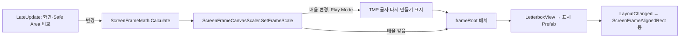

# 화면 프레임과 레터박스

16:9(1920×1080 Canvas 단위) 화면 프레임을 화면의 Safe Area 안에 균일하게 맞추고, 남는 영역을 바꿀 수 있는 레터박스로 채우는 구성 요소의 현재 구현입니다. 정책과 UI 작업 규칙은 [해상도 대응과 화면 프레임 정책](../development/resolution-and-screen-frame.md), 구현 지침은 [screen-frame-letterbox-resolution-policy.md](../instructions/screen-frame-letterbox-resolution-policy.md)에 있습니다.

2026-10-19에 `Candidate_MainScene`에 적용했습니다. `TMP_MainScene`은 이 구성을 쓰지 않습니다(Constant Pixel Size 유지).

## 구성 요소

코드는 `Assets/TxTRPG/UI/Runtime/ScreenFrame/`(어셈블리 `TxTRPG.UI`, 네임스페이스 `TxTRPG.UI.ScreenFrame`)에 있습니다.

| 타입 | 위치 | 책임 |
| --- | --- | --- |
| `ScreenFrameLayout` | 값 | 한 번 계산한 배치. `ScaleFactor`, `CanvasSize`, `FrameRect`, `SafeRect`, `TopBar`·`BottomBar`·`LeftBar`·`RightBar`(Canvas 단위, 원점은 Canvas 왼쪽 아래), `IsValid`. 크기 0인 막대도 담습니다. |
| `ScreenFrameMath` | 정적 | `Calculate(screenPixels, safeAreaPixels, referenceResolution)`. 아래 계산식 참조. |
| `ScreenFrameProfile` | ScriptableObject | `referenceResolution`(기본 1920×1080, 각 축 최소 1), `respectSafeArea`(기본 켜짐), `letterboxPresentation`(표시 Prefab, 비워 둘 수 있음), `fallbackLetterboxColor`(기본 검정). 메뉴 `TxT RPG/UI/Screen Frame Profile`. |
| `ScreenFrameCanvasScaler` | Canvas 루트 | `CanvasScaler` 상속. Scale With Screen Size로 고정하고 기준 해상도를 설정 자산과 동기화합니다. `ScreenFrameController`가 계산한 배율을 `SetFrameScale`로 받아 즉시 적용합니다. 컨트롤러가 없으면 `Canvas.renderingDisplaySize`와 `Screen.safeArea`로 직접 계산합니다. 설정 자산이 없으면 오류를 한 번 남기고 1920×1080으로 계산합니다. |
| `ScreenFrameController` | Canvas 루트 | `[ExecuteAlways]`, `[DefaultExecutionOrder(-100)]`. `LateUpdate`에서 화면 크기·Safe Area·기준 해상도·Safe Area 사용 여부를 이전 값과 비교하고, 바뀐 경우에만 다시 계산합니다. 배율을 Scaler에 전달하고, Play Mode에서 배율이 바뀌었으면 Canvas 아래 TMP 글자를 다시 만들도록 표시합니다(`regenerateTextOnScaleChange`, 기본 켜짐). 이어서 `frameRoot`를 구동하고(`DrivenRectTransformTracker`), `LetterboxView`에 배치를 넘긴 뒤 `LayoutChanged`를 발생시킵니다. `Current`는 마지막 유효 배치입니다. 입력 공급 지점은 `IScreenFrameInput`(`SetInput`)이며, 컨트롤러와 Scaler가 같은 입력을 씁니다. |
| `ScreenFrameTextRegeneration` | 정적 | `MarkForRegeneration(root, buffer)`. root 아래의 모든 `TMP_Text`(비활성 포함)에 `havePropertiesChanged = true`를 설정합니다. 목록은 재사용 버퍼로 모읍니다. |
| `IScreenFrameInput`, `UnityScreenFrameInput` | 인터페이스, 기본 구현 | 화면 크기와 Safe Area 공급. 기본은 `Screen.width`·`Screen.height`·`Screen.safeArea`. 테스트와 Play Mode 검증에서 바꿉니다. |
| `LetterboxView` | `LetterboxLayer` | Play Mode의 `Awake`에서 설정 자산의 표시 Prefab을 자식으로 하나 만들고, 인스턴스 루트의 `ILetterboxPresentation`에 배치를 전달합니다. 표시 Prefab이 없거나, 루트에 구현이 없거나, 표시가 예외를 던지면 대체 막대(`fallbackLetterboxColor`)로 바꾸고 오류를 한 번 남깁니다. `SetPresentation(prefab)`으로 실행 중 교체하며, 이전 인스턴스를 파괴하고 마지막 배치를 바로 전달합니다. 만든 표시 아래의 모든 Graphic은 `raycastTarget`을 끕니다. Edit Mode에서는 표시를 만들지 않습니다(Scene에 오브젝트가 추가되지 않음). |
| `ILetterboxPresentation` | 인터페이스 | `ApplyLayout(ScreenFrameLayout)`. 같은 배치가 여러 번 와도 결과가 같아야 합니다. |
| `LetterboxBarsPresentation` | 표시 Prefab 루트 | 기본 표시. `Top`·`Bottom`·`Left`·`Right` RectTransform(각각 `VisualRoot/Image`)을 막대 영역에 맞춥니다. 크기 0인 막대는 Image를 끕니다. 색은 직렬화 값이고, 막대마다 Image에 Sprite를 지정할 수 있습니다. `Create(parent, color)`가 같은 계층을 코드로 만듭니다(대체 막대, 적용 도구). |
| `ScreenFrameAlignedRect` | 화면 전체 레이어 안 | `controller.LayoutChanged`를 구독해 자기 RectTransform을 프레임 영역과 같게 맞춥니다. 앵커를 Canvas 대비 비율로 쓰므로 Canvas 크기 갱신 시점과 무관합니다. 부모는 Canvas 전체를 덮어야 합니다. 그래픽이 없어 입력을 막지 않습니다. 컨트롤러가 없으면 부모 전체로 늘어나고 경고를 한 번 남깁니다. |

## 계산식

```text
Safe = Screen.safeArea ∩ 화면 (respectSafeArea가 꺼져 있거나, 비었거나, 화면과 겹치지 않으면 화면 전체)
배율 = min(Safe.width / 기준.x, Safe.height / 기준.y)
Canvas 크기 = 화면 / 배율
프레임 = 기준 크기, Safe 가운데에 놓음 (Canvas 단위)
위·아래 막대 = Canvas 너비 전체, 왼쪽·오른쪽 막대 = 프레임 높이
```

화면 크기가 0 이하이거나 NaN이면 `IsValid = false`이고, 컨트롤러는 마지막 유효 배치를 유지합니다(창 최소화 등).

## 갱신 순서



컨트롤러는 실행 순서 -100으로 먼저 실행되므로, 같은 프레임의 `LateUpdate`에서 프레임을 기준으로 배치하는 요소(`SlotReelDock`)는 새 프레임 위치를 봅니다.

`Screen.width`는 Editor에서 Canvas 렌더링 직전(`Canvas.preWillRenderCanvases`)에 다른 Editor 창의 크기를 반환할 수 있습니다. 그래서 배율은 `LateUpdate`에서 읽은 값으로 컨트롤러가 정하고 Scaler는 그 값을 씁니다.

## 계층

```text
Canvas                          Canvas(Screen Space - Overlay), ScreenFrameCanvasScaler, GraphicRaycaster, ScreenFrameController
├── ScreenFrame                 왼쪽 아래 앵커·피벗, 1920×1080, 컨트롤러가 구동
│   ├── (화면 레이아웃 루트)
│   └── OverlayLayer            Stretch
├── LetterboxLayer              Stretch, LetterboxView (ScreenFrame보다 뒤 = 위에 그림)
└── ScreenOverlayLayer          Stretch, 모달 배경처럼 레터박스까지 덮을 요소
```

| 자산 | 경로 | 내용 |
| --- | --- | --- |
| `DefaultScreenFrameProfile.asset` | `Assets/TxTRPG/UI/Styles/ScreenFrame/` | 1920×1080, Safe Area 반영, 표시 Prefab `DefaultLetterboxPresentation`, 대체 색 검정 |
| `DefaultLetterboxPresentation.prefab` | `Assets/TxTRPG/UI/Prefabs/ScreenFrame/` | `LetterboxBarsPresentation` 루트(Stretch), `Top`·`Bottom`·`Left`·`Right/VisualRoot/Image`(검정, `raycastTarget` 꺼짐) |
| `ScreenFrameCanvas.prefab` | `Assets/TxTRPG/UI/Prefabs/ScreenFrame/` | 새 Scene용 Canvas. 위 계층이며 `ScreenFrame` 아래에는 빈 `OverlayLayer`만 있습니다. |

세 자산은 개발자 소유 자산이며 Prefab Rebuild 배치에 등록하지 않습니다([prefab-rebuild-registry.md](prefab-rebuild-registry.md)).

### `Candidate_MainScene`

```text
Canvas                          ScreenFrameCanvasScaler(DefaultScreenFrameProfile), ScreenFrameController
├── ScreenFrame
│   ├── MainArea                FlexibleLayoutPanel.prefab 인스턴스(Stretch)
│   └── OverlayLayer            SlotReelDockClip(RectMask2D) > SlotReelDock, EncounterDebugPanel, TooltipLayer(TooltipPresenter, 마지막 자식)
├── LetterboxLayer              LetterboxView(DefaultScreenFrameProfile)
├── ScreenOverlayLayer
│   └── EncounterResultModal    ModalWindowHost(화면 전체 배경) / FrameArea(ScreenFrameAlignedRect) / WindowFrame / Window
└── EncounterRollController
```

`TooltipLayer`(2026-10-25)는 `ScreenFrame` 안에 있으므로 툴팁은 레터박스 위에 그려지지 않습니다. `TooltipPresenter`는 `ScreenFrame` RectTransform을 직렬화 참조로 받아 `TooltipLayer` 로컬 좌표의 프레임 사각형을 구하고, 툴팁 상자를 그 안(여백 8)에 놓습니다. 툴팁은 독·디버그 패널 위, 결과 모달(`ScreenOverlayLayer`) 아래에 그려집니다. 프레임 배율이나 크기가 바뀌면 열린 툴팁을 닫습니다([툴팁](tooltips.md)).

`EncounterResultModal` 인스턴스의 `FrameArea.controller`는 Scene의 `ScreenFrameController`를 가리키는 인스턴스 Override입니다. 모달이 열릴 때의 `SetAsLastSibling`은 `ScreenOverlayLayer` 안에서만 순서를 바꿉니다.

`Main Camera`의 화면 영역(`Camera.rect`)은 프레임에 맞추지 않습니다. `Candidate_MainScene`에는 아직 월드 화면이 없으며, 월드 화면을 추가할 때 정책을 정합니다.

## 실패 동작

| 상황 | 동작 |
| --- | --- |
| 설정 자산 없음 | 1920×1080, Safe Area 반영, 검은 대체 막대. Scaler와 `LetterboxView`가 각각 오류를 한 번 남깁니다. |
| 표시 Prefab 없음 / 루트에 `ILetterboxPresentation` 없음 | 대체 막대. 구현이 없으면 오류를 한 번 남깁니다. |
| 표시가 `ApplyLayout`에서 예외 | 표시를 파괴하고 대체 막대로 바꾼 뒤 오류와 예외를 한 번 남깁니다. |
| Safe Area 비정상 | 화면 전체로 계산합니다. |
| 화면 크기 0 | 마지막 유효 배치를 유지합니다. |
| `ScreenFrameAlignedRect`에 컨트롤러 없음 | 부모 전체로 늘어나고 경고를 한 번 남깁니다. |
| 컨트롤러 비활성 | Scaler가 다시 직접 계산합니다(`ClearFrameScale`). |

## 확장 지점

- 레터박스 모양: `ILetterboxPresentation`을 루트에 구현한 Prefab을 만들고 설정 자산(또는 Scene별 새 설정 자산)에 연결합니다. 작성 방법은 [해상도 대응과 화면 프레임 정책](../development/resolution-and-screen-frame.md)의 3.3절에 있습니다.
- 프레임에 맞출 화면 전체 요소: `ScreenOverlayLayer` 아래 요소의 본문을 `ScreenFrameAlignedRect` 아래에 두고 Scene에서 컨트롤러 참조를 저장합니다.
- 화면 값 공급: `IScreenFrameInput`(테스트, Safe Area 모의).

## 배율 변경과 TMP 글자 선명도

Screen Space - Overlay Canvas에서 TextMeshPro는 메시를 만들 때 글자 가장자리(SDF) 값을 `lossyScale / canvas.scaleFactor`로 계산하므로 Canvas 배율과 무관합니다. 그런데 이미 만든 메시는 `lossyScale`이 20% 넘게 바뀌면 매 프레임 확인(`TextMeshProUGUI.InternalUpdate` → `UpdateSDFScale`)에서 기존 값에 변화량을 곱합니다. 그래서 배율이 바뀐 뒤 다시 만들어지지 않은 글자는 굵거나 흐리게 보였습니다(Game View 배율 0.526 → 1에서 1920×1080 캡처의 글자 가장자리 픽셀 약 0.36%가 적용 전과 다름).

`ScreenFrameController`는 Play Mode에서 배율이 실제로 바뀐 경우에만(같은 배율의 화면 크기 변경은 제외) Canvas 아래 모든 TMP 글자를 다시 만들도록 표시합니다. 표시된 글자는 다음 Canvas 렌더 직전에 새 배율로 다시 만들어지고 위 곱셈 경로는 건너뜁니다. 비활성 글자는 표시가 남아 있다가 켜질 때 다시 만들어집니다. 2026-10-19 확인에서 같은 절차의 캡처가 적용 전과 픽셀 단위로 같았습니다.

- 비용: 배율이 바뀐 프레임에 Canvas 아래 글자 전체를 다시 만들고 레이아웃을 다시 계산합니다. 창을 끌어서 크기를 바꾸는 동안에는 매 프레임 발생하며, 크기가 그대로이면 비용이 없습니다. 2026-10-19 사용자 결정으로 지연 없이 즉시 다시 만듭니다. 실제 기기 비용은 측정하지 않았습니다.
- Edit Mode에서는 하지 않습니다. 글자를 변경 상태로 표시하면 Scene이 변경된 것으로 기록되기 때문입니다.
- 이 Canvas 밖의 TMP 글자(다른 Canvas, `PersistentAppRoot`)는 대상이 아닙니다.

## 알려진 제한
- Device Simulator의 실제 노치 기기와 실제 휴대폰에서는 아직 확인하지 않았습니다. Safe Area는 Play Mode에서 입력 주입(2400×1080, Safe Area x 132·y 63·2268×1017)으로만 확인했습니다.
