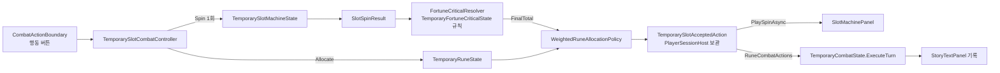

# 슬롯머신과 룬 기반 전투 행동

`TMP_MainScene`의 임시 전투에서 플레이어 행동은 슬롯머신(SlotMachine)과 룬(Rune)으로 정합니다. 슬롯머신은 숫자만 정합니다. 각 Reel의 Payline(가운데 줄)에 멈춘 숫자를 더한 값에 [Fortune Critical](#fortune-critical) 배수를 적용한 값이 이번 턴의 총합입니다. 어떤 행동을 할지는 룬 줄이 정합니다. 총합은 룬 줄의 가중치 비율로 자동 분배되고, 각 줄은 분배받은 수치로 행동을 한 번씩 수행합니다. 주사위 시스템은 코드와 자산을 남긴 채 보류 상태이며, `TMP_MainScene`에서는 꺼져 있습니다([주사위 보류](#주사위-보류)).

이 문서는 현재 구현을 설명합니다. 구현 지침은 [`DOCS/instructions/slot-machine-and-rune-combat.md`](../instructions/slot-machine-and-rune-combat.md)와 [`DOCS/instructions/slot-fortune-critical.md`](../instructions/slot-fortune-critical.md)입니다.

## 전체 흐름



| 어셈블리 | 구성 요소 |
| --- | --- |
| `TxTRPG.Gameplay` | `IRandomIndexProvider`(공용 난수 계약), `SlotMachine` 네임스페이스(`SlotSymbol`, `SlotReel`, `SlotMachine`, `SlotReelStop`, `SlotSpinResult`, Fortune Critical 규칙·가중치 함수·판정기), `Runes` 네임스페이스(정의·보유·줄·분배), 전투 입력 `PlayerCombatAction`. Unity에 의존하지 않습니다. |
| `TxTRPG.Application` | 설정 자산, 세션 상태(Fortune Critical 포함), `TemporarySlotCombatController`, 수락·턴 기록, `RuneCombatActions`, `SlotCombatStoryFormatter`, 공용 `ITemporaryCombatController`·`TemporaryCombatStoryText`·`TemporaryCombatPresentationTimeout`. |
| `TxTRPG.UI` | `SlotMachinePanel`, `SlotReelViewBase`/`SlotReelView`, 배치(`SlotMachineContentLayout`, `SlotReelAreaLayout`), `SlotPaylineFrameGraphic`, 스킨(`SlotMachinePanelSkin`, `SlotMachinePanelSkinCatalog`, `SlotSkinImage`, `SlotSkinColor`, `SlotSkinOffset`, `SlotSkinGraphicTarget`, `SlotSkinTextTarget`), 룬 표(`SlotRuneTableView`, `SlotRuneLineRow`), `SlotHeightScaledText`, Fortune 배수 배치(`SlotTotalMultiplierLayout`), 회전 연출(`SlotReelSpinProfile`, `SlotReelSpinSettings`, `SlotEasing`, `SlotReelSpinPlanner`, `SlotReelSpinPlan`, `SlotReelSpinCurve`), 표시용 구조(`SlotReelDisplay`, `SlotReelStopDisplay`, `SlotRuneLineDisplay`, `SlotSummaryDisplay`, `SlotSpinDisplay`). Gameplay·Application 타입을 쓰지 않습니다. |

주사위 도메인(`TxTRPG.Gameplay.Dice`)과 슬롯머신·룬 도메인은 서로 참조하지 않습니다. 기존 `IRandomIndexSource`는 이름과 위치를 그대로 둔 채 `IRandomIndexProvider`를 상속하도록 바꿨으므로 주사위 호출부는 바뀌지 않았습니다. 두 시스템이 만나는 곳은 전투 입력 `PlayerCombatAction`뿐입니다.

## Gameplay 도메인

### 슬롯머신

| 타입 | 책임 |
| --- | --- |
| `SlotSymbol` | Reel 한 칸의 불변 값(`Value` ≥ 0)입니다. 특수 기호나 이미지 키를 나중에 추가할 수 있도록 `int`를 감쌌습니다. |
| `SlotReel` | 불변입니다. 안정적인 `Id`와 순서 있는 Strip을 가집니다. 칸마다 같은 확률로 멈추므로 같은 값을 여러 칸에 두면 가중치처럼 동작합니다. `WithSymbol`·`WithInsertedSymbol`·`WithoutSymbol`·`WithStrip`은 검증한 새 Reel을 돌려줍니다. |
| `SlotMachine` | 순서 있는 Reel 목록입니다. `TryAddReel`·`TryRemoveReel`·`TryReplaceReel`·`TryReplaceAll`·`TrySetSymbol`·`TryAddSymbol`·`TryInsertSymbol`·`TryRemoveSymbol`·`TryReplaceStrip`은 후보 구성을 검증한 뒤에만 반영하고 `Changed`를 발생시킵니다. 실패하면 이전 구성을 유지하고 사유를 돌려줍니다. Reel은 최소 1개이며, 빈 Strip·음수·중복 ID·`Reel 수 × 최대값`이 `int` 범위를 넘는 구성은 거부합니다. |
| `SlotSpinResult` | `Spin(IRandomIndexProvider)`의 불변 스냅샷입니다. Reel 순서대로 한 번씩 추첨한 `SlotReelStop`(ReelId, 정지 인덱스, Payline 값, Strip 복사본, 순환하는 위·아래 칸)과 `PaylineTotal`을 가집니다. 이후 구성 변경과 무관합니다. |

Payline은 가운데 줄 하나입니다. 여러 Payline이나 기호 조합 판정은 없으며, 필요하면 `SlotSpinResult`를 입력으로 받는 별도 판정기를 추가합니다.

### 룬

| 타입 | 책임 |
| --- | --- |
| `RuneEffectKind` | `Unknown=0`, `Attack=1`, `Heal=2`로 값이 고정돼 있습니다. `Unknown`과 지원하지 않는 값은 거부합니다. |
| `RuneDefinition`, `RuneDefinitionCatalog` | 룬 종류의 불변 정의(ID, 표시 이름, 효과)와 ID 조회 목록입니다. 카탈로그는 중복 ID를 거부합니다. |
| `OwnedRune`, `RuneInventory` | 보유 룬 한 개(`InstanceId`, `DefinitionId`)와 보유 목록입니다. 목록은 `TryAdd`·`TryRemove`·`Snapshot`·`Changed`를 제공합니다. 줄에 놓인 룬은 제거를 거부합니다. 보상 기능은 이후 `TryAdd`를 호출합니다. |
| `RuneLoadoutLine`, `RuneLoadout` | 룬 줄(`LineId`, 쌓인 룬 인스턴스 ID 목록, `Weight` = 룬 개수)과 줄 목록입니다. 줄 추가·삽입·제거, 룬 겹치기·빼기, 전체 교체를 원자적으로 검증하고 `Changed`를 발생시킵니다. 마지막 룬을 빼면 그 줄도 제거됩니다. 인벤토리 하나에는 Loadout 하나만 연결됩니다. |
| `RuneAllocation`, `RuneAllocationLine` | 분배 결과의 불변 스냅샷입니다. 줄 순서대로 순번, `LineId`, 정의 ID·이름, 효과, 가중치, 분배 수치를 가지며 합계가 총합과 같은지 생성 시 검사합니다. |

줄 규칙은 다음과 같습니다.

- 한 줄은 룬 1개 이상이며 모두 같은 정의입니다.
- 같은 종류를 여러 줄에 나눠 둘 수 있습니다.
- 한 인스턴스는 최대 한 줄에만 둘 수 있습니다.
- 줄에 놓인 룬은 모두 보유 중이어야 합니다.
- 어느 줄에도 놓이지 않은 룬은 행동하지 않습니다.

### 가중치 자동 분배

`IRuneAllocationPolicy.Allocate(total, loadout, catalog)`가 변형 지점이며, 현재 구현은 `WeightedRuneAllocationPolicy`뿐입니다. 이 정책은 최대 나머지 방식을 씁니다.

1. 각 줄의 기본 몫은 `floor(total × weight / W)`입니다(`long` 계산).
2. 남은 값은 나머지(`total × weight mod W`)가 큰 줄부터 1씩 받고, 나머지가 같으면 앞선 줄이 먼저 받습니다.

분배 합계는 항상 총합과 같고, 같은 입력이면 결과도 같습니다. 줄이 없거나 가중치 합이 0이면 `InvalidOperationException`을 던집니다. 컨트롤러는 이 상태에서 행동을 실행 불가로 둡니다.

### 전투 입력

`TemporaryCombatState.ExecuteTurn(IReadOnlyList<PlayerCombatAction>)`이 기본 입력입니다. `PlayerCombatAction`은 종류(`Attack`·`Heal`), 수치, 출처 ID로 이루어집니다. 처리 순서와 규칙은 바뀌지 않았습니다.

1. 공격과 회복을 순서대로 적용합니다. 적이 이미 쓰러졌으면 공격은 `PlayerAttackSkipped`로 기록합니다.
2. 적이 살아 있으면 예고된 적 행동을 수행합니다.
3. 승리 또는 패배 이벤트를 남깁니다.

플레이어 이벤트의 `TemporaryCombatEvent.SourceId`에는 출처 ID(룬 줄의 `LineId`)가 들어갑니다. 기존 5인자 생성자는 빈 `SourceId`로 그대로 동작합니다.

주사위용 `ExecuteTurn(IReadOnlyList<DiceRollResult>)`은 결과를 행동으로 바꿔 위 메서드에 위임합니다. 변환을 먼저 끝내므로 지원하지 않는 주사위 효과는 상태를 하나도 바꾸기 전에 거부됩니다. 이전에는 앞선 면을 적용한 뒤 예외가 났습니다.

## 설정과 세션 상태

| 자산·타입 | 내용 |
| --- | --- |
| `Assets/TxTRPG/Application/Configuration/TemporarySlotMachineConfiguration.asset` (`TemporarySlotMachineConfiguration`) | Reel 목록(ID, 값 목록). 기본값은 `reel.1`·`reel.2`·`reel.3`이고 각 값은 `1, 2, 3, 4, 5, 6`입니다. |
| `Assets/TxTRPG/Application/Configuration/TemporaryRuneConfiguration.asset` (`TemporaryRuneConfiguration`) | 정의 `rune.attack`(공격 룬, Attack), `rune.heal`(회복 룬, Heal). 보유 `rune.attack.1`, `rune.heal.1`. 줄 `line.1`(공격 룬 ×1), `line.2`(회복 룬 ×1). Inspector에서 바꿀 수 있는 임시값입니다. |
| `TemporarySlotMachineState` | 세션 수명의 `SlotMachine` 복사본입니다. `Machine`의 변경 API를 쓰며 `Changed`를 전달합니다. |
| `TemporaryRuneState` | 세션 수명의 `Catalog`·`Inventory`·`Loadout`입니다. 보유와 줄의 `Changed`를 합쳐 전달하고, `CanAllocate`와 `Allocate(total, policy)`를 제공합니다. `Candidate_MainScene` LeftArea의 [룬 Grid](rune-grid-panel.md)가 줄마다 카드 하나와 Weight 배지로 표시합니다(`TemporaryRuneGridBinder`). |
| `Assets/TxTRPG/Application/Configuration/TemporaryFortuneCriticalConfiguration.asset`, `TemporaryFortuneCriticalState` | Fortune Critical 규칙의 설정 자산과 세션 상태입니다. [Fortune Critical](#fortune-critical)에서 설명합니다. |

`PlayerSessionHost`(`AppRoot.prefab`)의 `temporarySlotMachineConfiguration`·`temporaryRuneConfiguration`이 두 자산을 참조합니다. Fortune Critical 설정은 별도 필드 `temporaryFortuneCriticalConfiguration`이 참조하며 같은 시점에 복사합니다. Awake와 `EnsureInitializedAsync`에서 한 번 복사하며, 원본 자산은 실행 중 바뀌지 않습니다.

설정이 비었거나 잘못돼도 게임 시작은 막지 않습니다. 이때 상태를 만들지 않고 `TemporarySlotCombatError`에 사유를 남기며, 잘못된 경우에는 `Debug.LogError`도 기록합니다. 컨트롤러는 행동을 실행 불가로 두고, 패널 `StatusText`에 사유를 보여 줍니다.

룬과 슬롯머신 상태는 저장하지 않습니다. 저장 데이터와 `PlayerState`도 바뀌지 않았습니다. 정의·인스턴스·줄·Reel ID는 이후 저장과 조합을 위한 안정적인 문자열입니다.

## 전투 컨트롤러

`TemporarySlotCombatController`(`Assets/TxTRPG/Application/Runtime/SlotMachine/`)는 `IGameMenuCommandHandler`, `ISceneInitializer`(InitializationOrder -800), `ITemporaryCombatController`를 구현합니다. 명령 ID는 `temporary-slot.spin`입니다. `TMP_MainScene`에서는 `GameMenuPanel` 오브젝트에 보류된 주사위 컨트롤러와 함께 붙어 있습니다.

| 직렬화 필드 | 대상 |
| --- | --- |
| `menu`, `actionButton`, `storyPanel` | `GameMenuPanel`, `CombatActionBoundary`, `StoryTextPanel` |
| `combatConfiguration`, `enemyPanel`, `playerHealthBar`, `enemyHealthBar`, `nextEnemyActionText` | 주사위 컨트롤러와 같은 참조 |
| `slotPanel` | `SlotMachinePanel` |
| `spinTimeoutSeconds`(3), `spinTimeoutMarginSeconds`(1) | 연출 제한 시간 규칙 |

`CanExecute`는 주사위 컨트롤러와 같은 조건을 검사합니다. 실행 중이 아니어야 하고, 공용 행동 잠금이 비어 있어야 하며, 게임 창이 차단 중이 아니어야 합니다. 전투가 준비되어 있고 끝나지 않았으며 Story가 준비되어 있어야 합니다. 여기에 더해 Reel이 1개 이상이고 `TemporaryRuneState.CanAllocate`가 참이어야 합니다.

한 번의 실행은 다음 단계로 나뉩니다.

1. `PlayerSessionHost.TryBeginTemporaryCombatAction`으로 공용 행동 잠금을 얻습니다. 기존 `TryBeginTemporaryDiceAction`·`EndTemporaryDiceAction`은 같은 잠금에 위임하는 별칭입니다.
2. 회전과 분배를 수락합니다. `Spin`을 한 번 호출하고, 그 결과에 `FortuneCriticalResolver.Resolve`로 Fortune Critical을 판정한 뒤, 최종 합계(`FinalTotal`)를 그 시점의 룬 줄로 분배합니다. 최종 합계가 `int` 범위를 넘으면 `OverflowException`으로 수락이 실패하고, 기존 실패 경로가 오류를 기록하고 잠금을 풀며 상태를 바꾸지 않습니다. run·node·전투와 함께 `TemporarySlotAcceptedAction`으로 묶어 `AcceptTemporarySlotAction`으로 세션에 보관합니다. 이후에는 다시 돌리지 않습니다.
3. 패널 연출을 기다립니다. 제한 시간은 `TemporaryCombatPresentationTimeout.Resolve(최소, panel.GetMaximumPresentationSeconds(Reel 수) + 여유)`(1~15초)입니다. 최대 연출 길이는 회전 연출 설정 자산에서 계산합니다([회전 연출](#회전-연출)). 시간을 넘기거나 연출이 실패하면 `StopAtResult`로 결과를 바로 보여 줍니다. 패널이 없거나 비활성이면 연출 없이 진행합니다.
4. 수락 당시의 세션·전투·run·node가 그대로인지 확인합니다. 그대로이면 `RuneCombatActions.FromAllocation`으로 줄 순서의 행동 목록을 만들고 `ExecuteTurn`을 정확히 한 번 호출합니다. 수치 0인 줄은 목록에서 빠집니다. 일부가 실패해도 다시 실행하지 않습니다.
5. `PublishTemporarySlotStory`로 Story 기록을 발행합니다. 적·체력·예고 표시를 갱신하고, 전투가 끝났으면 `NotifyTemporaryCombatCompleted`와 `CombatFinished`를 호출합니다.
6. 수락 기록과 잠금을 해제합니다. 잠금 해제 시 `TemporaryCombatActionEnded`가 발생하고 실행 가능 상태가 갱신됩니다.

수락 기록(`TemporarySlotAcceptedAction`)과 턴 기록(`TemporarySlotTurnRecord`)은 `Fortune`(`FortuneCriticalResult`)을 함께 가집니다. 기존 생성자는 `FortuneCriticalResult.None(spin)`을 씁니다. 수락된 결과는 세션이 보관합니다. Scene이 다시 로드되면 진행 중이던 작업이 세션 참조로 결과를 한 번 적용합니다. 새 컨트롤러는 같은 전투에 다시 연결되고, `PendingSlotAction` 또는 현재 노드의 `LastTemporarySlotTurn`을 저장된 Fortune 결과와 함께 패널에 정지 상태로 보여 줍니다. 그다음 `PendingSlotStory`를 새 Story에 한 번 기록하고, `TemporaryCombatActionEnded`에서 버튼과 표시를 갱신합니다. 게임 창을 열고 닫아도 결과는 바뀌지 않습니다. 컨트롤러는 슬롯머신·룬 상태의 `Changed`를 받아 패널을 갱신합니다. 구독은 `OnDestroy`에서 해제하며, 파괴된 인스턴스는 남은 세션 이벤트를 무시합니다.

### 탐험 이벤트의 슬롯 판정

탐험 이벤트의 슬롯 판정(`ExplorationEventController`)은 같은 세션 Reel과 Fortune Critical 규칙으로 돌리고 같은 `SlotMachinePanel` 연출을 씁니다. 판정은 최종 합계로 하며 룬 분배와 전투 턴은 없습니다. 전투 없이 공용 행동 잠금을 얻도록 `PlayerSessionHost.TryBeginTemporarySlotPresentation(out actionId)` 오버로드가 있고(`IsTemporaryActionHeld`로 확인), 해제는 같은 `EndTemporaryCombatAction`입니다. 기존 `TryBeginTemporaryCombatAction`과 별칭의 동작은 바뀌지 않았습니다. 표시 데이터는 `TemporarySlotCombatController.CreateSpinDisplay(spin, fortune, weightLines)` 오버로드와 공개된 `WeightLines(TemporaryRuneState)`로 만들어, 룬 표가 회전 중·정지 후 모두 쌓인 수(`×N`)를 보여 줍니다. `RefreshSlotPanel`은 현재 노드의 이벤트 기록(`PlayerSessionHost.ActiveExplorationEvent`)에 슬롯 판정이 있으면 합계·룬 표를 유휴 표시로 덮어쓰지 않습니다. 이벤트 효과는 `TemporarySlotMachineState`·`TemporaryRuneState`·`TemporaryFortuneCriticalState`(Gameplay 계약 `IFortuneCriticalRuleStore` 구현)를 직접 바꾸며, 상태 `Changed`로 패널이 갱신되고 다음 전투부터 반영됩니다. 자세한 흐름은 [탐험 이벤트 노드와 이벤트 시스템](exploration-events.md#슬롯-판정)에 있습니다.

`ExplorationRunController`는 `ITemporaryCombatController`를 통해 전투를 시작하고 정리합니다. Unity가 인터페이스 필드를 직렬화하지 않으므로 필드는 `MonoBehaviour combatControllerBehaviour`이고, `[FormerlySerializedAs("combatController")]`로 기존 참조를 유지합니다. 초기화와 `ConfigureForEditor`·`ConfigureCombatForEditor`는 인터페이스를 구현하지 않은 컴포넌트를 거부합니다.

## Story 기록

`SlotCombatStoryFormatter`가 문구를 만듭니다. 적 행동, 승리·패배, 공격 건너뜀 문구는 주사위 경로와 공유하는 `TemporaryCombatStoryText`를 씁니다.

```text
[슬롯] 3 + 5 + 2 = 10
[룬] 1번 줄 공격 룬 ×1: 5
[전투] 테스트 적에게 피해 5. 체력 35/40.
[룬] 2번 줄 회복 룬 ×1: 5
[전투] 플레이어 회복 요청 5, 실제 회복 0. 체력 30/30.
[적 행동] 공격 5. 플레이어가 받은 피해 5. 체력 25/30.
```

Fortune Critical이 발생하면 `[슬롯]` 줄이 배수를 표시하고 `[행운 치명]` 줄이 뒤따릅니다([Fortune Critical의 Story 문구](#story-문구)). 각 줄의 전투 결과는 이벤트 순서가 아니라 `SourceId`로 그 줄에 연결합니다. 분배 0인 줄은 `[룬] 2번 줄 회복 룬 ×1: 0 (실행하지 않음)`으로 기록합니다. 슬롯머신 경로에는 결과 창이 없으며, 결과는 StoryTextPanel에만 기록합니다.

## Fortune Critical

Fortune Critical(행운 치명)은 회전 결과에 일정 확률로 정수 배수를 곱합니다. 각 Reel이 독립적으로 판정하고, 합계도 따로 판정합니다. 판정은 회전을 수락할 때 한 번만 하며, 결과는 회전 결과와 별도의 불변 스냅샷(`FortuneCriticalResult`)으로 보관합니다. `SlotSpinResult`와 `SlotMachine.Spin`은 바뀌지 않았습니다. 구현 지침은 [`DOCS/instructions/slot-fortune-critical.md`](../instructions/slot-fortune-critical.md)이며, 배수 분포 함수의 비교 분석은 그 문서의 부록에 있습니다.

### 계산 규칙

| 기호 | 의미 |
| --- | --- |
| `vᵢ` | Reel i의 Payline 값 |
| `rᵢ` | Reel i의 배수. 발생하지 않으면 1 |
| `t` | 합계 배수. 발생하지 않으면 1 |
| `C` | 유효 배수 상한 `MaximumEffectiveMultiplier` |
| `eᵢ = min(C, rᵢ × t)` | Reel i의 유효 배수 |
| `F = Σ vᵢ × eᵢ` | 최종 합계. 룬 분배와 전투에 씁니다. |

상한이 적용되지 않으면 `F = t × Σ(vᵢ × rᵢ)`입니다. 예를 들어 `v = (3, 5, 2)`, 2번 Reel ×10, 합계 ×5, `C = 30`이면 `e = (5, 30, 5)`이고 `F = 175`입니다. 최종 값은 `long`과 `checked`로 계산하며, `F`가 `int`를 넘으면 `OverflowException`을 던집니다.

판정 순서는 Reel 결과 순서대로 각 Reel, 그다음 합계입니다. 난수는 `IRandomIndexProvider` 하나로 뽑으며 해상도는 백만분율(`FortuneCriticalLimits.ProbabilityResolution`)입니다.

- 발생: 임계값 `k = round(p × 1,000,000)`. `NextIndex(1,000,000) < k`이면 발생합니다. `k = 0`이면 난수를 뽑지 않고 발생하지 않으며, `k = 1,000,000`이면 난수를 뽑지 않고 발생합니다.
- 배수: 배수별 백만분율 누적표에서 `NextIndex(1,000,000)`으로 고릅니다. 최소 배수와 최대 배수가 같으면 난수를 뽑지 않습니다.

`TemporarySlotCombatController`는 회전 난수와 별도로 `fortuneRandom`을 가집니다. 기본값은 GUID로 시드를 정한 `SystemRandomIndexProvider`입니다. 같은 시각에 만든 `System.Random` 두 개가 같은 시드를 받아 회전과 Fortune 판정이 상관되는 일을 막기 위해서입니다. 테스트는 `SetFortuneRandomForTests`로 주입합니다.

### Gameplay 타입

`Assets/TxTRPG/Gameplay/Runtime/SlotMachine/FortuneCritical/`의 타입은 모두 `TxTRPG.Gameplay.SlotMachine` 네임스페이스에 있으며 Unity에 의존하지 않습니다.

| 타입 | 책임 |
| --- | --- |
| `FortuneCriticalLimits` | 최소 배수 2, 절대 상한 100, 유효 배수 상한의 상한 10,000(100 × 100), 확률 해상도 1,000,000 |
| `IFortuneWeightFunction`, `FortuneFunctionParameter`, `FortuneFunctionArguments` | 가중치 함수 계약, 이름·기본값·범위·설명을 가진 매개변수, 불변 이름→값 인자. 인자 이름은 앞뒤 공백을 제거하고 `Ordinal`로 비교하며 중복을 거부합니다. |
| 기본 함수 6개, `FortuneWeightFunctionRegistry` | 아래 표. 레지스트리는 ID → 함수이며 중복 ID를 거부합니다. `Default`에 명시적으로 등록합니다. |
| `FortuneMultiplierDistribution` | 함수 ID와 인자, 또는 최소 배수부터의 가중치 표(`FortuneDistributionSource.Function`·`Table`). 불변입니다. |
| `FortuneMultiplierTable` | 정수 확률표. 배수별 백만분율·확률, `ExpectedMultiplier`(E[n]), 백만분율 0으로 잘린 배수 목록(`UnreachableMultipliers`)을 제공합니다. |
| `FortuneCriticalRule` | 확률 `Chance`(0~1), 최소·최대 배수, 분포, 미리 만든 확률표. `TryCreate`로 검증하고, `TryWithChance`는 같은 확률표를 쓰는 새 규칙을 돌려줍니다. `ExpectedMultiplier = 1 + p × (E[n] − 1)`. |
| `FortuneCriticalRules` | Reel 기본 규칙, Reel ID별 규칙(순서 있는 목록), 합계 규칙, `C`. 불변이며 `TryWith...`가 검증한 새 인스턴스를 돌려줍니다. `Disabled`는 모든 확률이 0입니다. |
| `FortuneCriticalResolver` | `Resolve(SlotSpinResult, FortuneCriticalRules, IRandomIndexProvider) → FortuneCriticalResult` |
| `FortuneCriticalResult`, `FortuneCriticalReelResult` | 불변 스냅샷. Reel마다 `ReelId`, `BaseValue`, `ReelMultiplier`, `UncappedMultiplier`, `EffectiveMultiplier`, `FinalValue`, `IsCritical`, `IsCapped`. 전체는 `TotalMultiplier`, `MaximumEffectiveMultiplier`, `BaseTotal`, `FinalTotal`, `HasAnyCritical`, `IsAnyCapped`. `None(spin)`은 모든 배수가 1입니다. |

규칙 선택은 Reel의 `ReelId`로 Reel별 규칙을 찾고, 없으면 기본 규칙을 씁니다. 실행 중 `TryAddReel`로 추가한 Reel도 같은 규칙을 따르므로 Reel 추가 때 Fortune 설정을 맞출 필요가 없습니다. 아직 없는 Reel ID의 규칙도 허용하며, Reel이 제거되어도 규칙은 남습니다. ID는 앞뒤 공백을 제거하고 대소문자를 구분해(`Ordinal`) 비교하며, 빈 ID와 중복 ID는 거부합니다.

### 배수 분포와 가중치 함수

`x = n − 최소`, `L = 최대 − 최소`입니다. 각 배수의 가중치를 계산해 음수·NaN·무한대나 합 0이면 거부하고, 확률을 백만분율로 바꿔 최대 나머지 방식으로 합을 정확히 1,000,000으로 맞춥니다. 나머지가 같으면 낮은 배수가 먼저 받습니다.

| ID | 이름 | 가중치 `w(n)` | 매개변수 (기본값, 범위) |
| --- | --- | --- | --- |
| `geometric` | 기하 (지수) | `r^x` | `ratio` (0.7, 0 초과 1 이하) |
| `power` | 거듭제곱 | `n^(−s)` | `exponent` (2, 0 이상 8 이하) |
| `half-normal` | 반정규 | `exp(−x² / (2σ²))` | `sigma` (3, 0.1 이상 50 이하) |
| `linear` | 선형 | `1 + (e − 1) × x / L` (`L = 0`이면 1) | `endWeight` (0.1, 0 이상 1 이하) |
| `equal-expected` | 기대 피해 균등 | `1 / (n − 1)` | 없음 |
| `uniform` | 균등 | `1` | 없음 |

인자는 이름으로 찾습니다. 없는 매개변수는 함수 기본값을 쓰고, 함수가 모르는 이름은 무시합니다(Inspector가 경고). 범위를 벗어난 값은 규칙 생성을 거부합니다.

함수를 추가하는 방법은 다음 두 단계입니다. 리플렉션 검색이나 `[SerializeReference]`는 IL2CPP 코드 제거와 클래스 이름 변경에 약하므로 쓰지 않습니다.

1. `IFortuneWeightFunction`을 구현하는 클래스를 하나 추가합니다. `Id`는 설정 자산에 저장되므로 출시 후 바꾸지 않습니다. `Weight`는 음수가 아닌 유한한 값을 돌려줍니다(정규화는 분포 생성기가 합니다).
2. `FortuneWeightFunctionRegistry.CreateDefault`에 `registry.Register(new ...)` 한 줄을 추가합니다.

### 설정 자산과 세션 상태

`TemporaryFortuneCriticalConfiguration`(만들기 메뉴 `Assets > Create > TxT RPG > Temporary Fortune Critical Configuration`)의 필드는 `defaultReelRule`, `reelRules`(`reelId` + `rule`), `totalRule`, `maximumEffectiveMultiplier`입니다. 규칙은 `chance`(Range 0~1), `minimumMultiplier`, `maximumMultiplier`, `distributionSource`, `functionId`, `parameters`(이름·값 목록), `tableWeights`로 저장합니다. `TryCreateRules(registry, out rules, out reason)`이 Gameplay 규칙을 만듭니다. `OnValidate`는 이 자산의 값만 범위로 보정합니다.

`Assets/TxTRPG/Application/Configuration/TemporaryFortuneCriticalConfiguration.asset`의 값은 확정되지 않은 임시 밸런스 값입니다.

| 항목 | 값 |
| --- | --- |
| Reel 기본 규칙 | 확률 0.05, ×2~×10, `geometric` `ratio` 0.7 |
| 합계 규칙 | 확률 0.03, ×2~×10, `geometric` `ratio` 0.7 |
| Reel별 규칙 | 없음 |
| 유효 배수 상한 `C` | 30 |

이 값에서 Reel 하나의 기대 배수는 약 1.148, 합계는 약 1.089입니다.

`TemporaryFortuneCriticalState`는 세션 수명 상태이며 저장하지 않습니다. 룬·아이템·버프 같은 기능은 다음 API로 규칙을 바꿉니다. 모두 후보를 검증한 뒤에만 반영하고 `Changed`를 한 번 발생시킵니다. 실패하면 이전 규칙을 유지하고 사유를 돌려주며, 같은 규칙으로 바꾸면 `Changed`를 발생시키지 않습니다.

| API | 동작 |
| --- | --- |
| `TrySetDefaultReelRule`, `TrySetReelRule(reelId, rule)`, `TryRemoveReelRule(reelId)`, `TrySetTotalRule`, `TrySetMaximumEffectiveMultiplier`, `TryReplaceAll(rules)` | 규칙 교체 |
| `TrySetDefaultReelChance`, `TrySetReelChance(reelId, chance)`, `TrySetTotalChance` | 확률만 교체. 개별 규칙이 없는 Reel의 `TrySetReelChance`는 기본 규칙을 복사해 그 확률로 개별 규칙을 만듭니다. |

새 규칙은 다음 수락부터 쓰입니다. 이미 수락한 결과와 그 표시는 바뀌지 않습니다.

| 상황 | 동작 |
| --- | --- |
| `AppRoot.prefab`의 `temporaryFortuneCriticalConfiguration`이 비어 있음 | `Disabled`로 시작하고 `Debug.LogWarning`을 한 번 남깁니다. 전투는 Fortune 없이 동작합니다. |
| 설정이 잘못됨 (등록되지 않은 함수, 범위 밖 값, 표 길이 불일치, 가중치 합 0 등) | `Disabled`로 시작하고 사유와 함께 `Debug.LogError`를 남깁니다. `TemporarySlotCombatError`는 설정하지 않습니다. |
| 실행 중 잘못된 변경 | 해당 `Try...`가 `false`와 사유를 돌려주고 이전 규칙을 유지합니다. |
| 판정 중 오버플로 | 수락 실패로 처리합니다([전투 컨트롤러](#전투-컨트롤러)). |

### Inspector 미리보기

`TemporaryFortuneCriticalConfigurationEditor`(`Assets/TxTRPG/Application/Editor/`)는 규칙마다 등록된 함수의 `DisplayName` 목록과 매개변수 입력란(이름·범위·설명)을 보여 줍니다. 자산에 없는 매개변수는 기본값으로 표시되고, 값을 바꾸면 이름과 함께 저장됩니다. 그 아래에 런타임과 같은 `FortuneCriticalRule`·`FortuneMultiplierTable`로 계산한 읽기 전용 미리보기를 보여 줍니다.

- 배수별 확률(백분율, 소수 둘째 자리)과 막대
- 발생 시 평균 배수 `E[n]`과 기대 배수 `1 + p(E[n] − 1)`
- Reel 기본 규칙과 합계 규칙의 대략적 기대 배수 `E[M_reel] × E[M_total]`(상한 무시 문구 포함)
- 경고: 검증 실패 사유, 백만분율 0이 된 배수, 0으로 반올림된 확률, `C`가 규칙의 최대 배수보다 작음, 함수가 모르는 매개변수(제거 버튼), 현재 `TemporarySlotMachineConfiguration`에 없는 Reel ID(정보)

### 표시

배수 텍스트(`×3`)는 `SlotCombatStoryFormatter.MultiplierText`가 만들며, 배수가 1이면 빈 문자열입니다. 글자 자체로 뜻을 전달하고, 색(기본 #FFC83D)은 보조입니다. 새 Graphic은 모두 `raycastTarget`이 꺼져 있고 TMP Auto Size를 쓰지 않으며 공유 Material을 바꾸지 않습니다. 강조 연출은 없습니다. 나중에 효과는 각 `VisualRoot`에만 붙입니다.

| 표시 | 계층 | 동작 |
| --- | --- | --- |
| Reel 배수 | `SlotReel_{n}/FortuneBadge`(배치 루트, Window 밖) > `VisualRoot` > `Text` | 그 Reel의 `ReelMultiplier`입니다. `SlotReelView`가 배치 루트를 Payline 칸의 오른쪽 위 모서리 안쪽(칸 높이 × `fortuneInset` 0.08 만큼 안쪽)에 둡니다. 칸 경계에 걸치게 두지 않는 것은 `PaylineFrame`이 Reel 위에 그려져 테두리가 글자를 가로지르기 때문입니다. 글자 크기는 칸 높이 × `fortuneFontRatio`(0.38)를 [12, 36]으로 제한하고, 좁은 Reel에서는 Payline 숫자 옆이나 위로 비켜날 수 있는 크기까지 줄입니다(최소 12). Window 크기가 바뀔 때와 배수를 보여 줄 때만 계산합니다. |
| 합계 배수 | `TotalBox/TotalMultiplier`(배치 루트) > `VisualRoot` > `Text` | `TotalMultiplier`입니다. `TotalBox`의 `SlotTotalMultiplierLayout`이 합계 값의 실제 글자 영역을 측정해, 공간이 있으면 오른쪽에 위첨자처럼(글자 크기 = 합계 글자 × 0.5, [12, 36]), 없으면 글자 위에 오른쪽 정렬로 둡니다. 아주 낮은 합계 상자에서는 값을 가리지 않도록 상자 위쪽 여백으로 넘어갑니다(1024×768, 390×844). `TotalLabel`·`TotalValue`의 앵커와 크기는 바꾸지 않습니다. `TotalBox` 크기 변경과 `SetSummary` 때만 계산합니다. |

- `SlotReelViewBase.ShowFortuneMultiplier(string)`은 기본 구현이 비어 있는 가상 메서드입니다. 패널은 회전이 시작되면 각 Reel의 배수를 지우고, Reel이 결과 칸에 멈춘 뒤(`PlaySpinAsync` 완료, Reduce Motion 포함) 또는 `StopAtResult`에서 표시합니다. 중단된 Reel은 표시하지 않으며 컨트롤러의 `StopAtResult`가 결과 상태를 보여 줍니다.
- 합계 배수는 `SetSummary`가 적용합니다. 회전 중 요약에서는 지워지고 정지 후 요약에서 나타납니다.
- 구성 변경으로 Strip이 바뀐 Reel은 배수를 지웁니다. ID와 Strip이 같은 Reel은 결과와 함께 배수도 유지합니다. 스킨 교체는 표시를 바꾸지 않습니다.
- 스킨의 `fortuneTextColor`가 재정의되면 두 표시의 색을 바꾸고, 아니면 기록된 Prefab 색을 씁니다.

### Story 문구

문구는 `SlotCombatStoryFormatter`에만 있습니다. 시스템 이름은 `FortuneCriticalName = "행운 치명"`입니다. Reel 번호는 결과 순서(1부터)입니다.

| 경우 | 예 |
| --- | --- |
| Fortune 없음 | `[슬롯] 3 + 5 + 2 = 10` |
| Reel만 발생 | `[슬롯] 3 + 5×3 + 2 = 20` |
| 합계만 발생 | `[슬롯] (3 + 5 + 2) ×2 = 20` |
| 둘 다 발생 | `[슬롯] (3 + 5×3 + 2) ×2 = 40` |
| 발생 요약 줄 | `[행운 치명] 2번 Reel ×3, 합계 ×2` |
| 상한 적용 줄 | `[행운 치명] 최대 배수 ×30 적용: 2번 Reel (×50 → ×30)` |

상한이 적용되면 `[슬롯]` 줄의 마지막 값은 상한을 적용한 최종 합계입니다. 룬 줄은 최종 합계를 분배한 값을 보여 줍니다.


## SlotMachinePanel

Reel 처리는 [Reel 처리 공용 구성 요소](#reel-처리-공용-구성-요소와-표시-계약)인 `SlotReelMachineCore`에 위임하며, 공개 API·직렬화 필드·Prefab은 분리 전과 같습니다. `Candidate_MainScene`의 하단 독은 [SlotReelDock](#slotreeldock-candidate_mainscene-하단-슬롯-reel-독)을 참조합니다.

### 배치

`MiddlePanel/ContentLayer`에서 `SlotMachinePanel`은 `OwnedDicePanel` 바로 다음 형제입니다. `FlexibleLayoutItem` 값은 `OwnedDicePanel`에서 복사했습니다(Weighted, Weight 0.7, 최소 200). `OwnedDicePanel`은 비활성이며, `ContentLayer`의 `FlexibleContentLayoutGroup`은 비활성 자식을 계산에서 뺍니다(`includeInactiveChildren` 꺼짐). 그래서 패널은 기존 주사위 패널과 같은 위치와 크기를 차지합니다.

패널 안의 `Content`는 `SlotMachineContentLayout`이 배치합니다. `Content`의 너비/높이 비율이 `stackBelowAspectRatio`(1.3) 이상이면 Reel 기계와 요약 영역을 좌우로 둡니다(가중치 0.62 : 간격 0.04 : 0.31, 합으로 정규화). 1.3 미만이면 Reel 기계를 위에, 요약 영역을 아래에 쌓습니다(0.62 : 0.04 : 0.34). 경계 근처에서 반복 전환하지 않도록 이력값 0.05를 둡니다. 좌우 배치에서 벗어나려면 비율이 1.25 미만이어야 하고, 상하 배치에서 돌아오려면 1.35 이상이어야 합니다. 같은 컴포넌트가 배치 상태에 맞춰 요약 영역 안의 `TotalBox`와 `RuneTableArea` 앵커를 바꿉니다. 상하 배치에서는 합계 상자가 왼쪽 약 35%, 룬 표가 오른쪽에 놓입니다. 이 계산은 `LayoutGroup`의 표준 갱신(크기·자식 변경)에서만 실행됩니다. 비율, 간격, 전환값, 앵커 사각형은 모두 직렬화 설정입니다. `Arrangement`와 `ArrangementChanged`로 현재 배치를 알 수 있습니다.

Play Mode 검증에서 측정한 패널 크기와 배치는 다음과 같습니다(2026-10-13, TMP_MainScene 인스턴스 기준).

| 화면 | 패널 크기 | 비율 | 배치 | Reel 창 | 합계 상자 | 합계 글자(라벨/값) |
| --- | --- | --- | --- | --- | --- | --- |
| 1920×1080 | 968×413 | 2.35 | 좌우 | 173×306 | 261×75 | 41.2 / 41.2 |
| 21:9 | 1302×413 | 3.15 | 좌우 | 234×306 | 353×75 | 41.2 / 41.2 |
| 1024×768 | 470×332 | 1.42 | 좌우 | 83×244 | 123×60 | 28.5 / 32.8 |
| 390×844 | 332×274 | 1.21 | 상하 | 89×123 | 95×70 | 22.0 / 35.5 |

`CombatActionBoundary`의 `PanelBoundaryPlacement.secondPanel`은 `SlotMachinePanel`입니다. 행동 버튼(72×72)은 패널 위쪽 가운데를 일부 덮습니다. `SlotMachinePanel.prefab`의 `Content` 위쪽 여백은 44px이지만, TMP_MainScene 인스턴스는 `SlotMachineContentLayout`의 `m_Padding.m_Top`을 8로 재정의합니다. 이 재정의는 `Content`의 레이아웃 컴포넌트를 바꾼 커밋 `bd70aa3`에서 남은 것입니다. 그래서 실제 화면에서 버튼은 패널 위쪽 30px까지 내려옵니다. 좌우 배치에서는 Reel 창 위쪽 여유(1024×768에서 약 44px) 덕분에 겹치지 않지만, 390×844 상하 배치에서는 가운데 Reel 창의 위쪽 가장자리를 약 4px 덮습니다. 사용자 확정(2026-10-13)에 따라 배치는 바꾸지 않고 이 겹침을 허용합니다. 버튼은 어느 화면에서도 Payline 칸, 합계 값, 룬 표 행을 가리지 않아야 하며, Play Mode 검증이 이 기준을 확인합니다. 재정의를 지우면 모든 배치의 위쪽 여백이 44px이 되어 겹침이 사라지는 대신 Reel 창 높이가 약 36px 줄어듭니다. `ExplorationNodePanel`의 `CoveredPanelInteractionBlocker`는 노드 선택 중 `SlotMachinePanel`의 `CanvasGroup`을 막습니다.

### 계층

Prefab은 `Assets/TxTRPG/UI/Prefabs/SlotMachine/SlotMachinePanel.prefab`과 `SlotReel.prefab`입니다. 패널 Prefab에는 `SlotReel` 중첩 인스턴스 3개가 들어 있습니다.

```text
SlotMachinePanel            (RectTransform, CanvasGroup, FlexibleLayoutItem, SlotMachinePanel)
├─ Background               (Image #757575, 입력 없음)
├─ Content                  (SlotMachineContentLayout, 여백 12·12·44·8)
│  ├─ ReelMachine           (레이아웃 전용)
│  │  ├─ Frame              (검은 틀 #0A0A0A, 시각 루트) > LeftEdge, RightEdge (밝은 세로 그라데이션 띠)
│  │  ├─ ReelArea           (SlotReelAreaLayout: Reel과 구분대 교차, 간격 0)
│  │  │  ├─ SlotReel_{n}    (SlotReelView, LayoutElement 최소 너비 40·유연 1)
│  │  │  │  ├─ Frame        (원통 음영 Image, 그라데이션 Sprite × #808080)
│  │  │  │  ├─ Window       (RectMask2D, 세로 8%~92%, 보이는 5칸)
│  │  │  │  │  ├─ Strip     (연출이 위치를 움직이는 루트)
│  │  │  │  │  │  └─ SymbolCell_0..6 > VisualRoot > Icon, Afterimage_3..1, Value
│  │  │  │  │  └─ ShadeOverlay (위·아래 가장자리를 어둡게 덮는 Image)
│  │  │  │  ├─ EffectRoot   (Reel 단위 효과, Window 밖)
│  │  │  │  └─ FortuneBadge (배치 루트, 기본 비활성) > VisualRoot > Text (Fortune 배수)
│  │  │  └─ ReelDivider_{n} (그라데이션 Sprite × #DCDCDC, LayoutElement 최소 너비 4·유연 0.16)
│  │  └─ PaylineFrame       (배치 전용 루트, LayoutElement ignoreLayout, Payline 칸 범위)
│  │     ├─ ProceduralBorder (SlotPaylineFrameGraphic #A3F213, 루트를 두께만큼 바깥으로 넓힌 크기)
│  │     └─ SkinImage       (Image, 기본 꺼짐, 루트에 스킨 paylineOutset을 더한 크기)
│  └─ SummaryArea           (레이아웃 전용)
│     ├─ Background         (#D9D9D9 시각 루트)
│     ├─ TotalBox (SlotTotalMultiplierLayout) > Background(#757575), TotalLabel, TotalValue,
│     │             TotalMultiplier (배치 루트, 기본 비활성) > VisualRoot > Text
│     └─ RuneTableArea
│        ├─ RuneTable > Background(#757575), Rows (SlotRuneTableView)
│        │                 ├─ RuneLineRowTemplate (비활성) > Background(#D9D9D9), EffectText, ValueText, MessageText
│        │                 └─ RuneLineRow_{n}      (실행 중 템플릿에서 생성)
│        └─ RuneTableHeader > RuneColumnTitle, ValueColumnTitle
├─ StatusText               (구성 오류, 평소 비활성)
└─ EffectRoot               (패널 단위 효과)
```

- 모든 저작 Graphic의 `raycastTarget`이 꺼져 있습니다. 패널은 입력을 받지 않습니다. TMP가 실행 중 대체 글꼴 글자를 위해 만드는 `TMP SubMeshUI` 자식은 Prefab에 저장되지 않으며 이 규칙의 검사 대상에서 제외합니다.
- `ReelMachine`, `SummaryArea`, `TotalBox`, `RuneTable`, 각 행은 레이아웃 루트와 시각 루트(`Frame` 또는 `Background`)를 분리했습니다.
- 원통 음영과 구분대·틀 가장자리 띠는 `Assets/TxTRPG/UI/Styles/SlotMachine/SlotReelCylinderGradient.png`(4×256, 가운데 흰색·위아래 검정)에 `Image.color`로 색을 입힙니다. `ShadeOverlay`는 `SlotReelEdgeShade.png`(위아래 불투명 검정, 가운데 투명)에 알파 0.75를 씁니다. 공유 Material은 바꾸지 않습니다.
- `PaylineFrame`(배치 루트)은 첫 Reel 창 왼쪽부터 마지막 Reel 창 오른쪽까지 Payline 칸 높이로 놓입니다. 바깥 확장은 자식이 맡습니다. `ProceduralBorder`는 루트에 앵커를 늘려 붙고 테두리 두께(기준 4, 화면 픽셀 최소 2)만큼 음수 offset으로 넓어져 테두리 안쪽 가장자리가 칸 경계와 맞습니다. `SkinImage`는 스킨의 `paylineOutset`만큼 넓어집니다. 자식 offset은 확장 값이 바뀔 때(스킨 교체, 캔버스 배율 변경)만 다시 씁니다. `PaylineFrameRect`는 배치 루트(칸 범위), `PaylineVisibleRect`는 지금 보이는 표시(테두리 또는 이미지)를 돌려줍니다. 위치는 `SlotReelAreaLayout.LayoutApplied`(Reel 영역 레이아웃 갱신 직후)와 Reel 수 변경 때만 다시 계산합니다. 각 Reel은 `SlotReelViewBase.GetPaylineWorldCorners`로 Payline 칸 모서리를 알려 줍니다.
- Payline은 색만으로 구분하지 않습니다. 테두리 모양과 가운데 칸의 가장 높은 밝기(알파 1)로 함께 구분합니다. 테두리는 전용 Graphic이므로 바깥 외곽선 Graphic을 나중에 덧붙일 수 있습니다.
- 칸 위치별 글자 알파는 `distanceAlpha` = `[1, 0.8, 0.4]`(Payline, ±1칸, ±2칸), 크기 배율은 `distanceFontScale` = `[1, 1, 1]`입니다. 회전 중에는 실제 화면 위치로 보간하므로 칸이 넘어갈 때 밝기가 튀지 않습니다. `boldPayline`(기본 꺼짐)을 켜면 정지 상태의 Payline 칸을 굵게 표시합니다.
- 숫자 크기는 TMP Auto Size 대신 칸 높이·너비 중 작은 값 × `paylineFontRatio`(0.62)를 `[16, 64]`로 제한해 정합니다. 요약 영역의 글자는 `SlotHeightScaledText`가 자기 높이 × 비율을 최소·최대값으로 제한합니다(합계 0.55·14~72, 열 제목 0.8·10~36, 행 0.6·10~48). `fitWidth`를 켠 글자는 너비 기준 문자열(`widthSample`, 비어 있으면 현재 글자)이 자기 너비(여백 제외, 2% 여유)에 들어가는 크기로도 제한하고 둘 중 작은 값을 씁니다. `TotalLabel`(현재 글자 `합계`)과 `TotalValue`(`88`, 두 자리 합계)가 이 설정을 켜서, 좁은 합계 상자에서는 잘리는 대신 글자가 작아집니다. 세 자리 이상 합계는 여전히 잘릴 수 있습니다. 모두 크기가 바뀔 때만 다시 계산합니다.
- 요약 영역 글자는 굵게(TMP Bold) 표시합니다. 한국어 대체 글꼴 `NotoSansKR-Fallback`이 가변 글꼴의 얇은 기본 굵기로 만들어져 회색 상자 위에서 흐리게 보이기 때문입니다.
- `SlotReelView`의 `visibleCellCount`(홀수, 기본 5)에 따라 `cells`·`cellVisualRoots`·`cellTexts`·`cellIcons`·`cellAfterimages`는 `visibleCellCount + 2`개여야 합니다. 길이가 맞지 않으면 배치를 건너뛰고 한 번 경고합니다. Payline 칸은 `SymbolCell_{visibleCellCount / 2 + 1}`(기본 `SymbolCell_3`)입니다. 검증 API `ValueAt`·`TextAt`은 ±2칸까지 지원합니다.
- `SymbolCell`은 `SlotReelView.symbolSprites`에 값에 맞는 Sprite가 있으면 Icon을, 없으면 숫자를 표시합니다. 현재 매핑은 비어 있습니다.
- Reel 수가 바뀌면 `reelPrefab`으로 `SlotReel_{n}`을 추가하거나 끝에서부터 제거하고, 구분대도 Reel 사이에만 있도록 맞춥니다. 첫 구분대는 템플릿으로 남기고 Reel이 1개일 때는 비활성으로 둡니다. 가로 스크롤은 없습니다.
- 두 Prefab은 개발자 소유 자산이며, 등록 기반 Prefab Rebuild에서 제외됩니다([등록 기반 Prefab Rebuild](prefab-rebuild-registry.md)).

### 표시 데이터

UI 어셈블리는 Gameplay·Application 타입을 모릅니다. 사용자에게 보이는 문구는 모두 Application의 `SlotCombatStoryFormatter`가 만들고 표시 데이터로 넘깁니다.

| 타입 | 내용 |
| --- | --- |
| `SlotRuneLineDisplay` | `EffectText`(`공격`), `ValueText`(`×2` 또는 `×2 → 6`) |
| `SlotReelStopDisplay` | `ReelId`, `StopIndex`, Strip 값, `MultiplierText`(`×3`, 없으면 빈 문자열) |
| `SlotSummaryDisplay` | `TotalLabel`(`합계`), `TotalValue`(`—`, `…`, `13`), `TotalMultiplierText`(`×2`, 없으면 빈 문자열), `RuneColumnTitle`(`룬`), `ValueColumnTitle`(`쌓임 → 분배`), `Lines`, `EmptyText`(`장착된 룬이 없습니다`), `OverflowFormat`(`외 {0}줄`) |
| `SlotSpinDisplay` | `Reels`, `PaylineTotal`, `SpinningSummary`, `ResultSummary` |

`SlotMachinePanel.SetSummary(SlotSummaryDisplay)`가 합계 상자와 룬 표를 갱신합니다. 검증용 읽기 속성은 `TotalLabelText`, `TotalValueText`, `TotalMultiplierText`, `RuneColumnTitleText`, `ValueColumnTitleText`, `RuneLineTexts`(행별 효과·값)와 `SlotReelView.FortuneMultiplierText`입니다. `TemporarySlotCombatController.CreateSummary`가 문구를 묶고, `CreateSpinDisplay(spin, fortune, allocation)`이 회전 중(`×N`)과 정지 후(`×N → 분배`, 합계는 `FinalTotal`) 요약을 만듭니다. 기존 `CreateSpinDisplay(spin, allocation)`은 `FortuneCriticalResult.None`으로 위임합니다. 분배 0인 줄도 행으로 표시합니다(`×1 → 0`).

`SlotRuneTableView`(`Rows`)는 줄마다 행 하나를 템플릿에서 만들고 재사용합니다. 행 높이는 표 높이의 22%를 넘지 않고, 줄이 많으면 최소 18까지 줄어듭니다. 그래도 모자라면 앞 줄들을 표시하고 마지막 행에 `외 N줄`을 표시합니다. 줄이 없으면 한 행 너비로 `장착된 룬이 없습니다`를 표시합니다. 쓰지 않는 칸은 GameObject를 끄지 않고 빈 문자열로 둡니다. 크기 변경은 레이아웃 재구성 중에 들어오므로 다음 `LateUpdate`에서 한 번 반영합니다. 크기 변경이 없는 프레임에는 아무것도 하지 않습니다.

### 표시 상태

| 상태 | Reel | 합계 값 | 룬 표 |
| --- | --- | --- | --- |
| 전투 없음·첫 회전 전 | 각 Strip 첫 칸이 Payline | `—` | 줄마다 효과 이름과 `×1` |
| 회전 중 | 3구간 연출 | `…` | 쌓인 수 유지(`×1`) |
| 정지 후 | 결과 칸이 Payline, 발생한 Reel에 배수 텍스트 | 최종 합계, 합계 배수가 있으면 배수 텍스트 | `×1 → 6`처럼 쌓인 수와 분배 |
| 장착된 룬 줄 없음 | 이전 상태 | 이전 값 | `장착된 룬이 없습니다` 한 행 |
| 구성 오류 | `Content` 숨김 | — | `StatusText`에 사유 |

구성이 바뀌면 ID와 Strip이 같은 Reel은 보이던 칸을 유지합니다. 새 Reel이나 값이 바뀐 Reel은 첫 칸을 보여 줍니다. 회전 중에 바뀐 구성은 연출이 끝난 뒤 반영합니다.

### 회전 연출

`SlotMachinePanel.PlaySpinAsync(SlotSpinDisplay, reduceMotion, token) → Task<bool>`은 이미 정해진 결과를 보여 주기만 합니다. 패널은 `SlotReelSpinPlanner.Create`로 Reel마다 `SlotReelSpinPlan`을 먼저 만들고, 모든 Reel의 `SlotReelViewBase.PlaySpinAsync(reel, stopIndex, plan, token)`을 동시에 시작합니다. 각 Reel은 자신의 시작 지연을 기다리는 동안 이전 정지 상태를 보여 주고, 중단 조건도 확인합니다. Reel 구현은 패널이나 설정 자산을 참조하지 않습니다.

#### 설정 자산 `SlotReelSpinProfile`

`SlotMachinePanel.spinProfile`은 `Assets/TxTRPG/UI/Styles/SlotMachine/DefaultSlotReelSpinProfile.asset`을 참조합니다. 만들기 메뉴는 `Assets > Create > TxT RPG > Slot Machine > Reel Spin Profile`입니다. 참조가 비면 코드의 같은 기본값(`SlotReelSpinSettings.Default`)으로 동작하고, 패널마다 한 번 경고합니다. 게임 진행은 막지 않습니다.

| 그룹 | 필드 | 기본값 | 의미 |
| --- | --- | --- | --- |
| Easing | `easing` | `InOutElastic` | 앞 절반은 시작 구간, 뒤 절반은 정지 구간에 씁니다. |
| 시차 | `startIntervalSeconds` | 0.08 | Reel i는 `i × 값` 뒤에 시작합니다. |
|  | `stopIntervalSeconds` | 0.22 | Reel i의 고속 구간 기준 길이에 `i × 값`을 더합니다. |
|  | `minimumStopGapSeconds` | 0.12 | 이웃 Reel 정지 시각의 최소 차이 |
| 구간 기준 | `accelerationSeconds` (n) | 0.35 | 시작 구간 |
|  | `cruiseSeconds` | 0.70 | 첫 Reel의 고속 구간 |
|  | `decelerationSeconds` (m) | 0.70 | 정지 구간 |
| 편차 | `startJitterSeconds`, `accelerationJitterSeconds`, `cruiseJitterSeconds`, `decelerationJitterSeconds` | 0.03, 0.05, 0.12, 0.08 | 각 기준값의 50% 이하로 제한됩니다. |
| 속도 | `cruiseCellsPerSecond` | 18 | 고속 구간 목표 속도(칸/초) |
|  | `minimumCruiseCellsPerSecond` | 8 | 조정된 속도의 하한 |
| 고속 연출 | `motionEffectsEnabled` | 켜짐 | 잔상·세로 늘림 사용 |
|  | `effectFadeInSeconds`, `effectFadeOutSeconds` | 0.12, 0.15 | 효과가 켜지고 꺼지는 시간 |
|  | `afterimageCount` | 2 | 칸마다 켜는 잔상 수(0~3) |
|  | `afterimageSpacing`, `afterimageAlpha` | 0.18, 0.35 | 잔상 간격(칸 높이 비율), 첫 잔상 최대 알파 |
|  | `maximumVerticalStretch`, `cruiseTextAlpha` | 1.25, 0.85 | 효과 강도 1의 `VisualRoot` 세로 배율, 글자 알파 배율 |
| Reduce Motion | `reducedMotionSecondsPerReel` | 0.15 | Reel i는 `(i + 1) × 값` 뒤에 결과를 보여 줍니다. |

`OnValidate`는 이 자산의 값만 보정합니다. 런타임도 `SlotReelSpinSettings` 생성자에서 같은 제한을 적용합니다.

#### Easing

`SlotEasing.Evaluate(SlotEasingKind, t)`는 easings.net 정의를 따르는 순수 함수입니다. 선택지는 `Linear`(0)와 `InOutSine`(1), `InOutQuad`(2), `InOutCubic`(3), `InOutQuart`(4), `InOutQuint`(5), `InOutExpo`(6), `InOutCirc`(7), `InOutBack`(8), `InOutElastic`(9), `InOutBounce`(10)입니다. 자산은 값을 숫자로 저장하므로 번호와 순서를 바꾸지 않습니다. 모든 선택지는 `E(0)=0`, `E(0.5)=0.5`, `E(1)=1`입니다.

경계 기울기 `k = E'(0.5)`는 수치 미분으로 구하고 `[0.5, 10]`으로 제한합니다. `InOutBounce`(실제 기울기 약 0)와 `InOutCirc`(무한대)는 이 제한 때문에 구간 경계에서 속도가 약간 끊길 수 있습니다. Inspector Tooltip에도 적었습니다.

#### Reel별 계획

`SlotReelSpinPlanner.Create(settings, reelCount, reduceMotion, random)`는 Reel i의 시작 지연 `i × startInterval + J`, 시작 구간 `n + J`, 고속 구간 `cruise + i × stopInterval + J`, 정지 구간 `m + J`를 정합니다. `J(a)`는 `[-a, a]` 균등 난수입니다. 시작·정지 구간은 기준값이 0보다 크면 최소 0.05초입니다. 정지 시각이 앞 Reel보다 `minimumStopGapSeconds` 이상 늦지 않으면 그 차이만큼 고속 구간을 늘립니다. 그래서 편차와 관계없이 항상 왼쪽부터 멈춥니다.

편차 난수는 패널이 가진 UI 전용 `System.Random`입니다. 결과 결정용 `IRandomIndexProvider`와 분리되어 있어 결과, 분배, 전투에 영향을 주지 않습니다. 같은 결과를 다시 재생해도 편차는 달라질 수 있습니다. `GetMaximumPresentationSeconds(reelCount)`는 모든 편차가 최대이고 정지 간격 보정까지 적용된 최악의 종료 시각을 돌려줍니다. 기본값에서 Reel 3개는 약 2.63초이고, 컨트롤러 제한 시간은 `max(3, 2.63 + 1)` = 약 3.63초입니다.

#### 위치 곡선

`SlotReelSpinCurve`는 시작 지연 이후 경과 시간 `t`의 이동 거리(칸)를 계산합니다. 고속 속도를 `v`라 하면 시작 구간 거리는 `v × n / k`, 정지 구간 거리는 `v × m / k`이므로 구간 경계에서 위치와 속도가 이어집니다. 총 거리 `D = (결과 - 시작) mod 칸 수 + 바퀴 수 × 칸 수`이며, 바퀴 수는 `v = D / (n / k + c + m / k)`가 `cruiseCellsPerSecond`에 가장 가깝고 `minimumCruiseCellsPerSecond` 이상이 되도록 고릅니다. 구간 길이는 바꾸지 않습니다. `InOutElastic`·`InOutBack`은 시작 직후 살짝 뒤로 갔다가 출발하고, 정지 직전에 결과 칸을 지나쳤다가 돌아옵니다. 음수와 초과 위치도 `FloorToInt`와 `Wrap`으로 올바른 기준 인덱스와 `Strip` 오프셋이 됩니다. 마지막에는 항상 `FinishAt(target)`으로 결과 칸에 정확히 맞춥니다.

시간은 `Time.unscaledTime`의 차이로 계산하므로 `Time.timeScale`과 프레임레이트에 영향을 받지 않습니다. 한 프레임이 길어도 곡선의 해당 시점으로 바로 이동합니다. 텍스트는 기준 인덱스가 바뀔 때만 다시 지정하고, 숫자 문자열은 캐시합니다.

#### 고속 회전 효과

효과 강도 `s`는 시작 구간이 끝난 뒤 `effectFadeInSeconds` 동안 0→1로 오르고, 정지 구간 시작 `effectFadeOutSeconds` 전부터 1→0으로 내려가 정지 구간 시작 시점에 0이 됩니다(smoothstep). 고속 구간이 두 페이드 합보다 짧으면 두 곡선 중 작은 값을 쓰므로 1에 닿지 않을 수 있습니다.

- 잔상: 각 `SymbolCell/VisualRoot`의 `Afterimage_1..3`(TMP) 중 `afterimageCount`개를 켭니다. Strip이 위로 움직이므로 잔상은 글자 아래쪽에 `j × afterimageSpacing × 칸 높이 × s` 간격으로 놓이고, 알파는 `afterimageAlpha × s × (1 - (j - 1) / (afterimageCount + 1))`입니다. 잔상은 본 글자 뒤에 그려집니다.
- 세로 늘림: `VisualRoot.localScale.y = 1 + (maximumVerticalStretch - 1) × s`
- 본 글자 알파: 칸 위치별 알파 × `lerp(1, cruiseTextAlpha, s)`
- 잔상 문자열은 켜질 때와 기준 인덱스가 바뀔 때만 본 글자에서 복사합니다. Sprite 아이콘 칸은 잔상 없이 늘림만 적용합니다. 효과 강도가 바뀌어도 `UpdateCellLayout`은 다시 부르지 않습니다.
- 연출 종료, 중단, `ShowStop`, `StopAtResult`, `OnDisable`에서 강도를 0으로 되돌려 잔상을 끄고 `VisualRoot` 배율을 1로 되돌립니다. `SymbolCell`의 위치는 `UpdateCellLayout`만 정합니다.
- `motionEffectsEnabled`가 꺼져 있거나 Reduce Motion이면 효과를 쓰지 않습니다. 효과를 꺼도 숫자, Payline, 합계는 그대로 보입니다.

Reduce Motion(`PlayerSessionHost.TemporaryDicePreferences.ReduceMotion`)이 켜져 있으면 계획 대신 Reel마다 `(i + 1) × reducedMotionSecondsPerReel` 뒤에 결과를 보여 줍니다. `StopAtResult`는 즉시 결과 상태로 바꿉니다. 비활성이 되거나 파괴되거나 취소되면 연출은 `false`를 돌려주고, 컨트롤러가 결과 상태를 표시합니다. 회전 중에 매 프레임 바뀌는 값은 Strip 위치, 칸 알파·잔상 위치·`VisualRoot` 배율뿐이며 문자열 할당은 기준 인덱스가 바뀔 때만 합니다. GC 할당은 Profiler로 측정하지 않았습니다.

### 스킨

패널의 이미지 묶음은 설정 자산 `SlotMachinePanelSkin`(`Assets/TxTRPG/UI/Runtime/SlotMachine/Skins/`)에 담습니다. 개발자는 스킨 자산을 여러 개 만들어 `SlotMachinePanelSkinCatalog`에 등록하고, 카탈로그의 `selectedSkinId`로 하나를 고릅니다. `SlotMachinePanel.skinCatalog`가 `Assets/TxTRPG/UI/Styles/SlotMachine/Skins/SlotMachinePanelSkinCatalog.asset`을 참조합니다. 스킨이 참조하는 Sprite는 빌드에 포함되므로 Steam과 모바일에서 똑같이 동작합니다. 카탈로그에 등록한 모든 스킨의 Sprite가 함께 메모리에 올라갑니다.

| 자산 | 내용 |
| --- | --- |
| `SlotMachinePanelSkinCatalog.asset` | 기본·예시 스킨 등록, `selectedSkinId = slot-skin.default` |
| `DefaultSlotMachinePanelSkin.asset` | `slot-skin.default`. 모든 항목이 비어 있어 Prefab 기본 외형과 같습니다. |
| `SampleImagePaylineSkin.asset` | `slot-skin.sample-image-payline`. Payline에만 `SlotPaylineFrameSample.png`(32px, 9-slice 테두리 12, Full Rect, 투명 여백과 발광 안쪽에 5px 금색 띠)를 쓰고 `paylineOutset`은 각 10입니다. 검증과 작성 예시용입니다. |

`SlotMachinePanelSkin`(만들기 메뉴 `Assets > Create > TxT RPG > Slot Machine > Panel Skin`)의 필드는 다음과 같습니다.

| 필드 | 형식 | 적용 대상 |
| --- | --- | --- |
| `skinId`, `displayName`, `previewSprite` | string, string, Sprite | 안정적인 ID(앞뒤 공백 제거), 나중의 선택 UI용 이름과 미리보기. 이번에는 표시하지 않습니다. |
| `paylineFrame`, `paylineOutset` | `SlotSkinImage`, `SlotSkinOffset`(왼쪽·오른쪽·위·아래, 기본 각 4) | Payline 표시 |
| `panelBackground`, `reelMachineFrame`, `reelMachineEdge`, `reelBackground`, `reelShadeOverlay`, `reelDivider`, `summaryBackground`, `totalBoxBackground`, `runeTableBackground`, `runeRowBackground` | `SlotSkinImage` | `Background`, `ReelMachine/Frame`, `LeftEdge`·`RightEdge`, Reel `Frame`, `Window/ShadeOverlay`, `ReelDivider_{n}`, `SummaryArea/Background`, `TotalBox/Background`, `RuneTable/Background`, 행 `Background` |
| `reelTextColor`, `darkSurfaceTextColor`, `lightSurfaceTextColor`, `fortuneTextColor` | `SlotSkinColor` | Reel 숫자와 잔상, 합계 라벨·값, 열 제목과 룬 표 행 글자, Fortune 배수 글자(Reel 배지와 합계). `fortuneTextColor`가 없는 기존 스킨 자산은 재정의 없음으로 읽혀 기본 외형을 유지합니다. |

`SlotSkinImage`는 `sprite`, `overrideColor`·`color`, `drawMode`(`Simple`·`Sliced`·`Tiled`, 기본 `Sliced`), `pixelsPerUnitMultiplier`(기본 1)를 가집니다. 최종 외형은 다음 규칙으로 정합니다.

| 스킨 항목 | Sprite·그리기 방식 | 색 |
| --- | --- | --- |
| 스킨 없음, 또는 Sprite 없고 색 재정의 없음 | 기록된 기본값 | 기록된 기본값 |
| Sprite 있음 | 스킨 Sprite, `drawMode`, `pixelsPerUnitMultiplier` | 재정의 색, 없으면 흰색(이미지 원래 색) |
| Sprite 없고 색 재정의 있음 | 기록된 기본값 | 재정의 색 |

Payline은 스킨에 `paylineFrame.sprite`가 있으면 `SkinImage`를 켜고 `ProceduralBorder`를 끕니다. 없으면 코드 테두리를 보여 주고, `overrideColor`가 켜져 있으면 테두리 색만 바꿉니다. 숨긴 쪽은 `enabled = false`로 끄고 GameObject는 유지합니다. 두 표시 모두 `raycastTarget`이 꺼져 있습니다. `Sliced` Sprite에 9-slice 테두리가 없으면 항목마다 한 번 경고합니다.

#### 기본 외형 기록

각 스킨 대상은 직렬화된 `SlotSkinGraphicTarget`(대상 Graphic과 기본 Sprite·색·`Image.Type`·`pixelsPerUnitMultiplier`) 또는 `SlotSkinTextTarget`(대상 TMP 텍스트와 기본 색)입니다. 기본값은 적용 메뉴가 Prefab의 현재 값을 한 번 기록해 저장하며, 실행 중의 현재 값은 기본값으로 쓰지 않습니다. 그래서 스킨 A에서 B로 바꿀 때 B의 빈 항목은 A가 아니라 기본 외형으로 돌아갑니다. 적용할 때 값이 같으면 쓰지 않고, 공유 Material은 바꾸지 않습니다. 대상이 비어 있거나 기본값이 기록되지 않았으면 건너뛰고, 스킨이 그 항목을 바꾸려 할 때 한 번 경고합니다.

Prefab의 기본 외형을 바꾼 뒤에는 Inspector 컴포넌트 메뉴 `기본 외형 다시 기록`으로 기본값을 다시 기록합니다. `SlotMachinePanel`의 메뉴는 패널, 룬 표 배경, 행 템플릿을 기록하고, `SlotReel.prefab`의 `SlotReelView` 메뉴는 Reel `Frame`·`ShadeOverlay`·숫자 색을 기록합니다. Play Mode에서는 기록하지 않습니다.

| 소유 컴포넌트 | 적용 대상 |
| --- | --- |
| `SlotMachinePanel` | 패널 배경, Reel 기계 틀과 가장자리 띠, Payline, 구분대(첫 구분대의 기본값을 모든 구분대에 사용), 요약 영역·합계 상자 배경, 합계·열 제목 글자, 합계 Fortune 배수 글자 |
| `SlotReelView` (`SlotReelViewBase.ApplySkin`) | Reel `Frame`, `ShadeOverlay`, 숫자와 잔상의 기준 색, Fortune 배수 글자 |
| `SlotRuneTableView` → `SlotRuneLineRow` | 룬 표 배경, 템플릿과 생성된 행의 배경·글자 |

`SlotReelViewBase.ApplySkin(SlotMachinePanelSkin)`은 기본 구현이 비어 있는 가상 메서드입니다. 스킨을 지원하지 않는 Reel 구현도 동작합니다. `SlotReelView`는 칸 위치별 알파, 잔상 알파, 고속 회전 알파를 지금처럼 매 갱신에서 계산하고, 그 값을 기준 색(스킨 `reelTextColor` 또는 기록된 기본 색의 불투명 RGB)의 알파에 곱합니다. 스킨 교체는 이 계산 경로에 할당을 추가하지 않습니다.

#### 적용 시점과 실행 중 교체

| API | 동작 |
| --- | --- |
| `SetSkin(SlotMachinePanelSkin)` | 스킨을 바꿉니다. `null`이면 기본 외형으로 돌아갑니다. 같은 스킨이면 아무것도 하지 않습니다. |
| `TrySetSkin(string skinId, out string reason)` | 카탈로그에서 ID로 찾아 적용합니다. 없으면 현재 스킨을 유지하고 `false`를 돌려줍니다. |
| `ActiveSkin`, `ActiveSkinId` | 현재 스킨과 ID. 스킨이 없으면 `null`과 빈 문자열 |
| `SkinChanged` | 스킨이 실제로 바뀐 뒤 한 번 발생합니다. |

- `Awake`는 Play Mode와 빌드에서만, 아직 스킨이 정해지지 않았을 때 카탈로그의 `SelectedSkin`을 적용합니다. 이후 `SetSkin`으로 바뀐 스킨은 비활성화·재활성화해도 유지됩니다. Edit Mode에서는 Prefab 기본 외형을 보여 주며 스킨을 Prefab·Scene에 저장하지 않습니다.
- 카탈로그가 비어 있거나 검증(`Validate`: 빈 항목, 빈 ID, 중복 ID, 등록되지 않은 선택 ID)에 실패해도 게임은 시작합니다. 선택 스킨을 찾을 수 없으면 기본 외형으로 표시하고 패널마다 한 번 경고합니다. 카탈로그 Inspector(`SlotMachinePanelSkinCatalogEditor`)는 등록된 스킨 중에서 선택 ID를 고르게 하고 검증 결과를 보여 줍니다.
- `EnsureReelCount`로 새로 만든 Reel과 구분대, `SlotRuneTableView`가 새로 만든 행에는 현재 스킨을 바로 적용합니다. 행은 템플릿의 직렬화된 기본값을 함께 복제하므로 이전 스킨을 물려받지 않습니다.
- 회전 중에 바꿔도 결과, 연출 시간, 위치 계산은 바뀌지 않습니다. Payline 확장 값이 바뀌면 `UpdatePaylineFrame`을 한 번 호출합니다.
- `TMP_MainScene`의 패널 인스턴스가 기본 외형 대상의 값을 Scene에서 재정의해도, 스킨을 적용하면(빈 기본 스킨 포함) Prefab에서 기록한 기본값이 쓰입니다. 현재 `ReelMachine/Frame` 색이 Scene에서 `#000000`으로 재정의되어 있어 Play Mode에서는 Prefab 기본값 `#0A0A0A`로 표시됩니다.

## Reel 처리 공용 구성 요소와 표시 계약

`SlotMachinePanel`과 `SlotReelDock`은 Reel·구분대·Payline·회전 처리를 `SlotReelMachineCore`(`UI/Runtime/SlotMachine/SlotReelMachineCore.cs`, `internal` 일반 C# 클래스)에 위임합니다. MonoBehaviour가 아니므로 소유 컴포넌트의 직렬화 필드와 Prefab 직렬화는 그대로입니다. 소유 컴포넌트는 `ISlotReelMachineHost`를 명시적으로 구현하여 참조(Reel 영역, Reel Prefab, Reel·구분대 목록, Payline 루트·테두리·이미지, 글자 크기 범위, 회전 설정, 스킨 상태)와 콜백(구분대 스킨 적용, 요약 표시)을 넘기며, 코어는 이 값을 사용할 때마다 다시 읽습니다.

| 책임 | 소유 |
| --- | --- |
| Reel 수 맞추기, 구분대 추가·제거·형제 순서, 새 Reel·구분대 스킨 적용 | `SlotReelMachineCore.EnsureReelCount` |
| `SetReels`(회전 중 보류), `PlaySpinAsync`(Reel별 계획·동시 시작·세대 번호), `StopAtResult`, 비활성화 시 회전 종료 | `SlotReelMachineCore` |
| Payline 위치·자식 확장, `SlotReelAreaLayout.LayoutApplied` 구독·해제(`Enable`/`Disable`), Payline 스킨(`ApplyPaylineSkin`) | `SlotReelMachineCore` |
| 요약 영역(합계 상자, 룬 표), 스킨 대상 기록과 적용 순서, 회전 설정 대체 경고 | `SlotMachinePanel` |
| 합계 카드, 독 배치, 표시·숨김, Reel 대상 스킨 | `SlotReelDock` |

`ISlotMachinePresenter`(`UI/Runtime/SlotMachine/ISlotMachinePresenter.cs`)는 컨트롤러가 쓰는 표시 계약이며 `SlotMachinePanel`과 `SlotReelDock`이 구현합니다. 멤버는 `TemporarySlotCombatController`(`IsSpinning`, `SetReels`, `SetSummary`, `PlaySpinAsync`, `StopAtResult`, `ShowError`, `ClearError`, `GetMaximumPresentationSeconds`)와 `ExplorationEventController`(`IsSpinning`, `PlaySpinAsync`, `StopAtResult`, `GetMaximumPresentationSeconds`)가 실제로 호출하는 것으로 한정합니다. 두 컨트롤러의 `slotPanel` 필드는 아직 `SlotMachinePanel` 형식입니다.

## SlotReelDock (Candidate_MainScene 하단 슬롯 Reel 독)

`Candidate_MainScene`에서는 슬롯 영역이 레이아웃 항목이 아니라 화면 프레임(`Canvas/ScreenFrame`) 하단에 떠 있는 독립 영역입니다. Reel만 있고, 합계는 Reel 기계 위쪽 가장자리에 걸친 합계 카드로 표시합니다. 표시와 Editor 미리보기까지 구현되어 있으며 실제 전투·탐험 이벤트 연결은 아직 없습니다.

### 배치와 계층

```text
Candidate_MainScene/Canvas/ScreenFrame      (1920×1080 화면 프레임, screen-frame.md)
├── MainArea                 (변경 없음)
└── OverlayLayer             (RectTransform Stretch, Graphic 없음)
    └── SlotReelDock         (SlotReelDock.prefab 인스턴스, 루트 기본 재정의 외 재정의 없음)
```

```text
SlotReelDock                 (배치 루트: 부모 아래 가운데 앵커, CanvasGroup(blocksRaycasts·interactable 꺼짐), SlotReelDock)
├─ PresentationRoot          (Stretch. 표시·숨김과 이후 전환 연출이 위치를 바꾸는 유일한 대상)
│  ├─ ReelMachine            (레이아웃 전용. 배치 루트를 채우고 위쪽은 카드 돌출 높이만큼 비움)
│  │  ├─ Frame > LeftEdge, RightEdge   (SlotMachinePanel의 ReelMachine/Frame 복제본, Prefab 연결 없음)
│  │  ├─ ReelArea            (SlotReelAreaLayout)
│  │  │  ├─ SlotReel_{n}     (SlotReel.prefab 중첩 인스턴스, 기본 3개)
│  │  │  └─ ReelDivider_{n}
│  │  └─ PaylineFrame        (배치 전용) > ProceduralBorder, SkinImage
│  ├─ TotalCard              (배치 루트, SlotTotalCardView. ReelMachine보다 뒤 형제)
│  │  ├─ VisualRoot          (효과 대상) > Fill (UiShapeGraphic Fill), Border (UiShapeGraphic InnerBorder, 기본 비활성)
│  │  └─ ContentRoot         (모양별 안쪽 글자 영역, SlotTotalMultiplierLayout)
│  │     ├─ TotalLabel       (TMP, SlotHeightScaledText 0.8, 위 35%)
│  │     ├─ TotalValue       (TMP, SlotHeightScaledText 0.9, fitWidth "999", 아래 65%)
│  │     └─ TotalMultiplier  (배치 루트, 기본 비활성) > VisualRoot > Text (#B45309)
│  ├─ StatusText             (구성 오류, 평소 비활성)
│  └─ EffectRoot             (독 단위 효과)
```

- Prefab은 `Assets/TxTRPG/UI/Prefabs/SlotMachine/SlotReelDock.prefab`입니다. `SlotMachinePanel.prefab`과 같은 `SlotReel.prefab`, `DefaultSlotReelSpinProfile.asset`, `SlotMachinePanelSkinCatalog.asset`을 참조합니다.
- 모든 저작 Graphic의 `raycastTarget`이 꺼져 있습니다. 독은 입력을 받지 않으며 뒤 화면의 클릭·탭을 막지 않습니다. 모달 등록, Cancel 경로, 입력 차단은 없습니다.
- 합계 배수 글자 색은 흰 카드 위의 대비를 위해 패널의 호박색 대신 `#B45309`를 씁니다. 의미는 `×N` 글자로 전달합니다.

### 배치 설정

크기 단위는 Canvas 단위이며 비율은 부모(`OverlayLayer`) 크기 기준입니다.

| 필드 | 기본값 | 의미 |
| --- | --- | --- |
| `heightRatio`, `minimumHeight`, `maximumHeight` | 0.28, 140, 320 | Reel 기계 높이 = 부모 높이 × 비율을 최소·최대로 제한. 카드 돌출 높이는 포함하지 않습니다. 부모가 낮아 카드가 부모 위쪽을 넘으면 Reel 기계 높이를 최소값 아래로 줄입니다. |
| `horizontalMargin`, `bottomMargin` | 16, 12 | 좌우·아래 바깥 여백 |
| `maximumWidth` | 1200 (0이면 제한 없음) | 너비 제한, 가운데 정렬 |
| `respectSafeArea` | 켜짐 | 부모 RectTransform의 화면 영역이 `Screen.safeArea` 밖과 겹치는 만큼(아래·좌·우)을 바깥 여백에 더하고, 위쪽 겹침은 카드와 드래그 위치 제한에만 씁니다. 부모 크기와 부모 화면 영역의 비율로 Canvas 단위로 바꿉니다(`SlotReelDock.CalculateSafeInsets`). 화면 프레임([화면 프레임과 레터박스](screen-frame.md)) 안에서는 부모가 이미 Safe Area 안에 있으므로 여백이 0이고, 화면 전체를 덮는 부모에서는 이전과 같은 화면 Safe Area 여백이 됩니다. |
| `initiallyShown` | 켜짐 | Awake 시 표시 상태 |
| `transitionBehaviour` | 없음 | `ISlotReelDockTransition`을 구현한 `MonoBehaviour`. 비어 있거나 구현하지 않으면(한 번 경고) 즉시 전환합니다. |

배치(`RefreshLayout`)는 부모 크기, Safe Area, 화면 크기가 바뀌었을 때와 설정 변경·`SetDockedOffset` 때만 실행합니다. `LateUpdate`는 이 값들을 비교만 합니다. 배치 루트 높이는 Reel 기계 높이 + 카드 돌출 높이이며, `ReelMachine`은 위쪽을 돌출 높이만큼 비우고 카드는 그 위에 걸칩니다.

Play Mode에서 측정한 값은 다음과 같습니다(2026-10-17, Candidate_MainScene, Safe Area 없음).

| 화면 | Reel 기계 | 카드 | 카드 위쪽 / 화면 높이 | 카드 글자(라벨/값) |
| --- | --- | --- | --- | --- |
| 1920×1080 | 1200×302 | 229×127 | 378 / 1080 | 29.9 / 62.4 |
| 2560×1080 | 1200×302 | 229×127 | 378 / 1080 | 29.9 / 62.4 |
| 1280×720 | 1200×202 | 152×85 | 256 / 720 | 19.9 / 41.6 |
| 1080×1920 | 1048×320 | 242×134 | 399 / 1920 | 31.6 / 66 |
| 750×1334 | 718×320 | 242×134 | 399 / 1334 | 31.6 / 66 |

독이 세 Area의 아래쪽을 가립니다. 현재 세 Area에는 콘텐츠가 없으므로 공간을 비워 두지 않습니다.

### 표시·숨김 API

| API | 동작 |
| --- | --- |
| `IsShown` | 현재 목표 상태 |
| `Show()`, `Hide()`, `SetShown(bool)` | 목표 상태를 바꿉니다. 같은 상태면 아무것도 하지 않습니다. |
| `DockedOffset`, `SetDockedOffset(Vector2)` | 표시 상태의 추가 위치(기본 0). 결과 위치(`ShownPosition`)는 부모의 Safe Area 사각형 안으로 제한합니다. |
| `HiddenOffset` | 숨김 상태의 `PresentationRoot` 위치. 배치 루트 높이(카드 돌출 포함)와 아래 여백만큼 내려 부모 아래쪽 밖에 둡니다. |
| `ShownChanged` (`Action<bool>`) | 상태가 실제로 바뀐 뒤 한 번 발생합니다. |
| `ReduceMotion` | 전환 연출에 넘기는 값 |

- 표시·숨김은 `PresentationRoot.anchoredPosition`만 바꿉니다. 배치 루트, Reel 레이아웃, 카드 배치는 바뀌지 않습니다. 숨김 상태에서는 `CanvasGroup.alpha`가 0입니다. GameObject를 끄지 않으므로 숨긴 동안에도 회전은 끝까지 진행되고 결과를 돌려줍니다.
- `ISlotReelDockTransition.PlayAsync(RectTransform target, Vector2 from, Vector2 to, bool reduceMotion, CancellationToken cancellationToken) → Task`는 확장 지점이며 구현체는 없습니다. 상태가 다시 바뀌면 이전 전환의 토큰을 취소하고 현재 위치에서 다음 전환을 시작합니다. 전환이 예외로 끝나면 로그를 남기고 목표 위치로 옮깁니다. Edit Mode에서는 항상 즉시 전환합니다.

### 합계 카드 `SlotTotalCardView`

모양 설정은 직렬화 값 형식 `SlotTotalCardAppearance`입니다.

| 필드 | 기본값 | 의미 |
| --- | --- | --- |
| `shape` | `Rectangle` | `Rectangle`, `RoundedRectangle`, `Circle`, `Ellipse`. `Triangle`이나 알 수 없는 값은 `Rectangle`로 그리고 한 번 경고합니다. |
| `cornerRadiusUnit`, `cornerRadius` | `ShortSideRatio`, 0.2 | `RoundedRectangle`에만 쓰입니다. 비율은 [0, 0.5], `Pixels`는 [0, 짧은 변/2]로 제한한 픽셀 값을 `UiShapeGraphic`에 넘깁니다. |
| `curveSegments` | 8 | `UiShapeGeometry` 범위로 제한 |
| `fillColor` | #FFFFFF | |
| `borderEnabled`, `borderColor`, `borderThickness` | 꺼짐, #0A0A0A, 3 | 안쪽 테두리. 카드 크기를 바꾸지 않습니다. |
| `textColor` | #0A0A0A | 라벨·값 글자 색 |

| 크기·위치 필드 | 기본값 | 의미 |
| --- | --- | --- |
| `heightRatio`, `minimumHeight`, `maximumHeight` | 0.42, 56, 140 | 카드 높이 = Reel 기계 높이 × 비율 |
| `aspectRatio` | 1.8 | 카드 너비 = 높이 × 비율(`Circle`은 1), Reel 기계 너비의 90% 이하 |
| `horizontalPosition` | 0.5 | Reel 기계 너비 기준 카드 중심. 카드는 Reel 기계 밖으로 나가지 않습니다. |
| `overhangRatio` | 0.5 | 카드 높이 중 Reel 기계 위쪽 가장자리 위로 나오는 비율 |

- 크기와 위치는 `ReelMachine`의 효과 적용 전 RectTransform을 기준으로 계산하며, `SlotReelDock`의 배치 뒤(`Refresh`)와 모양 변경 때만 다시 계산합니다. 기본값에서 카드 아래쪽 가장자리는 가장 위의 보이는 칸 범위 안에 있고 Payline 칸을 가리지 않습니다. `heightRatio`를 키우거나 `overhangRatio`를 줄이면 위쪽 칸과 Payline을 가릴 수 있으며 Inspector Tooltip에 적혀 있습니다.
- 글자 영역(`ContentRoot`)은 `Rectangle`·`RoundedRectangle`에서 카드 사각형에서 짧은 변 × 0.08(둥근 직사각형은 반지름 × 0.3 추가)을 뺀 영역, `Ellipse`는 가로·세로 × 0.707, `Circle`은 짧은 변 × 0.707 정사각형입니다. 글자 크기는 `SlotHeightScaledText`가, 배수 위치는 `SlotTotalMultiplierLayout`이 정합니다.
- `Appearance`, `SetAppearance(SlotTotalCardAppearance)`로 실행 중에 바꿉니다. 같은 값이면 아무것도 하지 않습니다. `UiShapeGraphic`에는 곡선 분할 수를 바꾸는 `SetCurveSegments(int)`만 추가했고 기존 공개 동작은 같습니다.

### 표시 데이터와 실패 동작

- `SetSummary`는 `SlotSummaryDisplay`의 `TotalLabel`, `TotalValue`, `TotalMultiplierText`만 표시하고 룬 항목·열 제목·빈 문구·넘침 형식은 무시합니다.
- Reel 수는 받은 표시 데이터를 따르며 1개부터 동작합니다. 가로 스크롤은 없고, 최소 너비보다 좁아지는 경우의 동작은 `SlotMachinePanel`과 같습니다.
- 회전 설정이 없으면 기본값으로 대체하고 한 번 경고합니다. 스킨 카탈로그가 없거나 선택 스킨이 없으면 Prefab 기본 외형을 쓰고 한 번 경고합니다. Reel Prefab이나 Reel 영역이 없어 Reel을 만들 수 없으면 `PlaySpinAsync`는 `false`를 돌려줍니다.
- 스킨은 Reel 대상(Reel 기계 틀, 가장자리 띠, 구분대, Payline, 각 Reel)에만 적용합니다. 기본값은 컴포넌트 메뉴 `기본 외형 다시 기록`으로 다시 기록합니다.
- `ShowError`는 `ReelMachine`과 합계 카드를 숨기고 `StatusText`에 사유를 표시합니다. `ClearError`는 되돌립니다.
- 합계 카드의 `Fill` 참조가 비어 있으면 글자만 표시하고 한 번 경고합니다.

## 주사위 보류

| 대상 | TMP_MainScene 상태 |
| --- | --- |
| `OwnedDicePanel` GameObject | 비활성. `DiceStage` 카메라는 이미 꺼져 있어 렌더하지 않습니다. 물리 시뮬레이션도 시작되지 않습니다. |
| `TemporaryDiceRollMenuController`, `OwnedDiceSessionBinder` 컴포넌트 | `enabled = false`. 직렬화 설정은 보존합니다. |
| 두 컴포넌트의 `InitializeAsync` | `SceneTransitionService`는 비활성 참여자도 초기화하므로 `!isActiveAndEnabled`이면 바로 반환합니다. 구독, Story, 결과 창, 버튼 갱신을 하지 않습니다. |
| `PlayerSessionHost`의 `TemporaryPlayerDiceState`, `DiceResultsPage` 등록 | 그대로 둡니다. 슬롯머신 경로는 주사위 결과를 만들지 않으므로 결과 창이 열리지 않습니다. |

주사위로 되돌릴 때 바꿔야 할 참조와 재실행하면 안 되는 주사위 도구는 [개발 및 검증 절차](../development/workflows.md#슬롯머신-전투-적용)에 정리했습니다.

## 확장 지점 (미구현)

| 향후 기능 | 현재 구조 |
| --- | --- |
| 수동 분배 | `IRuneAllocationPolicy`의 다른 구현으로 추가합니다. 컨트롤러는 회전 수락(`AcceptSpin`)·연출·적용을 분리된 단계로 처리하므로, 수락과 적용 사이에 입력 대기를 넣을 수 있습니다. 패널의 `SummaryArea`에 입력 영역을 추가할 수 있습니다. |
| 룬 장착·줄 편집 UI | `RuneLoadout`의 변경 API와 `TemporaryRuneState.Changed`를 씁니다. 패널과 [룬 Grid](rune-grid-panel.md)는 이미 `Changed`로 갱신됩니다. 룬 Grid는 현재 표시 전용입니다. |
| 룬 조합 | 재료를 줄에서 빼고(`TryRemoveRuneFromLine`) 보유에서 제거한 뒤 새 정의의 인스턴스를 `TryAdd`합니다. 줄과 분배 코드에는 효과 종류가 하드코딩되어 있지 않습니다. 효과 → 전투 행동 매핑은 `RuneCombatActions` 한 곳에 있습니다. |
| 룬 획득 | `RuneInventory.TryAdd`. 어느 줄에 둘지는 획득 기능이 정합니다. |
| 저장 | ID는 안정적인 문자열입니다. 저장 형식은 아직 없습니다. |
| 기호 이미지·특수 기호 | `SlotSymbol`에 필드를 추가하고, `SlotReelView.symbolSprites`에 값→Sprite를 매핑합니다. |
| Fortune Critical 연출 | 반짝임·흔들림 같은 강조는 `FortuneBadge/VisualRoot`·`TotalMultiplier/VisualRoot`에 붙입니다. 배치 루트와 Reel 레이아웃은 바뀌지 않습니다. |
| 게임 효과의 Fortune 규칙 변경 | 룬·아이템·버프는 `TemporaryFortuneCriticalState`의 `Try...` API를 호출합니다. 여러 효과가 겹치면 기본 규칙 위에 수정자(가산·곱셈)를 쌓는 계층이 필요합니다. |
| 연속 실패 보정(PRD, 천장) | 판정 상태(누적 실패 횟수)를 받는 `FortuneCriticalResolver.Resolve` 오버로드로 추가합니다. |
| 기호 연계 Fortune | 특정 기호가 Payline에 오면 확률을 바꾸는 규칙은 `SlotSpinResult`를 입력으로 받는 규칙 선택 함수로 추가합니다. |
| 입체 Reel | `SlotReelViewBase`를 구현하는 다른 Reel Prefab을 `reelPrefab`·`reelViews`에 연결합니다. 스킨이 필요하면 `ApplySkin`을 재정의합니다. |
| 플레이어 스킨 선택 | System 설정 모달에 `Slot 스킨` 항목을 추가하고 카탈로그 `Skins` 순서대로 `DisplayName`·`PreviewSprite`를 보여 줍니다. 고른 ID는 `ExplorationCardPlayerPreferences`처럼 PlayerPrefs에 저장하고(세이브 형식은 바꾸지 않음), Application의 연결 컴포넌트가 `TrySetSkin`을 호출합니다. 실패하면 개발자 선택으로 돌아가고 저장값을 지웁니다. 패널은 `Awake`에서 아직 스킨이 정해지지 않았을 때만 카탈로그 선택을 쓰므로, 플레이어 선택을 먼저 적용하면 그것이 우선합니다. `SkinChanged`로 미리보기를 갱신합니다. |
| 컨트롤러와 `SlotReelDock` 연결 | Unity는 인터페이스 필드를 직렬화하지 않으므로 `ExplorationRunController.combatControllerBehaviour`와 같은 방식을 씁니다. `TemporarySlotCombatController`·`ExplorationEventController`의 `slotPanel`을 `MonoBehaviour` 필드로 바꾸고 `[FormerlySerializedAs("slotPanel")]`로 기존 참조를 유지한 뒤, 사용 시 `ISlotMachinePresenter`인지 검사합니다. 룬 표가 없는 독에서는 룬 정보를 다른 화면에 보여 줄지 정해야 합니다. |
| 독 등장 전환 연출 | `ISlotReelDockTransition`을 구현한 `MonoBehaviour`를 `SlotReelDock.transitionBehaviour`에 연결합니다. `PresentationRoot`만 움직이며 Reduce Motion 값을 받습니다. |
| 독 드래그 위치 설정 | 드래그 입력 컴포넌트가 `SetDockedOffset`을 호출합니다. 결과 위치는 Safe Area 안으로 제한됩니다. 현재 독은 입력을 받지 않으므로 드래그 핸들에만 `raycastTarget`을 켜야 합니다. |
| 세 Area의 가려지는 공간 | `ReservedOverhang`과 독 루트 높이로 `MainArea`의 아래쪽 여백을 계산하는 연결이 필요합니다. |
| 합계 카드 스킨 | 카드 Graphic은 아직 스킨 대상이 아닙니다. `SlotMachinePanelSkin`에 카드 항목을 추가하고 `SlotTotalCardAppearance`의 색과 함께 적용 순서를 정해야 합니다. |
| 스킨 Addressables 지연 로드 | 지금은 카탈로그가 스킨을, 스킨이 Sprite를 직접 참조해 등록된 모든 스킨의 Sprite가 함께 로드됩니다. 스킨이 늘어나면 카탈로그 항목을 Addressables 참조로 바꾸고 `TrySetSkin`을 비동기로 확장합니다. |
