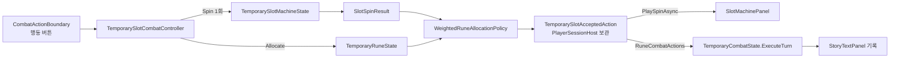

# 슬롯머신과 룬 기반 전투 행동

`TMP_MainScene`의 임시 전투에서 플레이어 행동은 슬롯머신(SlotMachine)과 룬(Rune)으로 정합니다. 슬롯머신은 숫자만 정합니다. 각 Reel의 Payline(가운데 줄)에 멈춘 숫자를 더한 값이 이번 턴의 총합입니다. 어떤 행동을 할지는 룬 줄이 정합니다. 총합은 룬 줄의 가중치 비율로 자동 분배되고, 각 줄은 분배받은 수치로 행동을 한 번씩 수행합니다. 주사위 시스템은 코드와 자산을 남긴 채 보류 상태이며, `TMP_MainScene`에서는 꺼져 있습니다([주사위 보류](#주사위-보류)).

이 문서는 현재 구현을 설명합니다. 구현 지침은 [`DOCS/instructions/slot-machine-and-rune-combat.md`](../instructions/slot-machine-and-rune-combat.md)입니다.

## 전체 흐름



| 어셈블리 | 구성 요소 |
| --- | --- |
| `TxTRPG.Gameplay` | `IRandomIndexProvider`(공용 난수 계약), `SlotMachine` 네임스페이스(`SlotSymbol`, `SlotReel`, `SlotMachine`, `SlotReelStop`, `SlotSpinResult`), `Runes` 네임스페이스(정의·보유·줄·분배), 전투 입력 `PlayerCombatAction`. Unity에 의존하지 않습니다. |
| `TxTRPG.Application` | 설정 자산, 세션 상태, `TemporarySlotCombatController`, 수락·턴 기록, `RuneCombatActions`, `SlotCombatStoryFormatter`, 공용 `ITemporaryCombatController`·`TemporaryCombatStoryText`·`TemporaryCombatPresentationTimeout`. |
| `TxTRPG.UI` | `SlotMachinePanel`, `SlotReelViewBase`/`SlotReelView`, 표시용 구조(`SlotReelDisplay`, `SlotReelStopDisplay`, `SlotSpinDisplay`). Gameplay·Application 타입을 쓰지 않습니다. |

주사위 도메인(`TxTRPG.Gameplay.Dice`)과 슬롯머신·룬 도메인은 서로 참조하지 않습니다. 기존 `IRandomIndexSource`는 이름과 위치를 그대로 둔 채 `IRandomIndexProvider`를 상속하도록 바꿨으므로 주사위 호출부는 바뀌지 않았습니다. 두 시스템이 만나는 곳은 전투 입력 `PlayerCombatAction`뿐입니다.

## Gameplay 도메인

### 슬롯머신

| 타입 | 책임 |
| --- | --- |
| `SlotSymbol` | Reel 한 칸의 불변 값(`Value` ≥ 0)입니다. 특수 기호나 이미지 키를 나중에 추가할 수 있도록 `int`를 감쌌습니다. |
| `SlotReel` | 불변입니다. 안정적인 `Id`와 순서 있는 Strip을 가집니다. 칸마다 같은 확률로 멈추므로 같은 값을 여러 칸에 두면 가중치처럼 동작합니다. `WithSymbol`·`WithInsertedSymbol`·`WithoutSymbol`·`WithStrip`은 검증한 새 Reel을 돌려줍니다. |
| `SlotMachine` | 순서 있는 Reel 목록입니다. `TryAddReel`·`TryRemoveReel`·`TryReplaceReel`·`TryReplaceAll`·`TrySetSymbol`·`TryAddSymbol`·`TryInsertSymbol`·`TryRemoveSymbol`·`TryReplaceStrip`은 후보 구성을 검증한 뒤에만 반영하고 `Changed`를 발생시킵니다. 실패하면 이전 구성을 유지하고 사유를 돌려줍니다. Reel은 최소 1개이며, 빈 Strip·음수·중복 ID·`Reel 수 × 최대값`이 `int` 범위를 넘는 구성은 거부합니다. |
| `SlotSpinResult` | `Spin(IRandomIndexProvider)`의 불변 스냅샷입니다. Reel 순서대로 한 번씩 추첨한 `SlotReelStop`(ReelId, 정지 인덱스, Payline 값, Strip 복사본, 순환하는 위·아래 칸)과 `PaylineTotal`을 가집니다. 이후 구성 변경과 무관합니다. |

Payline은 가운데 줄 하나입니다. 여러 Payline이나 기호 조합 판정은 없으며, 필요하면 `SlotSpinResult`를 입력으로 받는 별도 판정기를 추가합니다.

### 룬

| 타입 | 책임 |
| --- | --- |
| `RuneEffectKind` | `Unknown=0`, `Attack=1`, `Heal=2`로 값이 고정돼 있습니다. `Unknown`과 지원하지 않는 값은 거부합니다. |
| `RuneDefinition`, `RuneDefinitionCatalog` | 룬 종류의 불변 정의(ID, 표시 이름, 효과)와 ID 조회 목록입니다. 카탈로그는 중복 ID를 거부합니다. |
| `OwnedRune`, `RuneInventory` | 보유 룬 한 개(`InstanceId`, `DefinitionId`)와 보유 목록입니다. 목록은 `TryAdd`·`TryRemove`·`Snapshot`·`Changed`를 제공합니다. 줄에 놓인 룬은 제거를 거부합니다. 보상 기능은 이후 `TryAdd`를 호출합니다. |
| `RuneLoadoutLine`, `RuneLoadout` | 룬 줄(`LineId`, 쌓인 룬 인스턴스 ID 목록, `Weight` = 룬 개수)과 줄 목록입니다. 줄 추가·삽입·제거, 룬 겹치기·빼기, 전체 교체를 원자적으로 검증하고 `Changed`를 발생시킵니다. 마지막 룬을 빼면 그 줄도 제거됩니다. 인벤토리 하나에는 Loadout 하나만 연결됩니다. |
| `RuneAllocation`, `RuneAllocationLine` | 분배 결과의 불변 스냅샷입니다. 줄 순서대로 순번, `LineId`, 정의 ID·이름, 효과, 가중치, 분배 수치를 가지며 합계가 총합과 같은지 생성 시 검사합니다. |

줄 규칙은 다음과 같습니다.

- 한 줄은 룬 1개 이상이며 모두 같은 정의입니다.
- 같은 종류를 여러 줄에 나눠 둘 수 있습니다.
- 한 인스턴스는 최대 한 줄에만 둘 수 있습니다.
- 줄에 놓인 룬은 모두 보유 중이어야 합니다.
- 어느 줄에도 놓이지 않은 룬은 행동하지 않습니다.

### 가중치 자동 분배

`IRuneAllocationPolicy.Allocate(total, loadout, catalog)`가 변형 지점이며, 현재 구현은 `WeightedRuneAllocationPolicy`뿐입니다. 이 정책은 최대 나머지 방식을 씁니다.

1. 각 줄의 기본 몫은 `floor(total × weight / W)`입니다(`long` 계산).
2. 남은 값은 나머지(`total × weight mod W`)가 큰 줄부터 1씩 받고, 나머지가 같으면 앞선 줄이 먼저 받습니다.

분배 합계는 항상 총합과 같고, 같은 입력이면 결과도 같습니다. 줄이 없거나 가중치 합이 0이면 `InvalidOperationException`을 던집니다. 컨트롤러는 이 상태에서 행동을 실행 불가로 둡니다.

### 전투 입력

`TemporaryCombatState.ExecuteTurn(IReadOnlyList<PlayerCombatAction>)`이 기본 입력입니다. `PlayerCombatAction`은 종류(`Attack`·`Heal`), 수치, 출처 ID로 이루어집니다. 처리 순서와 규칙은 바뀌지 않았습니다.

1. 공격과 회복을 순서대로 적용합니다. 적이 이미 쓰러졌으면 공격은 `PlayerAttackSkipped`로 기록합니다.
2. 적이 살아 있으면 예고된 적 행동을 수행합니다.
3. 승리 또는 패배 이벤트를 남깁니다.

플레이어 이벤트의 `TemporaryCombatEvent.SourceId`에는 출처 ID(룬 줄의 `LineId`)가 들어갑니다. 기존 5인자 생성자는 빈 `SourceId`로 그대로 동작합니다.

주사위용 `ExecuteTurn(IReadOnlyList<DiceRollResult>)`은 결과를 행동으로 바꿔 위 메서드에 위임합니다. 변환을 먼저 끝내므로 지원하지 않는 주사위 효과는 상태를 하나도 바꾸기 전에 거부됩니다. 이전에는 앞선 면을 적용한 뒤 예외가 났습니다.

## 설정과 세션 상태

| 자산·타입 | 내용 |
| --- | --- |
| `Assets/TxTRPG/Application/Configuration/TemporarySlotMachineConfiguration.asset` (`TemporarySlotMachineConfiguration`) | Reel 목록(ID, 값 목록). 기본값은 `reel.1`·`reel.2`·`reel.3`이고 각 값은 `1, 2, 3, 4, 5, 6`입니다. |
| `Assets/TxTRPG/Application/Configuration/TemporaryRuneConfiguration.asset` (`TemporaryRuneConfiguration`) | 정의 `rune.attack`(공격 룬, Attack), `rune.heal`(회복 룬, Heal). 보유 `rune.attack.1`, `rune.heal.1`. 줄 `line.1`(공격 룬 ×1), `line.2`(회복 룬 ×1). Inspector에서 바꿀 수 있는 임시값입니다. |
| `TemporarySlotMachineState` | 세션 수명의 `SlotMachine` 복사본입니다. `Machine`의 변경 API를 쓰며 `Changed`를 전달합니다. |
| `TemporaryRuneState` | 세션 수명의 `Catalog`·`Inventory`·`Loadout`입니다. 보유와 줄의 `Changed`를 합쳐 전달하고, `CanAllocate`와 `Allocate(total, policy)`를 제공합니다. |

`PlayerSessionHost`(`AppRoot.prefab`)의 `temporarySlotMachineConfiguration`·`temporaryRuneConfiguration`이 두 자산을 참조합니다. Awake와 `EnsureInitializedAsync`에서 한 번 복사하며, 원본 자산은 실행 중 바뀌지 않습니다.

설정이 비었거나 잘못돼도 게임 시작은 막지 않습니다. 이때 상태를 만들지 않고 `TemporarySlotCombatError`에 사유를 남기며, 잘못된 경우에는 `Debug.LogError`도 기록합니다. 컨트롤러는 행동을 실행 불가로 두고, 패널 `StatusText`에 사유를 보여 줍니다.

룬과 슬롯머신 상태는 저장하지 않습니다. 저장 데이터와 `PlayerState`도 바뀌지 않았습니다. 정의·인스턴스·줄·Reel ID는 이후 저장과 조합을 위한 안정적인 문자열입니다.

## 전투 컨트롤러

`TemporarySlotCombatController`(`Assets/TxTRPG/Application/Runtime/SlotMachine/`)는 `IGameMenuCommandHandler`, `ISceneInitializer`(InitializationOrder -800), `ITemporaryCombatController`를 구현합니다. 명령 ID는 `temporary-slot.spin`입니다. `TMP_MainScene`에서는 `GameMenuPanel` 오브젝트에 보류된 주사위 컨트롤러와 함께 붙어 있습니다.

| 직렬화 필드 | 대상 |
| --- | --- |
| `menu`, `actionButton`, `storyPanel` | `GameMenuPanel`, `CombatActionBoundary`, `StoryTextPanel` |
| `combatConfiguration`, `enemyPanel`, `playerHealthBar`, `enemyHealthBar`, `nextEnemyActionText` | 주사위 컨트롤러와 같은 참조 |
| `slotPanel` | `SlotMachinePanel` |
| `spinTimeoutSeconds`(3), `spinTimeoutMarginSeconds`(1) | 연출 제한 시간 규칙 |

`CanExecute`는 주사위 컨트롤러와 같은 조건을 검사합니다. 실행 중이 아니어야 하고, 공용 행동 잠금이 비어 있어야 하며, 게임 창이 차단 중이 아니어야 합니다. 전투가 준비되어 있고 끝나지 않았으며 Story가 준비되어 있어야 합니다. 여기에 더해 Reel이 1개 이상이고 `TemporaryRuneState.CanAllocate`가 참이어야 합니다.

한 번의 실행은 다음 단계로 나뉩니다.

1. `PlayerSessionHost.TryBeginTemporaryCombatAction`으로 공용 행동 잠금을 얻습니다. 기존 `TryBeginTemporaryDiceAction`·`EndTemporaryDiceAction`은 같은 잠금에 위임하는 별칭입니다.
2. 회전과 분배를 수락합니다. `Spin`을 한 번 호출하고 그 시점의 룬 줄로 분배합니다. run·node·전투와 함께 `TemporarySlotAcceptedAction`으로 묶어 `AcceptTemporarySlotAction`으로 세션에 보관합니다. 이후에는 다시 돌리지 않습니다.
3. 패널 연출을 기다립니다. 제한 시간은 `TemporaryCombatPresentationTimeout.Resolve(최소, 패널 최대 연출 길이 + 여유)`(1~15초)입니다. 시간을 넘기거나 연출이 실패하면 `StopAtResult`로 결과를 바로 보여 줍니다. 패널이 없거나 비활성이면 연출 없이 진행합니다.
4. 수락 당시의 세션·전투·run·node가 그대로인지 확인합니다. 그대로이면 `RuneCombatActions.FromAllocation`으로 줄 순서의 행동 목록을 만들고 `ExecuteTurn`을 정확히 한 번 호출합니다. 수치 0인 줄은 목록에서 빠집니다. 일부가 실패해도 다시 실행하지 않습니다.
5. `PublishTemporarySlotStory`로 Story 기록을 발행합니다. 적·체력·예고 표시를 갱신하고, 전투가 끝났으면 `NotifyTemporaryCombatCompleted`와 `CombatFinished`를 호출합니다.
6. 수락 기록과 잠금을 해제합니다. 잠금 해제 시 `TemporaryCombatActionEnded`가 발생하고 실행 가능 상태가 갱신됩니다.

수락된 결과는 세션이 보관합니다. Scene이 다시 로드되면 진행 중이던 작업이 세션 참조로 결과를 한 번 적용합니다. 새 컨트롤러는 같은 전투에 다시 연결되고, `PendingSlotAction` 또는 현재 노드의 `LastTemporarySlotTurn`을 패널에 정지 상태로 보여 줍니다. 그다음 `PendingSlotStory`를 새 Story에 한 번 기록하고, `TemporaryCombatActionEnded`에서 버튼과 표시를 갱신합니다. 게임 창을 열고 닫아도 결과는 바뀌지 않습니다. 컨트롤러는 슬롯머신·룬 상태의 `Changed`를 받아 패널을 갱신합니다. 구독은 `OnDestroy`에서 해제하며, 파괴된 인스턴스는 남은 세션 이벤트를 무시합니다.

`ExplorationRunController`는 `ITemporaryCombatController`를 통해 전투를 시작하고 정리합니다. Unity가 인터페이스 필드를 직렬화하지 않으므로 필드는 `MonoBehaviour combatControllerBehaviour`이고, `[FormerlySerializedAs("combatController")]`로 기존 참조를 유지합니다. 초기화와 `ConfigureForEditor`·`ConfigureCombatForEditor`는 인터페이스를 구현하지 않은 컴포넌트를 거부합니다.

## Story 기록

`SlotCombatStoryFormatter`가 문구를 만듭니다. 적 행동, 승리·패배, 공격 건너뜀 문구는 주사위 경로와 공유하는 `TemporaryCombatStoryText`를 씁니다.

```text
[슬롯] 3 + 5 + 2 = 10
[룬] 1번 줄 공격 룬 ×1: 5
[전투] 테스트 적에게 피해 5. 체력 35/40.
[룬] 2번 줄 회복 룬 ×1: 5
[전투] 플레이어 회복 요청 5, 실제 회복 0. 체력 30/30.
[적 행동] 공격 5. 플레이어가 받은 피해 5. 체력 25/30.
```

각 줄의 전투 결과는 이벤트 순서가 아니라 `SourceId`로 그 줄에 연결합니다. 분배 0인 줄은 `[룬] 2번 줄 회복 룬 ×1: 0 (실행하지 않음)`으로 기록합니다. 슬롯머신 경로에는 결과 창이 없으며, 결과는 StoryTextPanel에만 기록합니다.

## SlotMachinePanel

### 배치

`MiddlePanel/ContentLayer`에서 `SlotMachinePanel`은 `OwnedDicePanel` 바로 다음 형제입니다. `FlexibleLayoutItem` 값은 `OwnedDicePanel`에서 복사했습니다(Weighted, Weight 0.7, 최소 200). `OwnedDicePanel`은 비활성이며, `ContentLayer`의 `FlexibleContentLayoutGroup`은 비활성 자식을 계산에서 뺍니다(`includeInactiveChildren` 꺼짐). 그래서 패널은 기존 주사위 패널과 같은 위치와 크기를 차지합니다. 적용 시 같은 Game view에서 두 패널의 크기·위치가 같음을 측정했습니다.

Play Mode 검증에서 측정한 패널 크기는 다음과 같습니다.

| 화면 | 패널 크기 |
| --- | --- |
| 1920×1080 | 968×413 |
| 21:9 | 1302×413 |
| 1024×768 | 470×332 |
| 390×844 | 332×274 |

`CombatActionBoundary`의 `PanelBoundaryPlacement.secondPanel`은 `SlotMachinePanel`입니다. 행동 버튼은 패널 위쪽 가운데를 일부 덮을 수 있습니다. `Content`의 위쪽 여백 44px 안에 Reel과 합계가 들어오지 않도록 했습니다. `ExplorationNodePanel`의 `CoveredPanelInteractionBlocker`는 노드 선택 중 `SlotMachinePanel`의 `CanvasGroup`을 막습니다.

### 계층

Prefab은 `Assets/TxTRPG/UI/Prefabs/SlotMachine/SlotMachinePanel.prefab`과 `SlotReel.prefab`입니다. 패널 Prefab에는 `SlotReel` 중첩 인스턴스 3개가 들어 있습니다.

```text
SlotMachinePanel          (RectTransform, CanvasGroup, FlexibleLayoutItem, SlotMachinePanel)
├─ Background             (Image, 입력 없음)
├─ Content                (VerticalLayoutGroup, 위쪽 여백 44)
│  ├─ ReelArea            (HorizontalLayoutGroup, Reel 같은 너비 분할)
│  │  ├─ SlotReel_{n}     (SlotReelView, LayoutElement: 레이아웃 전용)
│  │  │  ├─ Frame         (Reel 배경·테두리 시각 루트)
│  │  │  ├─ Window        (RectMask2D, 보이는 3칸)
│  │  │  │  └─ Strip      (연출이 위치를 움직이는 루트)
│  │  │  │     └─ SymbolCell_0..4 > VisualRoot > Icon(Image), Value(TMP_Text)
│  │  │  └─ EffectRoot    (Reel 단위 효과, Window 밖)
│  │  └─ PaylineOverlay   (ignoreLayout: 가운데 칸 위·아래 선과 양옆 마름모 표지)
│  └─ Summary > TotalText ("합계 10"), AllocationText ("공격 ×1 → 5 · 회복 ×1 → 5")
├─ StatusText             (구성 오류, 평소 비활성)
└─ EffectRoot             (패널 단위 효과)
```

- 모든 Graphic의 `raycastTarget`이 꺼져 있습니다. 패널은 입력을 받지 않습니다.
- `PaylineOverlay`는 지침의 `Content` 바로 아래가 아니라 `ReelArea` 안에 있습니다. `ignoreLayout`으로 Reel 창 높이의 가운데 1/3에 맞추기 위해서입니다.
- Payline은 색만으로 구분하지 않습니다. 선과 마름모 모양으로 표시하고, 가운데 칸 글자를 굵게·크게, 위·아래 칸을 흐리게(알파 0.45, 크기 0.72배) 보여 줍니다.
- `RectMask2D`가 `Window` 밖을 자르므로, 번지는 효과는 `EffectRoot`에 붙입니다.
- `SymbolCell`은 `SlotReelView.symbolSprites`에 값에 맞는 Sprite가 있으면 Icon을, 없으면 숫자를 표시합니다. 현재 매핑은 비어 있습니다.
- 글자 크기는 TMP Auto Size 대신 칸 높이·너비 × 0.62를 `[16, 64]` 범위로 제한해 정합니다. 칸 크기가 바뀔 때만 다시 계산합니다.
- Reel 수가 바뀌면 `reelPrefab`으로 `SlotReel_{n}`을 추가하거나 끝에서부터 제거합니다. 가로 스크롤은 없습니다.
- 두 Prefab은 처음 한 번 생성한 뒤 개발자 소유 자산이며, 등록 기반 Prefab Rebuild에서 제외됩니다([등록 기반 Prefab Rebuild](prefab-rebuild-registry.md)).

### 표시 상태

| 상태 | Reel | TotalText | AllocationText |
| --- | --- | --- | --- |
| 전투 없음·첫 회전 전 | 각 Strip 첫 칸이 Payline | `합계 —` | `공격 ×1 · 회복 ×1` (줄의 효과와 가중치) |
| 회전 중 | 흐름 연출 | `회전 중…` | 가중치 유지 |
| 정지 후 | 결과 칸이 Payline | `합계 N` | `공격 ×1 → 6 · 회복 ×1 → 5` |
| 장착된 룬 줄 없음 | 이전 상태 | 이전 값 | `장착된 룬이 없습니다` |
| 구성 오류 | `Content` 숨김 | — | `StatusText`에 사유 |

구성이 바뀌면 ID와 Strip이 같은 Reel은 보이던 칸을 유지합니다. 새 Reel이나 값이 바뀐 Reel은 첫 칸을 보여 줍니다. 회전 중에 바뀐 구성은 연출이 끝난 뒤 반영합니다.

### 회전 연출

`SlotMachinePanel.PlaySpinAsync(SlotSpinDisplay, reduceMotion, token) → Task<bool>`은 이미 정해진 결과를 보여 주기만 합니다. 각 Reel은 `SlotReelViewBase.PlaySpinAsync`로 독립적으로 돌아가므로, 패널은 Reel 구현의 내부 구조를 모릅니다.

`SlotReelView`의 연출은 다음과 같습니다.

- `Strip`을 칸 높이의 일부만큼 위로 움직입니다. 칸 하나만큼 움직이면 기준 인덱스를 1 올리고 `Strip`을 제자리로 되돌리므로, Payline에는 Strip 값이 순서대로 지나갑니다.
- 텍스트는 기준 인덱스가 바뀔 때만 다시 지정하고, 숫자 문자열은 캐시합니다.
- 이동 거리는 결과 칸에 정확히 멈추도록 `(결과 - 시작) mod n + n × 바퀴 수`로 정합니다. 속도는 일정하게 유지하다가 감속 구간에서 줄입니다.

기본값은 첫 Reel 회전 0.8초, Reel 간 정지 간격 0.25초, 감속 0.3초입니다. Reel은 왼쪽부터 차례로 멈추며, 값은 모두 직렬화 설정입니다. 시간은 `Time.unscaledTime`의 차이로 계산하므로 `Time.timeScale`과 프레임레이트에 영향을 받지 않습니다.

Reduce Motion(`PlayerSessionHost.TemporaryDicePreferences.ReduceMotion`)이 켜져 있으면 흐름 없이 Reel마다 0.15초 간격으로 결과를 보여 줍니다. `MaximumPresentationSeconds`와 `GetMaximumPresentationSeconds(reelCount)`는 컨트롤러가 제한 시간을 계산하는 데 씁니다. `StopAtResult`는 즉시 결과 상태로 바꿉니다. 비활성이 되거나 파괴되거나 취소되면 연출은 `false`를 돌려주고, 컨트롤러가 결과 상태를 표시합니다.

## 주사위 보류

| 대상 | TMP_MainScene 상태 |
| --- | --- |
| `OwnedDicePanel` GameObject | 비활성. `DiceStage` 카메라는 이미 꺼져 있어 렌더하지 않습니다. 물리 시뮬레이션도 시작되지 않습니다. |
| `TemporaryDiceRollMenuController`, `OwnedDiceSessionBinder` 컴포넌트 | `enabled = false`. 직렬화 설정은 보존합니다. |
| 두 컴포넌트의 `InitializeAsync` | `SceneTransitionService`는 비활성 참여자도 초기화하므로 `!isActiveAndEnabled`이면 바로 반환합니다. 구독, Story, 결과 창, 버튼 갱신을 하지 않습니다. |
| `PlayerSessionHost`의 `TemporaryPlayerDiceState`, `DiceResultsPage` 등록 | 그대로 둡니다. 슬롯머신 경로는 주사위 결과를 만들지 않으므로 결과 창이 열리지 않습니다. |

주사위로 되돌릴 때 바꿔야 할 참조와 재실행하면 안 되는 주사위 도구는 [개발 및 검증 절차](../development/workflows.md#슬롯머신-전투-적용)에 정리했습니다.

## 확장 지점 (미구현)

| 향후 기능 | 현재 구조 |
| --- | --- |
| 수동 분배 | `IRuneAllocationPolicy`의 다른 구현으로 추가합니다. 컨트롤러는 회전 수락(`AcceptSpin`)·연출·적용을 분리된 단계로 처리하므로, 수락과 적용 사이에 입력 대기를 넣을 수 있습니다. 패널의 `Summary` 아래에 입력 영역을 추가할 수 있습니다. |
| 룬 장착·줄 편집 UI | `RuneLoadout`의 변경 API와 `TemporaryRuneState.Changed`를 씁니다. 패널은 이미 `Changed`로 갱신됩니다. |
| 룬 조합 | 재료를 줄에서 빼고(`TryRemoveRuneFromLine`) 보유에서 제거한 뒤 새 정의의 인스턴스를 `TryAdd`합니다. 줄과 분배 코드에는 효과 종류가 하드코딩되어 있지 않습니다. 효과 → 전투 행동 매핑은 `RuneCombatActions` 한 곳에 있습니다. |
| 룬 획득 | `RuneInventory.TryAdd`. 어느 줄에 둘지는 획득 기능이 정합니다. |
| 저장 | ID는 안정적인 문자열입니다. 저장 형식은 아직 없습니다. |
| 기호 이미지·특수 기호 | `SlotSymbol`에 필드를 추가하고, `SlotReelView.symbolSprites`에 값→Sprite를 매핑합니다. |
| 입체 Reel | `SlotReelViewBase`를 구현하는 다른 Reel Prefab을 `reelPrefab`·`reelViews`에 연결합니다. |
