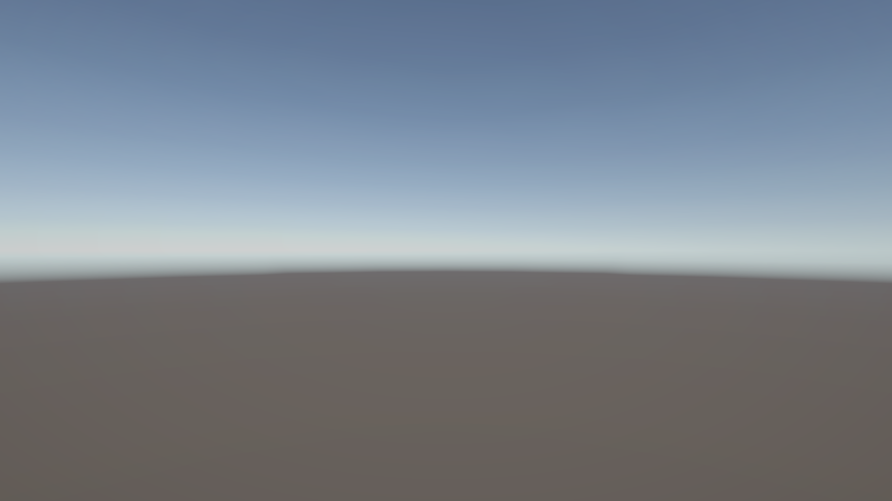

# 임시 적 전투

## 범위와 상태 소유권

`TMP_MainScene`의 임시 전투는 정식 전투·저장 시스템과 분리된 탐험 노드 처리기입니다. `TemporaryCombatState`는 Unity 객체를 참조하지 않는 순수 C# 상태이며, 전투 노드를 시작할 때 탐험이 소유한 `HealthState`를 직접 사용합니다. 피해와 회복은 다음 노드까지 이어지지만 `PlayerSession`의 운영 체력과 저장 DTO는 변경되지 않습니다.

| 구성 요소 | 책임 |
| --- | --- |
| `TemporaryCombatConfiguration` | 활성 여부, 적 이름·외형 ID·체력 40·공격 5·회복 3을 설정합니다. |
| `TemporaryCombatState` | 양쪽 체력, 다음 적 행동, 종료 상태와 한 턴의 순차 적용 결과를 관리합니다. |
| `TemporaryDiceRollMenuController` | 주사위 결과를 한 번 확정하고 전체 연출 후 전투를 한 번 적용하며 체력 바, 적 표현, 예고와 Story를 동기화합니다. |
| `TemporaryDiceMenuBuilder` | 설정 자산과 TMP_MainScene의 필수 참조를 선별 적용하고, 경계선 "행동" 버튼을 만들거나 찾으며 옛 메뉴 행동 버튼을 제거합니다. |
| `BoundaryCommandButton` (UI) | 경계선 "행동" 버튼의 표시·실행 가능 상태·클릭 실행·포커스 해제를 맡습니다. 실행은 `IGameMenuCommandHandler`로 컨트롤러에 전달합니다. |

## 한 턴의 처리

`행동` 명령은 보유 주사위를 순서대로 한 번씩 굴리고, 모든 연출이 끝난 뒤 확정 결과를 전투에 한 번 적용합니다. 연출은 확정 결과 면이 위로 오도록 보정한 물리 던지기 재생이며([보유 주사위 3D 표시](owned-dice-presentation.md)), 연출이 실패하거나 제한 시간을 넘겨도 재추첨하지 않습니다. 결과는 모든 주사위가 멈추고 결과 대기 시간이 지난 뒤 적용되며, 제한 시간은 패널의 최대 연출 길이에 여유를 더한 값(최소 `rollTimeoutSeconds`)이고 초과 시 주사위를 결과 면으로 먼저 정지·배치한 뒤 적용합니다. 공격 면은 임시 적을 공격하고 회복 면은 임시 플레이어를 회복합니다. 적이 주사위 처리 도중 쓰러지면 이후 공격 면은 건너뛰지만 이후 회복 면은 계속 처리합니다. 적이 살아 있으면 예고된 공격 또는 회복을 한 번 수행하고 다음 행동으로 교대합니다. 최대 체력에서의 회복도 턴을 소비하며 실제 회복량 0을 기록합니다.

빠른 중복 실행은 컨트롤러의 실행 상태와 행동 버튼의 실행 가능 상태로 차단합니다. 이미 완료된 전투는 추가 행동을 받지 않습니다. UI 기록 오류가 발생하더라도 이미 적용한 전투 결과를 자동으로 재실행하지 않습니다.

## "행동" 버튼

"행동" 버튼은 게임 메뉴가 아니라 `MiddlePanel/ContentLayer/CombatActionBoundary`(Prefab `Assets/TxTRPG/UI/Prefabs/BoundaryCommandButton.prefab`의 인스턴스)에 있으며, `EnemyDisplayPanelDemo`와 `OwnedDicePanel` 사이 경계선 가운데에 겹쳐 놓입니다. `StoryTextPanel`은 사용자가 왼쪽 열(`LeftPanel`, `NodeTreePanel` 아래)로 옮겼으므로 노드 선택 중에도 전투·탐험 기록이 보입니다. 배치 방식은 [FlexibleLayoutPanel 설계](flexible-layout-panel.md#레이아웃에-참여하지-않는-경계선-오버레이), 외형과 효과 확장 지점은 [경계선 명령 버튼](boundary-command-button.md)에 정리했습니다. 게임 메뉴에는 System·Bag·Status만 남고 `temporary-dice.roll-all` 명령 바인딩은 없습니다.

| 상태 | 버튼 |
| --- | --- |
| 전투 없음, 노드 선택 중(`ExplorationNodePanel` 표시) | 숨김 |
| 진행 중인 전투, 실행 가능 | 표시·활성 |
| 굴림 연출·결과 처리 중, 결과 창 또는 다른 게임 창 열림, 보유 주사위 없음 | 표시·비활성 (`CanExecute` 결과를 그대로 반영) |
| 전투 종료(승리 후 `ClearCombat`, 패배 후 `IsComplete`) | 숨김 |

컨트롤러는 `IsReady && !Combat.IsComplete`를 `BoundaryCommandButton.SetAvailable`로 전달합니다. 갱신은 폴링하지 않습니다. 컨트롤러의 모든 상태 변경 지점(초기화, 전투 시작·초기화·재연결, 굴림 수락·완료·실패, 결과 창 차단 변경)은 `GameMenuPanel.RefreshExecutionState()`를 호출하고, 메뉴가 끝에 발생시키는 `ExecutionStateRefreshed`에서 버튼을 갱신합니다. `GameMenuPanel`은 `GameWindowService.Opened`·`Closed`도 구독하므로 게임 창이 열리고 닫힐 때도 같은 경로로 갱신됩니다. 실행은 버튼 클릭(마우스·터치)과 `Submit`이 같은 `Button.onClick` → `CanExecute/TryExecute(RollAllCommandId)` 경로를 사용하며, 명령 ID·실행 잠금·결과 1회 적용·제한 시간 규칙은 바뀌지 않았습니다.

포커스 규칙은 다음과 같습니다.

- 탐색: 행동 버튼은 `Explicit`이며 오른쪽·아래 → `System` 버튼입니다. 메뉴 버튼 세 개는 기존 `Automatic` 탐색을 유지하므로, 메뉴에서 행동 버튼으로 가는 경로는 Unity 자동 탐색이 위치로 고릅니다(사용자 결정).
- 전투 시작 시 자동 선택하지 않습니다.
- 숨겨질 때 행동 버튼이 선택되어 있으면 선택을 해제합니다(`focusFallback` 비어 있음). 탐험 화면의 "초기 자동 선택 없음" 규칙과 같게, 다음 방향 입력은 노드 카드로 진입합니다.
- 굴림이 시작되어 버튼이 비활성이 되면 Unity가 선택을 해제합니다. 버튼은 이를 기억했다가 다시 활성화될 때 현재 선택이 없거나 숨겨진 오브젝트이면 자신을 다시 선택합니다. 그래서 결과 창을 닫으면 포커스가 행동 버튼으로 돌아옵니다. 플레이어가 그 사이 다른 보이는 UI를 선택했으면 그 선택을 유지합니다.
- `GameWindowService.Close`는 돌아갈 대상이 없을 때 숨겨진 창 컨트롤에 선택을 남기지 않고 해제합니다.
- 좁은 화면에서는 버튼이 선택되면 `ResponsiveMainScreen.Reveal`이 페이지 스크롤로 버튼을 보이게 합니다.

## Scene 수명과 표시

임시 컨트롤러는 전투 노드가 선택될 때까지 적을 생성하지 않습니다. TMP_MainScene에는 `MainScenePresentationController`가 없으며, `EnemyDisplayPanelDemo`의 `PanelStartupController.initialDataLoader` 연결을 해제해 `EnemyDisplayPanelDemoLoader`가 초기 데이터를 쓰지 않게 했으므로 임시 전투 컨트롤러만 적 표시를 갱신합니다. Scene이 파괴되면 체력 변경 구독을 해제하며, 재진입하면 `PlayerSessionHost`에 남은 탐험·전투 상태에 다시 연결합니다. 수락된 굴림의 완료 통지도 세션에서 새 Scene으로 전달합니다.

플레이어와 적 체력 바, 다음 적 행동, `StoryTextPanel`은 모두 같은 `TemporaryCombatState`를 읽습니다. 정식 전투, 보상, 경험치, 자동 부활, 3D 물리 굴림과 저장 반영은 이 기능의 범위에 포함되지 않습니다.

## 실행 화면

