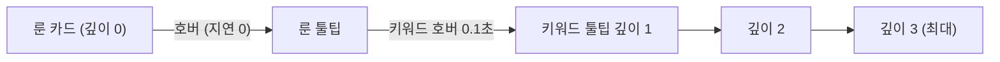

# 툴팁

마우스를 올린 대상의 설명을 화면 프레임 안의 상자로 보여 주는 범용 툴팁과, 본문 속 키워드에서 다시 여는 키워드 툴팁입니다. 현재 `Candidate_MainScene`의 룬 Grid 카드에 연결되어 있습니다. 구현 지침은 [rune-tooltip-and-test-runes.md](../instructions/rune-tooltip-and-test-runes.md)이며 2026-10-25에 구현했습니다.

## 구성 요소

`TxTRPG.UI` 어셈블리, `Assets/TxTRPG/UI/Runtime/Tooltips/`, 네임스페이스 `TxTRPG.UI.Tooltips`입니다. Gameplay·Application 타입을 쓰지 않으므로 이후 `TxTRPG.Content`(아이템)와 `TxTRPG.Application`(스킬·룬 설정)이 모두 툴팁 내용을 참조할 수 있습니다.

| 타입 | 책임 |
| --- | --- |
| `TooltipBlockKind` | `Title=1`, `Text=2`, `Image=3`, `Separator=4`. 값 고정. `0`(Unknown)은 표시하지 않고 경고 |
| `TooltipBlock` | `[Serializable]` 블록. `kind`, `text`(Title·Text), `sprite`·`imageHeight`(Image, 너비는 툴팁에 맞추고 비율 유지). `[SerializeReference]`·리플렉션을 쓰지 않음 |
| `TooltipContent` | ScriptableObject(`Assets > Create > TxT RPG > UI > Tooltip Content`). 블록 목록. 대상을 알지 않으며 여러 대상이 공유 가능 |
| `TooltipKeywordDefinition` | ScriptableObject(`... > UI > Tooltip Keyword`). `id`(안정 문자열, 출시 후 변경 금지), `displayName`(비면 ID), `icon`(선택), `blocks`(키워드 설명. 키워드 툴팁은 제목 = 표시 이름, 아이콘, 블록 순서), `relatedEntries` |
| `TooltipRelatedEntry`, `TooltipSubjectCategory` | 연관 항목(`Rune=1`, `Item=2`, `Skill=3`, `Other=4`)과 대상 ID 문자열. 대상 타입을 직접 참조하지 않음 |
| `TooltipKeywordCatalog` | ScriptableObject(`... > UI > Tooltip Keyword Catalog`). 키워드 목록, `TryGet`(앞뒤 공백 제거, `Ordinal`, 중복은 첫 항목), `Validate`(빈 항목·빈 ID·중복 ID 거부) |
| `TooltipMarkup` | 순수 해석기. `{kw:id}`·`{kw:id\|표시 텍스트}` → `<link="kw:id"><b><u><color=#FFD27A>…</color></u></b></link>`. `{{`·`}}`는 중괄호. 모르는 ID는 일반 텍스트, 닫히지 않은 표기는 원문 그대로. 다른 TMP 태그는 그대로 통과. `FindKeywordIds`(검색용), `KeywordIdOfLink` |
| `TooltipPlacement` | 순수 함수 `Place(anchor, size, frame, margin)` → 왼쪽 위 좌표, 뒤집힌 축, 밀어 넣은 축 |
| `ITooltipAnchor` | 툴팁을 연 대상 계약: `IsAnchorValid`, `IsPointerOver`, `TryGetAnchorRect(space)` |
| `TooltipView` | 툴팁 상자(`UI/Prefabs/Tooltips/TooltipView.prefab`). `Show(블록, 키워드 카탈로그, 최소·최대 너비, 최대 높이)` → 크기, `Hide`, `Clear`. 블록 템플릿을 풀로 재사용. 루트의 진입·이탈로 "상자 위" 판정 |
| `TooltipKeywordLinkDetector` | Text 블록에 붙어 `IPointerMoveHandler`·`IPointerExitHandler`로 `TMP_TextUtilities.FindIntersectingLink`를 호출. 포인터가 움직일 때만 계산하고 링크가 바뀔 때만 알림. 링크 글자 사각형의 합을 기준 사각형으로 제공 |
| `TooltipPresenter` | 사슬의 유일한 관리자(`TooltipLayer`에 하나). 직렬화 필드: `viewPrefab`, `keywordCatalog`, `frame`(ScreenFrame), `maximumKeywordDepth` 3, `rootShowDelaySeconds` 0, `keywordShowDelaySeconds` 0.1, `hideGraceSeconds` 0.08, `frameMargin` 8, `minimumWidth` 160, `maximumWidth` 420. Scene 검색을 하지 않음 |

룬 연결(`UI/Runtime/Runes/`):

| 타입 | 책임 |
| --- | --- |
| `RuneTooltipCatalog` | 룬 정의 ID → `TooltipContent`. `RuneIconCatalog`와 같은 ID 규칙. 게임 규칙 데이터에는 툴팁 필드가 없음 |
| `RuneGridCardTooltipTrigger` | 카드 루트. `CardArea/HitArea`·`BadgeArea/HitArea`의 진입·이탈을 하나의 호버로 합침. 기준 사각형은 `CardArea`. 카탈로그 내용이 없거나 `DefinitionId`가 비면 대체 내용(제목 = 표시 이름, 본문 `설명이 없습니다.`) |

## 사슬 규칙



1. 새 루트 툴팁은 기존 사슬을 모두 닫습니다. 같은 대상이 이미 루트이면 그대로 둡니다.
2. 키워드 툴팁은 바로 위 툴팁의 키워드 위에 포인터가 `keywordShowDelaySeconds` 동안 머물면 열립니다. 같은 깊이의 다른 키워드 툴팁은 그 아래 사슬과 함께 닫고 새로 엽니다. 최대 깊이를 넘거나, 위쪽 사슬에 같은 키워드가 이미 열려 있으면 열지 않습니다(강조 표시는 유지).
3. 각 툴팁은 "포인터가 자기를 연 대상, 자기 상자, 더 깊은 툴팁 중 하나 위에 있다"가 거짓이 된 뒤 `hideGraceSeconds`가 지나면 닫히고, 그보다 깊은 툴팁도 닫힙니다. 유예 중 다시 참이 되면 닫지 않습니다.
4. 대상이 무효가 되면 즉시 닫습니다: 카드가 다른 줄·정의로 다시 바인딩되거나 풀로 돌아감, 카드 비활성·파괴, 룬 Grid 스크롤 등으로 기준 사각형이 0.5 단위 넘게 움직임, 키워드가 있는 텍스트가 바뀜. 같은 줄의 Weight만 바뀌면 유지합니다.
5. 화면 프레임 크기나 배율(창 크기·Safe Area)이 바뀌면 사슬을 닫습니다.
6. 포인터 판정은 EventSystem 포인터 이벤트만 씁니다. `ExtendedPointerEventData.pointerType`이 `Touch`이면 열거나 유지하지 않습니다. 펜은 마우스와 같습니다.
7. 결과 모달이 열리면 배경이 포인터를 받아 카드·상자의 이탈 이벤트가 발생하므로 유예 뒤 닫힙니다. 명시적으로 닫을 때는 `TooltipPresenter.HideAll()`을 씁니다.
8. `TooltipPresenter.Update`는 `Tick(Time.unscaledTime)`을 호출합니다. 사슬이 비어 있으면 대기 중인 요청만 확인합니다. Edit Mode 테스트는 `Tick(time)`을 직접 호출합니다.

## 배치 계산

모든 사각형은 `TooltipLayer` 로컬 좌표(Canvas 단위, y 위쪽)입니다. 프레임 사각형은 `ScreenFrame`의 월드 모서리를 변환해 구하며 `Screen.width`·`Screen.height`를 쓰지 않습니다.

1. 기준 사각형의 오른쪽 위 모서리가 상자의 왼쪽 위 모서리입니다(간격 0). 카드 안 어디에서 호버해도 위치가 같습니다.
2. 오른쪽이 `frame.xMax − margin`을 넘으면 기준점을 왼쪽으로 뒤집어 기준 사각형의 왼쪽 위가 상자의 오른쪽 위가 됩니다. 아래가 `frame.yMin + margin`보다 내려가면 기준 사각형의 아래 변이 상자의 아래 변이 되도록 뒤집습니다.
3. 뒤집어도 넘치면 그 축을 프레임 안으로 밀어 넣습니다. 상자가 프레임보다 크면 프레임 왼쪽 위 여백에 맞춥니다.
4. 크기: 가장 긴 줄 너비 + 안쪽 여백 32를 160~420으로 제한하고, 높이는 내용 높이를 `프레임 높이 − 2 × margin`으로 제한합니다. 넘치는 내용은 `Content`의 RectMask2D가 자르고 Editor·Development Build에서 경고를 한 번 남깁니다.
5. 배치는 툴팁을 열 때만 계산합니다. 마우스 이동으로 다시 계산하지 않습니다.

## Prefab·Scene 계층

```text
TooltipView                 배치 루트(Presenter가 localPosition 지정, 피벗 (0,1)), CanvasGroup, TooltipView
└── VisualRoot              효과 적용 루트(Stretch)
    ├── Background          UiShapeGraphic 둥근 사각형(#141C33, alpha 0.97), Raycast 대상 — 상자 영역 판정
    ├── Border              UiShapeGraphic InnerBorder 2(#8FA6D9), Raycast 대상 아님
    └── Content             Stretch, RectMask2D(최대 높이를 넘는 내용 자르기)
        └── Blocks          위쪽 Stretch, VerticalLayoutGroup(여백 16, 간격 8), ContentSizeFitter(세로)
            ├── TitleTemplate     TMP_Text 26 굵게(비활성 템플릿)
            ├── TextTemplate      TMP_Text 22 + TooltipKeywordLinkDetector, Raycast 대상(비활성 템플릿)
            ├── ImageTemplate     Image(preserveAspect, LayoutElement 높이)(비활성 템플릿)
            └── SeparatorTemplate Image(높이 2)(비활성 템플릿)
```

- 지침서의 계층과 달리 `Content` 아래에 `Blocks`를 한 단계 더 둡니다. 내용 높이를 자르는 RectMask2D(`Content`, 상자 크기)와 내용 크기에 맞춰 늘어나는 레이아웃(`Blocks`)을 분리하기 위해서입니다. `Border`는 테두리 대비를 위해 추가했습니다.
- 배치 루트와 `VisualRoot`를 분리했습니다. 크기와 기준점은 효과 적용 전의 배치 루트 사각형으로 계산하며, 외곽선·발광이 프레임 밖으로 그려질 수 있도록 `frameMargin`을 0으로 두지 않습니다.
- Text 블록 외의 Graphic은 `Background`만 Raycast 대상입니다. 키워드 강조는 TMP 서식으로 처리하며 공유 Material을 바꾸지 않습니다.
- `TooltipView.prefab`은 개발자 소유 Prefab이며 Prefab Rebuild 배치에 등록하지 않습니다.

```text
Candidate_MainScene
Canvas/ScreenFrame/OverlayLayer
├── SlotReelDockClip
├── EncounterDebugPanel
└── TooltipLayer            Stretch(여백 0), Graphic 없음, TooltipPresenter (마지막 자식)
                            viewPrefab = TooltipView.prefab, keywordCatalog = TooltipKeywordCatalog.asset, frame = ScreenFrame
```

툴팁 상자는 실행 중 `TooltipLayer` 아래에 깊이마다 하나씩 만들어 재사용합니다. 툴팁은 독·디버그 패널 위, 결과 모달(`ScreenOverlayLayer`) 아래에 그려지고 레터박스로 나가지 않습니다. `RuneGrid` 인스턴스의 `tooltipPresenter`·`tooltipCatalog`는 Scene Override입니다([룬 Grid 패널](rune-grid-panel.md)).

## 자산

| 경로 | 내용 |
| --- | --- |
| `Assets/TxTRPG/UI/Tooltips/TooltipKeywordCatalog.asset` | 테스트 키워드 3개 |
| `Assets/TxTRPG/UI/Tooltips/Keywords/TestKeywordAlpha·Beta·Gamma.asset` | `keyword.test.alpha`(아이콘, `{kw:keyword.test.beta}`), `keyword.test.beta`(`{kw:keyword.test.gamma}`), `keyword.test.gamma`(`{kw:keyword.test.alpha}`로 순환 확인, Image 블록). 연관 항목 `Rune rune.test.tooltip` |
| `Assets/TxTRPG/UI/Tooltips/Runes/TemporaryRuneTooltipCatalog.asset` | `rune.attack`, `rune.heal`, `rune.test.tooltip`, `rune.test.long`. `rune.test.missing`은 대체 툴팁 확인용으로 없음 |
| `Assets/TxTRPG/UI/Tooltips/Runes/Contents/` | `TemporaryAttackRuneTooltip`·`TemporaryHealRuneTooltip`(임시 문구, 이름에 `Temporary`), `TestRuneTooltip`(Title·Image·Text·Separator와 키워드), `LongTestRuneTooltip`(최대 높이·경계 확인) |

## 키워드 사용처 확인

`TooltipKeywordDefinitionEditor`(`TxTRPG.UI.Editor`, `UI/Editor/Tooltips/`)가 키워드 Inspector 아래에 표시합니다.

- 연관 항목을 분류별로 묶어 읽기 전용으로 보여 줍니다.
- `사용처 새로고침`을 누를 때만 `TooltipKeywordUsageFinder.Find(id)`가 `AssetDatabase.FindAssets`로 모든 `TooltipContent`, 다른 키워드, 그 내용을 참조하는 `RuneTooltipCatalog` 항목(룬 정의 ID)을 찾습니다. 항목을 누르면 자산을 선택하고 Ping합니다.
- 연관 항목에 있지만 쓰지 않거나, 쓰지만 연관 항목에 없으면 정보 문구로 알립니다. 자동으로 고치거나 저장하지 않습니다.
- 확장 지점: 아이템·스킬 툴팁 카탈로그가 생기면 `TooltipKeywordUsageFinder.Find`의 `RuneTooltipCatalog` 검색 옆에 그 카탈로그를 추가합니다(분류 `Item`·`Skill`).

## 확장 지점

- 다른 대상의 툴팁: 대상 ID → `TooltipContent` 카탈로그와 `ITooltipAnchor`를 구현한 트리거를 만들고 `TooltipPresenter.RequestRoot`(포인터) 또는 `ShowRoot`(포인터 무관)를 호출합니다.
- 터치·게임패드: `ShowRoot(anchor, content)`와 `HideAll()`은 포인터와 무관한 공개 API입니다. 게임패드 포커스(`ISelectHandler`·`IDeselectHandler`)나 터치 탭이 같은 API를 호출하도록 만들 수 있습니다. 이 경우 포인터 이탈 대신 포커스 이탈로 닫는 `ITooltipAnchor.IsPointerOver` 구현이 필요합니다.
- 새 블록 종류: `TooltipBlockKind`에 새 값을 추가하고 `TooltipView`에 템플릿과 `Show`의 처리를 추가합니다.

## 실패 동작

| 상황 | 동작 |
| --- | --- |
| `RuneGridPanel`의 `tooltipPresenter`·`tooltipCatalog` 없음, 카탈로그 검증 실패 | 경고 한 번, 툴팁 없이 동작 |
| `TooltipPresenter`의 `viewPrefab`·`frame` 없음 | 오류 한 번, 툴팁을 열지 않음 |
| 키워드 카탈로그 없음 | 키워드 표기를 일반 텍스트로 표시 |
| 알 수 없는 블록 종류·키워드 ID, 닫히지 않은 표기, 프레임보다 큰 내용 | 표시는 계속하고 Editor·Development Build에서 경고 한 번 |
| 모달 열림, Scene 전환, 대상 파괴 | 사슬 닫힘(Presenter는 Scene과 함께 파괴) |

## 현재 제약

- 마우스(펜 포함)만 지원합니다. 터치와 게임패드에서는 툴팁을 볼 수 없습니다.
- 툴팁 등장·퇴장 애니메이션과 시각 효과는 없습니다. `VisualRoot`만 준비되어 있습니다.
- 내용의 동적 값(예: 줄 Weight)과 현지화 테이블 연결은 없습니다.
- 휴대폰 기준 글자 크기(본문 22 ≈ 1.4mm, 제목 26 ≈ 1.6mm)는 [해상도 문서](../development/resolution-and-screen-frame.md#35-가독성과-터치-영역)의 계산값이며 작아 보일 수 있습니다.
