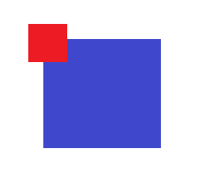

# Candidate_MainScene LeftArea 룬 Grid

## 1. 목적과 확정 사항

`Candidate_MainScene`의 `LeftArea`에 플레이어의 룬을 정사각형 카드 Grid로 표시하는 Container(이하 "룬 Grid")를 추가한다. 각 카드는 룬 이미지를 표시하는 카드 영역과, 카드의 왼쪽 위 모서리에 겹쳐 놓여 룬의 중첩 수를 숫자로 표시하는 배지 영역으로 구성된다.



위 그림에서 파란색은 카드 영역(룬 이미지·카드), 빨간색은 배지 영역(중첩 숫자)이다. 그림의 색은 영역 구분용이며 최종 색상을 뜻하지 않는다.

이 문서는 후속 구현 지침이며, 적용이나 실행 검증을 완료했다는 기록이 아니다.

### 1.1 사용자가 확정한 사항 (2026-10-19)

| 항목 | 확정 내용 |
| --- | --- |
| 중첩 숫자의 의미 | 룬 라인의 Weight이다. `RuneLoadout`의 라인 하나를 카드 하나로 표시하고, 그 라인에 쌓인 룬 인스턴스 수(`RuneLoadoutLine.Weight`)를 배지에 표시한다. 슬롯 결과 분배에 쓰이는 값과 같다. 라인에 배치되지 않은 보유 룬은 표시하지 않는다. |
| 데이터 연결 범위 | 세션 데이터에 연결한다. AppRoot의 `PlayerSessionHost.TemporaryRunes`(`TemporaryRuneState`)를 읽어 표시하고, `TemporaryRuneState.Changed`가 발생하면 목록을 갱신한다. |
| 룬 이미지 출처 | 룬 정의 ID와 Sprite를 짝짓는 UI 측 설정 자산(ScriptableObject)을 만든다. Sprite가 없는 룬은 이름 텍스트를 넣은 기본 카드로 표시한다. 게임 규칙 데이터(`TemporaryRuneConfiguration`, `RuneDefinition`)는 바꾸지 않는다. |
| 임시 아이콘 자산 | 표시를 확인할 수 있도록 공격 룬(`rune.attack`)과 회복 룬(`rune.heal`)의 임시 Sprite를 각각 만들고, 두 Sprite를 등록한 임시 UI 설정 자산을 만들어 `Candidate_MainScene`의 룬 Grid가 실제로 사용하게 한다. |
| 넘침 처리 | 카드의 최소·최대 크기 설정에 따라 LeftArea 너비에 맞는 열 수를 자동으로 정하고, 넘치는 행은 세로 스크롤로 본다. 가로 스크롤은 어떤 화면 크기에서도 생기지 않아야 하며, 이를 위해 카드 크기 또는 가로 방향 카드 개수가 조절되어야 한다. |

### 1.2 이 문서가 정한 기본값

사용자 답변 이후 결과에 큰 영향이 없어 지침서가 정한 값이다. 구현자는 이 값을 그대로 사용하고, 바꿀 필요가 생기면 근거와 함께 보고한다. 모든 길이는 Canvas 단위이다.

| 항목 | 기본값 |
| --- | --- |
| 카드 순서 | `RuneLoadout.Lines`의 순서(왼쪽 위에서 오른쪽, 다음 행으로) |
| 카드 크기 | 최소 64, 최대 120. 카드 사이 간격 8, Grid 안쪽 여백 상하좌우 8 |
| 배지 크기와 위치 | 한 변이 카드 한 변의 0.33배인 정사각형. 카드의 왼쪽과 위쪽 가장자리 밖으로 카드 한 변의 0.13배만큼 나온다(첨부 이미지의 비율). |
| 배지 숫자 | Weight를 정수로 표시한다(`1`, `2`, …). Weight가 1이어도 표시한다. 100 이상은 `99+`로 표시한다. |
| 마지막 행 정렬 | 왼쪽 정렬. 카드가 최대 크기에 걸려 남는 가로 공간은 오른쪽에 남긴다. |
| 기본 색상 | 카드 배경은 진한 남색 계열, 배지는 붉은 계열 배경에 흰 숫자. 개발자가 Prefab에서 바꿀 수 있게 직렬화한다. |
| 상호작용 | 표시 전용이다. 카드는 선택·클릭·Hover 동작이 없고 입력 대상(`raycastTarget`)을 갖지 않는다. 스크롤만 마우스 휠, 드래그, 터치로 동작한다. |
| 머리글 | 두지 않는다. 룬 Grid가 LeftArea의 콘텐츠 전체를 차지한다. |
| 빈 상태와 실패 표시 | 라인이 없으면 `장착된 룬이 없습니다`, 세션 또는 룬 상태가 없으면 `룬 정보를 불러올 수 없습니다`를 Grid 영역 가운데에 표시한다. |

## 2. 작성 시점에 확인한 현재 상태

### 2.1 `Candidate_MainScene`

```text
Candidate_MainScene
├── EventSystem
├── Main Camera
├── Canvas                     Canvas, CanvasScaler(Constant Pixel Size), GraphicRaycaster
│   ├── MainArea               FlexibleLayoutPanel.prefab 인스턴스(1:3:1, 너비 720 미만이면 세로)
│   │   └── ContentLayer
│   │       ├── LeftArea       FlexibleLayoutPanel.prefab 인스턴스 + FlexibleLayoutItem(Weighted 1)
│   │       ├── MiddleArea     FlexibleLayoutPanel.prefab 인스턴스 + FlexibleLayoutItem(Weighted 3)
│   │       └── RightArea      FlexibleLayoutPanel.prefab 인스턴스 + FlexibleLayoutItem(Weighted 1)
│   └── OverlayLayer           SlotReelDock 등 레이아웃 밖의 오버레이
└── Directional Light
```

- `LeftArea`에는 아직 콘텐츠가 없다. `FlexibleLayoutPanel.prefab`은 `BackgroundLayer`, `BackgroundContentLayer`, `ContentLayer`, `ForegroundLayer`를 가지며, 자식 배치는 `ContentLayer`의 `FlexibleContentLayoutGroup`이 담당한다([FlexibleLayoutPanel](../architecture/flexible-layout-panel.md)).
- `PlayerSessionHost`는 AppScene의 `AppRoot`에 있고 `PlayerSessionHost.Instance`로 접근한다. `Candidate_MainScene`에는 룬을 표시하는 구성 요소가 없다.

### 2.2 룬 상태

| 대상 | 내용 |
| --- | --- |
| `Assets/TxTRPG/Gameplay/Runtime/Runes/Runes.cs` | `RuneDefinition`(Id, DisplayName, EffectKind), `RuneDefinitionCatalog`, `RuneInventory`(보유 인스턴스), `RuneLoadoutLine`(LineId, RuneInstanceIds, `Weight` = 인스턴스 수), `RuneLoadout`(라인 목록, `DefinitionIdOf(line)`, `Changed`). 라인 하나는 한 종류의 룬만 담는다. |
| `Assets/TxTRPG/Application/Runtime/Runes/TemporaryRuneConfiguration.cs` | `TemporaryRuneConfiguration`(정의·시작 룬·시작 라인 저작 자산)과 `TemporaryRuneState`(Catalog, Inventory, Loadout, 두 변경을 합친 `Changed`). 기본 정의는 `rune.attack`(`공격 룬`), `rune.heal`(`회복 룬`)이고 시작 라인은 각각 Weight 1이다. 정의에 이미지 필드는 없다. |
| `Assets/TxTRPG/Application/Runtime/Players/PlayerSessionHost.cs` | `TemporaryRunes`는 초기화 때 한 번 만들어진다. 설정이 잘못되면 `null`이고 이유는 `TemporarySlotCombatError`에 남으며 게임은 계속 시작된다. `WhenReady`로 초기화 완료를 기다릴 수 있다. |
| `TemporarySlotCombatController.WeightLines`, `SlotCombatStoryFormatter.EffectName` | 기존 슬롯 패널이 라인을 표시 데이터로 바꾸는 방식이다. 라인 순서, `DefinitionIdOf`, 정의 조회 실패 시 `RuneEffectKind.Unknown` 처리를 참고한다. |
| `Assets/TxTRPG/SceneTransition/Prefabs/AppRoot.prefab` | `temporaryRuneConfiguration`이 `Assets/TxTRPG/Application/Configuration/TemporaryRuneConfiguration.asset`을 참조한다. |

### 2.3 재사용할 수 있는 요소

| 대상 | 활용 |
| --- | --- |
| `ActiveCharacterDisplayBinder` | `PlayerSessionHost.Instance`가 없으면 경고를 남기고, 있으면 준비 완료를 기다려 연결하는 Binder 패턴. Scene 검색을 하지 않는다. |
| `TemporaryMenuIconUtility.CreateIcon` | 코드로 PNG를 그려 Sprite로 가져오는 임시 아이콘 생성 방식과 Import 설정(`Assets/TxTRPG/UI/Icons/TemporaryMenu/`) |
| `UiShapeGraphic`(`Assets/TxTRPG/UI/Runtime/Shapes/`) | 텍스처 없이 카드·배지 배경을 그릴 수 있는 `MaskableGraphic`. 둥근 사각형도 지원한다. |
| `ActionGridPanel`, `ActionGridLayoutGroup` | 카테고리·컨텍스트 메뉴·명령 실행을 포함한 범용 선택 UI이다. 룬 Grid는 표시 전용이고 배지 돌출 공간을 셀 크기 계산에 포함해야 하므로 재사용하지 않는다. 열 계산이 겹치는 부분이 있으면 코드 재사용을 검토하되, `ActionGridPanel`의 동작을 바꾸지 않는다. |

## 3. 선행 조건

- 작업 시작 전에 `git status --short`를 기록한다. 작성 시점에는 `AGENTS.md`, `AddressableAssetSettings.asset`, `LiberationSans SDF - Fallback.asset`, `DefaultSceneTransitionProfile.asset`, `NotoSansKR-Fallback.asset` 수정이 사용자 변경으로 존재했다. 이 변경들을 되돌리거나 함께 정리하지 않는다.
- Unity Editor의 연결, 컴파일 상태, 열린 Scene의 미저장 변경을 확인한다. 미저장 변경이 있는 Scene은 저장하거나 덮어쓰지 말고 사용자에게 알린다.
- 변경이 UI·Application 두 어셈블리와 Scene·새 Prefab에 걸치므로, 편집 전에 `unity-impact-scout`로 `PlayerSessionHost.TemporaryRunes`, `TemporaryRuneState.Changed`, `Candidate_MainScene`의 `LeftArea` 관련 영향(호출자, 직렬화 참조, 테스트, 문서)을 조사한다. 결과는 소스로 다시 확인한다.
- 다음 문서를 먼저 읽는다: [FlexibleLayoutPanel](../architecture/flexible-layout-panel.md), [슬롯머신과 룬 기반 전투 행동](../architecture/slot-machine-and-runes.md), [플레이어 세션](../architecture/player-session.md), [시각 효과 준비](../development/visual-effect-readiness.md).

## 4. 작업 범위

### 4.1 포함

1. UI 어셈블리에 룬 Grid 표시 구성 요소(Panel, 카드 View, 열·크기 계산, 표시 데이터)와 아이콘 설정 자산 타입을 추가한다.
2. Application 어셈블리에 세션의 `TemporaryRuneState`를 룬 Grid 표시 데이터로 바꾸고 변경을 반영하는 Binder를 추가한다.
3. `RuneGridPanel.prefab`과 `RuneGridCard.prefab`을 만든다.
4. 공격·회복 룬 임시 Sprite 2개와, 이를 등록한 임시 아이콘 설정 자산을 만든다.
5. `Candidate_MainScene`의 `LeftArea/ContentLayer`에 룬 Grid를 배치하고 Binder와 임시 아이콘 설정 자산을 연결한다.
6. Edit Mode 테스트, Play Mode 확인용 임시 메뉴, 문서를 추가·갱신한다.

### 4.2 제외

- 카드 선택, 클릭, 상세 정보(툴팁), 드래그로 라인 바꾸기, 게임패드 포커스와 게임패드 스크롤은 구현하지 않는다. 최종 보고의 후속 작업에 남긴다.
- 라인에 배치되지 않은 보유 룬의 표시는 하지 않는다.
- `TemporaryRuneConfiguration`, `RuneDefinition` 등 게임 규칙 데이터와 그 직렬화 형식은 바꾸지 않는다.
- `TMP_MainScene`, `SlotMachinePanel`, `SlotReelDock`과 `MiddleArea`·`RightArea`는 바꾸지 않는다.
- `Candidate_MainScene`의 `CanvasScaler`와 Safe Area 정책은 바꾸지 않는다.
- 정식 룬 아트와 등장·변경 애니메이션 효과는 만들지 않는다.
- 커밋과 푸시는 하지 않는다.

## 5. 구현 요구 사항

### 5.1 UI 어셈블리 구성 (`TxTRPG.UI`, `Assets/TxTRPG/UI/Runtime/Runes/`, 네임스페이스 `TxTRPG.UI.Runes`)

UI 어셈블리는 `TxTRPG.Gameplay`를 참조할 수 있지만, 슬롯 표시와 같은 원칙으로 룬 Grid는 Gameplay·Application 타입을 사용하지 않고 아래 표시 데이터만 받는다.

| 타입 | 책임 |
| --- | --- |
| `RuneGridEntryDisplay`(readonly struct) | `Key`(라인 ID, 카드 재사용 판단용), `DefinitionId`(아이콘 조회용), `DisplayName`(대체 카드와 접근성 텍스트), `StackCount`(배지 숫자). 생성자에서 null 문자열을 빈 문자열로 바꾸고 `StackCount`가 음수이면 0으로 고정한다. |
| `RuneIconCatalog`(ScriptableObject, `CreateAssetMenu`) | `definitionId` 문자열과 `Sprite`의 목록. `TryGetIcon(string definitionId, out Sprite icon)`을 제공한다. ID는 앞뒤 공백을 제거하고 대소문자를 구분하여 비교한다. 빈 ID나 중복 ID는 `Validate(out string reason)`가 보고하고, 조회에서는 첫 항목만 사용한다. Sprite가 비어 있으면 아이콘이 없는 것으로 처리한다. |
| `RuneGridLayoutSettings`(Serializable) | 최소·최대 카드 크기, 카드 간격, 안쪽 여백(`RectOffset`), 배지 크기 비율(0.33), 배지 돌출 비율(0.13). 값은 사용 시점에 유효 범위로 고정한다(최소 크기 ≥ 1, 최대 크기 ≥ 최소 크기, 비율 0~1). |
| `RuneGridLayoutMath`(static) | 5.2절의 계산을 Unity 객체 없이 수행하는 순수 함수. 테스트 대상이다. |
| `RuneGridLayoutGroup`(`LayoutGroup` 파생) | Content의 자식 카드 셀을 `RuneGridLayoutMath` 결과대로 배치하고 Content의 선호 높이를 공급한다. 배치는 레이아웃 재계산 시점에만 수행하고 매 프레임 검사하지 않는다. |
| `RuneGridCardView`(MonoBehaviour) | 카드 하나의 표시. `Bind(RuneGridEntryDisplay entry, Sprite icon)`, `Clear()`. 아이콘이 있으면 아이콘 Image를, 없으면 대체 이름 텍스트를 표시한다. 배지 숫자를 갱신한다. 재사용될 때 이전 Sprite, 텍스트, 표시 상태를 남기지 않는다. |
| `RuneGridPanel`(MonoBehaviour) | `SetEntries(IReadOnlyList<RuneGridEntryDisplay> entries)`, `ShowMessage(string message)`(빈 상태·실패 문구, 카드는 모두 숨김), `SetIconCatalog(RuneIconCatalog catalog)`. 카드 Prefab을 풀로 재사용하며, 개수가 줄면 남는 카드를 비활성화하고 파괴하지 않는다. 같은 데이터로 다시 호출되어도 불필요한 Instantiate를 하지 않는다. 카드 갱신 후 레이아웃을 한 번만 다시 계산하도록 표시한다. |

추가 규칙은 다음과 같다.

1. `RuneGridPanel`의 직렬화 필드는 `ScrollRect`, Viewport, Content, `RuneGridLayoutGroup`, 카드 Prefab(`RuneGridCardView`), 메시지 텍스트(`TMP_Text`), `RuneIconCatalog`(선택)이다. 필수 내부 참조는 Prefab에 모두 저장한다. 필수 참조가 비어 있으면 `Debug.LogError`를 한 번 남기고 표시를 중단하며 예외를 던지지 않는다.
2. 아이콘 설정 자산이 없거나 `Validate`에 실패하면 경고를 한 번만 남기고 모든 카드를 대체 카드로 표시한다.
3. 배지 텍스트는 `StackCount`가 100 이상이면 `99+`, 그 외에는 정수 그대로 표시한다. 텍스트는 배지 영역에 맞춰 자동 크기 조절하되 최소 글자 크기를 둔다.
4. 대체 카드의 이름 텍스트는 카드 영역 안에서 줄바꿈과 자동 크기 조절을 사용하고, 넘치면 말줄임으로 처리한다. 한국어 표시는 프로젝트의 기본 TMP 글꼴과 Fallback 구성을 그대로 사용한다.
5. 색만으로 룬 종류를 구분하지 않는다. 아이콘이 없는 경우 이름 텍스트가 반드시 보인다.

### 5.2 열 수와 카드 크기 계산

배지가 카드의 왼쪽 위로 돌출하므로 셀 크기 `S`는 카드 크기 `C`에 돌출 길이를 더한 값이다. 돌출 비율을 `o`라고 하면 `S = C × (1 + o)`이다. 셀 사이 간격 `g`, Content의 사용 가능 너비 `W`(Viewport 너비에서 좌우 안쪽 여백을 뺀 값)를 사용한다.

1. `Smin = Cmin × (1 + o)`, `Smax = Cmax × (1 + o)`.
2. 최소 크기로 들어가는 최대 열 수: `colsFit = max(1, floor((W + g) / (Smin + g)))`.
3. 최대 크기를 넘지 않는 최소 열 수: `colsCap = max(1, ceil((W + g) / (Smax + g)))`.
4. 열 수 `cols = min(colsCap, colsFit)`.
5. 셀 크기 `S = min(Smax, (W − g × (cols − 1)) / cols)`, 카드 크기 `C = S / (1 + o)`.
6. `W < Smin`이면 `cols = 1`, `S = max(0, W)`로 하여 카드가 최소 크기보다 작아지더라도 가로로 넘치지 않게 한다.
7. 행 수 `rows = ceil(카드 수 / cols)`, Content 높이 = 위아래 안쪽 여백 + `rows × S + (rows − 1) × g`.

이 계산으로 어떤 너비에서도 `cols × S + (cols − 1) × g ≤ W`가 성립해야 한다. 계산 결과는 `RuneGridLayoutMath.Calculate(float availableWidth, int count, RuneGridLayoutSettings settings)`가 열 수, 셀 크기, 카드 크기, 배지 크기, 배지 돌출 길이, Content 높이를 담은 구조체로 반환한다. `W`가 0 이하이거나 NaN이면 열 1, 크기 0으로 반환한다.

### 5.3 가로 스크롤 방지와 세로 스크롤

1. `ScrollRect.horizontal = false`, `vertical = true`, `movementType = Clamped`로 둔다. Content의 가로 크기는 Viewport 너비에 맞춰 늘어나게(앵커 Stretch) 하고, 세로 크기만 `RuneGridLayoutGroup`이 공급한다.
2. 세로 Scrollbar는 `AutoHide`로 두되 `AutoHideAndExpandViewport`를 사용하지 않는다. Scrollbar 폭만큼을 오른쪽 안쪽 여백에 미리 확보하여, Scrollbar 표시 여부가 Viewport 너비와 열 수를 바꾸지 않게 한다. 이렇게 하면 Scrollbar 표시와 열 수 계산이 서로를 반복해서 바꾸는 상황이 생기지 않는다.
3. Viewport는 `RectMask2D`로 자른다. 배지 돌출 공간은 셀 안에 포함되므로 첫 행과 첫 열의 배지도 잘리지 않아야 한다.
4. 스크롤 입력을 받기 위해 Viewport에만 투명 입력 대상을 둔다. 카드와 배지의 모든 Graphic은 `raycastTarget = false`이다.

### 5.4 카드 Prefab 계층과 시각 효과 준비

```text
RuneGridCard                      RectTransform(레이아웃이 크기·위치를 제어), RuneGridCardView
└── VisualRoot                    효과(흔들림·글리치 등)가 수정할 수 있는 루트, 셀 전체 Stretch
    ├── CardArea                  카드 영역(파란색). 셀의 오른쪽 아래에 카드 크기 C로 배치
    │   ├── CardBackground        UiShapeGraphic 또는 Image(raycastTarget false)
    │   ├── Icon                  Image(preserveAspect true, raycastTarget false)
    │   └── FallbackLabel         TMP_Text(아이콘이 없을 때만 활성)
    └── BadgeArea                 배지 영역(빨간색). 셀의 왼쪽 위, 크기는 C × 0.33
        ├── BadgeBackground       UiShapeGraphic 또는 Image(raycastTarget false)
        └── CountText             TMP_Text
```

1. `CardArea`와 `BadgeArea`의 크기·위치는 `RuneGridCardView`가 레이아웃 결과(카드 크기, 배지 크기, 돌출 길이)로 설정하거나, 앵커 비율로 표현한다. 고정 픽셀 오프셋만으로 배치하지 않는다.
2. `BadgeArea`는 `CardArea`보다 뒤의 형제로 두어 카드 위에 그린다. 배지 중심은 카드의 왼쪽 위 모서리 근처에 오며, 배지의 왼쪽·위쪽 가장자리는 셀 경계와 일치한다.
3. 레이아웃이 제어하는 `RuneGridCard` 루트에는 효과를 적용하지 않는다. 이후 효과는 `VisualRoot`, `CardArea`, `BadgeArea`에 적용한다. 공유 Material 자산을 실행 중에 수정하지 않는다.
4. 셀 경계 밖으로 그려지는 효과(외곽선·발광)를 나중에 붙일 수 있도록, 카드 간격 `g`를 0으로 만들지 않는다.

### 5.5 Panel Prefab 계층

```text
RuneGridPanel                     RectTransform(Stretch), RuneGridPanel
├── Scroll View                   ScrollRect(세로만)
│   ├── Viewport                  RectMask2D, 투명 Image(raycastTarget true, 스크롤 입력용)
│   │   └── Content               RuneGridLayoutGroup(카드 셀이 자식으로 생성됨)
│   └── Scrollbar Vertical        AutoHide
└── Message                       TMP_Text(빈 상태·실패 문구, 기본 비활성)
```

1. Prefab 경로는 `Assets/TxTRPG/UI/Prefabs/Runes/RuneGridPanel.prefab`, `Assets/TxTRPG/UI/Prefabs/Runes/RuneGridCard.prefab`이다.
2. 두 Prefab은 개발자 소유 자산이다. 재사용 Builder를 만들지 않으므로 Prefab Rebuild 등록 대상이 아니다. [prefab-rebuild-registry.md](../architecture/prefab-rebuild-registry.md)의 제외 설명에 `SlotReelDock.prefab`과 같은 형식으로 두 Prefab과 제외 이유(일회성 적용, 이후 개발자 소유)를 추가한다.
3. Prefab 안에 카드 인스턴스를 미리 저장하지 않는다. 카드는 실행 중에 풀에서 만든다.

### 5.6 Application 어셈블리 Binder (`Assets/TxTRPG/Application/Runtime/Runes/TemporaryRuneGridBinder.cs`, 네임스페이스 `TxTRPG.Application.Runes`)

1. `TemporaryRuneGridBinder`(MonoBehaviour)는 직렬화 필드 `RuneGridPanel panel`을 가진다. 참조가 비어 있으면 오류를 한 번 남기고 아무것도 하지 않는다. Scene 검색으로 Panel을 찾지 않는다.
2. 시작 시 `PlayerSessionHost.Instance`를 사용한다. 없으면 경고를 남기고 `panel.ShowMessage("룬 정보를 불러올 수 없습니다")`를 호출한다. 있으면 `WhenReady`를 기다린 뒤 연결한다. 기다리는 동안 Binder가 파괴되었으면 연결하지 않는다.
3. `host.TemporaryRunes`가 `null`이면 실패 문구를 표시하고, `TemporarySlotCombatError`를 포함한 경고를 한 번 남긴다. 게임 진행은 막지 않는다.
4. 연결되면 즉시 한 번 표시하고 `TemporaryRuneState.Changed`를 구독한다. `OnDisable` 또는 `OnDestroy`에서 구독을 해제한다. 비활성 상태에서 다시 활성화되면 다시 구독하고 현재 상태를 표시한다.
5. 변환은 정적 함수 `CreateEntries(TemporaryRuneState runes)`로 분리한다. 라인 순서대로, 라인마다 `Key = LineId`, `DefinitionId = Loadout.DefinitionIdOf(line)`, `DisplayName = 정의의 DisplayName`, `StackCount = line.Weight`인 항목을 만든다. 정의를 찾을 수 없으면 `DisplayName = "알 수 없는 룬"`, `DefinitionId`는 빈 문자열로 하여 대체 카드로 표시한다.
6. 항목이 0개이면 `panel.ShowMessage("장착된 룬이 없습니다")`, 1개 이상이면 `panel.SetEntries(entries)`를 호출한다.
7. Binder는 룬 상태를 수정하지 않는다. 변환 과정에서 매 프레임 할당이 생기지 않도록 `Changed` 시점에만 목록을 만든다.

### 5.7 임시 아이콘 Sprite와 설정 자산

1. 임시 Sprite는 `Assets/TxTRPG/UI/Icons/TemporaryRunes/attack.png`(공격 룬)와 `Assets/TxTRPG/UI/Icons/TemporaryRunes/heal.png`(회복 룬)이다. `TemporaryMenuIconUtility`와 같은 방식으로 코드로 그린 128×128 PNG를 같은 Import 설정(Sprite, 비압축, Mipmap 없음, `alphaIsTransparency`)으로 가져온다.
2. 두 아이콘은 모양으로 구분되어야 한다. 공격 룬은 칼 또는 화살촉 모양, 회복 룬은 십자 또는 하트 모양으로 그린다. 색도 다르게 할 수 있지만 모양만으로도 구분되어야 한다.
3. 임시 아이콘 설정 자산은 `Assets/TxTRPG/UI/Styles/Runes/TemporaryRuneIconCatalog.asset`(`RuneIconCatalog`)이며 `rune.attack → attack.png`, `rune.heal → heal.png`를 등록한다. ID는 `TemporaryRuneConfiguration.AttackRuneId`, `HealRuneId`와 같은 값이다.
4. 이 설정 자산은 공용 `RuneGridPanel.prefab`의 기본값으로 넣지 않고, `Candidate_MainScene`의 룬 Grid 인스턴스에서 Override로 지정한다. 정식 아이콘이 생기면 이 자산을 교체하거나 새 자산으로 바꿀 수 있다.
5. 파일과 자산 이름, 클래스 주석에 임시 자산임을 기록한다.

### 5.8 `Candidate_MainScene` 배치

목표 계층은 다음과 같다.

```text
Canvas/MainArea/ContentLayer/LeftArea
└── ContentLayer
    └── RuneGrid                  RuneGridPanel.prefab 인스턴스
                                  + FlexibleLayoutItem(Weighted 1, Minimum·Maximum 0)
                                  + TemporaryRuneGridBinder(panel = 자신의 RuneGridPanel)
                                  RuneGridPanel.iconCatalog = TemporaryRuneIconCatalog(Override)
```

1. `LeftArea` 인스턴스의 `ContentLayer` 아래에 `RuneGridPanel.prefab`을 인스턴스화하고 이름을 `RuneGrid`로 한다. `FlexibleLayoutItem`과 `TemporaryRuneGridBinder`는 Scene 인스턴스의 추가 컴포넌트로 붙인다.
2. `LeftArea`의 배경색 Override, `FlexibleLayoutItem`, `MainArea`·`MiddleArea`·`RightArea`, `OverlayLayer`와 `SlotReelDock`은 바꾸지 않는다.
3. 작업 시점에 `LeftArea/ContentLayer`에 다른 자식이 생겼다면 진행을 멈추고 사용자에게 보고한다.

### 5.9 적용 방식

이 작업의 Prefab·Scene·자산 생성은 한 번만 적용하면 되므로 재사용 Builder를 만들지 않는다. Unity Editor 자동화로 직접 적용하는 방법을 우선한다. 자동화를 사용할 수 없으면 `TxTRPGEditorMenuPaths.Application + "Temporary/Apply Candidate Rune Grid"` 임시 메뉴를 만들어 사용자가 실행하게 하고, 다음을 지킨다.

- 클래스 주석에 목적, 임시 상태, 재실행 안전성을 기록한다.
- 실행 전 Play Mode·컴파일 중·대상 Scene 미저장 변경 여부를 검사하고, 조건이 맞지 않으면 아무것도 바꾸지 않는다.
- 이미 있는 PNG, 설정 자산, Prefab은 덮어쓰지 않는다. `RuneGrid`가 이미 있으면 Scene을 바꾸지 않고 그 사실을 로그로 남긴다. 따라서 재실행해도 안전해야 한다.
- 바꾼 자산과 `Candidate_MainScene`만 저장한다.
- 사용자가 적용과 검증을 끝낸 뒤 제거할 수 있다고 문서에 기록한다.

### 5.10 Play Mode 확인용 임시 메뉴

중첩 숫자 변경과 스크롤을 확인하기 위해 `TxTRPGEditorMenuPaths.Application + "Temporary/Rune Grid Play Check"` 임시 메뉴를 만든다.

1. Play Mode이고 `Candidate_MainScene`이 현재 콘텐츠이며 `PlayerSessionHost.Instance.TemporaryRunes`가 있을 때만 동작한다. 조건이 맞지 않으면 이유를 오류로 남기고 아무것도 하지 않는다.
2. 단계: (1) 현재 카드 수와 배지 숫자가 라인 수·Weight와 같은지 확인 → (2) 첫 라인과 같은 정의의 임시 룬 인스턴스를 추가하고 첫 라인에 쌓아 배지가 `2`가 되는지 확인 → (3) 임시 라인을 여러 개 추가하여 세로 스크롤이 생기고 가로 넘침이 없는지(Content 너비 ≤ Viewport 너비) 확인 → (4) 추가한 라인과 룬을 모두 제거하고 처음 상태로 돌아왔는지 확인한다.
3. 임시로 추가하는 인스턴스와 라인 ID에는 `rune.check.` 접두사를 붙인다. 각 단계 결과를 `RUNE_GRID_CHECK` 접두사로 Console에 남긴다.
4. 구현 전에 룬 상태가 세이브 데이터에 저장되는지 확인한다. 저장된다면 이 메뉴를 만들지 말고 보고한다. 작성 시점에는 `TemporaryRuneState`의 주석이 세션 수명 동안만 유지되고 저장되지 않는다고 밝히고 있다.
5. 화면 크기별 확인에는 기존 `Tools/TxT RPG/Application/Temporary/Measure Candidate Main Scene Layout (Play Mode)`(`TemporaryCandidateLayoutProbe`)를 사용할 수 있다. 이 메뉴에 룬 Grid의 열 수, 카드 크기, Content·Viewport 너비를 기록하는 줄을 추가해도 된다.

## 6. 호환성과 실패 동작

- 세이브 데이터, 입력 바인딩, 플레이어 설정 형식은 바뀌지 않는다. `TemporaryRuneConfiguration.asset`과 AppRoot Prefab은 수정하지 않는다.
- `PlayerSessionHost`가 없거나 룬 상태가 없으면 실패 문구만 표시하고 다른 화면과 Play 시작을 막지 않는다.
- 아이콘 설정 자산이 없거나 특정 룬의 Sprite가 없어도 대체 카드로 표시한다.
- 너비가 최소 카드 셀보다 좁아도 가로 스크롤 없이 카드 하나 너비로 줄어든다. 높이가 매우 낮으면 세로 스크롤로 모든 카드에 접근할 수 있다.
- `MainArea`가 너비 720 미만에서 세로 배치로 바뀌면 `LeftArea`가 넓고 낮아진다. 이때 열 수가 늘어나고 세로 스크롤이 생길 수 있으며, 정상 동작이다.
- Scene을 다시 로드하면 Binder가 새로 연결되고 이전 구독은 해제되어 있어야 한다.

## 7. 검증 기준

### 7.1 Edit Mode 테스트

테스트 전후의 Git 상태를 기록하고, 다음 클래스만 필터로 실행한다. 새 테스트는 Scene·Prefab을 저장하지 않으므로 `AssetWriting`이 아니다.

| 필터 | 내용 |
| --- | --- |
| `RuneGridLayoutMathTests`(새 테스트, `TxTRPG.UI.Tests.Editor`) | 여러 너비(0, 30, 64, 100, 200, 400, 1000, 2000)에서 `cols × S + (cols − 1) × g ≤ W`, 최대 크기 상한, 최소 크기 미만에서 1열 축소, Content 높이, 잘못된 설정 값 고정 |
| `RuneGridPanelTests`(새 테스트, `TxTRPG.UI.Tests.Editor`) | 항목 수 증감 시 카드 재사용·비활성화, 배지 텍스트(`1`, `99`, `99+`), 아이콘 유무에 따른 대체 카드 전환, 재사용 시 이전 Sprite·텍스트 초기화, `ShowMessage` 동작, 아이콘 설정 자산 없음, 모든 카드 Graphic의 `raycastTarget = false`, `ScrollRect.horizontal = false` |
| `RuneIconCatalogTests`(새 테스트, `TxTRPG.UI.Tests.Editor`) | ID 공백 제거, 빈 ID·중복 ID 보고, 첫 항목 우선, Sprite 없음 |
| `TemporaryRuneGridBinderTests`(새 테스트, `TxTRPG.Application.Tests.Editor`) | `CreateEntries`의 라인 순서·Weight·이름, 정의 없음 처리, `Changed` 후 갱신, 호스트 없음·룬 상태 없음 문구, 비활성화 후 구독 해제 |
| `RuneTests` | 도메인을 바꾸지 않았음을 확인하는 회귀 실행 |

전체 Edit Mode 테스트는 실행하지 않는다.

### 7.2 Editor 확인

1. 아무 Scene에서 Play를 시작하면 AppScene을 거쳐 `Candidate_MainScene`이 로드되고, `LeftArea`에 카드 2개(공격 룬 아이콘, 회복 룬 아이콘)가 Weight `1` 배지와 함께 표시된다.
2. 배지가 카드의 왼쪽 위 모서리에 걸쳐 그려지고, 첫 행·첫 열에서도 잘리지 않는다.
3. `Rune Grid Play Check` 메뉴의 모든 단계가 통과하고, 마지막에 처음 상태로 돌아온다.
4. 임시 아이콘 설정 자산의 참조를 Play 중에 비우는 등 Sprite가 없는 상황에서 이름이 적힌 대체 카드가 보인다(확인 후 원래대로 되돌린다).
5. Game View를 1920×1080, 2560×1080, 1280×720, 1080×1920, 750×1334, 640×1136, 700×400으로 바꿔 가로 스크롤이 없고 카드가 최소~최대 크기 범위에서 표시되는지 확인한다. 너비가 최소 셀보다 좁은 경우만 최소 크기 미만을 허용한다. Game View 크기를 임시로 추가했다면 확인 후 제거한다.
6. 마우스 휠, 드래그, (가능하면 Device Simulator의) 터치로 세로 스크롤이 동작하고, 카드가 클릭에 반응하지 않는다.

### 7.3 직렬화 변경 검토

적용 후 `serialization-diff-reviewer`로 `.unity`, `.prefab`, `.asset`, `.meta`, `.png.meta` 변경을 검토한다. 의도한 변경은 `Candidate_MainScene.unity`, 새 Prefab 2개, 새 PNG 2개, `TemporaryRuneIconCatalog.asset`과 각 `.meta`, 새 스크립트의 `.meta`뿐이다. 작업 전부터 있던 사용자 변경과 TMP 동적 글꼴 Atlas 증가 같은 부수 변경은 구분하여 보고한다.

## 8. 문서 갱신

| 문서 | 갱신 내용 |
| --- | --- |
| `DOCS/architecture/rune-grid-panel.md`(새 문서) | 구성 요소 책임표, 데이터 흐름(PlayerSessionHost → Binder → RuneGridPanel), Prefab 계층, 열·크기 계산, 아이콘 설정 자산과 대체 표시, 실패 동작, 효과 적용 위치 |
| `DOCS/README.md` | 새 아키텍처 문서 링크 |
| `DOCS/architecture/slot-machine-and-runes.md` | 룬 라인 Weight를 표시하는 화면으로 룬 Grid를 언급하고 새 문서로 연결 |
| `DOCS/architecture/project-structure.md` | `Assets/TxTRPG/UI/Runtime/Runes/`, `Assets/TxTRPG/UI/Prefabs/Runes/`, `Assets/TxTRPG/UI/Icons/TemporaryRunes/`, `Assets/TxTRPG/UI/Styles/Runes/`와 `Candidate_MainScene`의 `LeftArea` 구성 |
| `DOCS/development/workflows.md` | 새 테스트 위치와 필터, `Rune Grid Play Check` 메뉴, 임시 적용 메뉴를 만든 경우 그 절차와 제거 시점 |
| `DOCS/architecture/prefab-rebuild-registry.md` | 제외 설명에 두 Prefab과 제외 이유 추가 |
| `DOCS/instructions/README.md` | 구현과 적용을 마치면 이 문서 설명에 완료 날짜와 적용 결과를 덧붙임 |

## 9. 최종 보고

다음을 구분하여 보고한다.

1. 구현 완료: 코드·Prefab·자산·테스트·문서 변경 목록
2. 적용 완료: Editor에서 적용하고 저장한 자산과 확인한 값(`RuneGrid` 계층, 아이콘 설정 자산 Override, Binder 참조)
3. 적용 필요: 사용자가 실행해야 하는 임시 메뉴가 남았다면 `사용자가 수행할 적용 절차` 절과 복사 가능한 순서
4. 검증: 실행한 테스트 필터와 결과, Editor 확인 항목, 확인한 화면 크기, 확인하지 못한 입력 방식·기기·빌드 대상
5. 직렬화 검토 결과와 되돌린 파일, 작업 전부터 있던 사용자 변경
6. 후속 작업: 카드 선택·상세 정보·게임패드 포커스와 스크롤, 미배치 보유 룬 표시, 정식 룬 아트, `Candidate_MainScene`의 Safe Area·CanvasScaler 정책
