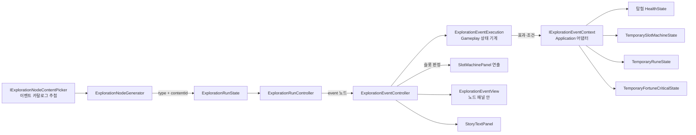

# 탐험 이벤트 노드와 확장 가능한 이벤트 시스템

## 1. 목적과 작업 범위

현재 탐험 노드는 전투(`combat`)와 효과 없는 회복·강화(`recovery-upgrade`) 두 종류뿐이다. 이 작업은 세 번째 노드 종류인 **이벤트 노드**(`event`)를 추가한다. 이벤트 노드를 고르면 노드 패널 안의 이벤트 화면에서 문구와 선택지를 보여 주고, 선택이나 슬롯 판정 결과에 따라 효과를 적용한 뒤 노드를 완료한다.

이벤트는 앞으로 크게 다양해진다. 그래서 이번 작업의 핵심은 테스트 이벤트 자체보다 **이벤트를 데이터로 조합하는 구조**다. 개발자는 이벤트 하나를 ScriptableObject 자산으로 만들고, 페이지·선택지·조건·효과를 Inspector에서 조합한다. 새 효과나 새 상호작용 종류는 클래스 하나를 추가해서 늘린다.

이 문서는 구현 지침이다. 아래의 신규 타입, 자산, 계층, 메뉴는 예정된 구조이며 아직 구현되었다고 간주하지 않는다. 이 문서를 작성하는 단계에서는 코드, Prefab, Scene, 설정 자산을 수정하지 않았다.

포함 범위는 다음과 같다.

- 노드 종류 `event`와 후보 생성 시 이벤트 확정(노드 기록에 이벤트 ID 저장)
- 노드 종류별 가중치를 목록형 설정으로 바꾸고 기존 값을 이전
- 이벤트 실행 모델: 페이지 그래프, 상호작용(계속·선택지·슬롯 판정), 조건, 효과, 실행 상태
- 기본 효과: 체력·최대 체력, Reel 칸·Reel 개수, Fortune Critical 확률·상한, 룬 획득, Story 문구
- 이벤트 자산과 이벤트 목록(카탈로그), 테스트 이벤트 5개
- 노드 패널 안의 이벤트 화면, 노드 카드와 탐험 기록 트리의 이벤트 표시
- Scene 재로드 시 진행 중 이벤트 복원과 효과 1회 적용
- 테스트, 적용 도구 또는 Editor 적용, 문서 갱신

제외 범위는 다음과 같다. 제외 항목은 12절에 확장 방향만 적는다.

- 아이템 획득 효과, 룬 강화·합성 효과의 실제 구현. 해당 게임 시스템이 아직 없으므로 확장 지점만 둔다.
- 이벤트에서 전투를 시작하는 상호작용, 무작위 분기 상호작용
- 이벤트 등장 조건(깊이, 보유 상태 등)과 한 탐험 안의 중복 등장 제한
- 이벤트 진행·결과의 디스크 저장. 탐험과 같이 세션 수명이다.
- 새 탐험 시작 시 슬롯머신·룬·Fortune 상태 초기화
- 강조 연출, 대화 초상화·타자기 효과 같은 대화 연출
- 회복·강화 노드의 실제 효과

## 2. 사용자 확정 사항

| 항목 | 확정 요구 |
| --- | --- |
| 이벤트 노드 | 노드 종류로 "이벤트"를 추가한다. 우선 임시(테스트) 이벤트를 만든다. |
| 등장 | 노드 선택 후보에 이벤트 노드가 등장할 수 있어야 한다. |
| 다양화 | 슬롯 결과 구간(이상·이하·사이)에 따른 분기, 텍스트·대화만 보여 주는 이벤트, 체력·최대 체력 증감, Reel 변화(칸 값 추가·제거, Reel 개수 증감, Fortune Critical 변동), 아이템 획득, 룬 획득·강화·합성 등 최대한 다양한 이벤트를 처리할 수 있는 구조여야 한다. |
| 테스트 범위 | 텍스트, 선택지에 따른 체력 변화, 슬롯 구간 분기, Reel·룬·Fortune 변화를 각각 쓰는 예시 이벤트 여러 개를 만든다. |
| 표시 위치 | 노드 선택 카드가 보이던 `ExplorationNodePanel` 안에 이벤트 화면(제목·본문·선택지)을 둔다. 슬롯 판정 때는 슬롯 패널이 보이도록 노드 패널을 잠시 숨긴다. |
| 작성 방식 | 이벤트마다 ScriptableObject 자산을 만들고, 페이지·선택지·조건·효과를 Inspector에서 조합한다. 효과 종류는 클래스로 추가하고 `[SerializeReference]` 드롭다운에서 고른다. |
| 노드 가중치 | 기존 노드를 유지하고 이벤트를 추가한다. 전투 40, 회복·강화 30, 이벤트 30. 종류별 가중치는 목록형 설정으로 바꾼다. |
| 체력 0 | 이벤트 효과로 체력이 0이 되면 전투 패배와 같이 노드를 실패로 기록하고 탐험을 종료한다. |
| 슬롯 판정 | 전투와 같은 세션 Reel과 Fortune Critical 규칙으로 돌리고, `SlotMachinePanel`에서 같은 회전 연출을 보여 준다. 판정은 최종 합계로 한다. 룬 분배는 하지 않는다. |
| 카드 표시 | 후보를 만들 때 이벤트를 미리 정하고, 카드에 이벤트 제목과 짧은 설명을 보여 준다. |
| 변화 지속 범위 | 이벤트로 바뀐 Reel·룬·Fortune 상태는 기존 세션 상태를 그대로 바꾸며 앱 실행 동안 유지된다. 저장하지 않는다. |

다음은 사용자가 정하지 않은 세부값이며 이 문서가 정한 임시값이다. 설정 자산의 값이고 바꿀 수 있다.

| 항목 | 임시값 |
| --- | --- |
| 테스트 이벤트 등장 가중치 | 5절 표 |
| 이벤트 화면의 시스템 문구 | `계속`, `이벤트 종료`, `조건 미충족: {사유}` 등 `ExplorationEventStoryFormatter`의 상수 |
| 효과 실패 정책 | 실행 중 적용할 수 없는 효과는 건너뛰고 Story에 알린 뒤 이벤트를 계속한다(7.5절). |

## 3. 선행 조건, 선행 문서와 확인한 현재 구조

### 3.1 선행 조건

이 작업은 Fortune Critical 구현(`DOCS/instructions/slot-fortune-critical.md`)이 작업 트리에 있다는 전제로 작성했다. 작성 시점(2026-10-13)에는 Fortune Critical 변경이 커밋되지 않은 상태로 작업 트리에 있었다. 이 변경은 사용자의 작업이므로 되돌리지 않는다. 구현 전에 `TemporaryFortuneCriticalState`, `FortuneCriticalResolver`, `TemporarySlotCombatController.CreateSpinDisplay`의 Fortune 오버로드가 있는지 확인하고, 없으면 작업을 멈추고 보고한다.

### 3.2 선행 문서

작업 전 `AGENTS.md`, `DOCS/README.md`와 아래 문서를 읽는다.

- `DOCS/architecture/exploration-node-tree.md` (탐험 상태, 노드 처리, 카드 입력 정책)
- `DOCS/architecture/exploration-history-tree.md` (노드 패널 배치, `CoveredPanelInteractionBlocker`, 기록 트리 스타일)
- `DOCS/architecture/slot-machine-and-runes.md` (슬롯머신·룬·Fortune Critical 상태와 패널 연출)
- `DOCS/architecture/temporary-combat.md` (공용 행동 잠금, Scene 재로드 시 결과 1회 적용)
- `DOCS/architecture/player-session.md`, `DOCS/architecture/character-domain.md` (`HealthState`)
- `DOCS/development/visual-effect-readiness.md`, `DOCS/architecture/korean-font-fallback.md`

### 3.3 확인한 현재 구조

구현 전에 다시 확인한다.

| 대상 | 현재 상태 |
| --- | --- |
| `ExplorationRunState` (`Assets/TxTRPG/Gameplay/Runtime/Exploration/ExplorationRunState.cs`) | 노드 기록 `ExplorationNodeRecord`는 ID, 부모, 후보 집합 ID, 형제 순서, 깊이, `TypeId`, 상태, 완료 이유만 가진다. 노드 내용(어떤 이벤트인지)을 담을 곳이 없다. `ExplorationNodeTypeIds`에 `root`, `combat`, `recovery-upgrade`가 있다. |
| `ExplorationNodeGenerator` | 선택지 수만큼 종류 가중치로 독립 추첨해 `TypeId` 목록을 돌려준다. 난수는 `IExplorationRandomSource.Next`다. |
| `ExplorationRunConfiguration` (`Assets/TxTRPG/Application/Runtime/Exploration/`, 자산 `Assets/TxTRPG/Application/Configuration/ExplorationRunConfiguration.asset`) | `choiceCount`(3), `combatWeight`(50), `recoveryUpgradeWeight`(50)를 고정 필드로 가진다. Editor용 `ConfigureForEditor(choices, combat, recoveryUpgrade)`가 있다. |
| `ExplorationRunController` | 선택한 노드를 `TypeId` if/else로 처리한다. 전투는 `ITemporaryCombatController.BeginCombat`, 회복·강화는 `panel`·`statusText`·`continueButton` 안내 후 `PlaceholderAcknowledged`로 완료, 그 밖의 종류는 `HandlerNotRegistered`로 탐험을 실패시킨다. 카드 문구(`CreateCardData`)와 Story 이름(`DisplayName`)도 if/else다. `RefreshRunPresentation`이 Scene 재진입 시 활성 노드 화면을 다시 만든다. |
| `ExplorationTreeProjection`, `ExplorationTreeStyle` | 트리 노드는 `TypeId`로 스타일 자산(`Assets/TxTRPG/UI/Styles/ExplorationTreeDefaultStyle.asset`)에서 이름과 아이콘을 찾는다. 현재 `combat`, `recovery-upgrade` 항목만 있고 없으면 `fallbackIcon`을 쓴다. |
| `ExplorationNodePanel` (`TMP_MainScene`의 `MiddlePanel/ContentLayer` 오버레이) | 노드 선택 중 `MiddlePanel`을 덮는다. `CoveredPanelInteractionBlocker`가 가려진 패널의 입력을 막는다. 자식으로 상태 문구, 카드 목록, `Continue` 버튼이 있다. 카드는 첫 방향 입력 전까지 자동 선택하지 않는다. |
| `HealthState` | `ApplyDamage`, `Heal`, `RestoreToFull`, `SetMaximum`(최소 1, 현재값은 새 최대값으로 잘림)과 `Changed` 이벤트가 있다. 탐험 체력은 운영 캐릭터 체력에서 한 번 복사한 별도 인스턴스다. |
| 세션 상태 (`PlayerSessionHost`) | `TemporarySlotMachine`(Reel 변경 `Try...` API), `TemporaryRunes`(`Catalog`, `Inventory.TryAdd`, `Loadout.TryAddLine` 등), `TemporaryFortuneCritical`(확률·규칙·상한 `Try...` API), `TemporaryExploration`, 공용 행동 잠금 `TryBeginTemporaryCombatAction(expectedCombat, ...)`이 있다. |
| `TemporarySlotCombatController` | 슬롯 패널을 소유하는 유일한 컨트롤러다. 슬롯머신·룬 상태의 `Changed`에서 패널 정지 표시와 요약을 갱신한다. 전투가 없을 때는 행동을 실행할 수 없다. |
| 아이템 (`Assets/TxTRPG/Gameplay/Runtime/Items/InventoryState.cs`) | 운영 `PlayerState`에 속하며 저장 대상이다. 이벤트 보상 경로는 없다. |

## 4. 전체 구조



| 어셈블리 | 담당 |
| --- | --- |
| `TxTRPG.Gameplay` | 노드 내용 ID, 이벤트 실행 모델(불변 이벤트·페이지), 상호작용·조건·효과 계약, 실행 상태 기계, 효과가 쓰는 기능 계약(capability)과 결과. Unity에 의존하지 않는다. |
| `TxTRPG.Application` | 이벤트 자산·카탈로그와 직렬화되는 효과·조건·상호작용 정의, 실행 문맥 어댑터, `ExplorationEventController`, 세션 보관, Story 문구, 적용 도구 |
| `TxTRPG.UI` | `ExplorationEventView`와 표시 데이터. Gameplay·Application 타입을 쓰지 않는다. |

## 5. 노드 종류와 후보 생성

### 5.1 노드 내용 ID

- `ExplorationNodeTypeIds.Event = "event"`를 추가한다.
- `ExplorationNodeRecord`에 `ContentId`(문자열, 기본 빈 문자열)를 추가한다. 이벤트 노드에서는 이벤트 ID이고, 다른 종류는 빈 문자열이다. 다른 노드 종류도 나중에 내용 ID(예: 적 ID)를 쓸 수 있다.
- `ExplorationNodeGenerator.Generate`는 `ExplorationNodeCandidate`(`TypeId`, `ContentId`) 목록을 돌려준다. 생성기는 종류를 추첨한 뒤, 종류에 등록된 `IExplorationNodeContentPicker`가 있으면 내용 ID를 추첨한다. 피커가 없는 종류는 빈 내용 ID다.
- 피커 계약: `bool TryPick(ExplorationNodeContentRequest request, IExplorationRandomSource random, out string contentId)`. 요청에는 종류 ID, 깊이, 같은 후보 집합에서 이미 고른 내용 ID 목록이 들어간다. 이벤트 피커는 가능하면 같은 후보 집합 안에서 같은 이벤트를 다시 고르지 않는다. 남은 이벤트가 없으면 중복을 허용한다.
- 피커가 실패하면(이벤트 목록이 비었거나 모든 가중치가 0) 그 칸의 종류를 다시 추첨하되 그 종류를 제외한다. 남은 종류가 없으면 생성기는 예외를 던진다. 이 경우는 설정 검증에서 미리 막는다(5.3절).
- 기존 생성자와 테스트가 쓰는 `IReadOnlyList<string> Generate()` 형태가 필요하면 호환 메서드로 남긴다. 기존 `ExplorationRunStateTests`가 그대로 통과해야 한다.

### 5.2 가중치 설정 이전

`ExplorationRunConfiguration`의 고정 필드를 목록 `nodeWeights`(종류 ID, 가중치)로 바꾼다.

- 기존 자산의 `combatWeight`·`recoveryUpgradeWeight` 값은 `[FormerlySerializedAs]`만으로 목록에 옮길 수 없다. `ISerializationCallbackReceiver`로 옛 필드를 읽어 목록이 비어 있을 때 한 번 채우는 방식, 또는 버전 필드와 이전 코드로 옮긴다. 옛 자산을 열었을 때 값이 사라지지 않아야 하며 이 이전을 테스트한다.
- 자산의 새 값은 `combat` 40, `recovery-upgrade` 30, `event` 30이다. 옛 값의 이전과 새 값 적용은 별개다. 이전 코드는 옛 값을 그대로 옮기고, 새 값은 적용 단계(9절)에서 자산에 명시적으로 쓴다.
- 이벤트 카탈로그 참조 `eventCatalog`를 추가한다.
- Editor용 `ConfigureForEditor(choices, combat, recoveryUpgrade)`는 유지하고(이벤트 0), 목록을 받는 오버로드를 추가한다.

### 5.3 이벤트 카탈로그와 실패 동작

`ExplorationEventCatalog`(ScriptableObject, 만들기 메뉴 `Assets > Create > TxT RPG > Exploration > Event Catalog`)는 이벤트 자산과 등장 가중치 목록이다. 이벤트 ID 중복, 빈 항목, 음수 가중치, 잘못된 이벤트 자산을 검증한다.

| 상황 | 동작 |
| --- | --- |
| 카탈로그 없음·비어 있음·검증 실패 | 이벤트 종류 가중치를 0으로 취급해 이벤트 노드가 나오지 않는다. `Debug.LogError`(없음은 `LogWarning`)를 한 번 남긴다. 게임은 시작한다. |
| 이벤트 자산 하나가 검증 실패 | 그 이벤트만 카탈로그 런타임 목록에서 빼고 사유를 기록한다. |
| 모든 노드 종류 가중치 합이 0 | 기존과 같이 생성기 생성에 실패한다. 설정 검증 오류로 보고한다. |
| 노드 기록의 이벤트 ID를 실행 시 찾지 못함(Scene 재로드 중 자산 변경 등) | 이벤트 화면에 `이벤트를 불러오지 못했습니다`를 보여 주고 `계속`으로 노드를 `EventUnavailable`로 완료한다. 탐험은 계속된다. |

### 5.4 노드 카드와 기록 트리

- 카드: 제목은 이벤트 `Title`, 설명은 이벤트 `Summary`, 상태 배지는 `이벤트`다. 문구는 Application이 만든다.
- Story: `[탐험] 이벤트: {제목} 노드를 선택했습니다. (node-n)`
- 기록 트리: `ExplorationTreeDefaultStyle.asset`에 `event` 항목(`이벤트`, 아이콘)을 추가한다. 아이콘 Sprite가 없으면 기존 `fallbackIcon`을 쓴다. 트리 노드에 이벤트 제목을 표시하는 것은 이번 범위가 아니다.

## 6. 이벤트 모델

### 6.1 구성

```text
ExplorationEventDefinition (자산)
├─ eventId, title, summary
├─ startPageId
└─ pages[]
   ├─ pageId, title(선택), body
   ├─ onEnter: effects[]            (페이지에 들어올 때 한 번)
   └─ interaction                   (SerializeReference, 하나)
      ├─ Continue      : label, effects[], next
      ├─ Choice        : options[] = { label, conditions[], effects[], next }
      └─ SlotCheck     : label, useFortuneCritical(기본 켜짐), outcomes[] = { min?, max?, effects[], next }, fallback
```

- `next`는 페이지 ID 또는 `End`다. 페이지 사이를 오가는 분기와 반복을 허용하되, 한 번의 이벤트에서 페이지 진입 횟수는 `ExplorationEventLimits.MaximumPageVisits`(64)를 넘지 않는다. 넘으면 이벤트를 강제로 끝내고 오류를 기록한다.
- 텍스트만 보여 주는 이벤트는 `Continue` 페이지만으로 만든다.
- 슬롯 결과 구간: `min`, `max`는 각각 비워 둘 수 있고 포함 경계다. `min`만 있으면 이상, `max`만 있으면 이하, 둘 다 있으면 사이다. 위에서부터 처음 맞는 구간을 쓰고, 맞는 구간이 없으면 `fallback`을 쓴다. 구간이 겹치면 Inspector에 경고를 표시한다(오류는 아님).
- 문구는 자산의 문자열이다. 나중에 현지화 키로 바꿀 수 있도록 표시 문구 생성은 `ExplorationEventStoryFormatter`와 표시 데이터 변환 한 곳에서만 한다.

### 6.2 확장 계약 (Gameplay)

| 계약 | 역할 | 이번 구현 |
| --- | --- | --- |
| `IExplorationEventInteraction` | 페이지의 플레이어 상호작용. 표시 형태와 허용 입력(`ExplorationEventInput`)을 정한다. | `Continue`, `Choice`, `SlotCheck` |
| `IExplorationEventCondition` | 선택지를 고를 수 있는지 판단하고, 아니면 사유 문구를 돌려준다. | `HealthAtLeast`, `ReelCountAtLeast`, `ReelCountAtMost`, `HasRuneDefinition` |
| `IExplorationEventEffect` | 문맥의 기능을 사용해 상태를 바꾸고 `ExplorationEventEffectResult`(성공·건너뜀·패배, Story 문구)를 돌려준다. | 7절 |
| `IExplorationEventContext` | 효과와 조건이 쓰는 기능의 묶음. 기능마다 없을 수 있다(`null` 대신 `TryGet...` 또는 `IsAvailable`). | Application 어댑터 |

`IExplorationEventContext`가 노출하는 기능 계약은 Gameplay에 둔다. 효과는 Application 상태 타입을 직접 알지 않는다.

| 기능 | 내용 |
| --- | --- |
| `Health` | 탐험 `HealthState` |
| `SlotMachine` | Gameplay `SlotMachine` 모델(변경 `Try...` API) |
| `Runes` | `RuneDefinitionCatalog`, `RuneInventory`, `RuneLoadout`, 새 인스턴스·줄 ID 생성기 |
| `FortuneCritical` | 현재 규칙 읽기와 변경 `Try...`를 감싸는 Gameplay 계약 `IFortuneCriticalRuleStore`. Application의 `TemporaryFortuneCriticalState`가 구현한다. |
| `Story` | 효과가 남길 문구를 모으는 수집기. 효과는 Story 패널에 직접 쓰지 않는다. |

새 효과 하나를 추가하는 방법은 "Application에 `[Serializable]` 클래스 하나 추가 + `IExplorationEventEffect` 구현"이어야 한다. 새 효과가 새 게임 시스템을 필요로 하면 그 시스템의 기능 계약을 `IExplorationEventContext`에 추가하고 Application 어댑터를 연결한다. 이 절차를 아키텍처 문서에 적는다.

### 6.3 직렬화

- 상호작용·조건·효과 필드는 `[SerializeReference]`로 선언한다. Inspector에서 구현 클래스를 고르는 드롭다운은 `Assets/TxTRPG/Application/Editor/`의 PropertyDrawer로 만든다. 후보 목록은 `TypeCache.GetTypesDerivedFrom<T>()`로 Editor에서만 찾는다. 런타임에는 리플렉션 검색을 하지 않는다.
- 구현 클래스는 `[Serializable]`, 매개변수 없는 생성자, 직렬화 필드만 가진다. 실행 중 상태를 필드에 저장하지 않는다(자산이 공유되기 때문이다).
- 클래스 이름·네임스페이스·어셈블리를 바꿀 때는 `[UnityEngine.Scripting.APIUpdating.MovedFrom]`을 붙인다. 이 규칙을 문서와 각 기반 클래스 주석에 적는다.
- IL2CPP 코드 제거로 `SerializeReference` 구현 클래스가 빠지지 않도록, 자산에서 참조되는 클래스는 그대로 보존된다는 점을 확인한다. 실제 빌드 확인을 하지 못했다면 미확인으로 보고한다.
- 런타임 실행 전에 자산을 Gameplay 불변 모델(`ExplorationEvent`, `ExplorationEventPage`)로 변환하고 검증한다. 검증 항목: 빈·중복 페이지 ID, 존재하지 않는 `next`·`startPageId`, 빈 상호작용, 선택지 0개, `null` 효과·조건, 각 효과·조건의 자체 검증(`Validate(out reason)`), `min > max` 구간.

### 6.4 실행 상태 기계

`ExplorationEventExecution`(Gameplay)은 이벤트 하나의 진행 상태다.

| 상태 | 의미 |
| --- | --- |
| `AwaitingInput` | 현재 페이지의 상호작용 입력을 기다린다. |
| `AwaitingSlotResult` | 슬롯 판정 결과(최종 합계)를 기다린다. 이 상태로 바뀌는 시점에 Application이 회전을 수락한다. |
| `Completed` | `End`에 도달했다. |
| `Defeated` | 효과로 체력이 0이 되었다. |

- 입력 메서드: `Continue()`, `Choose(optionIndex)`, `BeginSlotCheck()`, `ResolveSlotCheck(int finalTotal)`. 상태와 맞지 않는 입력, 조건을 만족하지 않는 선택지는 거부하고 상태를 바꾸지 않는다.
- 한 번의 전환은 "효과 적용 → 다음 페이지 진입 → 그 페이지의 `onEnter` 효과 적용"까지를 한 단계로 처리하고 `ExplorationEventStepResult`(Story 문구 목록, 새 상태)를 돌려준다.
- 효과는 목록 순서대로 적용한다. 체력 효과 뒤 체력이 0이면 남은 효과를 적용하지 않고 `Defeated`가 된다.
- 실행 상태는 적용한 전환 수(`AppliedStepCount`)와 현재 페이지 ID, 방문 횟수를 가진다. 같은 입력이 두 번 들어와도 효과는 한 번만 적용된다.

## 7. 기본 효과

모든 수치는 정수다. 효과마다 `Validate`에서 정적 오류를 거부하고, 실행 중 적용할 수 없는 경우는 7.5절을 따른다. Story 문구 예는 8절에 있다.

### 7.1 체력

| 효과 | 매개변수 | 규칙 |
| --- | --- | --- |
| `ChangeHealthEffect` | `amount`(0 아닌 정수) | 양수는 `Heal`, 음수는 `ApplyDamage`. 0이 되면 패배 |
| `RestoreHealthEffect` | 없음 | `RestoreToFull` |
| `ChangeMaximumHealthEffect` | `amount`(0 아닌 정수), `alsoChangeCurrent`(기본 켜짐) | 새 최대값은 최소 1. 증가 시 `alsoChangeCurrent`면 같은 양만큼 회복한다. 감소 시 현재값은 새 최대값으로 잘린다. 최대 체력 감소로는 0이 되지 않는다. |

### 7.2 슬롯머신 Reel

Reel 지정은 `ReelSelector`(Reel ID, 또는 위치: 처음·마지막·N번째)로 한다. 지정한 Reel이 없으면 건너뛴다.

| 효과 | 매개변수 | 규칙 |
| --- | --- | --- |
| `AddReelSymbolEffect` | Reel, `value`(0 이상), `count`(기본 1) | Strip 끝에 추가한다. |
| `RemoveReelSymbolEffect` | Reel, `value`, `count`(기본 1) | 해당 값의 칸을 앞에서부터 제거한다. 칸이 1개만 남는 경우 마지막 칸은 제거하지 않고 건너뜀으로 기록한다. |
| `AddReelEffect` | `reelId`, `values` | 끝에 Reel을 추가한다. ID가 이미 있으면 `{reelId}.2`, `.3`처럼 처음 비는 접미사를 붙인다. Fortune Critical은 그 ID의 개별 규칙 또는 기본 규칙을 따른다. |
| `RemoveReelEffect` | Reel | Reel이 1개만 남으면 건너뛴다. |

변경은 모두 `SlotMachine`의 기존 `Try...` API를 쓴다. 실패 사유는 Story와 경고 로그에 남긴다. 슬롯 패널은 기존처럼 상태 `Changed`로 갱신된다.

### 7.3 Fortune Critical

| 효과 | 매개변수 | 규칙 |
| --- | --- | --- |
| `ChangeFortuneChanceEffect` | 대상(`DefaultReel`, `Reel`(ID), `Total`), `mode`(`Set`·`Add`), `value`(확률, `Add`는 음수 허용) | 결과는 0~1로 자른다. `Reel` 대상에 개별 규칙이 없으면 기본 규칙을 복사해 개별 규칙을 만든 뒤 확률을 바꾼다. |
| `ChangeFortuneCapEffect` | `mode`(`Set`·`Add`), `value` | 허용 범위로 자른다. |

### 7.4 룬

| 효과 | 매개변수 | 규칙 |
| --- | --- | --- |
| `GrantRuneEffect` | `definitionId`, `count`(기본 1), `placement`(`NewLine` 기본, `StackOnLine`(줄 ID 또는 같은 정의의 첫 줄), `Unequipped`) | 새 인스턴스 ID는 기존 ID와 겹치지 않게 만든다(예: `rune.attack.event.{n}`). 카탈로그에 없는 정의 ID는 `Validate`에서 확인할 수 없으므로(세션 카탈로그는 실행 중에 정해진다) 실행 시 건너뛴다. 장착 실패 시 인벤토리 추가도 되돌린다. |

룬 강화·합성과 아이템 획득은 이번에 구현하지 않는다(12절).

### 7.5 실행 중 적용 실패와 기능 없음

- 기능이 없는 문맥(예: 슬롯 설정 오류로 `SlotMachine` 기능 없음)에서는 효과를 건너뛰고 `[이벤트] 적용할 수 없는 효과를 건너뛰었습니다: {사유}`를 기록한다. `Debug.LogWarning`도 남긴다.
- 건너뛴 효과는 이벤트를 멈추지 않는다. 같은 선택지의 다음 효과는 계속 적용한다.
- 효과 하나의 일부만 적용된 상태로 끝나지 않게, 여러 단계를 바꾸는 효과(룬 추가 + 장착 등)는 실패 시 자기 변경을 되돌린다.
- 예외는 효과 실행기가 잡아 건너뜀으로 바꾸고 오류를 기록한다. 이미 적용한 앞선 효과는 되돌리지 않는다.

### 7.6 조건

| 조건 | 사유 문구 예 |
| --- | --- |
| `HealthAtLeast(value)` | `체력 6 이상 필요` |
| `ReelCountAtLeast(value)`, `ReelCountAtMost(value)` | `Reel 2개 이상 필요` |
| `HasRuneDefinition(definitionId, count)` | `공격 룬 1개 필요` |

조건을 만족하지 않는 선택지도 화면에 보이되 비활성으로 두고 사유를 함께 표시한다. 모든 선택지가 비활성이면 이벤트를 진행할 수 없으므로, 검증 단계에서 조건 없는 선택지가 하나 이상 있는지 확인하고 없으면 Inspector 경고를 표시한다. 실행 중 모든 선택지가 비활성이면 `이벤트 종료` 버튼을 보여 주고 노드를 `EventCompleted`로 완료한다.

## 8. Application 실행 경로

### 8.1 구성 요소

| 대상 | 요구 |
| --- | --- |
| `ExplorationEventDefinition` (ScriptableObject) | 6.1절 자산. 만들기 메뉴 `Assets > Create > TxT RPG > Exploration > Event`. `TryCreateEvent(out ExplorationEvent, out reason)`으로 Gameplay 모델을 만든다. |
| `ExplorationEventCatalog` | 5.3절 |
| `ExplorationEventContext` | `IExplorationEventContext` 구현. `PlayerSessionHost`의 탐험 체력, 슬롯머신·룬·Fortune 상태를 감싼다. 상태가 없으면 해당 기능을 없음으로 보고한다. |
| `ExplorationEventController` (MonoBehaviour, `ISceneInitializer`) | 이벤트 노드 실행을 맡는다. `ExplorationRunController`가 `IExplorationEventController`(`Begin(node)`, `Restore(node)`, `Completed` 이벤트) 계약으로 호출한다. 전투 컨트롤러 연결과 같이 `MonoBehaviour` 직렬화 필드 + 인터페이스 검증을 쓴다. 참조: `ExplorationEventView`, `StoryTextPanel`, `SlotMachinePanel`, 노드 패널. |
| 세션 보관 | `PlayerSessionHost`에 진행 중 이벤트 기록(`TemporaryExplorationEventRecord`: run ID, node ID, 이벤트 ID, `ExplorationEventExecution`, 수락된 슬롯 판정, 아직 Story에 쓰지 않은 문구)을 보관하는 API를 추가한다. |
| `ExplorationEventStoryFormatter` | 이벤트 Story·화면 문구 |

`ExplorationRunController` 변경은 최소로 한다.

- `event` 노드 선택 시 `IExplorationEventController.Begin(node)`을 호출한다. 이벤트 진행 중 노드 패널은 계속 보이며 카드 목록 대신 이벤트 화면을 보여 준다.
- `Completed(nodeId, outcome)`을 받으면 `Completed` → `run.CompleteActive(nodeId, "EventCompleted"/"EventUnavailable")` 후 후보 표시, `Defeated` → `run.FailActive(nodeId, "EventDefeat")` 후 기존 패배 화면과 같은 종료 표시를 한다.
- `RefreshRunPresentation`은 활성 노드가 `event`이면 `Restore(node)`를 호출한다.
- 카드 문구와 Story 이름에 `event`를 추가한다. 기존 전투·회복·강화 분기는 바꾸지 않는다. 처리기 레지스트리로의 전면 재구성은 이번 범위가 아니다.
- 이벤트 컨트롤러 참조가 없으면 `event` 노드 가중치를 0으로 취급하고 경고한다. 이미 생성된 `event` 노드가 활성인데 컨트롤러가 없으면 기존 `HandlerNotRegistered` 경로 대신 5.3절의 `EventUnavailable` 완료를 쓴다.

### 8.2 슬롯 판정

1. 플레이어가 슬롯 판정 버튼을 누르면 공용 행동 잠금을 얻는다. 현재 잠금 API는 전투 상태를 기대값으로 받으므로, 전투 없이도 쓸 수 있는 오버로드(예: `TryBeginTemporarySlotPresentation(out actionId)`)를 추가한다. 전투 행동과 이벤트 판정이 동시에 실행되지 않아야 한다.
2. `Spin` → `FortuneCriticalResolver.Resolve`(설정이 `useFortuneCritical`일 때만, 아니면 `FortuneCriticalResult.None`)로 결과를 한 번 정하고 세션 기록에 저장한다. 이후 다시 돌리지 않는다. 난수는 이벤트 컨트롤러가 가진 회전용·Fortune용 `IRandomIndexProvider`이며 테스트 주입 메서드를 둔다.
3. 노드 패널을 숨겨 `SlotMachinePanel`이 보이고 입력 차단이 풀리게 한다. `CreateSpinDisplay`의 Fortune 오버로드로 표시 데이터를 만들되, 룬 분배가 없으므로 룬 표는 회전 중·정지 후 모두 쌓인 수(`×N`)만 보여 주는 요약을 쓴다. 이 요약 생성은 `TemporarySlotCombatController`의 공개 정적 메서드를 재사용하거나 같은 곳에 오버로드를 추가한다.
4. `PlaySpinAsync`를 기존 제한 시간 규칙(`TemporaryCombatPresentationTimeout`)으로 기다리고, 시간 초과·실패 시 `StopAtResult`로 결과를 보여 준다. Reduce Motion을 따른다.
5. `ResolveSlotCheck(FinalTotal)`로 구간을 정하고 효과를 적용한 뒤 노드 패널을 다시 보여 준다. 잠금을 해제한다.

슬롯 패널을 두 컨트롤러가 동시에 조작하지 않도록 한다. 이벤트 판정 중에는 `TemporarySlotCombatController`가 상태 `Changed`로 패널을 재설정하더라도 회전 중인 패널은 기존 규칙(회전 중 구성 변경은 연출 뒤 반영)으로 보호되는지 확인하고, 판정이 끝나면 정지 결과를 유지한다. 다음 전투에서 패널이 정상적으로 다시 갱신되는지 확인한다.

### 8.3 Scene 재로드와 1회 적용

- 진행 중 이벤트는 세션 기록이 원본이다. 새 Scene의 컨트롤러는 기록에 다시 연결해 현재 페이지를 표시하고 새 이벤트를 고르지 않는다.
- 슬롯 판정 결과를 수락한 뒤 Scene이 바뀌면, 기존 슬롯 전투와 같이 진행 중이던 작업이나 새 컨트롤러가 수락된 결과로 `ResolveSlotCheck`를 정확히 한 번 호출한다. 새로 돌리지 않는다.
- 아직 Story에 쓰지 않은 문구는 새 Story 패널에 한 번 기록한다.
- 게임 창(가방 등)을 열고 닫아도 이벤트 상태는 바뀌지 않는다. 모달이 열린 동안 이벤트 화면 입력은 차단한다.

## 9. UI와 적용

### 9.1 `ExplorationEventView`

`TxTRPG.UI.Exploration`에 둔다. 표시 데이터 `ExplorationEventPageDisplay`(제목, 본문, 선택지 목록 `{라벨, 활성, 사유}`, 진행 중 여부)를 받아 그린다.

```text
ExplorationNodePanel
├─ (기존) 상태 문구, 카드 목록, Continue
└─ EventView                        (배치 루트, 노드 패널 영역을 채움, 평소 비활성)
   └─ VisualRoot                    (외형·효과 루트)
      ├─ Background
      ├─ Title                      (TMP)
      ├─ BodyScroll (ScrollRect) > Viewport > Body (TMP, 줄바꿈)
      ├─ Choices (VerticalLayoutGroup, 버튼 템플릿 재사용)
      │  └─ ChoiceTemplate          (Button > VisualRoot > Label, Reason)
      └─ EffectRoot
```

- 레이아웃은 앵커와 LayoutGroup으로 만든다. 본문이 길면 본문만 스크롤하고 선택지는 항상 보인다. 선택지가 많으면 선택지 영역도 스크롤한다. 1920×1080, 21:9, 1024×768, 390×844에서 제목·본문·선택지가 잘리지 않아야 한다.
- 터치 목표는 높이 최소 48 기준 단위 이상이다.
- 비활성 선택지는 색만으로 구분하지 않고 사유 문구를 함께 표시한다.
- 입력: 클릭·터치와 `Submit`은 같은 `Button.onClick` 경로를 쓴다. 카드 목록과 같이 새 페이지를 보여 줄 때 자동 선택하지 않고, 첫 방향 입력에서 첫 활성 선택지에 포커스를 준다. `Cancel`은 이벤트를 취소하지 않는다. 버튼 하나를 누르면 다음 페이지가 표시될 때까지 모든 선택지를 잠가 중복 입력을 막는다.
- 페이지가 바뀔 때만 문자열을 할당한다. 매 프레임 갱신하지 않는다.
- 모든 장식 Graphic의 `raycastTarget`을 끈다. 한국어 대체 글꼴로 표시되는지 확인한다.

### 9.2 테스트 이벤트 자산

`Assets/TxTRPG/Application/Configuration/Events/`에 카탈로그 `ExplorationEventCatalog.asset`을, `Events/Test/`에 아래 이벤트를 만든다. 이벤트 ID는 `event.test.*`로 시작한다. 문구와 수치는 임시값이다.

| 이벤트 ID | 제목 | 가중치 | 내용 | 검증하는 기능 |
| --- | --- | --- | --- | --- |
| `event.test.signpost` | 낡은 표지판 | 3 | 두 페이지 텍스트 → `계속` → 종료 | 텍스트·페이지 이동 |
| `event.test.shrine` | 수상한 제단 | 3 | 기도한다: 최대 체력 +5(현재도 +5) / 피를 바친다(조건 체력 6 이상): 체력 -5, Reel 기본 Fortune 확률 +0.02 / 지나친다: 효과 없음 | 선택지, 조건, 체력·최대 체력, Fortune |
| `event.test.slot-trial` | 운명의 슬롯 | 3 | 슬롯 판정: 6 이하 체력 -4 / 7~12 효과 없음 / 13 이상 체력 +6, 첫 Reel에 7 추가 | 슬롯 구간, Fortune 반영 합계, Reel 칸 추가 |
| `event.test.workshop` | 떠돌이 세공사 | 3 | Reel 하나 추가(`reel.event`, 1~6) / 첫 Reel에서 1 하나 제거 / 공격 룬 1개 획득(새 줄) | Reel 개수, 칸 제거, 룬 획득 |
| `event.test.trap` | 무너지는 천장 | 1 | 시작 페이지 `onEnter` 체력 -6 → `계속` | `onEnter`, 체력 0일 때 탐험 실패 |

### 9.3 적용

카탈로그·이벤트 자산은 developer-authored 자산이며 Prefab 일괄 Rebuild에 등록하지 않는다. Editor 자동화로 적용하거나, 다시 실행해도 안전한 임시 메뉴 `Tools > TxT RPG > Application > Temporary > Apply Exploration Event Nodes`를 만든다. 메뉴는 다음만 한다.

1. 없을 때만 카탈로그와 테스트 이벤트 자산을 만든다. 있는 자산의 내용은 덮어쓰지 않는다.
2. `ExplorationRunConfiguration.asset`의 노드 가중치 목록에 `event`가 없을 때만 추가하고, 이번 확정값(40/30/30)이 아니면 기록한 뒤 바꾼다. 실행 결과에 이전 값을 남긴다. `eventCatalog`가 비어 있으면 연결한다.
3. `ExplorationTreeDefaultStyle.asset`에 `event` 항목이 없으면 추가한다.
4. `TMP_MainScene`의 `ExplorationNodePanel`에 `EventView`가 없으면 추가하고, `ExplorationEventController`를 `ExplorationRunController`와 같은 오브젝트(또는 정해진 오브젝트)에 추가해 빈 참조만 채운다.
5. 원하는 상태면 파일을 쓰지 않고 `already matches; not saved`를 기록한다. 열린 Scene에 저장되지 않은 변경이 있으면 중단한다.

`Validate Exploration Event Nodes` 메뉴(변경 없음)로 자산 검증, 카탈로그 연결, Scene 참조를 검사한다.

## 10. 호환성

- 저장 데이터와 `PlayerState`는 바뀌지 않는다. 아이템 효과를 구현하지 않으므로 저장 대상 인벤토리를 바꾸지 않는다.
- 기존 `ExplorationRunConfiguration.asset`의 가중치는 이전 코드로 보존된다. 옛 필드를 지운 뒤에도 옛 YAML을 읽을 수 있어야 한다.
- `ExplorationNodeRecord`의 새 `ContentId`는 기존 노드에서 빈 문자열이다. 기록 트리와 기존 테스트는 바뀌지 않아야 한다.
- 슬롯 전투 흐름, Fortune Critical, 룬 분배 규칙은 바뀌지 않는다. 이벤트가 바꾼 Reel·룬·Fortune 상태는 다음 전투부터 반영된다.
- 공용 행동 잠금에 오버로드를 추가해도 기존 `TryBeginTemporaryCombatAction`과 별칭의 동작은 같다.

## 11. 검증 기준

Edit Mode 테스트는 관련 클래스만 이름으로 지정해 실행하고 `!AssetWriting`으로 제외한다. 실행 전 Git 상태를 기록한다.

`TxTRPG.Gameplay.Tests.Editor`

- `ExplorationRunStateTests`(기존) 통과, 내용 ID가 있는 후보 생성, 피커 실패 시 종류 재추첨, 같은 후보 집합 내 이벤트 중복 회피
- 새 `ExplorationEventExecutionTests`: 페이지 이동, 선택지 조건 거부, 슬롯 구간(이상·이하·사이·겹침 시 첫 구간·fallback), `onEnter`, 체력 0에서 남은 효과 중단과 `Defeated`, 방문 상한, 같은 입력 반복 시 효과 1회 적용, 상태와 맞지 않는 입력 거부
- 효과별 테스트(테스트용 문맥 구현 사용): 체력 3종, Reel 4종(빈 Reel 방지, ID 충돌 접미사), Fortune 2종(개별 규칙 생성, 범위 자르기), 룬 획득 3가지 배치와 실패 시 되돌림, 기능 없음 건너뜀
- 새 효과를 테스트 어셈블리에서 정의해 실행할 수 있음(확장 검사)

`TxTRPG.Application.Tests.Editor`

- 이벤트 자산 → 모델 변환과 검증 오류, 카탈로그 검증과 실패 시 이벤트 가중치 0
- `ExplorationRunConfiguration` 옛 필드 이전
- `ExplorationEventController`: 시작·완료·패배 통지, 이벤트 ID 없음 처리, 슬롯 판정의 1회 수락·Fortune 반영·룬 분배 없음, 잠금 충돌, Scene 재연결 복원과 미기록 Story 1회 기록
- 테스트 이벤트 5개 자산이 검증을 통과함

`TxTRPG.UI.Tests.Editor`

- `ExplorationEventView`: 선택지 수 변화와 템플릿 재사용, 비활성 사유 표시, 입력 잠금, 자동 선택 없음, `raycastTarget` 규칙

Play Mode 확인은 `AppScene`을 거쳐 `TMP_MainScene`에서 한다.

- 노드 후보에 이벤트 카드가 제목·설명과 함께 등장한다(테스트 중에는 가중치를 임시로 올리거나 테스트용 난수로 고정해도 되지만, 자산을 그 값으로 저장하지 않는다).
- 테스트 이벤트 5개를 모두 끝까지 진행한다. 체력 바, 슬롯 패널(Reel 수·칸), 룬 표, Story 기록이 바뀐 상태와 일치한다. 다음 전투에서 바뀐 Reel·룬·Fortune이 쓰인다.
- `event.test.trap`으로 체력 0일 때 탐험 실패 화면이 나온다.
- 슬롯 판정 중 Scene을 다시 로드해도 결과가 한 번만 적용된다. 판정 중 가방 창을 열고 닫아도 결과가 바뀌지 않는다.
- 키보드·게임패드 `Navigate`/`Submit`, 포인터, 터치(시뮬레이션) 입력과 Reduce Motion
- 1920×1080, 21:9, 1024×768, 390×844에서 이벤트 화면 배치
- 적용 메뉴나 Editor 작업이 `.unity`, `.prefab`, `.asset`, `.meta` 파일을 바꿨으면 `serialization-diff-reviewer`로 확인한다.

이 작업은 Scene·설정 자산·여러 어셈블리를 바꾸므로 구현 전에 `unity-impact-scout`를 호출한다. 실제 모바일·Steam·IL2CPP 빌드를 확인하지 않았다면 미확인으로 보고한다.

## 12. 확장 방향 (미구현)

| 향후 기능 | 연결 방법 |
| --- | --- |
| 아이템 획득 | 아이템 정의·보상 정책이 정해지면 `IExplorationEventContext`에 아이템 기능을 추가하고 `GrantItemEffect`를 만든다. 운영 `InventoryState`는 저장 대상이므로 탐험 중 임시 보관인지 즉시 지급인지 먼저 정한다. |
| 룬 강화·합성 | 룬 시스템에 강화 단계나 합성 규칙이 생기면 그 API를 룬 기능 계약에 추가하고 `UpgradeRuneEffect`, `CombineRunesEffect`를 만든다. 대상 룬을 플레이어가 고르는 경우 새 상호작용(`RuneSelect`)을 추가한다. |
| 이벤트에서 전투 시작 | `StartCombat` 상호작용을 추가한다. 이벤트 실행을 `AwaitingCombat` 상태로 두고 `ITemporaryCombatController`의 승패로 다음 페이지를 정한다. |
| 무작위 분기 | 가중치 결과 목록을 가진 `RandomOutcome` 상호작용. 난수는 이벤트 컨트롤러가 주입한다. |
| 등장 조건 | 카탈로그 항목에 `IExplorationEventAppearanceCondition` 목록(깊이, 보유 룬, 이미 본 이벤트 등)을 추가하고 피커가 요청 정보로 판단한다. |
| 탐험 단위 상태 | 새 탐험 시작 기능이 생기면 Reel·룬·Fortune을 설정 자산 기준으로 다시 만들지 함께 정한다. |
| 대화 연출 | `ExplorationEventView`의 `VisualRoot`·`EffectRoot`에 화자 이름, 초상화, 글자 출력 효과를 추가한다. 페이지 모델에 화자 필드를 추가한다. |
| 현지화 | 자산 문자열을 Localization 키로 바꾸고, 표시 문구 생성 위치(`ExplorationEventStoryFormatter`, 표시 데이터 변환)만 수정한다. |

## 13. 문서 갱신

- 새 아키텍처 문서 `DOCS/architecture/exploration-events.md`: 모델, 계약, 기본 효과·조건·상호작용 표, 효과 추가 절차, 직렬화 규칙(`MovedFrom`), 실행 상태 기계, 실패 동작, Scene 재로드, 슬롯 판정, 표시. `DOCS/README.md`에 직접 링크한다.
- `DOCS/architecture/exploration-node-tree.md`: 노드 종류, 내용 ID, 가중치 목록, 이벤트 처리 연결과 완료 이유(`EventCompleted`, `EventDefeat`, `EventUnavailable`)
- `DOCS/architecture/exploration-history-tree.md`: `event` 스타일 항목
- `DOCS/architecture/slot-machine-and-runes.md`: 이벤트 슬롯 판정 경로, 공용 잠금 오버로드, 이벤트가 바꾸는 상태
- `DOCS/architecture/project-structure.md`: 새 폴더·타입·자산·메뉴
- `DOCS/development/workflows.md`: 적용·검증 메뉴, 새 이벤트 만들기 절차, 새 효과 추가 절차
- `DOCS/instructions/README.md`: 이 지침서 행이 있는지 확인한다.

## 14. 최종 보고 형식

다음을 구분해 보고한다.

1. 구현 완료: 추가·변경한 타입과 파일
2. 적용 완료: Editor에서 이미 적용하고 저장한 자산·Scene과 확인 방법
3. 적용 필요: 사용자가 실행해야 할 메뉴가 남았다면 `사용자가 수행할 적용 절차` 절과 복사 가능한 순서. 없으면 없다고 명시한다.
4. 검증: 실행한 테스트 클래스와 결과, Play Mode에서 진행한 테스트 이벤트와 화면 크기·입력 방식, 직렬화 변경 검토 결과
5. 미확인: 실제 기기·IL2CPP 빌드, 성능 측정 등
6. 2절의 임시값을 그대로 두었는지, 바꿨다면 그 값
