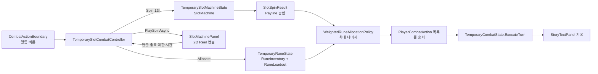

# 슬롯머신과 룬 기반 전투 행동

## 1. 목적과 작업 범위

현재 임시 전투의 플레이어 행동은 보유 주사위를 굴려 정한다. 각 주사위의 면에는 "공격 3", "회복 2"처럼 효과와 수치가 함께 적혀 있고, `행동` 버튼을 누르면 모든 주사위의 결과 면을 모아 순서대로 적용한다. 이 작업은 주사위 시스템을 보류하고, 플레이어 행동을 **슬롯머신(SlotMachine)과 룬(Rune)** 으로 정하는 방식으로 바꾼다.

- 슬롯머신은 숫자만 정한다. 각 Reel의 Payline(가운데 줄)에 멈춘 숫자를 모두 더한 값이 이번 턴의 **총합**이다.
- 어떤 행동을 할지는 룬이 정한다. 플레이어는 보유한 룬을 **룬 줄**(행동 항목)에 배치하며, 같은 종류의 룬을 한 줄에 겹치면 그 줄의 **가중치**가 커진다.
- 총합은 룬 줄의 가중치 비율로 자동 분배되고, 각 줄은 분배받은 수치로 별도 행동을 한 번 수행한다.

이 문서는 구현 지침이다. 아래의 신규 타입, 계층, 설정, 메뉴는 예정된 구조이며 아직 구현되었다고 간주하지 않는다. 이 문서를 작성하는 단계에서는 Scene, Prefab, 런타임 코드를 수정하지 않았다.

포함 범위는 다음과 같다.

- 개수를 늘리거나 줄일 수 있는 Reel과 Reel별 숫자 목록을 가진 슬롯머신 Gameplay 도메인(기본 3개 Reel, 각 1~6)
- 룬 정의, 보유 룬, 룬 줄 구성과 가중치 자동 분배를 담당하는 룬 Gameplay 도메인
- 세션 수명의 슬롯머신·룬 상태, 기본 설정 자산, 실행 중 변경 API
- `행동` 버튼으로 회전 → 자동 분배 → 줄별 행동 → 적 행동을 한 번에 처리하는 전투 연결
- `TMP_MainScene`의 `OwnedDicePanel` 자리에 같은 크기로 놓이는 2D `SlotMachinePanel`과 회전 연출
- `OwnedDicePanel`과 주사위 Scene 연결의 비활성화(코드와 자산은 보존)
- StoryTextPanel 기록, 테스트, Scene 적용, 문서 갱신

제외 범위는 다음과 같다. 제외 항목은 6.6절의 확장 지점만 남기고 구현하지 않는다.

- 수동 분배 모드(플레이어가 총합을 룬별로 직접 입력하는 UI)
- 룬 줄을 나누거나 합치는 플레이어용 편집 UI, 룬 장착 창
- 룬 조합(여러 룬을 소비해 새 룬을 만드는 기능)
- 이벤트·적 처치로 룬을 획득하는 보상 흐름. 획득에 쓸 추가 API만 만든다.
- 룬·슬롯머신 상태의 저장과 저장 형식 변경
- 슬롯머신 결과 창(모달). 주사위 결과 창과 패널의 결과 버튼도 사용하지 않는다.
- 주사위 코드, 주사위 Prefab·형태 자산, 주사위 테스트의 삭제
- `행동` 버튼 아이콘 교체와 전투 규칙(적 행동, 체력) 변경

## 2. 사용자 확정 사항

| 항목 | 확정 요구 |
| --- | --- |
| 주사위 시스템 | 보류한다. 코드와 자산은 남기되 `TMP_MainScene`에서는 보이지 않고 사용되지 않아야 한다. |
| Reel 수 | 기본 3개다. 개수를 늘리거나 줄일 수 있어야 한다. |
| Reel 숫자 | 각 Reel은 숫자 목록을 가지며 숫자를 변경하거나 추가할 수 있어야 한다. 기본값은 각 Reel이 1~6이다. |
| 회전 입력 | 기존 `행동` 버튼(`CombatActionBoundary`)으로 돌린다. |
| 결과 결정 | `행동` 버튼을 누르는 순간 결과가 결정된다. 회전과 정지는 연출이며, 실제로 Reel이 회전하지 않고 회전하는 것처럼 보여도 된다. |
| Payline | 가운데 줄 하나다. Payline에 멈춘 숫자들의 합을 플레이어가 볼 수 있어야 한다. |
| 분배 방식 | 수동 모드는 이번 범위에서 고려하지 않는다. auto 모드처럼 룬 줄의 가중치로 총합을 자동 분배하는 방식을 기본 동작으로 사용한다. |
| 룬 줄 | 같은 종류의 룬 여러 개를 각각 다른 줄에 둘 수도 있고, 한 줄에 겹쳐 그 줄의 가중치를 높일 수도 있다. 각 줄은 별도 행동으로 동작하며, 가중치를 높이려고 겹친 룬도 모두 유효하게 반영된다. |
| 줄 구성 범위 | 줄 구성의 도메인, 변경 API, 검증과 설정 자산의 기본 구성까지만 만든다. 플레이어용 편집 UI는 후속 작업이다. |
| 나머지 처리 | 최대 나머지 방식(Largest Remainder)을 사용한다. 분배 합계는 항상 총합과 같다. |
| 룬 보유 수명 | 세션 수명이며 저장하지 않는다. 다만 저장과 조합에 쓸 수 있도록 안정적인 ID를 둔다. |
| 미적용 결과 | 수락된 회전 결과는 세션이 보관하며 다시 돌릴 수 없다. Scene이 다시 로드되거나 게임 창을 열고 닫아도 같은 결과가 정확히 한 번 적용된다. |
| 결과 기록 | StoryTextPanel 기록만 유지한다. 주사위 결과 창과 결과 버튼은 사용하지 않는다. |
| 패널 위치 | `SlotMachinePanel`은 `OwnedDicePanel`과 같은 위치·같은 크기에 놓인다. Reel 3개가 보여야 한다. |
| Reel 표현 | 작업 용이성, 효과 적용, 기능·디자인 확장성을 고려해 에이전트가 정한다. 이 문서는 6.1절의 근거로 **2D(uGUI)** 를 채택한다. |
| 룬 시스템 향후 계획 | 수동 모드, 장착 UI, 룬 조합은 나중에 추가된다. 이번 구조가 이 기능들을 막지 않아야 한다. |

## 3. 선행 문서와 확인한 현재 구조

작업 전 `AGENTS.md`, `DOCS/README.md`와 아래 문서를 읽는다.

- `DOCS/architecture/temporary-combat.md`
- `DOCS/architecture/dice-domain.md`
- `DOCS/architecture/owned-dice-presentation.md`
- `DOCS/architecture/boundary-command-button.md`
- `DOCS/architecture/flexible-layout-panel.md`
- `DOCS/architecture/player-session.md`
- `DOCS/architecture/scene-transition.md`
- `DOCS/architecture/project-structure.md`
- `DOCS/development/workflows.md`
- `DOCS/development/visual-effect-readiness.md`: 6절의 Reel 계층, 효과 루트, 마스크와 Material 규칙은 이 문서를 따른다.

문서 작성 시 현재 작업 트리에서 다음을 확인했다. 구현 직전 다시 확인하고, 다르면 실제 상태를 우선한다.

- `TMP_MainScene`(`Assets/Scenes/TMP_MainScene.unity`)의 가운데 열 `MiddlePanel/ContentLayer`에 `EnemyDisplayPanelDemo`(Weight 2)와 그 아래 `OwnedDicePanel`(`FlexibleLayoutItem` Weight 0.7, 최소 200)이 있다. 좁은 화면에서는 `ResponsiveMainScreen`이 `MiddlePanel`에 높이 520을 주며, 이때 주사위 패널은 약 332×274(390×844 기준)다.
- `OwnedDicePanel` GameObject에는 `OwnedDicePanel`과 `OwnedDiceSessionBinder`가 함께 붙어 있다. `OwnedDiceSessionBinder`는 `ISceneInitializer`(InitializationOrder -810)이며, 보유 주사위 변경과 결과 창 요청을 구독한다.
- 전투 처리는 `TemporaryDiceRollMenuController`(`Assets/TxTRPG/Application/Runtime/Dice/`, `IGameMenuCommandHandler`·`ISceneInitializer`, InitializationOrder -800, 명령 ID `temporary-dice.roll-all`)가 맡는다. `TryExecute`에서 `TemporaryPlayerDiceState.RollAll`로 결과를 확정하고, `CompleteAcceptedActionAsync`에서 연출이 끝나면 `TemporaryCombatState.ExecuteTurn(IReadOnlyList<DiceRollResult>)`을 한 번 호출한다. 이후 `TemporaryDiceRollHistory`에 기록하고 Story와 결과 창을 갱신한다.
- 수락된 행동의 잠금과 Scene 교체 중 완료 알림은 `PlayerSessionHost`의 `TryBeginTemporaryDiceAction`, `EndTemporaryDiceAction`, `PublishTemporaryDiceStory`, `PendingDiceStory`, `QueueTemporaryDiceResult`가 담당한다.
- `TemporaryCombatState`(`Assets/TxTRPG/Gameplay/Runtime/Combat/TemporaryCombatState.cs`)는 `DiceRollResult` 목록을 순서대로 처리한다. `Attack`은 적에게 피해를 주고, 적이 이미 쓰러졌으면 `PlayerAttackSkipped`를 남긴다. `Heal`은 플레이어를 회복한다. 그다음 적이 살아 있으면 예고된 적 행동을 수행한다. 이 순서는 이번 작업에서 바꾸지 않는다.
- `ExplorationRunController.combatController`의 직렬화 타입은 `TemporaryDiceRollMenuController`이며, `BeginCombat`, `ClearCombat`, `Combat`, `CombatFinished`를 사용한다.
- `행동` 버튼은 `MiddlePanel/ContentLayer/CombatActionBoundary`(`BoundaryCommandButton.prefab` 인스턴스)다. `BoundaryCommandButton.commandHandlerBehaviour`가 명령 처리기를 가리키고, `PanelBoundaryPlacement`의 `firstPanel`·`secondPanel`이 경계선 위치를 정하는 두 패널을 가리킨다.
- `ExplorationNodePanel`의 `CoveredPanelInteractionBlocker.coveredPanels`(`CanvasGroup[]`)는 노드 선택 중 `OwnedDicePanel`과 `EnemyDisplayPanelDemo`의 상호작용을 끈다.
- `SceneTransitionService.FindSceneParticipants`는 `GetComponentsInChildren<MonoBehaviour>(true)`로 참여자를 찾는다. 따라서 **비활성 GameObject와 비활성 컴포넌트의 `ISceneInitializer`도 초기화된다.** GameObject를 끄는 것만으로는 주사위 Binder와 컨트롤러의 초기화를 막을 수 없다.
- 설정 자산은 `Assets/TxTRPG/Application/Configuration/`에 있다(`TemporaryDiceConfiguration.asset`, `TemporaryCombatConfiguration.asset`). `PlayerSessionHost`는 `temporaryDiceConfiguration`을 복사해 세션 수명의 `TemporaryPlayerDiceState`를 만든다.
- 주사위 관련 Editor 도구 `TemporaryDiceMenuBuilder`, `TemporaryOwnedDiceIntegration`, `TemporaryStoryDicePanelSwap`, `OwnedDiceThrowValidation`, `CombatActionBoundaryValidation`은 이름과 직렬화 참조로 `OwnedDicePanel`과 주사위 컨트롤러를 찾거나 연결한다. 슬롯머신 적용 후 이 도구들을 다시 실행하면 주사위 연결이 되살아날 수 있다.
- 현재 저장소에는 `SlotMachine`이나 `Rune`이라는 이름의 코드와 문서가 없다.

구현 전에 `unity-impact-scout`를 `opus` 모델로 호출한다. 이 작업은 MonoBehaviour 직렬화 필드 타입 변경(`ExplorationRunController`), Scene 구조 변경, 여러 어셈블리를 함께 다루기 때문이다. 조사 대상은 `TemporaryDiceRollMenuController`, `OwnedDiceSessionBinder`, `OwnedDicePanel`, `TemporaryCombatState.ExecuteTurn`, `ExplorationRunController.combatController`, `BoundaryCommandButton.commandHandlerBehaviour`, `PanelBoundaryPlacement`, `CoveredPanelInteractionBlocker`, `PlayerSessionHost`의 주사위 관련 멤버, 위 Editor 도구와 이를 검사하는 Edit Mode·Play Mode 테스트다. 결과는 실제 소스와 Scene 직렬화로 확인한다.

## 4. 전체 구조



| 어셈블리 | 신규 책임 |
| --- | --- |
| `TxTRPG.Gameplay` | 슬롯머신·Reel·회전 결과, 룬 정의·보유·줄 구성, 가중치 분배, 전투 행동 입력. Unity 객체에 의존하지 않는 순수 C#이다. |
| `TxTRPG.Application` | 설정 자산, 세션 수명 상태, 전투 컨트롤러, Story 문구, 임시 적용·검증 메뉴(Editor 어셈블리) |
| `TxTRPG.UI` | `SlotMachinePanel`, `SlotReelView`, 표시용 데이터 구조. Application과 Gameplay를 참조하지 않는다. |

주사위 도메인(`TxTRPG.Gameplay.Dice`)과 슬롯머신·룬 도메인은 서로 참조하지 않는다. 두 시스템이 공통으로 만나는 지점은 전투 입력인 `PlayerCombatAction`뿐이다.

## 5. Gameplay 도메인

### 5.1 슬롯머신

위치는 `Assets/TxTRPG/Gameplay/Runtime/SlotMachine/`, 네임스페이스는 `TxTRPG.Gameplay.SlotMachine`이다.

| 타입 | 책임 |
| --- | --- |
| `SlotSymbol` | Reel 한 칸의 불변 값이다. 현재는 `Value`(0 이상의 정수)만 가진다. 이후 특수 기호나 이미지 키를 추가할 수 있도록 `int`를 그대로 쓰지 않고 값 타입으로 감싼다. |
| `SlotReel` | 안정적인 `Id`와 순서가 있는 `SlotSymbol` 목록(Strip)을 보유한다. 같은 값이 여러 번 있어도 되며, 칸마다 같은 확률로 멈추므로 중복은 가중치 역할을 한다. 칸 변경·추가·교체를 원자적으로 검증한다. |
| `SlotMachine` | 순서가 있는 `SlotReel` 목록을 보유한다. Reel 추가·제거·교체를 지원하며 Reel은 최소 1개다. `Spin(IRandomIndexSource)`은 Reel 순서대로 정지 칸을 한 번씩 뽑는다. |
| `SlotSpinResult` | 회전 시점의 불변 스냅샷이다. Reel별 `ReelId`, 정지 칸 인덱스, Payline 값, 그 Reel의 Strip 복사본을 가지며 `PaylineTotal`을 제공한다. |

- 슬롯머신이 주사위 네임스페이스에 의존하지 않도록, 난수 인터페이스는 `TxTRPG.Gameplay.Dice.IRandomIndexSource`를 직접 참조하지 않는다. 같은 계약(`NextIndex(int exclusiveUpperBound)`)의 인터페이스를 Gameplay 공통 위치에 새로 두고 슬롯머신은 그것을 사용한다. 기존 `IRandomIndexSource`와 `SystemRandomIndexSource`는 이름과 위치를 바꾸지 않으며, 필요하면 새 공통 인터페이스를 상속하게 하여 주사위 호출부와 테스트가 바뀌지 않게 한다.
- null·빈 Strip, 음수 값, 중복 Reel ID, 마지막 Reel 제거, 잘못된 인덱스는 예외 또는 실패 사유로 거부한다. 검증에 실패하면 이전 구성이 그대로 유지된다.
- 회전 결과는 이후 구성 변경과 무관하게 유지된다. Strip 복사본이 있으므로 UI는 결과만으로 Payline 위·아래 칸(Strip의 이전·다음 칸, 처음과 끝은 순환)을 그릴 수 있다.
- Payline은 가운데 줄 하나이며 총합은 각 Reel의 Payline 값을 더한 값이다. 덧셈은 `long`으로 계산하고 `int` 범위를 넘으면 구성 검증 단계에서 거부한다(Reel 수 × 최대값 기준).
- 여러 Payline이나 기호 조합 판정은 만들지 않는다. 필요해지면 `SlotSpinResult`를 입력으로 받는 별도 판정기를 추가할 수 있도록 결과에 Strip과 정지 인덱스를 남긴다.

### 5.2 룬

위치는 `Assets/TxTRPG/Gameplay/Runtime/Runes/`, 네임스페이스는 `TxTRPG.Gameplay.Runes`다.

| 타입 | 책임 |
| --- | --- |
| `RuneEffectKind` | 저장과 콘텐츠에서 쓸 명시적 값이다. `Unknown=0`, `Attack=1`, `Heal=2`를 고정한다. `Unknown`과 지원하지 않는 값은 거부하며 공격이나 회복으로 추정하지 않는다. |
| `RuneDefinition` | 룬 종류의 불변 정의다. 안정적인 `Id`(예: `rune.attack`), 표시 이름, `RuneEffectKind`를 가진다. |
| `RuneDefinitionCatalog` | ID로 정의를 찾는 읽기 전용 목록이다. 중복 ID를 거부한다. |
| `OwnedRune` | 보유한 룬 한 개다. 안정적인 `InstanceId`와 `DefinitionId`를 가진다. 같은 종류를 여러 개 보유하면 인스턴스 ID로 구별한다. |
| `RuneInventory` | 보유 룬 목록이다. `TryAdd`, `TryRemove`, `Snapshot`, `Changed`를 제공한다. 이벤트·적 처치 보상은 이후 `TryAdd`를 호출한다. |
| `RuneLoadoutLine` | 룬 줄 하나다. 안정적인 `LineId`와 순서가 있는 룬 인스턴스 ID 목록을 가진다. `Weight`는 줄에 놓인 룬 개수다. |
| `RuneLoadout` | 순서가 있는 룬 줄 목록이다. 줄 추가·제거, 줄에 룬 겹치기·빼기, 전체 교체를 원자적으로 검증한다. |
| `RuneAllocation` | 분배 결과의 불변 스냅샷이다. 총합, 줄별 `LineId`·정의 ID·효과·가중치·분배 수치를 줄 순서대로 가진다. |

룬 줄의 검증 규칙은 다음과 같다.

- 한 줄은 룬을 1개 이상 가진다. 빈 줄은 저장하지 않는다.
- 한 줄의 룬은 모두 같은 `DefinitionId`다. 같은 종류를 여러 줄에 나눠 두는 것은 허용한다.
- 한 룬 인스턴스는 최대 한 줄에만 놓인다.
- 줄의 룬은 모두 `RuneInventory`에 있어야 한다. 줄에 놓인 룬을 보유 목록에서 제거하려 하면 거부하고 사유를 반환한다. 조합처럼 룬을 소비하는 기능은 먼저 줄에서 빼고 제거해야 한다.
- 보유했지만 어떤 줄에도 놓이지 않은 룬은 행동에 쓰이지 않는다.

### 5.3 가중치 자동 분배

분배는 `IRuneAllocationPolicy`(`Allocate(int total, RuneLoadout loadout, RuneDefinitionCatalog catalog) → RuneAllocation`)로 감싸고, 이번에는 `WeightedRuneAllocationPolicy` 하나만 구현한다. 수동 모드가 나중에 추가될 것이 확정되어 있으므로 이 계약은 실제 변형 지점이다.

최대 나머지 방식으로 계산한다.

1. 가중치 합 `W`를 구한다. 줄이 없거나 `W = 0`이면 분배를 만들지 않는다(7.2절에서 행동 버튼이 비활성이 된다).
2. 각 줄의 기본 몫은 `floor(total × weight / W)`다. 곱셈은 `long`으로 계산한다.
3. 남은 값 `total - Σ기본 몫`을 나머지(`total × weight mod W`)가 큰 줄부터 1씩 준다. 나머지가 같으면 줄 순서가 앞선 줄이 먼저 받는다.
4. 분배 합계는 항상 `total`과 같고, 같은 입력이면 항상 같은 결과가 나온다.

| 총합 | 줄과 가중치 | 결과 |
| --- | --- | --- |
| 10 | 회복 ×2, 공격 ×3 | 회복 4, 공격 6 |
| 10 | 공격 ×1, 공격 ×1, 회복 ×1 | 4, 3, 3 |
| 3 | 공격 ×1, 회복 ×1, 공격 ×1, 회복 ×1, 공격 ×1 | 1, 1, 1, 0, 0 |
| 0 | 공격 ×2, 회복 ×1 | 0, 0 |

분배 수치가 0인 줄은 행동을 만들지 않으며, Story에는 해당 줄이 0을 받았다고 기록한다(8절).

### 5.4 전투 입력

`TemporaryCombatState`가 주사위 결과 대신 효과와 수치만 받도록 입력을 넓힌다.

- `TxTRPG.Gameplay.Combat`에 `PlayerCombatActionKind`(`Attack=1`, `Heal=2`)와 `PlayerCombatAction`(종류, 수치, 출처 ID)을 추가한다. 출처 ID는 룬 줄의 `LineId`다.
- `ExecuteTurn(IReadOnlyList<PlayerCombatAction>)`을 추가하고, 기존 `ExecuteTurn(IReadOnlyList<DiceRollResult>)`은 주사위 결과를 `PlayerCombatAction`으로 바꿔 새 메서드에 위임한다. 기존 주사위 테스트(`TemporaryCombatStateTests`, `OwnedDiceIntegrationTests`)는 수정 없이 통과해야 한다.
- 처리 순서와 규칙(공격 → 이미 쓰러졌으면 `PlayerAttackSkipped`, 회복, 적 행동, 승리·패배 이벤트)은 바꾸지 않는다.
- `TemporaryCombatEvent`에 선택적 `SourceId`(기본값 빈 문자열)를 추가해 Story가 이벤트를 룬 줄과 연결할 수 있게 한다. 기존 생성자 호출은 그대로 컴파일되어야 한다.
- 룬 효과를 전투 행동으로 바꾸는 매핑(`RuneEffectKind` → `PlayerCombatActionKind`)은 한곳에 둔다. 지원하지 않는 효과는 추정하지 않고 거부한다.

## 6. 표시: SlotMachinePanel

### 6.1 2D(uGUI) 채택 근거

| 기준 | 2D uGUI | 3D(RenderTexture Stage) |
| --- | --- | --- |
| 작업 용이성 | 숫자 칸은 TMP_Text와 Image이며, `RectMask2D`와 위치 이동만으로 회전처럼 보이게 할 수 있다. 결과가 미리 정해져 있으므로 물리나 회전 각도 보정이 필요 없다. | Camera·RenderTexture·조명·원통 메시와 결과 각도 보정이 필요하다. 주사위에서 이미 구도·크기 계산과 회수 연출 문제를 여러 번 다뤘다. |
| 반응형 레이아웃 | 앵커와 Layout으로 패널 크기, 좁은 화면, Reel 수 변화에 바로 맞춘다. | 화면 비율마다 카메라 구도를 다시 계산해야 하고 텍스처 해상도 상한이 있다. |
| 효과 확장 | 칸·Reel·패널마다 효과 루트를 두고 UI Material, 흔들림, 글로우, 외곽선을 붙이기 쉽다. | 셰이더 표현력은 높지만 효과가 렌더 텍스처 전체에 걸리기 쉽고 칸 단위 효과가 번거롭다. |
| 성능 | 텍스트 몇십 개의 위치 이동이다. 모바일 부담이 작다. | 별도 Camera 렌더와 RenderTexture 메모리가 계속 필요하다. |
| 디자인 확장 | 숫자 대신 이미지 기호, Reel 테두리, Payline 장식을 자산 교체로 바꿀 수 있다. | 입체감 있는 원통 Reel이 필요할 때만 장점이 있다. |

따라서 Reel은 2D uGUI로 만든다. 나중에 입체 Reel이 필요해지면 `SlotReelView`를 같은 표시 계약을 따르는 다른 구현으로 바꿀 수 있도록, 패널은 Reel 구현의 내부 구조에 의존하지 않는다(6.3절).

### 6.2 배치와 크기

- `SlotMachinePanel`은 `MiddlePanel/ContentLayer`에서 `OwnedDicePanel` 바로 다음 형제로 둔다. `FlexibleLayoutItem` 설정(Weight 0.7, 최소 200 등)은 구현 시점의 `OwnedDicePanel` 값을 그대로 복사한다. 사용자가 그 사이 값을 바꿨다면 현재 값을 따른다.
- `OwnedDicePanel` GameObject는 비활성화한다. 비활성 항목이 `FlexibleContentLayoutGroup` 계산에서 빠지는지 확인하고, 빠지지 않으면 레이아웃 참여를 끄는 기존 방식(`FlexibleLayoutItem` 또는 `LayoutElement.ignoreLayout`)을 사용한다. 결과적으로 넓은 화면과 좁은 화면(390×844, `MiddlePanel` 높이 520) 모두에서 `SlotMachinePanel`의 크기와 위치가 기존 `OwnedDicePanel`과 같아야 한다.
- `CombatActionBoundary`의 `PanelBoundaryPlacement.secondPanel`을 `SlotMachinePanel`로 바꾼다. 버튼은 계속 적 패널과 슬롯머신 패널의 경계선 가운데에 놓이며, 패널 위쪽 가운데를 일부 덮을 수 있다(주사위 때와 같은 허용). 덮이는 영역에 Reel이나 총합이 가려지지 않도록 패널 상단에 여백 또는 제목 영역을 둔다.
- `CoveredPanelInteractionBlocker.coveredPanels`에서 `OwnedDicePanel`의 `CanvasGroup`을 `SlotMachinePanel`의 `CanvasGroup`으로 바꾼다. 현재 패널에 상호작용 요소는 없지만, 이후 수동 분배 UI가 들어올 때 노드 선택 중 입력 차단이 그대로 동작해야 한다.

### 6.3 계층

`visual-effect-readiness.md`에 따라 레이아웃이 움직이는 Transform과 연출·효과가 움직이는 Transform을 나눈다.

```text
SlotMachinePanel                (RectTransform, FlexibleLayoutItem, CanvasGroup, SlotMachinePanel)
├─ Background                   (Image, raycastTarget 끔)
├─ Content                      (세로 레이아웃: 상단 여백 → ReelArea → Summary)
│  ├─ ReelArea                  (가로 레이아웃, Reel 수에 따라 같은 너비로 분할)
│  │  └─ SlotReel_{index}       (SlotReelView, 레이아웃 전용)
│  │     ├─ Frame               (Reel 배경·테두리 시각 루트)
│  │     ├─ Window              (RectMask2D, 보이는 3칸 영역)
│  │     │  └─ Strip            (연출이 위치를 움직이는 루트)
│  │     │     └─ SymbolCell × (보이는 칸 3 + 여유 2)
│  │     │        └─ VisualRoot (TMP_Text Value, 선택적 Image Icon)
│  │     └─ EffectRoot          (Reel 단위 효과 오버레이, Window 밖)
│  ├─ PaylineOverlay            (Payline 표시선과 좌우 표지, 입력 없음)
│  └─ Summary
│     ├─ TotalText              ("합계 10", 가장 큰 글자)
│     └─ AllocationText         ("공격 ×3 → 6 · 회복 ×2 → 4")
├─ StatusText                   (구성 오류·빈 상태 표시)
└─ EffectRoot                   (패널 단위 효과 오버레이)
```

- 모든 표시 요소의 `raycastTarget`은 끈다. 패널은 입력을 받지 않는다.
- Payline은 색만으로 구분하지 않는다. 가운데 칸을 가로지르는 선과 양옆 표지(삼각형 등 모양)를 함께 쓰고, 가운데 칸 글자를 위·아래 칸보다 진하고 크게 표시한다.
- Payline 위·아래 칸은 같은 Reel Strip의 이전·다음 값을 흐리게 보여준다.
- `RectMask2D`는 `Window` 밖을 자르므로, 칸 밖으로 번지는 효과는 `Window` 안이 아닌 `EffectRoot`에 붙인다.
- `SymbolCell`은 값에 대응하는 Sprite가 있으면 Image를, 없으면 숫자 텍스트를 보여준다. 이번에는 Sprite 매핑을 비워 두고 숫자만 표시한다.
- 글자 크기는 TMP Auto Size 대신 칸 높이에서 계산한 크기를 최소·최대 범위로 제한해 적용한다. 칸 크기가 바뀔 때만 다시 계산한다.
- Reel 수가 바뀌면 `SlotReel_{index}`를 Reel Prefab으로 추가·제거한다. Reel이 많아 칸 너비가 최소값보다 좁아지면 글자 크기를 줄이며, 가로 스크롤은 만들지 않는다.

Prefab은 `Assets/TxTRPG/UI/Prefabs/SlotMachine/SlotMachinePanel.prefab`과 `SlotReel.prefab`으로 만든다. 없을 때만 생성 유틸리티가 만들고, 이후에는 `BoundaryCommandButton.prefab`과 같이 개발자 소유 자산으로 취급한다. 따라서 등록 기반 Prefab Rebuild에 넣지 않으며, 제외 사유를 `prefab-rebuild-registry.md`의 정책에 맞게 기록한다.

### 6.4 표시 상태

| 상태 | Reel | TotalText | AllocationText |
| --- | --- | --- | --- |
| 전투 없음·첫 회전 전 | 각 Reel Strip의 첫 칸이 Payline에 놓인 상태 | `합계 —` | 룬 줄과 가중치만 표시(예: `공격 ×1 · 회복 ×1`) |
| 회전 중 | 빠르게 흐르는 연출 | `회전 중…` | 가중치만 표시 |
| 정지 후 | 결과 칸이 Payline에 멈춤 | `합계 10` | 줄별 분배 수치 표시 |
| 장착된 룬 줄 없음 | 이전 상태 유지 | 이전 값 유지 | `장착된 룬이 없습니다` |
| 구성 오류 | 표시 안 함 | — | `StatusText`에 오류 사유 |

UI 어셈블리는 Gameplay를 참조하지 않으므로 패널에는 표시용 구조만 전달한다. 예를 들어 `SlotReelDisplay`(ReelId, 값 목록), `SlotSpinDisplay`(Reel별 정지 인덱스와 Payline 값, 총합), `RuneAllocationDisplay`(줄별 이름·가중치·분배 수치)를 둔다. 문자열 조립은 Application의 문구 공급자가 맡고, 패널은 받은 문자열을 표시한다.

### 6.5 회전 연출

- `PlaySpinAsync(SlotSpinDisplay result, bool reduceMotion, CancellationToken token) → Task<bool>`을 제공한다. 결과는 호출 전에 이미 정해져 있으며 연출은 결과를 바꾸지 않는다.
- 각 `Strip`을 칸 높이 단위로 아래(또는 위)로 빠르게 이동시키고, 칸이 Window 밖으로 나가면 반대쪽으로 재배치하며 표시 값을 바꾼다. 회전 중 표시 값은 해당 Reel Strip의 값을 순서대로 보여준다.
- Reel은 왼쪽부터 차례로 멈춘다. 기본값은 첫 Reel 회전 0.8초, Reel 간 정지 간격 0.25초, 감속 0.3초이며 모두 직렬화 설정이다. 멈추기 직전 최종 칸 3개(이전·결과·다음)를 배치해 결과 칸이 Payline에 정확히 맞도록 끝낸다.
- 시간은 `Time.unscaledDeltaTime`을 사용해 `Time.timeScale`과 프레임레이트에 영향을 받지 않는다. 매 프레임 할당과 레이아웃 재구성을 하지 않는다.
- `reduceMotion`이 켜져 있으면 흐르는 연출 없이 Reel별로 짧게(약 0.15초) 결과를 표시한다. Reduce Motion 값은 기존 `PlayerSessionHost.TemporaryDicePreferences.ReduceMotion`을 그대로 읽는다. 별도 설정 분리는 이번 범위가 아니다.
- `MaximumPresentationSeconds`를 제공해 컨트롤러가 제한 시간을 계산할 수 있게 한다. 컨트롤러는 기존 `TemporaryDiceRollMenuController.ResolveRollTimeout`과 같은 규칙(최소값, 최대 연출 길이 + 여유, 1~15초)을 사용한다. 공용 계산으로 옮겨도 된다.
- 제한 시간을 넘기거나 취소되면 `StopAtResult(result)`로 즉시 결과 상태를 표시한다. 패널이 비활성이거나 참조가 빠져 연출할 수 없으면 `false`를 반환하고, 컨트롤러는 결과를 그대로 적용한다.
- 연출 중 Reel 구성이 바뀌면 현재 연출은 수락된 결과의 Strip 복사본으로 끝내고, 새 구성은 연출이 끝난 뒤 반영한다.

### 6.6 확장 지점(이번에는 구현하지 않음)

| 향후 기능 | 이번 구조에서 남길 것 |
| --- | --- |
| 수동 분배 | `IRuneAllocationPolicy`의 다른 구현으로 추가한다. 회전 결과 수락과 분배 확정 사이에 입력 단계가 들어가므로, 컨트롤러는 "회전 수락 → 분배 → 전투 적용"을 분리된 단계로 구현해 단계 사이에 대기 상태를 끼울 수 있게 한다. 패널의 `Summary` 아래에 입력 영역을 추가할 공간을 고려한다. |
| 룬 장착·줄 편집 UI | `RuneLoadout`의 변경 API와 `Changed` 알림을 그대로 쓴다. |
| 룬 조합 | 룬은 인스턴스 ID로만 줄에 놓이고 효과는 정의 ID로 찾는다. 조합은 재료 인스턴스를 줄에서 빼고 보유 목록에서 제거한 뒤 새 정의의 인스턴스를 추가하는 흐름으로 만들 수 있다. 줄이나 분배 코드에 효과 종류를 직접 하드코딩하지 않는다. |
| 룬 획득 | `RuneInventory.TryAdd`. 새로 얻은 룬을 어느 줄에 둘지는 획득 기능에서 정한다. |
| 저장 | 룬 정의·인스턴스·줄 ID와 Reel ID는 안정적인 문자열로 둔다. 저장 형식은 만들지 않는다. |
| 기호 이미지·특수 기호 | `SlotSymbol`에 필드를 추가하고, 패널은 값→Sprite 매핑을 사용한다. |

## 7. Application 연결

### 7.1 설정 자산과 세션 상태

위치는 `Assets/TxTRPG/Application/Runtime/SlotMachine/`와 `Assets/TxTRPG/Application/Runtime/Runes/`다.

- `TemporarySlotMachineConfiguration`(ScriptableObject): Reel 목록. 각 항목은 ID와 값 목록이다. 자산 `Assets/TxTRPG/Application/Configuration/TemporarySlotMachineConfiguration.asset`의 기본값은 Reel 3개(`reel.1`, `reel.2`, `reel.3`), 각 값 `1, 2, 3, 4, 5, 6`이다.
- `TemporaryRuneConfiguration`(ScriptableObject): 룬 정의 목록, 시작 보유 룬, 시작 룬 줄 구성. 자산 `Assets/TxTRPG/Application/Configuration/TemporaryRuneConfiguration.asset`의 기본값은 다음과 같다.
  - 정의: `rune.attack`(공격 룬, `Attack`), `rune.heal`(회복 룬, `Heal`)
  - 보유: 공격 룬 1개, 회복 룬 1개
  - 줄: 1번 줄 공격 룬 ×1, 2번 줄 회복 룬 ×1
  - 이 기본값은 주사위의 공격·회복 교대 구성과 비슷한 체감을 주기 위한 임시값이며 Inspector에서 바꿀 수 있다.
- `PlayerSessionHost`에 두 설정 자산 참조를 추가하고, 기존 `TemporaryPlayerDiceState`처럼 복사해 세션 수명의 `TemporarySlotMachineState`와 `TemporaryRuneState`를 만든다. 원본 자산은 실행 중에 변경하지 않는다.
- 두 상태는 실행 중 변경 API(Reel 추가·제거·교체, 칸 변경, 룬 추가·제거, 줄 변경)와 `Changed` 이벤트를 제공한다. 변경은 원자적으로 검증하며 실패하면 이전 상태를 유지하고 사유를 반환한다.
- 설정 자산이 비어 있거나 잘못되었으면 `PlayerSessionHost`는 게임 시작을 막지 않는다. 상태를 만들지 않고 오류를 기록하며, 컨트롤러가 `행동` 버튼을 비활성으로 두고 패널 `StatusText`에 사유를 표시한다.
- 저장 데이터와 `PlayerState`는 변경하지 않는다.

### 7.2 전투 컨트롤러

`TemporarySlotCombatController`(MonoBehaviour, `IGameMenuCommandHandler`, `ISceneInitializer`)를 새로 만든다. 주사위 컨트롤러를 고쳐 쓰지 않는 이유는, 주사위를 보류 상태로 그대로 남겨 이후 되돌리거나 비교할 수 있게 하기 위해서다.

- 명령 ID는 `temporary-slot.spin`처럼 새 값을 쓴다. `CombatActionBoundary`의 `commandId`와 `commandHandlerBehaviour`를 새 컨트롤러로 바꾼다.
- `ExplorationRunController`가 두 컨트롤러 중 하나를 쓸 수 있도록 Application에 `ITemporaryCombatController`(`IsReady`, `Combat`, `BeginCombat`, `ClearCombat`, `CombatFinished`)를 정의하고 두 컨트롤러가 모두 구현한다. Unity는 인터페이스 필드를 직렬화하지 않으므로 `ExplorationRunController`의 필드는 `MonoBehaviour combatControllerBehaviour`로 바꾸고 `[FormerlySerializedAs("combatController")]`를 붙여 기존 참조를 잃지 않게 한다. 초기화 시 인터페이스 구현 여부를 검증하고, 구현하지 않으면 명확한 오류를 낸다. `ConfigureForEditor`와 이를 호출하는 Editor 도구·테스트도 함께 고친다.
- `CanExecute`는 기존 주사위 컨트롤러의 조건(실행 중, 수락된 행동 대기, 게임 창 차단, 전투 준비·종료, Story 준비)을 그대로 따르고, 보유 주사위 대신 다음을 검사한다: 슬롯머신 상태가 있고 Reel이 1개 이상인지, 룬 줄이 1개 이상이고 가중치 합이 0보다 큰지.
- `TryExecute` 순서:
  1. `PlayerSessionHost`의 행동 잠금을 얻는다. 주사위와 슬롯머신이 동시에 실행되지 않도록 같은 잠금을 공유한다. 기존 `TryBeginTemporaryDiceAction`을 재사용하거나 이름을 일반화한 메서드로 바꾸되, 기존 호출부는 계속 동작해야 한다.
  2. `Spin`을 한 번 호출하고, 그 시점의 룬 줄로 분배를 계산한다. 두 결과와 전투 대상(run ID, node ID, 전투 객체)을 묶은 수락 기록을 세션에 보관한다. 이 시점 이후에는 다시 돌릴 수 없다.
  3. 패널 연출을 기다린다(제한 시간과 대체 경로는 6.5절).
  4. 수락 당시의 세션·전투·노드가 그대로인지 확인한 뒤, 분배 결과를 `PlayerCombatAction` 목록(줄 순서, 수치 0인 줄 제외)으로 바꿔 `ExecuteTurn`을 **정확히 한 번** 호출한다. 일부 실패가 나도 재실행하지 않는다.
  5. Story 기록을 세션을 통해 발행하고(Scene이 바뀌어도 새 Scene의 Story에 한 번 기록), 적·체력·예고 표시를 갱신하고, 전투가 끝났으면 `CombatFinished`와 `NotifyTemporaryCombatCompleted`를 호출한다.
  6. 잠금을 해제하고 실행 가능 상태를 갱신한다.
- 수락된 결과의 수명은 기존 주사위와 같다. Scene이 다시 로드되면 새 컨트롤러가 세션에 남은 수락 기록과 완료 알림에 다시 연결하며, 같은 결과를 다시 적용하거나 새로 돌리지 않는다. 게임 창 열고 닫기도 같은 규칙을 따른다.
- 패널과 연결하는 `SlotMachineSessionBinder`를 둘지, 컨트롤러가 패널을 직접 갱신할지는 구현자가 정한다. 다만 슬롯머신·룬 상태의 `Changed`를 받아 패널의 Reel 구성과 가중치 표시를 갱신해야 하며, 구독은 Scene 파괴 시 해제한다.
- 실행 가능 상태 갱신 경로(`GameMenuPanel.RefreshExecutionState` → `ExecutionStateRefreshed` → `BoundaryCommandButton.SetAvailable`)와 포커스 규칙은 [임시 적 전투](../architecture/temporary-combat.md)의 현재 규칙을 그대로 따른다. 이번 작업에서 버튼 포커스·표시 규칙을 바꾸지 않는다.

### 7.3 주사위 연결 보류

`SceneTransitionService`는 비활성 오브젝트와 비활성 컴포넌트도 초기화하므로, 주사위 참여자를 다음과 같이 명시적으로 멈춘다.

- `TemporaryDiceRollMenuController`와 `OwnedDiceSessionBinder` 컴포넌트를 `enabled = false`로 둔다. 두 클래스의 `InitializeAsync` 시작에 `if (!isActiveAndEnabled) return;`과 같은 명시적 비참여 처리를 넣고, 이 경우 구독·Story 기록·결과 창 요청·`행동` 버튼 갱신을 하지 않는다. 비활성 상태를 오류로 취급하지 않는다.
- `OwnedDicePanel` GameObject는 비활성화한다. 패널이 비활성이므로 `DiceStage` 렌더와 물리 시뮬레이션도 시작되지 않아야 한다.
- 주사위 컨트롤러가 붙은 GameObject(`GameMenuPanel`과 같은 오브젝트)는 끄지 않는다. 컴포넌트만 끈다.
- 컴포넌트를 제거하지 않으므로 직렬화된 설정(결과 기록 모드, 제한 시간 등)은 보존된다. 주사위 시스템을 되돌리는 작업은 이번 범위가 아니지만, 되돌릴 때 바꿔야 하는 참조(버튼 처리기, `ExplorationRunController`, 경계선 패널, 입력 차단 대상)를 `workflows.md`에 기록한다.
- `PlayerSessionHost`의 `TemporaryPlayerDiceState`와 주사위 결과 창 페이지(`DiceResultsPage`) 등록은 그대로 둔다. 슬롯머신 경로는 주사위 결과를 만들지 않으므로 결과 창이 열리지 않는다.
- 주사위 Editor 도구(`Apply Player Dice Roll Menu`, `TemporaryOwnedDiceIntegration`, `TemporaryStoryDicePanelSwap` 등)는 실행하면 주사위 연결을 되살릴 수 있다. 각 도구가 슬롯머신 적용 상태를 감지하면 경고 후 중단하도록 하거나, 최소한 `workflows.md`에 "슬롯머신 적용 후 실행 금지"를 명시한다. 둘 중 무엇을 했는지 최종 보고에 적는다.

## 8. Story 기록

문구는 `SlotCombatStoryFormatter`처럼 한곳에서 만들고, 기존 `DiceRollStoryFormatter`처럼 이후 로컬라이제이션 공급자로 교체할 수 있게 한다. 기록 순서와 형식은 다음과 같다.

```text
[슬롯] 3 + 5 + 2 = 10
[룬] 1번 줄 공격 룬 ×1: 5
[전투] 슬라임에게 피해 5. 체력 35/40.
[룬] 2번 줄 회복 룬 ×1: 5
[전투] 플레이어 회복 요청 5, 실제 회복 2. 체력 30/30.
[적 행동] 공격 5. 플레이어가 받은 피해 5. 체력 25/30.
```

- 첫 줄은 Reel 순서대로 Payline 값과 총합을 쓴다.
- 각 룬 줄의 분배 기록 다음에 그 줄의 전투 결과를 쓴다. 이벤트와 줄은 `SourceId`로 연결하며, 이벤트 순서에 기대어 인덱스로 맞추지 않는다.
- 분배 0인 줄은 `[룬] 2번 줄 회복 룬 ×1: 0 (실행하지 않음)`으로 쓴다.
- 적 행동, 승리, 패배, 공격 건너뜀 문구는 기존 주사위 컨트롤러의 문구를 그대로 쓴다. 공용 문구로 옮겨도 된다.
- 적 이름 등 위 예시의 수치는 형식 예시다.

## 9. 주요 수정 경로

| 경로 | 작업 |
| --- | --- |
| `Assets/TxTRPG/Gameplay/Runtime/SlotMachine/` | 신규: `SlotSymbol`, `SlotReel`, `SlotMachine`, `SlotSpinResult` |
| `Assets/TxTRPG/Gameplay/Runtime/Runes/` | 신규: `RuneEffectKind`, `RuneDefinition`, `RuneDefinitionCatalog`, `OwnedRune`, `RuneInventory`, `RuneLoadoutLine`, `RuneLoadout`, `RuneAllocation`, `IRuneAllocationPolicy`, `WeightedRuneAllocationPolicy` |
| `Assets/TxTRPG/Gameplay/Runtime/Combat/TemporaryCombatState.cs` | `PlayerCombatAction` 입력과 `SourceId` 추가, 주사위 오버로드 위임 |
| `Assets/TxTRPG/Application/Runtime/SlotMachine/`, `Runes/` | 신규: 설정 자산 타입, 세션 상태, `TemporarySlotCombatController`, 문구 공급자, (선택) Binder |
| `Assets/TxTRPG/Application/Runtime/Players/PlayerSessionHost.cs` | 설정 참조, 세션 상태 생성, 수락 기록·Story 발행 경로, 공유 행동 잠금 |
| `Assets/TxTRPG/Application/Runtime/Exploration/ExplorationRunController.cs` | `ITemporaryCombatController` 기반 참조로 변경 |
| `Assets/TxTRPG/Application/Runtime/Dice/TemporaryDiceRollMenuController.cs`, `OwnedDiceSessionBinder.cs` | 비활성 시 비참여 처리, `ITemporaryCombatController` 구현 |
| `Assets/TxTRPG/Application/Configuration/` | 신규 `TemporarySlotMachineConfiguration.asset`, `TemporaryRuneConfiguration.asset` |
| `Assets/TxTRPG/UI/Runtime/SlotMachine/` | 신규: `SlotMachinePanel`, `SlotReelView`, 표시용 구조 |
| `Assets/TxTRPG/UI/Prefabs/SlotMachine/` | 신규: `SlotMachinePanel.prefab`, `SlotReel.prefab` |
| `Assets/TxTRPG/Application/Editor/` | 신규 임시 메뉴(10절), 기존 주사위 도구의 경고 또는 문서화 |
| `Assets/Scenes/TMP_MainScene.unity` | 패널 추가, 주사위 비활성, 버튼·경계선·입력 차단·탐험 참조 변경 |
| 각 어셈블리의 `Tests/Editor`, `UI/Tests/PlayMode` | 11절의 테스트 |

새 Gameplay 하위 폴더는 기존 `TxTRPG.Gameplay` 어셈블리에 포함되므로 새 asmdef를 만들지 않는다.

## 10. 적용

- Prefab 생성, 설정 자산 생성, `PlayerSessionHost`(AppScene)·`TMP_MainScene` 연결은 하나의 임시 메뉴 `Tools/TxT RPG/Application/Temporary/Apply Slot Machine Combat`(`Assets/TxTRPG/Application/Editor/TemporarySlotMachineIntegration.cs`)로 수행한다. Scene 작업이 섞이므로 등록 기반 Prefab Rebuild 배치에서 제외하고 사유를 남긴다.
- 메뉴는 다시 실행해도 안전해야 한다. 이미 있는 Prefab·자산·Scene 오브젝트는 재사용하며, 사용자가 바꾼 Prefab 내용, 설정 값, `FlexibleLayoutItem` 값, Scene 배치를 덮어쓰지 않는다. 필요한 참조만 채우고 무엇을 바꿨는지 Console에 요약한다.
- 적용 전 Editor 연결, 컴파일 완료, Play Mode 아님, 열린 Scene의 저장되지 않은 변경을 확인한다. 저장되지 않은 사용자 변경이 있으면 중단하고 알린다.
- Unity Editor 자동화(UnitySkills 등)를 사용할 수 있으면 에이전트가 직접 메뉴를 실행하고 결과를 확인한다. 사용할 수 없으면 원인과 남은 절차를 보고한다.
- 적용 후 `serialization-diff-reviewer`를 호출해 의도한 변경(신규 Prefab·자산, Scene의 패널 추가와 참조 변경, 주사위 컴포넌트 비활성)과 부수 변경(레이아웃 재계산 값, TMP 폰트 아틀라스 등)을 구분한다.

## 11. 검증

테스트 실행 전 `git status`를 기록한다. Edit Mode 테스트는 관련 클래스나 어셈블리로 필터링하고 `!AssetWriting` 범주를 기본으로 제외한다.

Gameplay Edit Mode 테스트(신규):

- 기본 3개 Reel 1~6에서 고정 난수로 Reel 순서대로 한 번씩 뽑고 총합이 Payline 값의 합과 같다.
- Reel 추가·제거·교체, 칸 변경·추가가 원자적이며 실패 시 이전 구성과 이미 반환된 결과가 유지된다. 마지막 Reel 제거, 빈 Strip, 음수, 중복 ID를 거부한다.
- 같은 값이 여러 칸에 있으면 칸 단위로 독립 추첨된다.
- 룬 줄 검증: 다른 종류 섞기, 한 인스턴스 두 줄 배치, 미보유 룬, 빈 줄을 거부한다. 줄에 놓인 룬의 보유 제거를 거부한다.
- 분배: 5.3절 표의 네 사례, 합계 보존, 같은 나머지에서 줄 순서 우선, 큰 수에서 오버플로 없음.
- `TemporaryCombatState`: `PlayerCombatAction` 순서 처리, `SourceId` 전달, 기존 주사위 오버로드 결과가 이전과 같음.

Application Edit Mode 테스트(신규·수정):

- 설정 복사 후 원본 자산이 바뀌지 않고, 잘못된 설정은 게임 시작을 막지 않는다.
- 컨트롤러가 한 번의 실행에서 `Spin`과 `ExecuteTurn`을 각각 정확히 한 번 호출하고, 실행 중·결과 처리 중 중복 실행을 거부한다.
- 룬 줄이 없으면 실행할 수 없다.
- 수락 후 전투·노드가 바뀌면 결과를 적용하지 않는다. Scene 재초기화 후 같은 결과가 한 번만 적용된다.
- 연출 제한 시간 초과·패널 없음에서도 결과가 한 번 적용된다.
- 비활성 주사위 컨트롤러·Binder가 초기화되어도 구독, 버튼 갱신, Story 기록을 하지 않는다.
- `ExplorationRunController`의 `FormerlySerializedAs` 이전과 인터페이스 검증.
- 영향 조사에서 찾은 기존 주사위·Scene 연결 테스트(예: `OwnedDiceIntegrationTests`, `TemporaryPlayerDiceStateTests`, Main Scene 연결 검사)를 실행하고, 슬롯머신 적용으로 의도가 바뀐 Scene 검사만 수정한다. 주사위 도메인 테스트는 그대로 통과해야 한다.

UI 테스트:

- Reel 수 변경 시 Reel 뷰가 늘고 줄며, 총합·분배 문구가 상태별로 바뀐다.
- `PlaySpinAsync` 종료 후 각 Reel의 Payline 칸 값이 결과와 같고, 위·아래 칸이 Strip의 이전·다음 값이다. Reduce Motion과 `StopAtResult`도 같은 최종 상태다.

Play Mode·화면 검증(AppScene에서 시작하는 기존 Play 경로를 사용):

1. 전투 노드를 선택하면 `SlotMachinePanel`에 Reel 3개, Payline, `합계 —`, 가중치가 보이고 `OwnedDicePanel`과 주사위 3D 표시는 보이지 않는다.
2. `행동`을 마우스 클릭, 터치(또는 터치 시뮬레이션), 키보드·컨트롤러 `Submit`으로 각각 실행한다. Reel이 빠르게 흐르다 왼쪽부터 멈추고, 합계와 분배가 표시된 뒤 적 체력·플레이어 체력·Story가 갱신된다. 연출 중 버튼은 비활성이다.
3. 결과가 정해진 직후(연출 중) Scene 재진입 또는 게임 창 열기·닫기를 해도 다른 결과로 바뀌거나 두 번 적용되지 않는다.
4. 승리·패배 후 버튼이 숨겨지고 노드 선택으로 돌아간다. 노드 선택 중 패널은 가려지고 입력이 차단된다.
5. 넓은 화면(1920×1080, 21:9)과 좁은 화면(390×844), 태블릿 비율(1024×768)에서 패널 크기·위치가 기존 주사위 패널과 같고, 경계선 버튼이 Reel과 합계를 가리지 않으며, 숫자가 잘리지 않는다.
6. 실행 중 설정 변경 API로 Reel을 4개·5개로 늘리고 칸 값을 바꿔도 다음 회전부터 반영되고 레이아웃이 깨지지 않는다.

Console에 새 오류나 경고가 없는지 확인한다. 실제 모바일 기기와 Steam 빌드는 이번 작업에서 검증하지 않는다면 미검증으로 보고한다.

## 12. 문서 갱신

- 신규 `DOCS/architecture/slot-machine-and-runes.md`: 도메인 타입, 분배 규칙, 세션 수명, 컨트롤러 흐름, 패널 계층과 연출, 확장 지점을 현재 구현 기준으로 설명한다. `DOCS/README.md` 문서 목록에 추가한다.
- `DOCS/architecture/temporary-combat.md`: 한 턴의 처리, 버튼 처리기, 입력 타입 변경과 주사위 보류 상태를 갱신한다.
- `DOCS/architecture/dice-domain.md`, `owned-dice-presentation.md`: 보류 상태와 `TMP_MainScene`에서 비활성인 이유, 되돌릴 때 바꿀 참조를 짧게 적는다. 기존 설명은 삭제하지 않는다.
- `DOCS/architecture/boundary-command-button.md`: 경계선 두 번째 패널과 명령 처리기 변경을 반영한다.
- `DOCS/architecture/project-structure.md`: 새 Gameplay·Application·UI 디렉터리와 Prefab, 설정 자산을 추가한다.
- `DOCS/development/workflows.md`: 적용 메뉴, 재실행 안전성, 검증 절차, 주사위 도구 실행 금지 또는 경고, 주사위로 되돌릴 때의 참조 목록을 추가한다.
- `DOCS/architecture/prefab-rebuild-registry.md`: 새 Prefab 생성 유틸리티의 제외 사유를 추가한다.

## 13. 최종 보고

최종 보고에는 다음을 구분해 적는다.

- 구현 완료: 추가·수정한 타입과 자산, 테스트
- 이미 적용한 것: Editor에서 실행한 메뉴와 확인한 Scene·AppScene 연결
- 아직 적용이 필요한 것: 사용자가 실행해야 하는 메뉴가 있으면 `사용자가 수행할 적용 절차` 절과 복사 가능한 `text` 코드 블록. 없으면 없다고 명시한다.
- 검증 결과: 실행한 테스트 필터와 결과, Play Mode에서 확인한 입력 방식과 해상도, 미검증 기기·빌드
- 7.3절의 주사위 도구 처리 방식(경고 추가 또는 문서화)
- 이 문서와 달라진 결정이나 구현 중 발견한 제약
