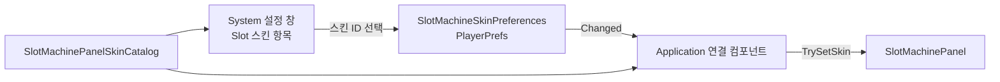

# SlotMachinePanel 스킨과 Payline 이미지

## 1. 목적과 작업 범위

현재 `SlotMachinePanel`의 Payline 틀은 `SlotPaylineFrameGraphic`이 메시를 직접 만들어 그리는 연두색 직사각형 테두리다. 다른 부분(패널 배경, Reel 원통 음영, 구분대, 요약 영역 배경 등)의 외형은 Prefab에 저장된 Sprite와 색으로 정해지며, 바꾸려면 개발자가 Prefab을 직접 수정해야 한다.

이 작업은 패널의 이미지 묶음을 **스킨 설정 자산**(`SlotMachinePanelSkin`)으로 분리한다. 개발자는 스킨 자산을 여러 개 만들어 **스킨 카탈로그**(`SlotMachinePanelSkinCatalog`)에 등록하고, 카탈로그에서 하나를 골라 패널에 적용한다. 스킨에 Payline 이미지가 없으면 지금처럼 코드로 테두리를 그린다.

이 문서는 구현 지침이다. 아래의 신규 타입, 계층, 자산, 메뉴는 예정된 구조이며 아직 구현되었다고 간주하지 않는다. 이 문서를 작성하는 단계에서는 Scene, Prefab, 런타임 코드를 수정하지 않았다. 현재 구현은 [`DOCS/architecture/slot-machine-and-runes.md`](../architecture/slot-machine-and-runes.md)의 SlotMachinePanel 절에 설명되어 있다.

포함 범위는 다음과 같다.

- `SlotMachinePanelSkin` 설정 자산: 안정적인 스킨 ID, 표시 이름, 미리보기 이미지, 패널 각 부분의 Sprite·색·그리기 방식, Payline 배치 여백
- `SlotMachinePanelSkinCatalog` 설정 자산: 스킨 목록, ID 중복 검사, 개발자가 고른 스킨
- 스킨에 Payline 이미지가 있으면 이미지로, 없으면 지금처럼 코드로 그리는 Payline 표시
- 스킨에서 비어 있는 항목은 Prefab의 기본 외형으로 표시하는 규칙
- 실행 중 스킨 교체 API. 나중에 추가하거나 다시 만든 Reel·구분대·룬 표 행에도 같은 스킨이 적용되어야 한다.
- 기본 스킨(현재 외형과 같음)과 Payline 이미지를 쓰는 예시 스킨, 테스트, Prefab·Scene 적용, 문서 갱신

제외 범위는 다음과 같다. 플레이어 선택 기능은 8절의 설계를 따를 수 있도록 구조만 준비하고 구현하지 않는다.

- 플레이어가 게임 안에서 스킨을 고르는 UI, 고른 스킨의 저장
- 플레이어가 기기의 이미지 파일을 가져와 스킨으로 쓰는 기능
- Edit Mode에서 스킨을 Prefab·Scene에 미리 적용하는 도구(4절 참고)
- Addressables 기반 스킨 지연 로드
- 스킨의 해금·구매·보유 판정
- Reel 기호 Sprite(`SlotReelView.symbolSprites`), 글꼴, 레이아웃 비율, 회전 연출의 스킨화

## 2. 사용자 확정 사항

| 항목 | 확정 요구 |
| --- | --- |
| Payline 이미지 | 개발자가 지정한 이미지를 스킨처럼 Payline에 사용할 수 있어야 한다. |
| 이미지가 없을 때 | 지정한 이미지가 없으면 지금처럼 코드로 Payline 테두리를 그린다. |
| 스킨 자산 | 회전 설정 자산(`SlotReelSpinProfile`)처럼 이미지 묶음을 담는 설정 자산 `SlotMachinePanelSkin`을 패널이 참조하는 방식으로 만든다. |
| 스킨 범위 | Payline 틀만이 아니라 패널 전체 이미지를 담는다. 비어 있는 항목은 현재 표시를 그대로 사용한다. |
| 여러 스킨 | 개발자가 스킨 자산을 여러 개 만들어 카탈로그에 등록할 수 있어야 한다. Steam과 모바일에서 똑같이 동작하고, 빌드에 포함된 이미지만 사용한다. |
| 이번 선택 방식 | 우선 개발자가 카탈로그에서 스킨 하나를 골라 설정하는 방식으로 동작해야 한다. |
| 실행 중 교체 | 스킨을 실행 중에 바꿔 끼울 수 있어야 한다. |
| 플레이어 선택 | 플레이어가 스킨을 고르는 시스템은 설계에서 고려만 한다. 나중에 만들 때는 System 설정 창에 항목을 추가하고, 고른 스킨 ID를 기기 설정(PlayerPrefs)에 저장하는 방향이다. |

## 3. 선행 문서와 확인한 현재 구조

작업 전 `AGENTS.md`, `DOCS/README.md`와 아래 문서를 읽는다.

- `DOCS/architecture/slot-machine-and-runes.md` (패널 계층, Payline 틀 배치)
- `DOCS/instructions/slot-machine-panel-visual-and-spin-motion.md` (직전 외형 개편 지침과 적용 메뉴)
- `DOCS/development/visual-effect-readiness.md` (표시 루트 분리, Sprite 여백·Mesh Type·Atlas Padding, 공유 Material 금지)
- `DOCS/architecture/prefab-rebuild-registry.md` (슬롯머신 Prefab의 Rebuild 제외)
- `DOCS/architecture/korean-font-fallback.md` (스킨 이름을 나중에 UI에 표시할 때)

이 문서를 작성할 때 확인한 현재 구조는 다음과 같다. 구현 전에 다시 확인한다. 작성 시점에는 직전 외형 개편 작업이 커밋되지 않은 상태로 작업 트리에 있었다. 이 변경은 사용자의 작업이므로 되돌리지 않는다.

| 대상 | 현재 상태 |
| --- | --- |
| `SlotPaylineFrameGraphic` (`Assets/TxTRPG/UI/Runtime/SlotMachine/SlotPaylineFrameGraphic.cs`) | `MaskableGraphic`이다. 자기 RectTransform 안쪽에 두께 `thickness`(4)·화면 픽셀 최소 `minimumPixelThickness`(2)의 사각 테두리를 사각형 4개로 그린다. `EffectiveThickness`를 공개한다. |
| `SlotMachinePanel.paylineFrame` | `SlotPaylineFrameGraphic` 직렬화 참조다. `UpdatePaylineFrame`이 첫 Reel과 마지막 Reel의 `GetPaylineWorldCorners`로 범위를 구하고, `EffectiveThickness`만큼 바깥으로 넓혀 이 Graphic의 RectTransform에 직접 크기와 위치를 쓴다. `SlotReelAreaLayout.LayoutApplied`와 Reel 수 변경 때만 호출된다. `PaylineFrameRect`가 이 RectTransform을 돌려준다. |
| 패널 외형 | `Background`(#757575), `ReelMachine/Frame`(#0A0A0A)과 `LeftEdge`·`RightEdge`, Reel마다 `Frame`(`SlotReelCylinderGradient.png` × #808080)과 `Window/ShadeOverlay`(`SlotReelEdgeShade.png`, 알파 0.75), `ReelDivider_{n}`(그라데이션 × #DCDCDC), `SummaryArea/Background`(#D9D9D9), `TotalBox/Background`(#757575), `RuneTable/Background`(#757575), `RuneLineRowTemplate/Background`(#D9D9D9)로 이루어져 있다. 값은 `slot-machine-and-runes.md`의 계층 절과 Prefab에서 다시 확인한다. |
| 동적 생성 | Reel은 `reelPrefab`에서, 구분대는 첫 구분대를 템플릿으로, 룬 표 행은 `SlotRuneTableView.rowTemplate`에서 실행 중 만들어진다. |
| 설정 자산 선례 | `SlotReelSpinProfile`(UI 어셈블리)을 패널이 `spinProfile`로 참조한다. 비어 있으면 코드의 기본값으로 동작하고 인스턴스마다 한 번 경고한다. 자산은 `Assets/TxTRPG/UI/Styles/SlotMachine/`에 있다. |
| 기기 설정 저장 선례 | `ExplorationCardPlayerPreferences`(`Assets/TxTRPG/UI/Runtime/Exploration/ExplorationCardPresentationProfile.cs`)가 PlayerPrefs로 표시 설정을 저장한다. |
| 적용 도구 | `Assets/TxTRPG/Application/Editor/TemporarySlotMachinePanelVisualApply.cs` (`Tools/TxT RPG/Application/Temporary/Apply Slot Machine Panel Visual`) |

`SlotMachinePanel`의 직렬화 필드, `SlotReelViewBase`의 계약, Prefab 계층이 바뀌므로 편집 전에 `unity-impact-scout` 에이전트로 호출부, 직렬화 참조, 테스트, 문서를 조사한다. 공유 Prefab이 바뀌므로 `opus` 모델로 호출한다.

## 4. 에이전트가 정한 세부 사항

다음 항목은 사용자 확정 사항을 구현하기 위해 이 문서가 정한 기본값이다. 구현 중 더 나은 근거가 생기면 바꿀 수 있지만, 바꾼 경우 최종 보고에 적는다.

| 항목 | 기본 결정 | 이유 |
| --- | --- | --- |
| 기본 외형의 보관 | 각 스킨 대상의 기본 Sprite·색·그리기 방식을 Prefab에 직렬화 값으로 저장한다. 실행 중에 현재 값을 읽어 기본값으로 삼지 않는다. | 스킨 A에서 B로 바꿀 때 B의 빈 항목이 A의 이미지를 물려받지 않고, 몇 번을 바꿔도 정확히 기본 외형으로 돌아가게 하기 위해서다. |
| 적용 시점 | 스킨은 Play Mode와 빌드에서만 적용한다. Edit Mode에서는 Prefab의 기본 외형을 보여 준다. | Edit Mode 적용은 스킨 이미지를 Prefab·Scene에 저장해 기본 외형을 오염시킬 수 있다. 미리보기 도구는 후속 작업으로 남긴다. |
| 자산 참조 | 카탈로그가 스킨을, 스킨이 Sprite를 직접 참조한다. | 스킨 수가 적은 현재에는 단순하다. 카탈로그에 등록된 모든 스킨의 Sprite가 함께 메모리에 올라가므로, 스킨이 늘어나면 Addressables 지연 로드로 바꾼다(10절). |
| 텍스트 색 | 배경을 바꾸면 글자 대비가 무너질 수 있으므로 Reel 숫자, 어두운 바탕 글자, 밝은 바탕 글자의 색을 선택적으로 덮어쓸 수 있게 한다. | 접근성 규칙(대비 유지)을 스킨에서도 지킬 수 있게 한다. |
| 기본 스킨 | 모든 항목이 빈 `DefaultSlotMachinePanelSkin`을 카탈로그의 선택 스킨으로 둔다. | 적용 직후 화면이 지금과 같아야 하고, 새 스킨을 만들 때 출발점이 된다. |

## 5. 스킨 데이터

### 5.1 `SlotMachinePanelSkin`

`Assets/TxTRPG/UI/Runtime/SlotMachine/Skins/SlotMachinePanelSkin.cs`에 `ScriptableObject`를 추가하고 `CreateAssetMenu`(`TxT RPG/Slot Machine/Panel Skin`)를 붙인다.

| 필드 | 형식 | 의미 |
| --- | --- | --- |
| `skinId` | string | 안정적인 ID(예: `slot-skin.default`). 저장과 플레이어 선택에 쓰므로 한 번 배포한 ID는 바꾸지 않는다. 앞뒤 공백을 제거한 값을 쓰며, 비어 있으면 카탈로그 검증에서 거부한다. |
| `displayName` | string | 나중에 선택 UI에 보여 줄 이름. 이번 작업에서는 표시하지 않는다. 지역화가 들어오면 키로 바꿀 수 있도록 접근은 속성 하나로만 한다. |
| `previewSprite` | Sprite | 나중에 선택 UI에 보여 줄 미리보기. 선택 사항이다. |
| `paylineFrame` | `SlotSkinImage` | Payline 틀. 5.3절의 규칙을 따른다. |
| `paylineOutset` | `RectOffset`과 같은 의미의 직렬화 값(왼쪽·오른쪽·위·아래, 캔버스 단위) | Payline 이미지를 Payline 칸 범위에서 바깥으로 넓히는 양. 그림자나 발광이 들어간 이미지의 실제 테두리를 칸 경계에 맞출 때 쓴다. 기본값은 각 4다. |
| `panelBackground`, `reelMachineFrame`, `reelMachineEdge`, `reelBackground`, `reelShadeOverlay`, `reelDivider`, `summaryBackground`, `totalBoxBackground`, `runeTableBackground`, `runeRowBackground` | `SlotSkinImage` | 3절 표의 각 Graphic. `reelMachineEdge`는 `LeftEdge`·`RightEdge`에 함께 적용한다. |
| `reelTextColor`, `darkSurfaceTextColor`, `lightSurfaceTextColor` | `SlotSkinColor` | 선택적 글자 색. Reel 숫자(잔상 포함), 어두운 바탕 글자(합계 라벨·값), 밝은 바탕 글자(열 제목, 룬 표 행)에 적용한다. 칸 위치별 알파와 잔상 알파는 이 색의 알파에 곱한다. |

`SlotSkinImage`는 직렬화 가능한 값 형식이다.

| 필드 | 의미 |
| --- | --- |
| `sprite` | 비어 있으면 기본 Sprite를 쓴다. |
| `overrideColor`, `color` | `overrideColor`가 켜져 있으면 `color`를 쓴다. 꺼져 있으면 Sprite가 지정된 경우 흰색(이미지 원래 색), Sprite도 비어 있으면 기본 색을 쓴다. |
| `drawMode` | `Simple`, `Sliced`, `Tiled` 중 하나. Sprite가 지정된 경우에만 적용한다. 기본값은 `Sliced`다. |
| `pixelsPerUnitMultiplier` | Sliced·Tiled에서 테두리 두께 배율. 기본값 1. |

`SlotSkinColor`는 `override` 여부와 `color`를 가진다. 꺼져 있으면 기본 글자 색을 쓴다.

- 스킨 자산은 실행 중 바뀌지 않는다. 패널은 스킨을 읽기만 한다.
- `OnValidate`는 ID 공백 제거와 범위 보정만 하고, 다른 자산이나 Scene을 바꾸지 않는다.
- `Sliced`·`Tiled`인데 Sprite에 테두리(border)가 없으면 Unity가 늘려 그리므로 경고를 한 번 남긴다.

### 5.2 `SlotMachinePanelSkinCatalog`

같은 폴더에 `ScriptableObject`를 추가하고 `CreateAssetMenu`(`TxT RPG/Slot Machine/Panel Skin Catalog`)를 붙인다.

| 필드·API | 의미 |
| --- | --- |
| `skins` | 등록된 스킨 목록. 순서는 나중에 선택 UI의 표시 순서가 된다. |
| `selectedSkinId` | 개발자가 고른 스킨 ID. Inspector에서는 등록된 스킨 중에서 고를 수 있게 하고(PropertyDrawer 또는 Custom Editor, Editor 어셈블리), 직렬화는 ID 문자열로 한다. |
| `SelectedSkin` | `selectedSkinId`에 해당하는 스킨. 없으면 `null`. |
| `TryGet(string skinId, out SlotMachinePanelSkin skin)` | ID 조회. 나중에 플레이어 선택이 쓴다. |
| `Skins` | 읽기 전용 목록 |
| `Validate(out string reason)` | 빈 항목, 빈 ID, 중복 ID, 목록에 없는 `selectedSkinId`를 검사한다. |

- 카탈로그 검증에 실패해도 게임 시작을 막지 않는다. 패널은 사용할 수 있는 스킨이 없으면 스킨 없이(기본 외형) 표시하고 인스턴스마다 한 번 경고한다.
- 선택 ID를 직렬화 문자열로 두므로, 스킨 자산의 파일 이름이나 경로가 바뀌어도 선택이 유지된다.

### 5.3 Payline 표시 규칙

| 스킨 상태 | 표시 |
| --- | --- |
| 스킨 없음, 또는 `paylineFrame.sprite` 비어 있음 | 코드로 그린 테두리(`SlotPaylineFrameGraphic`)를 보여 준다. 두께와 바깥 확장은 지금과 같다. `overrideColor`가 켜져 있으면 테두리 색만 바꾼다. |
| `paylineFrame.sprite` 지정 | 이미지 테두리(`Image`)를 보여 주고 코드 테두리는 숨긴다. 범위는 Payline 칸 범위에 `paylineOutset`을 더한 크기다. |

- 두 표시는 동시에 보이지 않는다. 숨긴 쪽은 `enabled = false`로 끄고 GameObject는 유지한다.
- 색만 구분하지 않는다는 규칙을 이미지에도 적용한다. Payline 이미지는 칸을 둘러싸는 모양을 가져야 하며, 이 요구를 스킨 작성 문서(`workflows.md`)에 적는다.
- 이미지와 코드 테두리 모두 `raycastTarget`을 끈다. 패널은 계속 입력을 받지 않는다.

## 6. 적용 구조

### 6.1 Payline 계층

`PaylineFrame`을 배치 전용 루트로 바꾸고, 두 표시를 자식으로 둔다. 배치 루트와 표시 루트를 나누는 효과 확장 규칙을 따른다.

```text
ReelMachine
└─ PaylineFrame          (RectTransform, LayoutElement ignoreLayout: 배치 전용, Payline 칸 범위)
   ├─ ProceduralBorder   (SlotPaylineFrameGraphic: 루트를 두께만큼 바깥으로 넓힌 크기)
   └─ SkinImage          (Image: 루트에 paylineOutset을 더한 크기, 기본 비활성)
```

- `UpdatePaylineFrame`은 루트를 Payline 칸 범위(바깥 확장 없음)로 놓는다. 두 자식은 루트에 앵커를 늘려 붙이고, 음수 offset으로 바깥 확장을 표현한다. 코드 테두리는 `EffectiveThickness`, 이미지는 `paylineOutset`을 쓴다.
- 확장 값이 바뀌는 경우(스킨 교체, 캔버스 배율 변경)에만 자식 offset을 다시 쓴다. 매 프레임 쓰지 않는다.
- `SlotMachinePanel`에는 루트 `paylineRoot`(RectTransform)와 `paylineImage`(Image) 필드를 추가하고, 기존 `paylineFrame` 필드는 `ProceduralBorder`의 `SlotPaylineFrameGraphic`을 계속 가리키게 한다. 필드 형식이 그대로이므로 이름 변경과 `FormerlySerializedAs`가 필요 없다.
- `PaylineFrameRect`는 배치 루트를 돌려준다. 이 속성을 쓰는 검증·테스트(`TemporarySlotMachinePlayValidation`, `SlotMachinePanelTests`)는 의미가 "Payline 칸 범위"로 바뀐 것에 맞춰 기대값을 고친다. 실제로 보이는 틀의 범위가 필요하면 `PaylineVisibleRect`처럼 별도 속성을 추가한다.

### 6.2 스킨 대상과 기본 외형

- 직렬화 가능한 `SlotSkinGraphicTarget`을 둔다. 대상 `Image`와 기본 `Sprite`·색·`Image.Type`·`pixelsPerUnitMultiplier`를 가진다. 글자 대상 `SlotSkinTextTarget`은 대상 TMP 텍스트와 기본 색을 가진다.
- 기본값은 적용 메뉴가 현재 Prefab의 값을 한 번 기록해 저장한다(4절). 메뉴를 다시 실행해도 이미 기록된 기본값은 덮어쓰지 않는다. 개발자가 Prefab의 기본 외형을 바꿀 때 기본값을 다시 기록하는 방법(예: 컴포넌트 Context Menu `기본 외형 다시 기록`)을 둔다.
- 적용 함수는 스킨 항목과 기본값으로 최종 Sprite·색·그리기 방식을 계산해 대상에 쓴다. 값이 같으면 쓰지 않는다. 공유 Material은 바꾸지 않는다.
- 대상이 비어 있으면(사용자가 Prefab에서 지운 경우) 건너뛰고 한 번 경고한다.

### 6.3 소유와 전달

각 대상은 그 Graphic을 만들고 관리하는 컴포넌트가 직접 적용한다. 이름 검색이나 Scene 검색을 쓰지 않는다.

| 소유 컴포넌트 | 적용 대상 |
| --- | --- |
| `SlotMachinePanel` | 패널 배경, Reel 기계 틀과 가장자리 띠, Payline, 구분대(템플릿과 생성된 것), 요약 영역·합계 상자 배경, 합계·열 제목 글자 |
| `SlotReelViewBase` → `SlotReelView` | Reel 원통 음영, `ShadeOverlay`, Reel 숫자와 잔상 글자 |
| `SlotRuneTableView` → `SlotRuneLineRow` | 룬 표 배경, 템플릿과 생성된 행의 배경·글자 |

- `SlotReelViewBase`에 `public virtual void ApplySkin(SlotMachinePanelSkin skin) { }`를 추가한다. 추상 메서드로 만들지 않아 다른 Reel 구현이 스킨을 지원하지 않아도 동작한다. `null`은 기본 외형으로 되돌리라는 뜻이다.
- 패널은 현재 스킨을 기억하고, `EnsureReelCount`로 Reel이나 구분대를 새로 만들 때 바로 적용한다. `SlotRuneTableView`도 현재 스킨을 기억해 새 행을 만들 때 적용한다.
- `SlotReelView`의 칸 위치별 알파, 잔상 알파, 고속 회전 글자 알파는 지금처럼 매 갱신에서 알파만 바꾼다. 기준 RGB는 스킨 글자 색 또는 기본 색에서 가져온다. 스킨 교체가 이 계산 경로에 할당을 추가하면 안 된다.

### 6.4 패널 API와 수명주기

| API | 동작 |
| --- | --- |
| `[SerializeField] SlotMachinePanelSkinCatalog skinCatalog` | 패널이 참조하는 카탈로그. 비어 있으면 스킨 없이 표시하고 한 번 경고한다. |
| `ActiveSkin`, `ActiveSkinId` | 현재 적용된 스킨과 ID. 스킨이 없으면 `null`과 빈 문자열이다. |
| `SetSkin(SlotMachinePanelSkin skin)` | 실행 중 스킨을 바꾼다. `null`이면 기본 외형으로 돌아간다. 같은 스킨이면 아무것도 하지 않는다. |
| `TrySetSkin(string skinId, out string reason)` | 카탈로그에서 ID로 찾아 적용한다. 없으면 현재 스킨을 유지하고 `false`와 사유를 돌려준다. |
| `SkinChanged` 이벤트 | 스킨이 실제로 바뀐 뒤 한 번 발생한다. 나중에 선택 UI가 미리보기를 갱신하는 데 쓴다. |

- `Awake`(Play Mode)에서 아직 스킨이 정해지지 않았으면 카탈로그의 `SelectedSkin`을 적용한다. 이후 `SetSkin`으로 바뀐 스킨은 비활성화·재활성화해도 유지한다.
- 회전 중에 스킨을 바꿔도 결과, 연출 시간, 위치 계산에 영향이 없어야 한다. Payline 확장 값이 바뀌면 `UpdatePaylineFrame`을 한 번 호출한다.
- Edit Mode에서는 `SetSkin`을 호출해도 Prefab·Scene을 저장 대상으로 표시하지 않는다. 테스트는 임시 객체에서만 Edit Mode 적용을 사용한다.

## 7. 자산

| 경로 | 내용 |
| --- | --- |
| `Assets/TxTRPG/UI/Styles/SlotMachine/Skins/SlotMachinePanelSkinCatalog.asset` | 기본·예시 스킨을 등록하고 `selectedSkinId = slot-skin.default` |
| `Assets/TxTRPG/UI/Styles/SlotMachine/Skins/DefaultSlotMachinePanelSkin.asset` | `skinId = slot-skin.default`, 모든 항목이 빈 스킨. 현재 외형과 같다. |
| `Assets/TxTRPG/UI/Styles/SlotMachine/Skins/SampleImagePaylineSkin.asset` | `skinId = slot-skin.sample-image-payline`. Payline에만 예시 이미지를 쓴다. 검증과 스킨 작성 예시용이며 기본 선택이 아니다. |
| `Assets/TxTRPG/UI/Styles/SlotMachine/Skins/SlotPaylineFrameSample.png` | 9-slice 테두리(border 설정)가 있는 예시 Payline 이미지. Mesh Type `Full Rect`, 외곽 효과용 투명 여백을 둔다. |

- `SlotMachinePanel.prefab`이 카탈로그를 참조한다.
- 예시 이미지는 의미 있는 글자를 넣지 않는다.
- 스킨 이미지 Import 설정은 `visual-effect-readiness.md`의 2D 이미지 규칙(투명 여백, `Full Rect`, Atlas Padding)을 따른다.

## 8. 플레이어 선택 기능 설계(이번에는 구현하지 않음)

나중에 플레이어 선택을 추가할 때 아래 흐름을 따를 수 있도록 이번 구조를 맞춘다. 이번 작업에서는 아래 타입과 UI를 만들지 않는다.



| 구성 | 예정 내용 | 이번 작업에서 준비하는 것 |
| --- | --- | --- |
| 저장 | `ExplorationCardPlayerPreferences`처럼 PlayerPrefs에 스킨 ID 문자열을 저장한다. 세이브 파일 형식은 바꾸지 않는다. | 안정적인 `skinId`, `TryGet` |
| 선택 UI | 기존 System 설정 모달에 `Slot 스킨` 항목을 추가하고, 카탈로그 순서대로 `displayName`과 `previewSprite`를 보여 준다. 키보드·컨트롤러·터치로 같은 방식으로 조작한다. | `Skins` 순서, `displayName`, `previewSprite`, `SkinChanged` |
| 적용 | Application의 연결 컴포넌트가 저장된 ID로 `TrySetSkin`을 호출한다. 실패하면 개발자가 고른 `selectedSkinId`로 돌아가고 저장값을 지운다. | `TrySetSkin` 실패 시 현재 스킨 유지 |
| 우선순위 | 플레이어 선택이 있으면 그것을, 없으면 개발자 선택을 쓴다. | `Awake`에서 "아직 스킨이 정해지지 않았을 때만" 카탈로그 선택을 적용하는 규칙 |

## 9. 주요 수정 경로

| 경로 | 작업 |
| --- | --- |
| `Assets/TxTRPG/UI/Runtime/SlotMachine/Skins/` | 신규: `SlotMachinePanelSkin`, `SlotMachinePanelSkinCatalog`, `SlotSkinImage`, `SlotSkinColor`, `SlotSkinGraphicTarget`, `SlotSkinTextTarget` |
| `Assets/TxTRPG/UI/Runtime/SlotMachine/SlotMachinePanel.cs` | 카탈로그 참조, 스킨 API, Payline 루트·이미지, 생성 시 적용 |
| `Assets/TxTRPG/UI/Runtime/SlotMachine/SlotPaylineFrameGraphic.cs` | 동작은 유지한다. 자식으로 옮겨져도 두께 계산이 맞는지 확인한다. |
| `Assets/TxTRPG/UI/Runtime/SlotMachine/SlotReelViewBase.cs`, `SlotReelView.cs` | `ApplySkin`, 글자 기준 색 |
| `Assets/TxTRPG/UI/Runtime/SlotMachine/SlotRuneTableView.cs`, `SlotRuneLineRow.cs` | 표·행 스킨 적용 |
| `Assets/TxTRPG/UI/Editor/` (기존 UI Editor 어셈블리) | 카탈로그의 스킨 선택 Inspector |
| `Assets/TxTRPG/UI/Styles/SlotMachine/Skins/` | 7절의 자산 |
| `Assets/TxTRPG/UI/Prefabs/SlotMachine/SlotMachinePanel.prefab`, `SlotReel.prefab` | Payline 계층, 스킨 대상과 기본값 기록, 카탈로그 참조 |
| `Assets/TxTRPG/Application/Editor/` | 신규 임시 적용 메뉴(10절), `TemporarySlotMachinePlayValidation.cs` 갱신 |
| `Assets/Scenes/TMP_MainScene.unity` | Prefab 변경 반영. 인스턴스 재정의는 충돌하는 것만 정리 |
| `Assets/TxTRPG/UI/Tests/Editor/` | 11절의 테스트 |

UI Editor 어셈블리가 없으면 기존 Editor 어셈블리 구성을 확인하고, 새 asmdef가 필요한 경우 `project-structure.md`에 함께 적는다.

## 10. 적용

- 임시 메뉴 `Tools/TxT RPG/Application/Temporary/Apply Slot Machine Panel Skin`(`Assets/TxTRPG/Application/Editor/TemporarySlotMachinePanelSkinApply.cs`)으로 7절의 자산을 만들고, 두 Prefab의 Payline 계층을 6.1절로 바꾸고, 스킨 대상과 기본값을 기록하고, 카탈로그를 연결한다. 메뉴 이름과 경로는 구현 후 실제 값으로 문서에 적는다.
- 두 Prefab은 개발자 소유 자산이다. 필요한 객체와 참조만 추가하고, 이미 원하는 상태면 아무것도 바꾸지 않는다. 다시 실행해도 안전해야 한다. 이미 기록된 기본값과 사용자가 만든 스킨·카탈로그 내용은 덮어쓰지 않는다.
- 기존 `PaylineFrame`의 `SlotPaylineFrameGraphic` 컴포넌트는 새 자식 `ProceduralBorder`로 옮긴다. 컴포넌트 값(색, 두께)은 그대로 복사하고, 옮긴 뒤 패널 참조를 다시 연결한다.
- 등록 기반 Prefab Rebuild 배치에 넣지 않는다. 기존 슬롯머신 Prefab의 제외 사유를 유지하고, 이 메뉴의 임시 성격을 `prefab-rebuild-registry.md`에 함께 적는다.
- `TMP_MainScene`의 `SlotMachinePanel` 인스턴스 재정의 중 `PaylineFrame` 구조 변경과 충돌하는 것만 정리한다. 다른 재정의와 Scene 배치는 보존한다.
- 적용 전 Editor 연결, 컴파일 완료, Play Mode 아님, 열린 Scene·Prefab의 저장되지 않은 변경을 확인한다. 저장되지 않은 사용자 변경이 있으면 중단하고 알린다.
- Unity Editor 자동화를 사용할 수 있으면 에이전트가 직접 메뉴를 실행하고 결과를 확인한다. 사용할 수 없으면 원인과 남은 절차를 보고한다.
- 적용 후 `serialization-diff-reviewer`를 호출해 의도한 변경(신규 자산, Prefab 계층·참조, 기본값 기록)과 부수 변경(레이아웃 재계산 값, TMP 폰트 아틀라스)을 구분한다. 작업 전 `git status`에 있던 변경은 사용자 변경으로 보고 되돌리지 않는다.

## 11. 검증

테스트 실행 전 `git status`를 기록한다. Edit Mode 테스트는 관련 클래스로 필터링하고 `!AssetWriting` 범주를 기본으로 제외한다. 테스트용 Sprite와 스킨은 메모리에서 만들고 끝나면 파괴한다.

UI Edit Mode 테스트(신규 `SlotMachinePanelSkinTests`, 기존 `SlotMachinePanelTests` 수정):

- 스킨 없음과 빈 스킨: 코드 테두리가 켜지고 이미지가 꺼진다. 모든 대상이 기록된 기본값과 같다.
- Payline Sprite가 있는 스킨: 이미지가 켜지고 코드 테두리가 꺼진다. 이미지 범위가 Payline 칸 범위에 `paylineOutset`을 더한 값과 같다. 이미지의 `raycastTarget`이 꺼져 있다.
- Payline에 색만 지정한 스킨: 코드 테두리가 유지되고 색만 바뀐다.
- 스킨 A(모든 항목 지정) → 스킨 B(일부만 지정) → `null`: B의 빈 항목은 A가 아니라 기본값이고, `null`이면 모든 대상이 기본값이다.
- 스킨 적용 후 Reel 수를 늘리고 룬 줄 수를 늘리면 새 Reel, 구분대, 행에도 같은 스킨이 적용된다.
- 회전 중 스킨을 바꿔도 회전이 결과 칸에 정확히 멈추고, 칸 위치별 알파와 잔상 알파가 스킨 글자 색의 알파에 곱해진다.
- 카탈로그: 빈 ID, 중복 ID, 목록에 없는 선택 ID를 거부한다. `TrySetSkin`이 없는 ID에서 `false`를 돌려주고 현재 스킨을 유지한다. 카탈로그가 비어 있으면 경고 한 번과 함께 기본 외형으로 동작한다.
- `SkinChanged`는 실제로 바뀐 경우에만 한 번 발생한다.

Play Mode·화면 검증(AppScene에서 시작하는 기존 Play 경로를 사용):

1. 기본 카탈로그 선택(`slot-skin.default`)으로 전투 노드에 들어가면 패널이 적용 전과 같은 외형이다. 적용 전후 1920×1080 화면을 캡처해 비교한다.
2. 카탈로그의 `selectedSkinId`를 `slot-skin.sample-image-payline`으로 바꾸고 Play하면 Payline이 예시 이미지로 보이고 Reel 3개의 가운데 칸을 감싼다. 확인 후 기본값으로 되돌린다.
3. Play 중 `SetSkin`으로 두 스킨을 번갈아 바꿔도(검증 메뉴 또는 테스트용 진입점) 회전, 합계, 룬 표, 행동 버튼이 정상이다.
4. 1920×1080, 21:9, 1024×768, 390×844에서 예시 Payline 이미지가 칸에 맞고, 행동 버튼이 Reel 창·합계 값·룬 표 행을 가리지 않는다.
5. 실행 중 Reel을 4개·5개로 늘려도 이미지 Payline이 모든 Reel을 감싼다.

Console에 새 오류나 경고가 없는지 확인한다(카탈로그를 일부러 비운 검증은 제외). 실제 모바일 기기와 Steam 빌드는 이번 작업에서 검증하지 않는다면 미검증으로 보고한다.

## 12. 문서 갱신

- `DOCS/architecture/slot-machine-and-runes.md`: Payline 계층, 스킨 자산·카탈로그, 빈 항목 규칙, 기본값 기록, 적용 시점, 실행 중 교체 API, 플레이어 선택 확장 지점을 현재 구현 기준으로 적는다. 확장 지점 표에 "플레이어 스킨 선택"과 "Addressables 지연 로드"를 추가한다.
- `DOCS/architecture/project-structure.md`: 새 런타임 폴더와 스킨 자산 폴더를 추가한다.
- `DOCS/development/workflows.md`: 새 스킨을 만드는 절차(자산 생성, ID 규칙, Sprite Import 설정, 9-slice 테두리, Payline 이미지 모양 요구, 카탈로그 등록과 선택), 적용 메뉴, 재실행 안전성, 기본값 다시 기록 방법, 검증 절차, 메뉴를 은퇴시킬 수 있는 시점을 적는다.
- `DOCS/architecture/prefab-rebuild-registry.md`: 새 임시 메뉴의 제외 사유를 추가한다.

## 13. 최종 보고

최종 보고에는 다음을 구분해 적는다.

- 구현 완료: 추가·수정한 타입, 자산, 테스트
- 이미 적용한 것: Editor에서 실행한 메뉴와 확인한 Prefab·Scene 상태
- 아직 적용이 필요한 것: 사용자가 실행해야 하는 메뉴가 있으면 `사용자가 수행할 적용 절차` 절과 복사 가능한 `text` 코드 블록. 없으면 없다고 명시한다.
- 검증 결과: 실행한 테스트 필터와 결과, Play Mode에서 확인한 스킨과 해상도, 미검증 기기·빌드
- 4절의 에이전트 결정 사항 중 바꾼 것과 그 이유, 구현 중 발견한 제약
