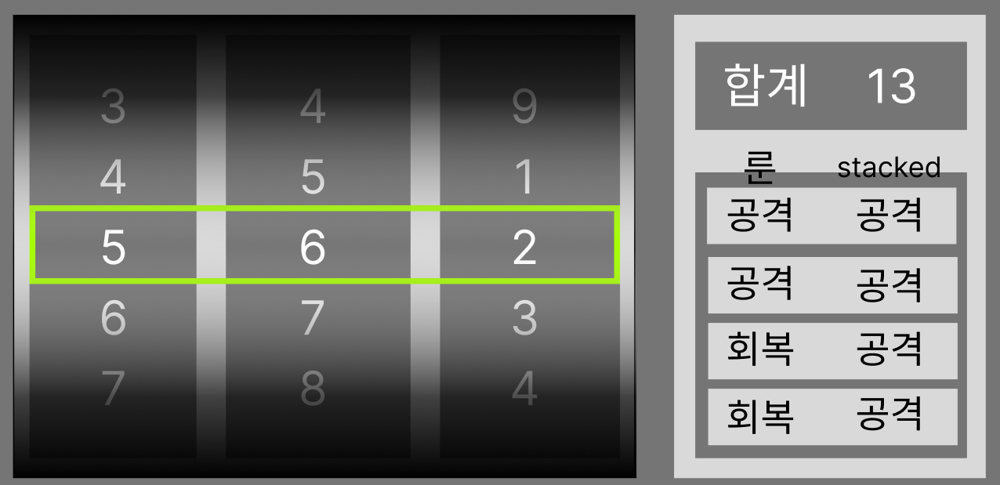

# SlotMachinePanel 외형 개편과 설정 가능한 Reel 회전 연출

## 1. 목적과 작업 범위

`TMP_MainScene`의 `SlotMachinePanel`을 아래 목표 이미지처럼 보이도록 바꾸고, `행동` 버튼을 눌렀을 때 재생되는 Reel 회전 연출을 개발자가 설정 자산으로 조정할 수 있게 만든다.



목표 이미지 파일은 `DOCS/instructions/images/slot-machine-panel-target.png`이다.

이 문서는 구현 지침이다. 아래의 신규 타입, 계층, 설정 자산, 메뉴는 예정된 구조이며 아직 구현되었다고 간주하지 않는다. 이 문서를 작성하는 단계에서는 Scene, Prefab, 런타임 코드를 수정하지 않았다. 현재 구현은 [`DOCS/architecture/slot-machine-and-runes.md`](../architecture/slot-machine-and-runes.md)에 설명되어 있다.

포함 범위는 다음과 같다.

- 패널 외형: 왼쪽 Reel 기계(검은 틀, 원통 음영 Reel, 밝은 Reel 구분대, 5칸 표시, 연두색 Payline 틀)와 오른쪽 요약 영역(합계 상자, 룬 줄 표)
- 좁은 패널에서 Reel 기계와 요약 영역을 세로로 쌓는 반응형 배치
- 회전 연출 설정 자산(`SlotReelSpinProfile`)과 easing 함수 선택(기본 `InOutElastic`)
- 가속(easing 앞 절반) → 고속 회전(잔상·세로 늘림) → 감속·정지(easing 뒤 절반)의 3구간 연출
- Reel별로 독립적이되 기준값에서 크게 벗어나지 않는 시작 시각·구간 길이와 왼쪽부터의 정지 순서
- 표시 데이터 변경(합계 값과 룬 줄 행), Application 문구 공급, 테스트, Prefab·Scene 적용, 문서 갱신

제외 범위는 다음과 같다.

- 슬롯 결과 결정, 룬 분배 규칙, 전투 규칙, Story 기록 문구의 변경
- 셰이더 기반 모션 블러, 블러 전용 Strip 이미지
- 사용자 지정 `AnimationCurve` easing, 시작·정지 easing의 개별 선택
- 룬 장착·줄 편집 UI, 룬 표의 입력(선택·스크롤·터치) 기능
- 회전·정지 효과음, 진동, 화면 흔들림
- 저장 데이터와 플레이어 설정 형식의 변경

## 2. 사용자 확정 사항

| 항목 | 확정 요구 |
| --- | --- |
| 외형 기준 | 첨부한 목표 이미지처럼 보여야 한다. |
| 룬 표의 의미 | 행 1개 = 룬 줄 1개다. 왼쪽 열은 줄의 효과 종류(`공격`, `회복`), 오른쪽 열은 쌓인 룬 수와 분배 수치(`×2 → 6`)다. 목표 이미지의 `stacked` 열 제목은 의미에 맞는 한국어 제목으로 바꾼다. 회전 전에는 쌓인 수만 표시한다. |
| 좁은 화면 | 패널의 너비/높이 비율이 설정값보다 작으면 Reel 기계를 위에, 합계·룬 표를 아래에 쌓는다. 넓은 화면은 목표 이미지처럼 좌우 배치다. |
| 회전 설정 | 회전 속도와 시간을 개발자가 설정할 수 있어야 한다. |
| Reel 시차 | Reel들은 동시에 시작하거나 멈추지 않고 약간의 시간 차이를 둔다. |
| easing | easing 함수를 선택할 수 있다. 기본값은 `easeInOutElastic`이다. 하나의 InOut easing을 고르면 앞 절반은 시작 구간, 뒤 절반은 정지 구간에 적용한다. |
| 구간 구조 | easing은 시작과 끝 구간에서 실질적으로 적용된다. 시작 후 n초가 지나면 고속 회전 연출(잔상·세로 늘림, 고속 스크롤)이 적용되고, 끝나기 m초 전부터 이 연출이 자연스럽게 사라진 뒤 easing이 적용된 속도로 정지한다. |
| 고속 연출 방식 | 각 칸 글자 뒤에 알파가 낮은 잔상 TMP를 두고, 속도에 따라 잔상 간격·알파와 세로 배율을 조절한다. 셰이더를 쓰지 않는다. |
| 시간 편차 | 시작·고속·정지 구간의 길이는 Reel마다 독립적이다. 각 구간은 기준 시간(base duration)에 작은 편차(alpha)를 더해 정하며, Reel끼리 동떨어진 시간을 갖지 않는다. |

## 3. 에이전트가 정한 세부 사항

다음 항목은 사용자 확정 사항을 구현하기 위해 이 문서가 정한 기본값이다. 구현 중 더 나은 근거가 생기면 바꿀 수 있지만, 바꾼 경우 최종 보고에 적는다.

| 항목 | 기본 결정 | 이유 |
| --- | --- | --- |
| 정지 순서 | 편차와 관계없이 항상 왼쪽 Reel부터 멈춘다. 이웃 Reel의 정지 시각 차이는 최소 `minimumStopGapSeconds`다. | 기존 동작이며 Payline 합계를 왼쪽부터 읽는 흐름과 맞는다. |
| 편차 난수 | 결과 결정용 `IRandomIndexProvider`가 아니라 UI 전용 `System.Random`을 쓴다. 테스트는 시드를 주입한다. | 연출 편차가 결과나 Gameplay 난수 흐름에 영향을 주지 않게 한다. |
| 정확한 착지 | 구간 길이는 편차를 적용한 값 그대로 지키고, 고속 구간 속도를 조절해 결과 칸에 정확히 멈춘다. | 정지 순서와 제한 시간 계산이 시간에 의존하기 때문이다. |
| 회전 중 합계 | 합계 상자의 값 칸에 `…`를 표시한다. | `회전 중…`은 합계 상자 값 칸에 들어가기에 길다. |
| 룬 줄이 많을 때 | 행 높이는 최소값까지 줄어든다. 그래도 모자라면 앞 줄들을 표시하고 마지막 행에 `외 N줄`을 표시한다. 패널은 계속 입력을 받지 않는다. | 기본 구성은 2줄이며, 입력 없는 패널에서 스크롤을 만들지 않기 위해서다. |
| 설정 자산 위치 | `Assets/TxTRPG/UI/Styles/SlotMachine/DefaultSlotReelSpinProfile.asset` | 표시 전용 설정이므로 UI 어셈블리의 스타일 자산과 함께 둔다. |

## 4. 선행 문서와 확인한 현재 구조

작업 전 `AGENTS.md`, `DOCS/README.md`와 아래 문서를 읽는다.

- `DOCS/architecture/slot-machine-and-runes.md` (패널 계층, 표시 상태, 회전 연출, 제한 시간)
- `DOCS/instructions/slot-machine-and-rune-combat.md` (원래 구현 지침)
- `DOCS/development/visual-effect-readiness.md` (표시 루트 분리, 효과 상태 정리)
- `DOCS/architecture/boundary-command-button.md` (행동 버튼이 패널 위쪽을 덮는 범위)
- `DOCS/architecture/prefab-rebuild-registry.md` (슬롯머신 Prefab의 Rebuild 제외)
- `DOCS/development/workflows.md`의 슬롯머신 전투 적용 절

이 문서를 작성할 때 확인한 현재 구조는 다음과 같다. 구현 전에 다시 확인한다.

| 대상 | 현재 상태 |
| --- | --- |
| `SlotMachinePanel` (`Assets/TxTRPG/UI/Runtime/SlotMachine/SlotMachinePanel.cs`) | `firstReelSpinSeconds`(0.8), `reelStopIntervalSeconds`(0.25), `decelerationSeconds`(0.3), `reducedMotionSecondsPerReel`(0.15)를 직렬화 필드로 가진다. `PlaySpinAsync`가 Reel마다 `SlotReelSpinTiming`을 만들어 `SlotReelViewBase.PlaySpinAsync`를 동시에 호출한다. 합계는 `totalText` 하나("합계 10"), 분배는 `allocationText` 하나("공격 ×1 → 5 · 회복 ×1 → 5")다. |
| `SlotReelSpinTiming` (`SlotReelViewBase.cs`) | `SpinSeconds`, `DecelerationSeconds`, `ReducedMotionSeconds`, `ReduceMotion`만 가진다. |
| `SlotReelView` (`SlotReelView.cs`) | `VisibleCells = 3`, `CellCount = 5` 상수다. 등속 이동 후 2차식으로 감속하며, 위치를 `distance - .0001f`로 잘라 결과 칸을 넘지 않는다. Payline 칸은 굵게, 위·아래 칸은 알파 0.45·크기 0.72배다. `cellsPerSecond`(14)가 대략적 속도다. |
| `SlotSpinDisplay` (`SlotMachineDisplays.cs`) | `SpinningTotalText`, `TotalText`, `AllocationText` 문자열을 가진다. |
| `TemporarySlotCombatController` | `CreateSpinDisplay`가 `SlotCombatStoryFormatter.SpinningTotal`·`Total`·`Allocation` 문자열로 표시 데이터를 만든다. 대기 상태는 `SetTotalText(IdleTotal)`, `SetAllocationText(WeightsText(...))`로 표시한다. 제한 시간은 `panel.GetMaximumPresentationSeconds(reelCount)`에 여유를 더해 정한다. |
| Prefab | `Assets/TxTRPG/UI/Prefabs/SlotMachine/SlotMachinePanel.prefab`, `SlotReel.prefab`. 개발자 소유 자산이며 Prefab Rebuild 배치에서 제외되어 있다. `TMP_MainScene`에는 `SlotMachinePanel` Prefab 인스턴스가 있고, RectTransform 등 속성 재정의가 있다. |
| 생성·검증 도구 | `Assets/TxTRPG/Application/Editor/TemporarySlotMachineIntegration.cs`(Prefab 최초 생성과 Scene 연결), `TemporarySlotMachinePlayValidation.cs`(Play Mode 검증; `TotalText` 이름, `SymbolCell_2` 이름, `AllocationText` 문자열을 검사한다) |
| 테스트 | `Assets/TxTRPG/UI/Tests/Editor/SlotMachinePanelTests.cs`, `Assets/TxTRPG/Application/Tests/Editor/SlotMachineCombatTests.cs`. 두 곳이 `SetTimingForEditor`를 호출한다. |
| easing | 프로젝트에 easing 유틸리티나 Tween 패키지가 없다. |

`SlotReelViewBase.PlaySpinAsync`의 시그니처, 직렬화 필드, Prefab 계층이 바뀌므로 편집 전에 `unity-impact-scout` 에이전트로 호출부, 직렬화 참조, 테스트, 문서를 조사한다. 공유 Prefab이 바뀌므로 `opus` 모델로 호출한다.

## 5. 목표 외형

### 5.1 전체 배치

목표 이미지(1276×619)에서 측정한 비율이다. 색은 근사값이며 설정 가능한 직렬화 값으로 둔다.

| 영역 | 내용 |
| --- | --- |
| `ReelMachine` (왼쪽) | 패널 너비의 약 62%. 거의 검은 틀(`#0A0A0A`) 안에 Reel 3개와 구분대 2개가 있다. 틀의 안쪽 여백은 가로 약 2.7%, 세로 약 4%다. 틀의 왼쪽·오른쪽 안쪽 가장자리에는 가운데가 밝은 세로 그라데이션 띠가 보인다. |
| 간격 | 왼쪽과 오른쪽 사이에 패널 너비의 약 4%. |
| `SummaryArea` (오른쪽) | 패널 너비의 약 31%. 밝은 회색(`#D9D9D9`) 배경. |

`행동` 버튼이 패널 위쪽 가운데를 덮는 범위(현재 `Content` 위쪽 여백 44px)는 유지한다. 좌우·세로 배치 모두에서 버튼이 Reel 창, 합계 값, 룬 표 행을 가리면 안 된다.

### 5.2 ReelMachine

- **Reel 배경**: 각 Reel 창은 위·아래 가장자리가 거의 검정(`#0D0D0D`)이고 가운데로 갈수록 회색(`#808080`)이 되는 세로 원통 음영이다.
- **구분대**: Reel 사이의 구분대는 Reel 너비의 약 16%이며, 가운데가 밝은 회색(`#DCDCDC`)이고 위·아래로 어두워지는 세로 그라데이션이다.
- **표시 칸**: Reel마다 5칸(Payline 위 2칸, Payline, 아래 2칸)이 보인다. 글자 크기는 다섯 칸이 거의 같고, 밝기로 거리감을 준다. 기본 알파는 Payline 1.0, ±1칸 0.8, ±2칸 0.4다. 글자 색은 흰색이다. 칸 위치에 따른 단계적 알파와 별개로, `ShadeOverlay`가 위·아래 가장자리로 갈수록 내용을 어둡게 덮어 움직이는 글자가 자연스럽게 사라지게 한다.
- **Payline 틀**: 세 Reel의 가운데 칸을 한 번에 감싸는 연두색(`#A3F213`) 직사각형 테두리다. 두께는 기준 해상도에서 4px이며 최소 2px이다. 틀은 Reel 창 가로 범위 전체를 감싸고 구분대 위를 지나간다. 기존 `PaylineOverlay`의 선 두 개와 마름모 표지는 이 틀로 대체한다.
- Payline은 색만으로 구분하지 않는다. 테두리 모양과 가운데 칸의 가장 높은 밝기로 함께 구분한다. 연두색 대비가 부족한 배경이 생기면 테두리 바깥에 어두운 외곽선 Graphic을 추가할 수 있게 테두리 전용 Graphic으로 만든다.

### 5.3 SummaryArea

- **합계 상자**(`TotalBox`): 진한 회색(`#757575`) 상자에 흰색 `합계` 라벨(왼쪽)과 흰색 값(오른쪽)을 크게 표시한다. 라벨과 값은 별도 TMP 텍스트다.
- **열 제목**(`RuneTableHeader`): 표 위쪽 가장자리에 걸쳐 두 열 제목을 검은 글자로 표시한다. 왼쪽 `룬`, 오른쪽 `쌓임 → 분배`다.
- **룬 표**(`RuneTable`): 진한 회색(`#757575`) 바탕 안에 밝은 회색(`#D9D9D9`) 행을 세로로 나열한다. 각 행은 두 칸이며 검은 글자다. 왼쪽 칸은 효과 이름(`공격`), 오른쪽 칸은 회전 전 `×1`, 정지 후 `×1 → 6`이다.
- 행은 `RuneLineRow` 템플릿(Prefab 안의 비활성 자식 또는 별도 Prefab)에서 필요한 수만큼 만들고 재사용한다. 행 수가 바뀔 때만 만들거나 숨긴다.
- 룬 줄이 없으면 표 안에 한 행 너비로 `장착된 룬이 없습니다`를 표시한다.
- 구성 오류 상태는 기존처럼 `Content`를 숨기고 `StatusText`에 사유를 표시한다.

### 5.4 좁은 패널의 세로 배치

- `Content`의 배치는 새 `SlotMachineContentLayout`(UI 어셈블리, `LayoutGroup` 파생)이 담당한다. 이 컴포넌트는 두 자식(`ReelMachine`, `SummaryArea`)을 패널 너비/높이 비율에 따라 좌우 또는 상하로 배치한다.
- 기본 전환 비율은 1.3이다. 비율이 1.3 이상이면 좌우(기본 62% : 31%, 간격 4%), 미만이면 상하(Reel 기계 약 62%, 간격, 요약 약 34%)다. 비율·간격·전환값은 직렬화 설정이다.
- 상하 배치에서 `SummaryArea`는 내부를 좌우로 바꿔 합계 상자를 왼쪽(약 35%)에, 룬 표를 오른쪽에 둔다. 이 전환도 같은 컴포넌트가 알려 주는 배치 상태로 처리하고, 이름 검색이나 Scene 검색을 쓰지 않는다.
- 크기 변경 시에만 다시 계산한다(`OnRectTransformDimensionsChange`와 `LayoutGroup`의 표준 갱신). 매 프레임 계산하지 않는다.
- 전환 경계 근처에서 레이아웃이 반복해서 바뀌지 않도록 0.05 정도의 이력(hysteresis)을 둔다.

현재 측정된 패널 크기로 예상한 배치는 다음과 같다. 적용 후 실제 값으로 다시 측정한다.

| 화면 | 패널 크기 | 비율 | 배치 |
| --- | --- | --- | --- |
| 1920×1080 | 968×413 | 2.34 | 좌우 |
| 21:9 | 1302×413 | 3.15 | 좌우 |
| 1024×768 | 470×332 | 1.42 | 좌우 |
| 390×844 | 332×274 | 1.21 | 상하 |

### 5.5 글자 크기와 지역화

- Reel 숫자는 기존처럼 칸 높이·너비에서 크기를 계산하고 `[minimumFontSize, maximumFontSize]`로 제한한다. 다섯 칸 표시로 칸 높이가 줄어드므로, 390×844에서도 숫자가 칸 안에 들어가는지 검증한다.
- 합계 값, 열 제목, 행 글자도 각 영역 높이에서 크기를 계산하고 최소·최대값으로 제한한다. TMP Auto Size는 쓰지 않는다.
- 한국어 fallback 폰트(`NotoSansKR-Fallback`)가 적용된 기존 TMP 폰트 자산을 그대로 사용한다.
- `합계`, `룬`, `쌓임 → 분배`, `외 N줄`, `장착된 룬이 없습니다`, `…` 같은 사용자 표시 문구는 UI 코드에 하드코딩하지 않는다. `SlotCombatStoryFormatter`가 공급하고 표시 데이터로 전달한다. 열 너비는 고정 글자 수에 맞추지 않고 비율로 정해, 다른 언어로 바뀌어도 넘치지 않게 한다.

### 5.6 효과 확장 준비

`DOCS/development/visual-effect-readiness.md`의 규칙을 따른다.

- `ReelMachine`, `SummaryArea`, `TotalBox`, `RuneTable`, 각 행은 레이아웃 전용 루트와 시각 루트(`VisualRoot` 또는 `Frame`)를 분리한다.
- `PaylineFrame`은 레이아웃을 무시하는 오버레이로 두고, Reel 창의 레이아웃 기준 위치에서 계산한다. 발광 효과를 붙일 여백을 두기 위해 Reel 창 바깥으로 테두리 두께만큼 확장되는 것을 허용한다.
- 잔상과 세로 늘림은 각 칸의 `VisualRoot` 아래에서만 바꾼다. `SymbolCell`의 위치는 `UpdateCellLayout`만 정한다.
- 연출이 끝나거나, 중단되거나, 비활성화되면 잔상 알파·위치와 `VisualRoot` 배율을 원래 값으로 되돌린다.
- 모든 Graphic의 `raycastTarget`은 꺼져 있어야 한다. 패널은 계속 입력을 받지 않는다.

## 6. 회전 연출 설계

### 6.1 설정 자산: `SlotReelSpinProfile`

`Assets/TxTRPG/UI/Runtime/SlotMachine/SlotReelSpinProfile.cs`에 `ScriptableObject`를 추가하고 `CreateAssetMenu`(`TxT RPG/Slot Machine/Reel Spin Profile`)를 붙인다. `SlotMachinePanel`은 `[SerializeField] SlotReelSpinProfile spinProfile`로 참조한다.

| 그룹 | 필드 | 기본값 | 의미 |
| --- | --- | --- | --- |
| Easing | `easing` | `InOutElastic` | 6.2절의 easing 종류 |
| 시차 | `startIntervalSeconds` | 0.08 | Reel i는 `i × startIntervalSeconds` 뒤에 시작한다. |
|  | `stopIntervalSeconds` | 0.22 | Reel i의 고속 구간 기준 길이에 `i × stopIntervalSeconds`를 더한다. |
|  | `minimumStopGapSeconds` | 0.12 | 이웃 Reel 정지 시각의 최소 차이 |
| 구간 기준 | `accelerationSeconds` (n) | 0.35 | easing 앞 절반이 적용되는 시작 구간 |
|  | `cruiseSeconds` | 0.70 | 첫 Reel의 고속 구간 |
|  | `decelerationSeconds` (m) | 0.70 | easing 뒤 절반이 적용되는 정지 구간 |
| 편차(alpha) | `startJitterSeconds` | 0.03 | 시작 시각 편차 최대 절댓값 |
|  | `accelerationJitterSeconds` | 0.05 | 시작 구간 편차 최대 절댓값 |
|  | `cruiseJitterSeconds` | 0.12 | 고속 구간 편차 최대 절댓값 |
|  | `decelerationJitterSeconds` | 0.08 | 정지 구간 편차 최대 절댓값 |
| 속도 | `cruiseCellsPerSecond` | 18 | 고속 구간의 목표 속도(칸/초). 실제 속도는 착지를 위해 조정된다. |
|  | `minimumCruiseCellsPerSecond` | 8 | 조정된 속도의 하한 |
| 고속 연출 | `motionEffectsEnabled` | true | 잔상·세로 늘림 사용 여부 |
|  | `effectFadeInSeconds` | 0.12 | 시작 구간이 끝난 뒤 효과 강도가 0→1이 되는 시간 |
|  | `effectFadeOutSeconds` | 0.15 | 정지 구간이 시작되기 전에 효과 강도가 1→0이 되는 시간 |
|  | `afterimageCount` | 2 | 칸마다 켜는 잔상 수(0~3, Prefab의 잔상 수 이하) |
|  | `afterimageSpacing` | 0.18 | 잔상 간격(칸 높이 비율) |
|  | `afterimageAlpha` | 0.35 | 첫 잔상의 최대 알파. 뒤 잔상일수록 줄어든다. |
|  | `maximumVerticalStretch` | 1.25 | 효과 강도 1에서 `VisualRoot`의 세로 배율 |
|  | `cruiseTextAlpha` | 0.85 | 효과 강도 1에서 본 글자의 알파 배율 |
| Reduce Motion | `reducedMotionSecondsPerReel` | 0.15 | 기존 동작과 같다. |

- 모든 시간 값은 0 이상, 편차는 해당 기준값의 50% 이하로 `OnValidate`와 런타임 계산에서 제한한다. `OnValidate`는 값만 보정하고 다른 자산이나 Scene을 바꾸지 않는다.
- 기본 자산은 `Assets/TxTRPG/UI/Styles/SlotMachine/DefaultSlotReelSpinProfile.asset`이며 `SlotMachinePanel.prefab`이 참조한다.
- `spinProfile`이 비어 있으면 코드에 정의한 같은 기본값(`SlotReelSpinProfile.DefaultSettings` 같은 불변 값)으로 동작하고, 패널 인스턴스마다 한 번만 경고를 남긴다. 게임 진행은 막지 않는다.
- `SlotMachinePanel`의 기존 직렬화 필드 `firstReelSpinSeconds`, `reelStopIntervalSeconds`, `decelerationSeconds`, `reducedMotionSecondsPerReel`은 제거한다. Prefab에 저장된 값은 기존 기본값과 같으므로 별도 마이그레이션 없이 새 자산의 기본값으로 대체한다. Scene 인스턴스에 이 필드의 재정의가 있으면 적용 전에 보고한다.

### 6.2 Easing

- `Assets/TxTRPG/UI/Runtime/SlotMachine/SlotEasing.cs`에 `enum SlotEasingKind`와 순수 정적 함수 `SlotEasing.Evaluate(kind, t)`를 둔다. Unity 객체에 의존하지 않고, 할당을 만들지 않는다.
- 선택지는 `Linear`와 easings.net의 InOut 계열 10종(`InOutSine`, `InOutQuad`, `InOutCubic`, `InOutQuart`, `InOutQuint`, `InOutExpo`, `InOutCirc`, `InOutBack`, `InOutElastic`, `InOutBounce`)이다. 공식은 easings.net의 정의를 따른다. 사용자가 "하나의 InOut easing"을 확정했으므로 In·Out 단독 계열은 넣지 않는다.
- enum 값은 숫자를 명시하고 이후 순서를 바꾸지 않는다. 직렬화된 자산이 값을 숫자로 저장하기 때문이다.
- 모든 선택지는 `E(0) = 0`, `E(0.5) = 0.5`, `E(1) = 1`을 만족해야 하며, 테스트로 확인한다.

### 6.3 Reel별 시간 계획

`SlotReelSpinPlanner`(UI 어셈블리, 순수 C#)가 회전 한 번에 대해 Reel마다 `SlotReelSpinPlan`을 만든다. `SlotReelSpinTiming`은 이 계획 타입으로 대체한다.

Reel i(0부터)의 계획은 다음 순서로 만든다. `J(a)`는 `[-a, +a]` 균등 난수다.

1. 시작 지연 `delay_i = i × startIntervalSeconds + J(startJitter)`, 최소 0.
2. 시작 구간 `n_i = accelerationSeconds + J(accelerationJitter)`, 최소 0.05.
3. 고속 구간 `c_i = cruiseSeconds + i × stopIntervalSeconds + J(cruiseJitter)`, 최소 0.
4. 정지 구간 `m_i = decelerationSeconds + J(decelerationJitter)`, 최소 0.05.
5. 정지 시각 `end_i = delay_i + n_i + c_i + m_i`. i > 0이고 `end_i < end_(i-1) + minimumStopGapSeconds`이면 차이만큼 `c_i`를 늘린다.

- 편차 난수는 패널이 가진 `System.Random`에서 얻는다. Edit Mode 테스트는 시드를 주입할 수 있어야 한다(`SetSpinRandomSeedForEditor` 같은 Editor 전용 진입점).
- 편차는 결과 결정, 분배, 전투와 무관하다. 같은 결과를 다시 재생해도 편차는 달라질 수 있다.
- `GetMaximumPresentationSeconds(reelCount)`는 모든 편차가 최대일 때와 5단계의 정지 간격 보정까지 포함한 최악의 `end`를 돌려준다. 컨트롤러의 제한 시간은 이 값을 그대로 사용한다. 기본값에서 Reel 3개의 최댓값은 약 2.6초다. 컨트롤러의 `TemporaryCombatPresentationTimeout`(1~15초) 범위 안에 들어가는지 확인한다.
- Reduce Motion에서는 계획을 만들지 않고 기존처럼 Reel마다 `(i + 1) × reducedMotionSecondsPerReel` 뒤에 결과를 보여 준다. 잔상과 늘림도 사용하지 않는다.

### 6.4 위치 곡선과 정확한 착지

한 Reel의 이동 거리(칸 단위) `p(t)`는 시작 지연 이후의 경과 시간 `t`로 계산한다.

- easing 앞 절반: `f_in(u) = 2 × E(u / 2)`, 뒤 절반: `f_out(u) = 2 × E(0.5 + u / 2) - 1` (u는 0~1). 두 함수 모두 0에서 1로 간다.
- 경계 기울기 `k = E'(0.5)`를 수치 미분으로 한 번 계산하고 `[0.5, 10]`으로 제한한다. `InOutBounce`처럼 기울기가 0에 가깝거나 `InOutCirc`처럼 무한대에 가까운 함수는 이 제한 때문에 구간 경계에서 속도가 약간 끊길 수 있다. 이 제약을 문서와 Inspector Tooltip에 적는다.
- 고속 속도를 `v`라 하면 시작 구간 거리 `A_in = v × n / k`, 정지 구간 거리 `A_out = v × m / k`다. 이렇게 하면 구간 경계에서 위치와 속도가 이어진다.
  - `0 ≤ t < n`: `p = A_in × f_in(t / n)`
  - `n ≤ t < n + c`: `p = A_in + v × (t - n)`
  - `n + c ≤ t < n + c + m`: `p = A_in + v × c + A_out × f_out((t - n - c) / m)`
- 총 이동 거리 `D = v × (n / k + c + m / k)`다. `D`는 `(결과 - 시작) mod 칸 수 + 바퀴 수 × 칸 수`여야 한다. 바퀴 수는 결과 속도 `v = D / (n / k + c + m / k)`가 `cruiseCellsPerSecond`에 가장 가까워지는 값으로 고르되, `v`가 `minimumCruiseCellsPerSecond` 이상이고 바퀴 수가 1 이상이 되게 한다. 구간 길이는 바꾸지 않는다.
- `InOutElastic`과 `InOutBack`은 시작 직후 약간 뒤로 갔다가 출발하고, 정지 직전 결과 칸을 지나쳤다가 돌아온다. 따라서 `p`가 0보다 작거나 `D`보다 커질 수 있다. 현재 `Mathf.Min(position, distance - .0001f)` 제한을 없애고, 음수와 초과 위치에서도 기준 인덱스와 `Strip` 오프셋이 올바르게 계산되게 한다(`Mathf.FloorToInt`와 `Wrap`이 음수를 처리해야 한다).
- 마지막 프레임에서는 항상 `FinishAt(target)`으로 결과 칸에 정확히 맞춘다.
- 시간은 기존처럼 `Time.unscaledTime`의 차이로 계산한다. 프레임레이트와 `Time.timeScale`에 영향을 받지 않는다. 한 프레임이 길어도 곡선의 해당 시점으로 바로 이동한다.

### 6.5 고속 회전 효과

효과 강도 `s(t)`는 0~1이며 시간 구간으로 정한다.

- 시작 구간이 끝난 시점(`t = n`)부터 `effectFadeInSeconds` 동안 0→1로 부드럽게(smoothstep) 오른다.
- 정지 구간이 시작되는 시점(`t = n + c`)보다 `effectFadeOutSeconds` 앞에서 1→0으로 내려가며, 정지 구간 시작 시점에 정확히 0이 된다. 그래서 easing이 적용되는 정지 구간에는 효과가 없다.
- 고속 구간이 두 페이드 시간의 합보다 짧으면 두 곡선 중 작은 값을 쓴다. 이때 최대 강도가 1보다 작을 수 있다.

강도에 따라 다음을 바꾼다.

- **잔상**: 각 `SymbolCell/VisualRoot` 아래의 `Afterimage_1..3`(TMP, `raycastTarget` 꺼짐) 중 `afterimageCount`개를 켠다. Strip은 위로 움직이므로 잔상은 글자의 아래쪽(지나온 방향)에 `j × afterimageSpacing × 칸 높이 × s` 간격으로 놓는다. 알파는 `afterimageAlpha × s × (1 - (j - 1) / (afterimageCount + 1))`이다.
- **세로 늘림**: `VisualRoot.localScale.y = 1 + (maximumVerticalStretch - 1) × s`.
- **본 글자 알파**: 칸 위치별 알파에 `lerp(1, cruiseTextAlpha, s)`를 곱한다.
- 잔상 글자는 본 글자와 같은 값·폰트·크기를 쓰며, `Bind`에서 본 글자를 바꿀 때 함께 바꾼다. 잔상이 꺼져 있으면 갱신하지 않는다. Sprite 아이콘을 표시하는 칸은 잔상 없이 늘림과 알파만 적용한다.
- 강도가 바뀌어도 레이아웃 재계산(`UpdateCellLayout`)을 다시 부르지 않는다. 문자열 할당은 기준 인덱스가 바뀔 때만 한다.
- `motionEffectsEnabled`가 꺼져 있거나 Reduce Motion이면 효과를 쓰지 않는다. 효과를 꺼도 숫자, Payline, 합계는 모두 그대로 보인다.
- 연출 종료, 중단(`Interrupted`), `ShowStop`, `OnDisable`에서 강도를 0으로 되돌리고 잔상을 끄며 `VisualRoot` 배율을 1로 되돌린다.

### 6.6 패널과 Reel의 계약

- `SlotReelViewBase.PlaySpinAsync(SlotReelDisplay reel, int stopIndex, SlotReelSpinPlan plan, CancellationToken token)`으로 바꾼다. 계획에는 시작 지연, 세 구간 길이, easing, 목표·최소 속도, 효과 설정, Reduce Motion 여부와 Reduce Motion 시간이 들어간다. Reel 구현은 패널이나 설정 자산을 직접 참조하지 않는다.
- 패널은 계획을 모두 만든 뒤 Reel들을 동시에 시작시킨다. 각 Reel은 자신의 시작 지연을 기다린다. 기다리는 동안에도 중단 조건을 확인한다.
- 시작 지연 중인 Reel은 이전 정지 상태를 그대로 보여 준다.
- 기존의 반환 규칙(중단되면 `false`, 패널이 `ShowStop`·`StopAtResult`로 결과를 보여 줌)과 회전 중 구성 변경 보류 규칙은 유지한다.

## 7. 표시 데이터와 Application 변경

UI 어셈블리는 계속 Gameplay·Application 타입을 모른다. Application이 모든 문구를 만들어 표시 데이터로 넘긴다.

| 타입(예정) | 내용 |
| --- | --- |
| `SlotRuneLineDisplay` | `EffectText`(`공격`), `ValueText`(`×2` 또는 `×2 → 6`) |
| `SlotSummaryDisplay` | `TotalLabel`(`합계`), `TotalValue`(`—`, `…`, `13`), `RuneColumnTitle`(`룬`), `ValueColumnTitle`(`쌓임 → 분배`), `Lines`, `EmptyText`(`장착된 룬이 없습니다`), `OverflowFormat`(`외 {0}줄`) |
| `SlotSpinDisplay` | `Reels`, `PaylineTotal`, 회전 중 요약(`SpinningSummary`), 정지 후 요약(`ResultSummary`). 기존 문자열 속성 `SpinningTotalText`·`TotalText`·`AllocationText`는 제거한다. |

- `SlotMachinePanel`은 `SetSummary(SlotSummaryDisplay)`를 제공한다. 기존 `SetTotalText`·`SetAllocationText`와 읽기 속성 `TotalText`·`AllocationText`는 새 API로 바꾸고, 검증용으로 `TotalValueText`, `RuneLineTexts`(행별 두 칸 문자열) 같은 읽기 속성을 둔다.
- `SlotCombatStoryFormatter`에 `TotalLabel`, `IdleTotalValue`(`—`), `SpinningTotalValue`(`…`), `RuneColumnTitle`, `ValueColumnTitle`, `OverflowFormat`과 행 문구 함수(`LineWeight(weight)` → `×2`, `LineAllocation(weight, amount)` → `×2 → 6`)를 추가한다. 효과 이름은 기존 `EffectName`을 쓴다. 기존 `Weights`·`Allocation` 함수는 다른 호출부가 없으면 제거하고, 남겨야 하면 이유를 적는다. Story 기록 문구(`Spin`, `Line`, `Turn`)는 바꾸지 않는다.
- `TemporarySlotCombatController.CreateSpinDisplay`와 `RefreshSlotPanel`(대기 상태)을 새 요약 데이터로 바꾼다. 수치가 0인 줄도 행으로 표시한다(`×1 → 0`).
- 제한 시간 계산은 기존 경로(`panel.GetMaximumPresentationSeconds(display.Reels.Count)` + 여유)를 유지한다.

## 8. 계층 변경

변경 후 목표 계층은 다음과 같다. 기존 이름은 가능한 한 유지하고, 직렬화 참조는 새 계층에 맞게 다시 연결한다.

```text
SlotMachinePanel            (RectTransform, CanvasGroup, FlexibleLayoutItem, SlotMachinePanel)
├─ Background               (Image)
├─ Content                  (SlotMachineContentLayout, 위쪽 여백 44)
│  ├─ ReelMachine           (레이아웃 전용)
│  │  ├─ Frame              (검은 틀, 양옆 밝은 띠: 시각 루트)
│  │  ├─ ReelArea           (HorizontalLayoutGroup: Reel과 구분대 교차)
│  │  │  ├─ SlotReel_{n}    (SlotReelView, LayoutElement)
│  │  │  │  ├─ Frame        (원통 음영 배경)
│  │  │  │  ├─ Window       (RectMask2D, 보이는 5칸)
│  │  │  │  │  ├─ Strip     (연출이 움직이는 루트)
│  │  │  │  │  │  └─ SymbolCell_0..6 > VisualRoot > Icon, Value, Afterimage_1..3
│  │  │  │  │  └─ ShadeOverlay (위·아래 어둡게, 입력 없음)
│  │  │  │  └─ EffectRoot
│  │  │  └─ ReelDivider_{n} (구분대, LayoutElement)
│  │  └─ PaylineFrame       (ignoreLayout 오버레이, 연두색 테두리 Graphic)
│  └─ SummaryArea           (레이아웃 전용 + 배경 시각 루트)
│     ├─ TotalBox > Background, TotalLabel, TotalValue
│     └─ RuneTableArea
│        ├─ RuneTableHeader > RuneColumnTitle, ValueColumnTitle
│        └─ RuneTable > Background, Rows > RuneLineRow_{n} > Background, EffectText, ValueText
├─ StatusText
└─ EffectRoot
```

- `SlotReelView`의 `VisibleCells`·`CellCount` 상수를 직렬화 값 `visibleCellCount`(홀수, 기본 5)로 바꾸고, `cells`·`cellTexts`·`cellIcons`·잔상 배열의 길이는 `visibleCellCount + 2`여야 한다. 길이가 맞지 않으면 기존처럼 배치를 건너뛰고 한 번 경고한다. Payline 칸 인덱스는 `visibleCellCount / 2 + 1`(기본 `SymbolCell_3`)이다. `ValueAt`·`TextAt` 검증 API는 ±2칸까지 지원한다.
- 칸 위치별 알파·크기는 거리별 배열(`distanceAlpha` = `[1, .8, .4]`, `distanceFontScale` = `[1, 1, 1]`)로 직렬화한다. 기존 `paylineFontRatio`, 굵은 Payline 글자 설정은 목표 이미지에 맞게 조정하되 필드는 유지한다.
- 원통 음영과 구분대의 세로 그라데이션은 작은 그라데이션 Sprite(예: 4×256 회색조 PNG, `Assets/TxTRPG/UI/Styles/SlotMachine/`)에 `Image.color`로 색을 입힌다. 공유 Material을 바꾸지 않는다.
- Reel 수가 바뀌면 `EnsureReelCount`가 Reel과 구분대를 함께 추가·제거한다. 구분대는 Reel 사이에만 있어야 한다.
- `PaylineFrame`은 첫 Reel 창 왼쪽부터 마지막 Reel 창 오른쪽까지, Payline 칸 높이로 놓는다. Reel 수나 크기가 바뀔 때만 다시 계산한다.

## 9. 주요 수정 경로

| 경로 | 작업 |
| --- | --- |
| `Assets/TxTRPG/UI/Runtime/SlotMachine/SlotReelSpinProfile.cs` | 신규 설정 자산 타입 |
| `Assets/TxTRPG/UI/Runtime/SlotMachine/SlotEasing.cs` | 신규 easing 함수 |
| `Assets/TxTRPG/UI/Runtime/SlotMachine/SlotReelSpinPlanner.cs` | 신규: Reel별 계획, 위치 곡선, 효과 강도 계산(순수 C#) |
| `Assets/TxTRPG/UI/Runtime/SlotMachine/SlotMachineContentLayout.cs` | 신규 좌우·상하 전환 배치 |
| `Assets/TxTRPG/UI/Runtime/SlotMachine/SlotReelViewBase.cs` | `SlotReelSpinTiming`을 `SlotReelSpinPlan`으로 대체 |
| `Assets/TxTRPG/UI/Runtime/SlotMachine/SlotReelView.cs` | 5칸 표시, 3구간 곡선, 잔상·늘림, 상태 복원 |
| `Assets/TxTRPG/UI/Runtime/SlotMachine/SlotMachinePanel.cs` | 설정 자산 참조, 계획 생성, 요약 영역, 구분대, Payline 틀, 편차 난수 |
| `Assets/TxTRPG/UI/Runtime/SlotMachine/SlotMachineDisplays.cs` | 요약·룬 줄 표시 데이터 |
| `Assets/TxTRPG/UI/Styles/SlotMachine/` | 신규 `DefaultSlotReelSpinProfile.asset`, 그라데이션 Sprite |
| `Assets/TxTRPG/UI/Prefabs/SlotMachine/SlotMachinePanel.prefab`, `SlotReel.prefab` | 8절의 계층으로 부분 수정 |
| `Assets/TxTRPG/Application/Runtime/SlotMachine/TemporarySlotCombatController.cs`, `TemporarySlotCombatRecords.cs` | 요약 데이터 생성, 문구 추가 |
| `Assets/TxTRPG/Application/Editor/` | 신규 임시 적용 메뉴(10절), `TemporarySlotMachinePlayValidation.cs`·`TemporarySlotMachineIntegration.cs`의 이름·문구 검사 갱신 |
| `Assets/Scenes/TMP_MainScene.unity` | Prefab 변경 반영. 인스턴스 재정의는 필요한 것만 정리 |
| `Assets/TxTRPG/UI/Tests/Editor/`, `Assets/TxTRPG/Application/Tests/Editor/` | 11절의 테스트 |

새 asmdef는 만들지 않는다.

## 10. 적용

- Prefab 부분 수정과 기본 설정 자산 생성은 임시 메뉴 `Tools/TxT RPG/Application/Temporary/Apply Slot Machine Panel Visual`(`Assets/TxTRPG/Application/Editor/TemporarySlotMachinePanelVisualApply.cs`)로 수행한다. 메뉴 이름과 경로는 구현 후 실제 값으로 문서에 적는다.
- 두 Prefab은 개발자 소유 자산이다. 메뉴는 전체 재생성이 아니라 8절에 필요한 객체를 추가하고, 이 문서가 정한 속성(색, 그라데이션 Sprite, 배치 비율, 직렬화 참조)만 설정한다. 이미 원하는 상태면 아무것도 바꾸지 않는다. 다시 실행해도 안전해야 한다.
- 기존 `PaylineOverlay`와 `Summary`(`TotalText`, `AllocationText`)는 생성 당시 구성에서 사용자가 추가한 자식이나 컴포넌트가 없으면 제거한다. 추가된 것이 있으면 비활성화만 하고 Console에 남은 객체를 보고한다.
- 등록 기반 Prefab Rebuild 배치에 넣지 않는다. 슬롯머신 Prefab의 기존 제외 사유를 유지하고 이 메뉴의 임시 성격을 `prefab-rebuild-registry.md`에 함께 적는다.
- `TMP_MainScene`의 `SlotMachinePanel` 인스턴스 재정의 중 새 계층과 충돌하는 것(예: 제거한 `TotalText`의 속성 재정의)만 정리한다. 다른 재정의와 Scene 배치는 보존한다.
- 적용 전 Editor 연결, 컴파일 완료, Play Mode 아님, 열린 Scene·Prefab의 저장되지 않은 변경을 확인한다. 저장되지 않은 사용자 변경이 있으면 중단하고 알린다.
- Unity Editor 자동화를 사용할 수 있으면 에이전트가 직접 메뉴를 실행하고 결과를 확인한다. 사용할 수 없으면 원인과 남은 절차를 보고한다.
- 적용 후 `serialization-diff-reviewer`를 호출해 의도한 변경(Prefab 계층, 신규 자산, Scene 재정의 정리)과 부수 변경(레이아웃 재계산 값, TMP 폰트 아틀라스 증가)을 구분한다. 작업 전 `git status`에 이미 있던 변경(`TMP_MainScene.unity`, 두 fallback 폰트 자산)은 사용자 변경으로 보고 되돌리지 않는다.

## 11. 검증

테스트 실행 전 `git status`를 기록한다. Edit Mode 테스트는 관련 클래스로 필터링하고 `!AssetWriting` 범주를 기본으로 제외한다.

UI Edit Mode 테스트(신규·수정):

- `SlotEasing`: 모든 선택지에서 `E(0) = 0`, `E(0.5) = 0.5`, `E(1) = 1`이고 NaN·무한대가 없다. 경계 기울기 `k`가 `[0.5, 10]` 안에 있다.
- `SlotReelSpinPlanner`:
  - 고정 시드에서 모든 편차가 각 기준값 ± 설정 범위 안에 있다.
  - 1000개 이상의 시드에서 Reel 정지 시각이 왼쪽부터 증가하고 이웃 차이가 `minimumStopGapSeconds` 이상이다.
  - 모든 계획의 종료 시각이 `GetMaximumPresentationSeconds` 이하다.
  - 위치 곡선이 `t = 0`에서 0, 종료 시점에서 `D`이며, 구간 경계에서 위치가 이어지고 속도 차이가 허용 오차 안에 있다(기울기 제한에 걸리는 easing은 제외하고 별도로 검사).
  - 효과 강도가 시작 구간과 정지 구간에서 0이고, 고속 구간 한가운데에서 1이다(고속 구간이 충분히 길 때).
- `SlotMachinePanelTests` 수정:
  - Prefab에 Reel 3개, 구분대 2개, `PaylineFrame`, 요약 영역이 있고 모든 Graphic의 `raycastTarget`이 꺼져 있다.
  - 회전 후 각 Reel의 Payline 값이 결과와 같고, 위·아래 ±2칸이 Strip의 이전·다음 값이다. Reduce Motion과 `StopAtResult`도 같은 최종 상태다.
  - 정지 후, 중단 후, 비활성화 후 잔상이 꺼져 있고 `VisualRoot` 배율이 1이다.
  - 요약 표시: 대기(`—`, `×1`), 회전 중(`…`), 정지 후(`×1 → 6`), 룬 줄 없음, 행 수 초과(`외 N줄`), 구성 오류.
  - `SlotMachineContentLayout`: 비율 1.3 이상은 좌우, 미만은 상하이며, 경계 근처에서 이력 때문에 반복 전환하지 않는다.
- `SetTimingForEditor` 호출부(`SlotMachinePanelTests`, `SlotMachineCombatTests`)는 즉시 끝나는 프로필 또는 지정 길이 프로필을 주입하는 새 Editor 진입점으로 바꾼다.

Application Edit Mode 테스트(수정):

- `SlotMachineCombatTests`의 분배 문자열 검사를 요약 데이터 검사로 바꾼다. 제한 시간 테스트는 새 최대 연출 시간으로 계산한다.
- 변경된 호출부를 추적해 관련 테스트 클래스를 추가로 찾고 필터에 넣는다.

Play Mode·화면 검증(AppScene에서 시작하는 기존 Play 경로를 사용):

1. 전투 노드를 선택하면 `SlotMachinePanel`이 목표 이미지와 같은 구성(검은 틀, 원통 음영 Reel 3개, 밝은 구분대, 5칸, 연두색 Payline 틀, 합계 상자, 룬 표 2행)으로 보인다. 1920×1080 화면을 캡처해 목표 이미지와 나란히 비교하고, 차이를 보고한다.
2. `행동`을 마우스 클릭, 터치(또는 터치 시뮬레이션), 키보드·컨트롤러 `Submit`으로 각각 실행한다. Reel이 약간씩 다른 시각에 출발해 탄성 있게 가속하고, 고속 구간에서 잔상과 늘림이 보이며, 정지 구간 전에 효과가 사라진 뒤 결과 칸을 살짝 지나쳤다가 돌아와 멈춘다. 왼쪽부터 멈춘다.
3. 정지 후 합계 값이 Payline 숫자의 합과 같고, 각 행에 `×N → 분배값`이 표시되며 Story 기록과 일치한다.
4. 기본 프로필 자산의 easing을 `Linear`, `InOutQuad`, `InOutBounce`로 바꾸고 각 구간 길이·편차를 크게 바꿔도 결과 칸에 정확히 멈추고 제한 시간 안에 끝난다. 확인 후 기본값으로 되돌린다.
5. Reduce Motion을 켜면 잔상·늘림 없이 Reel마다 0.15초 간격으로 결과가 보인다.
6. 연출 중 Scene 재진입, 게임 창 열기·닫기를 해도 다른 결과가 나오거나 두 번 적용되지 않고, 다시 보이는 Reel에 잔상이 남지 않는다.
7. 1920×1080, 21:9, 1024×768에서 좌우 배치, 390×844에서 상하 배치가 된다. 모든 화면에서 행동 버튼이 Reel 창·합계 값·룬 표 행을 가리지 않고, 숫자와 한국어 문구가 잘리지 않는다. 화면 크기를 바꾸는 동안 배치가 깜빡이며 반복 전환되지 않는다.
8. 실행 중 Reel을 4개·5개로 늘리면 구분대와 Payline 틀이 함께 맞춰진다.

Console에 새 오류나 경고가 없는지 확인한다. Profiler로 회전 중 GC 할당이 매 프레임 발생하지 않는지 확인하고, 측정하지 못했으면 미검증으로 보고한다. 실제 모바일 기기와 Steam 빌드는 이번 작업에서 검증하지 않는다면 미검증으로 보고한다.

## 12. 문서 갱신

- `DOCS/architecture/slot-machine-and-runes.md`: SlotMachinePanel의 배치·계층·표시 상태·회전 연출 절을 현재 구현 기준으로 바꾼다. 설정 자산의 필드와 기본값, easing 선택지와 기울기 제한, 편차·정지 순서 규칙, 잔상 효과의 상태 복원, 좌우·상하 전환 기준을 적는다. 3절의 에이전트 결정 사항 중 실제로 구현한 것을 반영한다.
- `DOCS/architecture/project-structure.md`: 새 UI 타입과 `Assets/TxTRPG/UI/Styles/SlotMachine/` 자산을 추가한다.
- `DOCS/development/workflows.md`: 적용 메뉴, 재실행 안전성, 회전 연출 조정 방법(자산 경로와 주요 필드), 검증 절차, 메뉴를 은퇴시킬 수 있는 시점을 적는다.
- `DOCS/architecture/prefab-rebuild-registry.md`: 새 임시 메뉴의 제외 사유를 추가한다.
- `DOCS/architecture/boundary-command-button.md`: 버튼이 덮는 영역 설명에 새 요약 영역이 포함되면 갱신한다.

## 13. 최종 보고

최종 보고에는 다음을 구분해 적는다.

- 구현 완료: 추가·수정한 타입, 자산, 테스트
- 이미 적용한 것: Editor에서 실행한 메뉴와 확인한 Prefab·Scene 상태
- 아직 적용이 필요한 것: 사용자가 실행해야 하는 메뉴가 있으면 `사용자가 수행할 적용 절차` 절과 복사 가능한 `text` 코드 블록. 없으면 없다고 명시한다.
- 검증 결과: 실행한 테스트 필터와 결과, Play Mode에서 확인한 입력 방식·해상도·easing, 목표 이미지와의 비교 결과, 미검증 기기·빌드·성능 항목
- 3절의 에이전트 결정 사항 중 바꾼 것과 그 이유, 구현 중 발견한 제약
