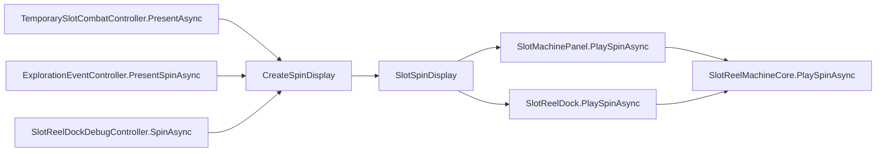

# 슬롯 합계의 Reel별 누적 표시와 합계 Critical 갱신

## 목적

현재 슬롯 합계는 회전 중에 `…`를 표시하다가, 모든 Reel이 멈춘 뒤에야 최종 합계(`FortuneCriticalResult.FinalTotal`)와 합계 배수를 한 번에 표시합니다. 이 작업은 합계 표시를 다음 순서로 바꿉니다.

1. 회전을 시작하면 합계를 `0`으로 표시합니다.
2. 각 Reel이 확정될 때마다(그 Reel의 Fortune Critical 배수를 적용한 값으로) 합계에 더해 표시합니다.
3. 모든 Reel이 반영된 뒤 합계 Critical이 발생했다면, 짧게 대기한 다음 합계 배수 텍스트(`×N`)와 최종 합계로 갱신합니다. 합계 Critical이 없으면 대기 없이 그 상태가 최종 결과입니다.

결과(회전, Fortune Critical 판정, 룬 분배, 전투, 탐험 이벤트 판정)는 바뀌지 않습니다. 바뀌는 것은 표시 순서와 연출 시간뿐입니다.

## 확정된 결정 사항 (2026-10-25 사용자 확인)

| 항목 | 결정 |
| --- | --- |
| 적용 범위 | 공용 `SlotReelMachineCore`에서 구현하여 `Candidate_MainScene`의 `SlotReelDock`과 `TMP_MainScene`의 `SlotMachinePanel`(전투·탐험 이벤트 슬롯 판정) 모두에 적용합니다. |
| 첫 Reel 확정 전 표시 | 회전 시작과 동시에 합계 값을 `0`으로 표시합니다. `…`(`SlotCombatStoryFormatter.SpinningTotalValue`)는 회전 중 합계에 더 이상 쓰지 않습니다. 회전 전 대기 표시 `—`(`IdleTotalValue`)는 그대로 둡니다. |
| 합계 Critical 갱신 시점 | 마지막 Reel이 반영된 합계를 잠시 보여 준 뒤 갱신합니다. 대기 시간은 `SlotReelSpinProfile`의 새 설정으로 조절하며 기본값은 0.4초입니다. Reduce Motion에서는 대기하지 않습니다. |
| 유효 배수 상한 `C`와 중간 합계 | Reel `i`가 확정될 때 더하는 값은 `vᵢ × min(C, rᵢ)`입니다. 최종 합계는 지금처럼 `F = Σ vᵢ × min(C, rᵢ × t)`입니다. 따라서 합계 Critical이 없으면(`t = 1`) 마지막 누적값이 항상 `F`와 같고, 합계 배수 없이 숫자가 다시 바뀌는 일이 없습니다. |

2026-10-25 후속 결정(사용자 확인): 회전 전 대기 표시도 `—` 대신 `0`으로 바꿔 두 화면에 함께 적용합니다(`IdleTotalValue = "0"`, `SlotReelDock.prefab`·`SlotMachinePanel.prefab`의 `TotalValue` 기본 글자 `0`). 또한 `SlotReelDock`은 Play 시작(테스트 실행 포함) 시 화면 밖에서 시작합니다(`initiallyShown` 꺼짐). Edit Mode의 저장된 모습은 바꾸지 않습니다. 위 표의 "`IdleTotalValue`는 그대로 둔다"는 이 결정으로 대체됩니다.

기호는 [슬롯머신과 룬](../architecture/slot-machine-and-runes.md)의 Fortune Critical 절과 같습니다(`vᵢ`: Payline 값, `rᵢ`: Reel 배수, `t`: 합계 배수, `C`: 유효 배수 상한).

## 선행 조건

- 아래 문서를 먼저 읽습니다.
  - [`DOCS/architecture/slot-machine-and-runes.md`](../architecture/slot-machine-and-runes.md): 표시 데이터(`SlotSummaryDisplay`, `SlotSpinDisplay`), 상태별 표시 표, Fortune Critical 계산, `SlotReelDock`과 `SlotReelDockDebugController`
  - [`DOCS/instructions/slot-fortune-critical.md`](slot-fortune-critical.md): Reel·합계 배수 표시 규칙
  - [`DOCS/instructions/slot-machine-panel-visual-and-spin-motion.md`](slot-machine-panel-visual-and-spin-motion.md): 회전 계획, 시간 초과 계산, Reduce Motion
  - [`DOCS/development/visual-effect-readiness.md`](../development/visual-effect-readiness.md): 합계 값과 배수 텍스트의 효과 루트 규칙
- 작업 전 `git status`를 기록합니다. 현재 작업 트리에는 사용자의 미커밋 변경(`Candidate_MainScene.unity`, 폰트 자산, `TemporaryCandidateLayoutProbe.cs` 등)이 있을 수 있으므로, 이 작업과 무관한 파일은 건드리지 않습니다.

## 범위

### 포함

- UI 표시 데이터에 Reel별 진행 요약을 추가합니다(`SlotMachineDisplays.cs`).
- `SlotReelMachineCore.PlaySpinAsync`에서 Reel 확정마다 진행 요약을 적용하고, 합계 Critical이 있으면 대기 후 결과 요약을 적용합니다.
- `SlotReelSpinProfile`/`SlotReelSpinSettings`에 합계 Critical 대기 시간을 추가하고, 최대 연출 시간 계산(`SlotReelSpinPlanner.GetMaximumPresentationSeconds`)에 포함합니다.
- Application의 표시 데이터 생성(`TemporarySlotCombatController.CreateSpinDisplay` 두 오버로드)에서 회전 시작 요약을 `0`으로, Reel별 진행 요약을 생성합니다.
- 미리보기 메뉴 `SlotReelDockPreviewMenu`와 Play Mode 검증 메뉴(`TemporarySlotMachinePlayValidation`, `TemporarySlotFortuneCriticalPlayValidation`)의 기대값을 새 동작에 맞춥니다.
- 관련 Edit Mode 테스트를 갱신·추가하고 문서를 갱신합니다.

### 제외

- Fortune Critical 판정, 상한 계산, 룬 분배, 전투·탐험 이벤트 결과 적용, Story 문구(`SlotCombatStoryFormatter.Spin` 등)는 바꾸지 않습니다.
- 숫자가 올라가는 카운트업 애니메이션, 강조·흔들림·빛 효과 같은 새 연출은 구현하지 않습니다(효과를 나중에 붙일 수 있는 구조만 유지합니다).
- `SlotReelDock`을 전투·탐험 컨트롤러에 연결하는 작업은 하지 않습니다.
- Prefab 계층, 합계 카드·합계 상자 배치, 스킨은 바꾸지 않습니다.

## 영향 받는 경로와 의존성

| 경로 | 변경 내용 |
| --- | --- |
| `Assets/TxTRPG/UI/Runtime/SlotMachine/SlotMachineDisplays.cs` | `SlotSpinDisplay`에 진행 요약 목록을 추가합니다. |
| `Assets/TxTRPG/UI/Runtime/SlotMachine/SlotReelMachineCore.cs` | `PlaySpinAsync`/`PlayReelAsync`의 요약 적용 순서와 합계 Critical 대기를 구현합니다. `StopAtResult`는 결과 요약을 즉시 적용하는 현재 동작을 유지합니다. |
| `Assets/TxTRPG/UI/Runtime/SlotMachine/SlotReelSpinProfile.cs` | `SlotReelSpinSettings`와 `SlotReelSpinProfile`에 대기 시간을 추가하고 `Default`·`Instant`를 갱신합니다. |
| `Assets/TxTRPG/UI/Runtime/SlotMachine/SlotReelSpinPlanner.cs` | 최대 연출 시간에 대기 시간을 더합니다. |
| `Assets/TxTRPG/UI/Runtime/SlotMachine/SlotMachinePanel.cs`, `SlotReelDock.cs` | 주석과 `PlaySpinAsync` 설명을 갱신합니다. 표시 계약(`SetSummary`)은 바꾸지 않습니다. |
| `Assets/TxTRPG/Application/Runtime/SlotMachine/TemporarySlotCombatController.cs` | `CreateSpinDisplay`에서 시작 요약 `0`과 진행 요약을 만듭니다. |
| `Assets/TxTRPG/Application/Runtime/SlotMachine/TemporarySlotCombatRecords.cs` | 필요하면 `SpinningTotalValue`를 정리합니다(남은 사용처가 없을 때만 제거). |
| `Assets/TxTRPG/Application/Editor/SlotReelDockPreviewMenu.cs` | 미리보기 회전도 진행 요약을 만들어 같은 방식으로 표시합니다. |
| `Assets/TxTRPG/Application/Editor/TemporarySlotMachinePlayValidation.cs`, `TemporarySlotFortuneCriticalPlayValidation.cs` | 회전 중 합계 기대값(`…`)을 새 동작으로 바꿉니다. |
| `Assets/TxTRPG/UI/Styles/SlotMachine/DefaultSlotReelSpinProfile.asset` | 새 필드는 필드 초기값으로 읽히므로 자산 수정은 필수가 아닙니다. 기본값과 다르게 둘 때만 저장합니다. 이 자산은 `SlotMachinePanel.prefab`과 `SlotReelDock.prefab`이 함께 참조합니다. |

호출 경로는 다음과 같습니다. 이 경로의 호출자는 모두 같은 `SlotSpinDisplay`를 넘기므로, 표시 데이터만 바꾸면 세 경로가 함께 새 동작을 따릅니다.

## 구현 요구 사항

### 1. 표시 데이터 (`SlotSpinDisplay`)

- `SlotSpinDisplay`에 `IReadOnlyList<SlotSummaryDisplay> ProgressSummaries`를 추가합니다. 길이는 `Reels.Count`와 같고, `ProgressSummaries[k]`는 결과 순서로 0번부터 `k`번 Reel까지 확정된 상태의 요약입니다.
- 모든 사용자 표시 문자열은 지금처럼 Application이 만듭니다. UI 어셈블리는 숫자를 더하거나 문자열을 조립하지 않습니다.
- 기존 생성자(`reels, paylineTotal, spinningSummary, resultSummary`)는 유지하고, 진행 요약을 받는 생성자를 추가합니다. 진행 요약이 없는 표시 데이터는 지금처럼 모든 Reel이 멈춘 뒤 결과 요약만 적용합니다(기존 테스트·외부 호출자 호환).
- 진행 요약 목록의 길이가 `Reels.Count`와 다르거나 항목이 `null`이면 `ArgumentException`을 던집니다.
- 합계 Critical 여부를 UI가 추측하지 않도록, 마지막 진행 요약과 결과 요약 사이에 대기가 필요한지 나타내는 값을 함께 둡니다(예: `bool HasTotalStep`). Application은 `fortune.IsTotalCritical`일 때만 이 값을 켭니다.

### 2. Application의 표시 데이터 생성

`TemporarySlotCombatController.CreateSpinDisplay`의 두 오버로드(룬 분배용, 탐험 이벤트·디버그용 가중치 줄)를 다음과 같이 바꿉니다.

| 요약 | 합계 값 | 합계 배수 텍스트 | 룬 표 |
| --- | --- | --- | --- |
| 회전 시작(`SpinningSummary`) | `0` | 없음 | 지금의 회전 중 줄(쌓인 수 `×N`) |
| 진행 `k`(`ProgressSummaries[k]`) | `Σ(j ≤ k) vⱼ × min(C, rⱼ)` | 없음 | 회전 중 줄과 같음 |
| 결과(`ResultSummary`) | `FinalTotal` | `t > 1`이면 `×t` | 지금의 결과 줄(분배 `×N → M`) |

- 중간값은 `FortuneCriticalReelResult`의 `BaseValue`, `ReelMultiplier`, `FortuneCriticalResult.MaximumEffectiveMultiplier`로 계산합니다. 계산은 `long`과 `checked`로 하며, 중간값은 최종값 이하이므로 `FinalTotal`이 `int`에 들어가면 중간값도 들어갑니다. 그래도 `int` 변환은 `checked`로 합니다.
- 합계 Critical이 없으면 마지막 진행 요약의 합계 값은 `FinalTotal`과 같아야 합니다. 이 성질을 테스트로 확인합니다.
- 합계 값 문자열은 `SlotCombatStoryFormatter.TotalValue`로 만듭니다. `0`도 같은 함수로 만듭니다.
- 룬 분배가 있는 전투에서 분배 결과 줄은 결과 요약에서만 나타납니다. 즉 합계 Critical이 있으면 대기 후, 없으면 마지막 Reel이 확정된 직후에 나타납니다.
- `FortuneCriticalResult.None(spin)`으로 만든 표시(Fortune Critical을 쓰지 않는 탐험 이벤트 판정)는 모든 배수가 1이므로 Payline 값의 누적만 표시하고 대기하지 않습니다.

### 3. 표시 순서 (`SlotReelMachineCore.PlaySpinAsync`)

진행 요약이 있는 표시 데이터에 대해 다음 순서를 따릅니다.

1. 회전 시작 시 `SpinningSummary`를 적용합니다(합계 `0`).
2. 각 Reel의 `PlayReelAsync`가 정지를 마치고 Reel 배수 배지(`ShowFortuneMultiplier`)를 표시한 직후, 그 시점까지 결과 순서로 앞에서부터 연속해서 확정된 Reel의 수 `n`을 구해 `ProgressSummaries[n - 1]`을 적용합니다.
   - 회전 계획은 Reel이 왼쪽부터 차례로 멈추도록 보장합니다(`SlotReelSpinPlanner.Create`의 `MinimumStopGapSeconds`). 설정값 때문에 뒤쪽 Reel이 먼저 멈추더라도, 앞쪽 Reel이 확정되어 연속 구간에 포함될 때 함께 반영합니다. 이렇게 하면 표시되는 합계가 항상 실제로 확정된 Reel 집합의 합과 같습니다.
   - 같은 `n`을 다시 적용하지 않습니다(불필요한 TMP 재구성을 피합니다).
   - 회전 세대(`generation`)가 바뀌었거나 소유자가 비활성·파괴되었으면 적용하지 않습니다.
3. 모든 Reel이 완료되면 다음을 수행합니다.
   - `HasTotalStep`이 꺼져 있으면 `ResultSummary`를 즉시 적용하고 `true`를 돌려줍니다.
   - 켜져 있으면 Reduce Motion이 아닐 때 `TotalCriticalRevealDelaySeconds`만큼 `Time.unscaledTime` 기준으로 대기한 뒤 `ResultSummary`를 적용합니다. Reduce Motion이거나 대기 시간이 0이면 즉시 적용합니다.
   - 대기 중 취소, 비활성, 새 회전, `StopAtResult`가 일어나면 `false`를 돌려주고 요약을 적용하지 않습니다. 호출자는 지금처럼 `StopAtResult`로 결과 요약을 적용합니다.
4. 대기 중에도 `IsSpinning`은 `true`로 유지합니다. 대기 중에 들어온 `SetReels`는 지금처럼 회전이 끝날 때 적용합니다.

진행 요약이 없는 표시 데이터는 지금 동작(회전 시작 시 `SpinningSummary`, 모든 Reel 완료 후 `ResultSummary`)을 그대로 유지합니다.

`StopAtResult`는 바꾸지 않습니다. 시간 초과·취소·복원 시 모든 Reel과 결과 요약(최종 합계와 합계 배수)을 즉시 표시합니다.

### 4. 대기 시간 설정과 최대 연출 시간

- `SlotReelSpinProfile`에 `[Header("Fortune Critical")]` 아래 `totalCriticalRevealDelaySeconds`(기본 0.4, `Min(0)`)를 추가하고, 툴팁에 "모든 Reel이 반영된 뒤 합계 Critical 배수와 최종 합계를 표시하기까지 기다리는 시간이며 Reduce Motion에서는 기다리지 않는다"는 의미를 적습니다.
- `SlotReelSpinSettings`에 같은 값을 추가합니다. 생성자 인자 순서를 바꾸면 기존 호출자(`SlotReelDock`, `SlotMachinePanel`, `TemporarySlotMachinePanelVisualApply`, 테스트)를 모두 갱신해야 하므로, 끝에 기본값이 있는 인자로 추가하는 방식을 우선 검토합니다. `Default`는 0.4, `Instant`는 0으로 둡니다.
- `SlotReelSpinPlanner.GetMaximumPresentationSeconds`는 최악의 경우를 기준으로 하므로 대기 시간을 항상 더합니다. 전투·탐험 이벤트 컨트롤러의 시간 초과(`TemporaryCombatPresentationTimeout.Resolve`)는 이 값을 쓰므로, 대기 때문에 정상 연출이 시간 초과로 끊기지 않아야 합니다.
- `DefaultSlotReelSpinProfile.asset`은 기본값을 그대로 쓰면 저장하지 않아도 됩니다. 저장한 경우 직렬화 diff에 새 필드 한 줄만 추가되었는지 확인합니다.

### 5. 미리보기와 Play Mode 검증 메뉴

- `SlotReelDockPreviewMenu.Spin`은 진행 요약(Payline 값 누적, 시작 `0`)을 만들고 `Spin With Total Multiplier`일 때 `HasTotalStep`을 켭니다. 메뉴 경로는 바꾸지 않습니다.
- `TemporarySlotMachinePlayValidation`이 회전 중 합계를 `SpinningTotalValue`와 비교하는 검사(현재 110번째 줄 부근)를 "회전 시작 직후 `0`, 이후 확정된 Reel의 누적값"으로 바꿉니다. `TemporarySlotFortuneCriticalPlayValidation`에서도 회전 중 합계·합계 배수 기대값이 있으면 같은 기준으로 바꾸고, 합계 Critical을 고정 배수로 강제한 경우 대기 후에만 배수 텍스트가 나타나는지 확인합니다.
- `SpinningTotalValue`의 사용처가 남지 않으면 상수를 제거하고, 남으면 주석으로 용도를 밝힙니다.

## 화면·입력·플랫폼 고려 사항

- 합계 값이 `0`에서 여러 자리로 바뀌므로, 합계 상자와 합계 카드의 글자 크기 계산(`SlotHeightScaledText`의 `fitWidth`, `SlotTotalMultiplierLayout.Refresh`)이 갱신마다 올바르게 따라오는지 확인합니다. 합계 배수 텍스트는 결과 요약에서만 나타나므로 배치 계산도 그때만 일어납니다.
- 갱신은 Reel 수(최대 10) + 1회로 제한되며, 매 프레임 요약을 적용하지 않습니다.
- 입력 처리, 포커스, 버튼 상태는 바뀌지 않습니다. 대기 중에도 회전 중으로 취급되므로 디버그 Tab의 `회전` 버튼과 전투 행동 잠금은 지금처럼 연출이 끝날 때 풀립니다.
- Reduce Motion에서는 Reel별 누적 표시는 유지하되 합계 Critical 대기만 생략합니다. 정보는 줄지 않습니다.
- 합계 배수는 색만이 아니라 `×N` 글자로 전달하는 기존 규칙을 유지합니다.

## 호환성과 실패 동작

- 결과 데이터, 세션 상태, 저장 데이터 형식은 바뀌지 않습니다.
- 진행 요약이 없는 `SlotSpinDisplay`는 기존 동작을 유지합니다.
- `OverflowException`이 나는 회전은 지금처럼 표시 데이터를 만들기 전에 실패합니다.
- 회전이 중단되면 호출자의 `StopAtResult`가 최종 결과를 표시하므로, 중간 합계가 화면에 남지 않아야 합니다.

## 검증 기준

### Edit Mode 테스트

필터를 지정해 관련 테스트만 실행합니다. `AssetWriting` 범주는 제외합니다(`!AssetWriting`). 실행 전후 `git status`를 기록합니다.

| 대상 | 확인 내용 |
| --- | --- |
| `SlotFortuneCriticalCombatTests` | 시작 요약 `0`, 진행 요약 값(`v = (3, 5, 2)`, 2번 Reel ×10, 합계 ×5, `C = 30`이면 진행 `3, 53, 55`, 결과 `175`와 `×5`), 상한 적용(`C`보다 큰 Reel 배수), 합계 Critical이 없으면 마지막 진행값 = `FinalTotal`이고 `HasTotalStep`이 꺼짐, 진행 요약에는 배수 텍스트와 분배 줄이 없음 |
| `SlotMachinePanelTests`, `SlotReelDockTests` | Reel 확정마다 합계 값이 진행 요약을 따름, 합계 Critical이 있으면 대기 전에는 배수 텍스트가 없고 대기 후 결과 요약, Reduce Motion에서 대기 생략, 대기 중 `StopAtResult`·취소·비활성 시 결과 요약과 `false`, 진행 요약 없는 표시 데이터의 기존 동작, 뒤쪽 Reel이 먼저 끝나는 경우의 연속 구간 처리 |
| `SlotReelSpinPlannerTests` | 최대 연출 시간에 대기 시간이 포함됨 |
| `SlotMachineCombatTests`, `SlotReelDockDebugControllerTests` | 시간 초과 계산과 디버그 회전이 새 표시 데이터로 통과함 |

### Play Mode 확인

- AppScene에서 Play를 시작해 `Candidate_MainScene`의 DEBUG 패널 `슬롯` Tab에서 회전합니다. 합계 확률을 1로 올린 경우와 0으로 둔 경우 모두 확인합니다.
  - 회전 시작 시 합계 카드가 `0`을 표시하고, Reel이 왼쪽부터 멈출 때마다 배수가 적용된 값이 더해집니다.
  - 합계 Critical이 발생하면 마지막 Reel 반영 후 약 0.4초 뒤 `×N`과 최종 합계가 나타나고, 결과 문구의 최종 합계와 같습니다.
  - Reduce Motion을 켜면 대기 없이 결과가 나타납니다.
- `TMP_MainScene`의 전투 슬롯 행동과 탐험 이벤트 슬롯 판정에서 같은 순서가 보이고, 룬 분배 줄은 결과 요약에서만 나타나며, 시간 초과 경고(`SLOT_SPIN_TIMEOUT`, `EVENT_SLOT_SPIN_TIMEOUT`)가 나오지 않는지 확인합니다.
- `Tools/TxT RPG/Application/Temporary/Validate Slot Fortune Critical (Play Mode)`와 `Tools/TxT RPG/Application/Temporary/Validate Slot Machine Combat (Play Mode)`가 통과하는지 확인합니다.
- [해상도와 화면 프레임 문서](../development/resolution-and-screen-frame.md)의 검증 크기 가운데 최소 1920×1080, 21:9, 1024×768, 390×844에서 세 자리 합계와 배수 텍스트가 합계 카드·합계 상자 안에 들어가는지 확인하고, 작아지는 글자가 있으면 보고합니다.

## 문서 갱신

- [`DOCS/architecture/slot-machine-and-runes.md`](../architecture/slot-machine-and-runes.md): 표시 데이터 표(`SlotSpinDisplay`의 진행 요약과 `HasTotalStep`), 상태별 표시 표(회전 중 합계 `0`과 누적, 합계 Critical 대기 상태 추가), "합계 배수는 정지 후 요약에서 나타난다"는 설명, 회전 설정 표의 새 필드, `SlotReelDock`·디버그 회전 설명을 갱신합니다.
- [`DOCS/instructions/README.md`](README.md): 이 문서 항목에 구현 결과와 검증 상태를 기록합니다.
- 메뉴 경로나 검증 절차가 바뀌면 [`DOCS/development/workflows.md`](../development/workflows.md)를 갱신합니다.

## 최종 보고에 포함할 내용

- 구현한 내용과 변경 파일 목록
- Editor에 이미 적용한 내용(자산 저장 여부 포함)과 사용자가 수행해야 할 남은 절차(없으면 없다고 명시)
- 실행한 Edit Mode 테스트의 필터와 결과, Play Mode에서 확인한 화면 크기와 시나리오
- 테스트·적용 과정에서 바뀐 직렬화 자산과 그 검토 결과
- 검증하지 못한 항목(Device Simulator, 실제 기기, Player 빌드 등)
