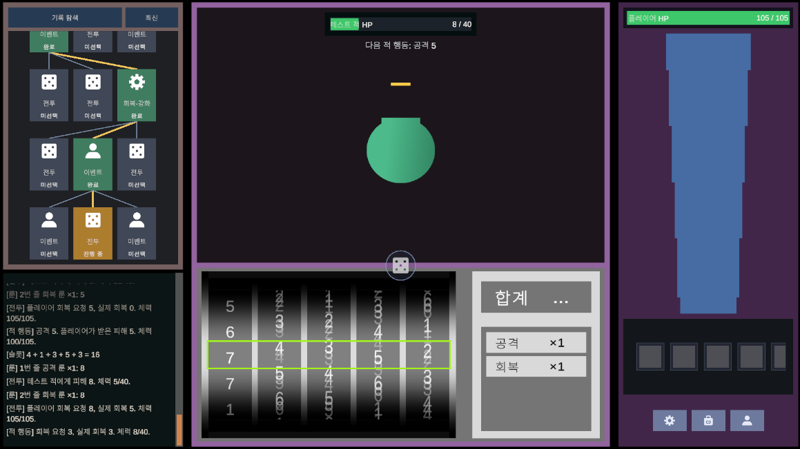
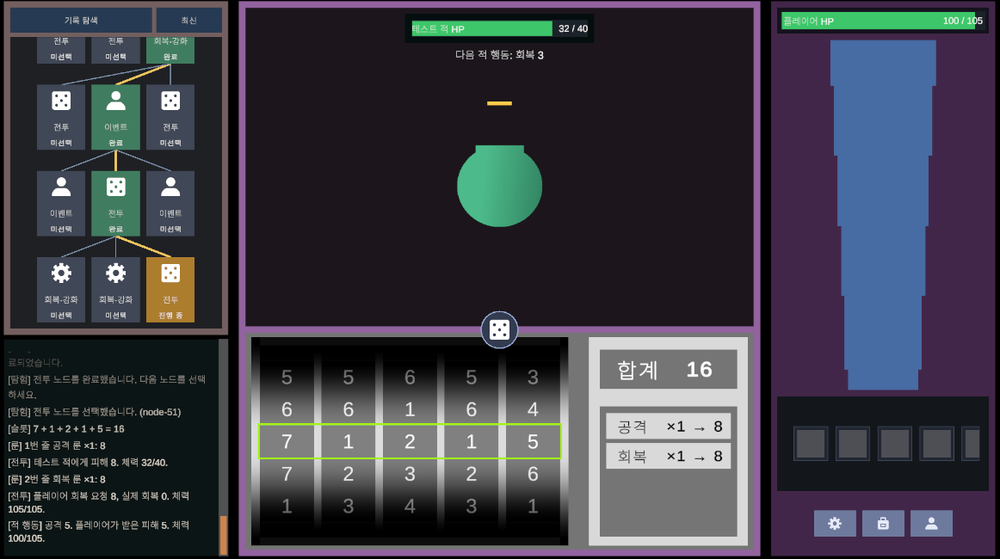

# TxT-RPG

텍스트 기록과 슬롯머신으로 진행하는 탐험형 RPG 프로토타입입니다. 탐험 노드를 하나씩 고르며 나아가고, 전투에서는 슬롯머신을 돌려 나온 합계를 장착한 룬 줄에 나눠 공격과 회복을 합니다. Unity 6(6000.3) 프로젝트이며 Steam 데스크톱과 모바일을 함께 지원하는 것을 목표로 합니다.

> 현재 전투의 적, 수치, 이벤트 문구는 시험용 임시값입니다.

## 게임 진행 방식

### 화면 구성

| 영역 | 내용 |
| --- | --- |
| 왼쪽 위: 탐험 기록 | 지금까지 나온 노드 후보를 깊이별로 보여 주는 트리입니다. 노드마다 종류(전투·회복·강화·이벤트)와 상태(`완료`, `진행 중`, `미선택`)를 표시합니다. 실제로 지나온 경로는 노란 선으로 이어집니다. |
| 왼쪽 아래: Story | 탐험·전투·이벤트에서 일어난 일을 순서대로 기록합니다. 예: `[슬롯] 7 + 1 + 2 + 1 + 5 = 16`, `[룬] 1번 줄 공격 룬 ×1: 8`, `[적 행동] 공격 5`. |
| 가운데 위: 적 | 적의 체력과 다음 행동 예고(예: `다음 적 행동: 공격 5`, `회복 3`)를 보여 줍니다. |
| 가운데 경계의 주사위 버튼 | 전투 행동 버튼입니다. 누르면 슬롯머신을 한 번 돌립니다. |
| 가운데 아래: 슬롯머신 | 왼쪽에는 Reel과 초록색 Payline, 오른쪽에는 합계와 장착한 룬 줄 표가 있습니다. |
| 오른쪽 | 플레이어 체력, 캐릭터, 퀵 아이템 칸과 설정·가방·캐릭터 메뉴입니다. |

### 1. 탐험 노드 고르기

한 단계마다 후보 카드 세 장이 나오고, 그중 하나를 골라 진행합니다. 고르지 않은 후보는 기록 트리에 `미선택`으로 남습니다. 노드 종류는 세 가지입니다.

- **전투**: 시험용 적과 전투합니다. 이기면 다음 후보가 나오고, 지면 탐험이 끝납니다.
- **회복·강화**: 아직 효과가 없는 자리표시 노드입니다.
- **이벤트**: 노드 패널 안에 문구와 선택지가 나옵니다. 고른 선택지나 슬롯 판정 결과에 따라 체력·최대 체력이 바뀌거나, Reel 칸이나 Reel 수가 늘고 줄거나, 행운 치명 확률이 바뀌거나, 룬을 얻을 수 있습니다.

탐험 체력은 노드 사이에 이어지며, 이벤트로 바뀐 슬롯머신·룬 상태는 다음 전투부터 그대로 쓰입니다. 위 화면은 이벤트로 Reel이 다섯 개까지 늘어난 상태입니다.

### 2. 전투: 슬롯머신 돌리기

행동 버튼을 누르면 모든 Reel이 회전합니다. 회전하는 동안 합계는 `…`로, 룬 표는 각 줄에 쌓인 룬 수(`×1`)로 표시됩니다.

- 각 Reel이 멈춘 칸 중 **Payline**(초록 테두리) 위 숫자를 더해 합계를 만듭니다. 같은 숫자가 여러 칸에 있으면 그 숫자가 나올 확률이 높아집니다.
- **행운 치명(Fortune Critical)**: Reel별로, 또는 합계에 확률적으로 정수 배수가 붙습니다. 이때 Story에는 `[슬롯] 3 + 5×3 + 2 = 20`처럼 기록됩니다.

### 3. 룬 줄에 합계 나누기와 적의 차례

회전이 끝나면 최종 합계를 장착한 **룬 줄**에 나눕니다. 줄마다 쌓인 룬 수가 가중치가 됩니다. 위 화면에서는 합계 16을 `공격 ×1 → 8`, `회복 ×1 → 8`로 나눴습니다.

1. 줄 순서대로 행동합니다. 공격 룬 줄은 적에게 피해를 주고(적 체력 40 → 32), 회복 룬 줄은 플레이어를 회복합니다.
2. 이어서 적이 예고한 행동(공격 5, 회복 3 등)을 실행하고 다음 행동을 예고합니다.
3. 적 체력이 0이 되면 전투 노드가 완료되고 다음 후보 카드가 나옵니다. 플레이어 체력이 0이 되면 탐험이 끝납니다.

모든 결과와 그 계산은 Story에 남습니다. 탐험 기록 트리에서는 진행 중인 노드가 주황색으로, 완료한 노드가 초록색으로 표시됩니다.

## 실행

1. Unity 6000.3으로 프로젝트를 엽니다.
2. Play를 누르면 Editor Play 정책에 따라 `Assets/Scenes/AppScene.unity`를 거쳐 `TMP_MainScene`이 열리고 새 탐험이 시작됩니다.

## 문서

구조, 클래스 책임, 개발·검증 절차는 [DOCS/README.md](DOCS/README.md)에서 볼 수 있습니다. 주요 문서는 다음과 같습니다.

- [점진 생성 탐험 노드 트리](DOCS/architecture/exploration-node-tree.md)
- [탐험 이벤트 노드와 이벤트 시스템](DOCS/architecture/exploration-events.md)
- [슬롯머신과 룬 기반 전투 행동](DOCS/architecture/slot-machine-and-runes.md)
- [탐험 기록 트리](DOCS/architecture/exploration-history-tree.md)
- [개발 및 검증 절차](DOCS/development/workflows.md)
